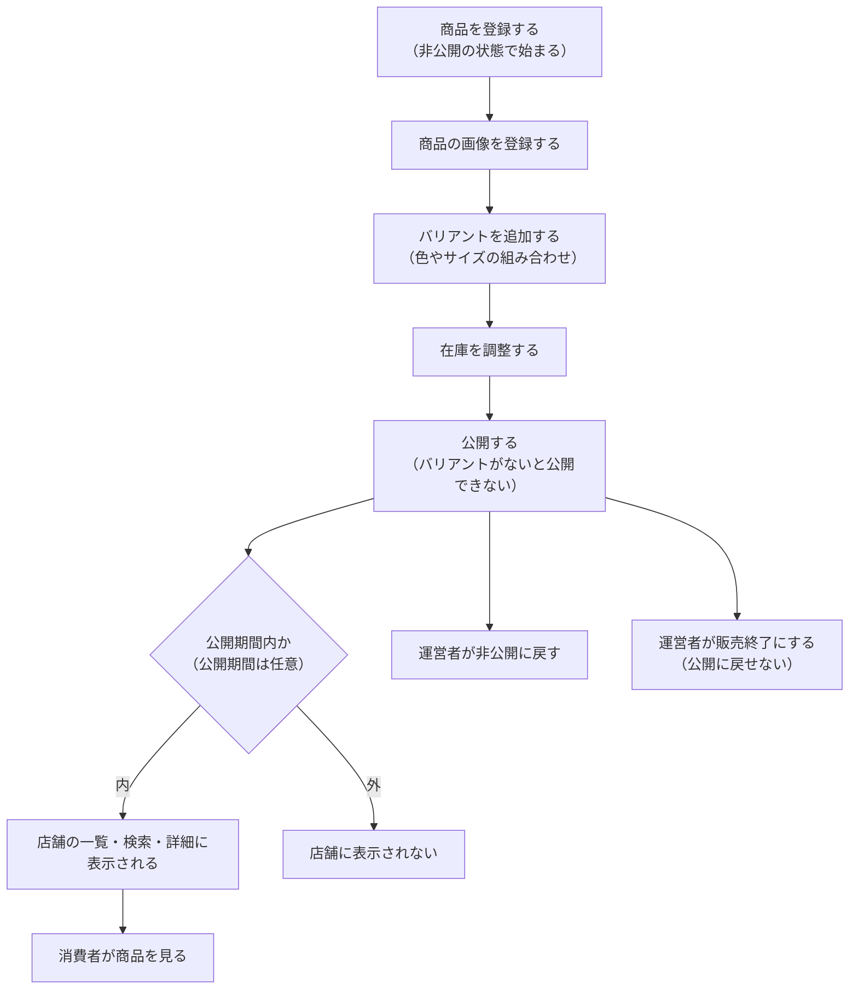
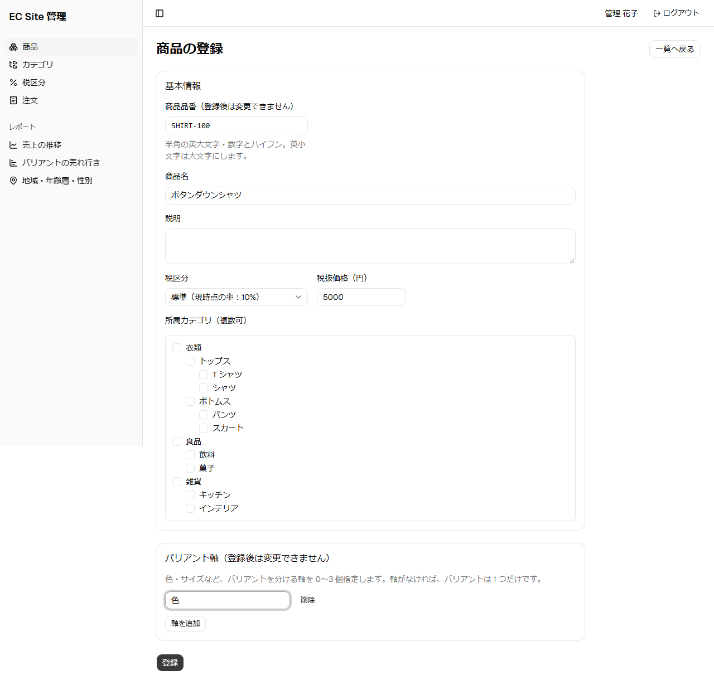
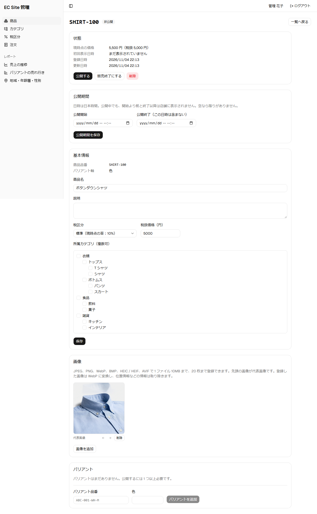
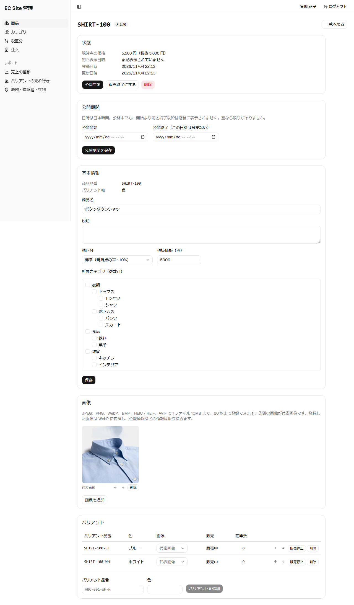
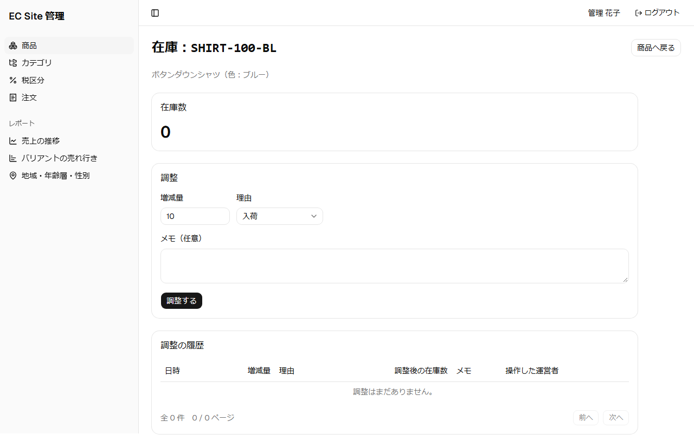
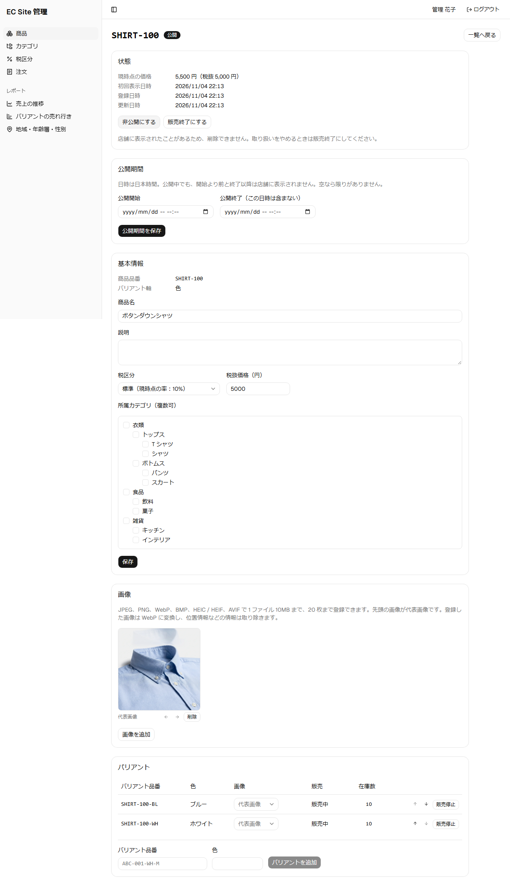
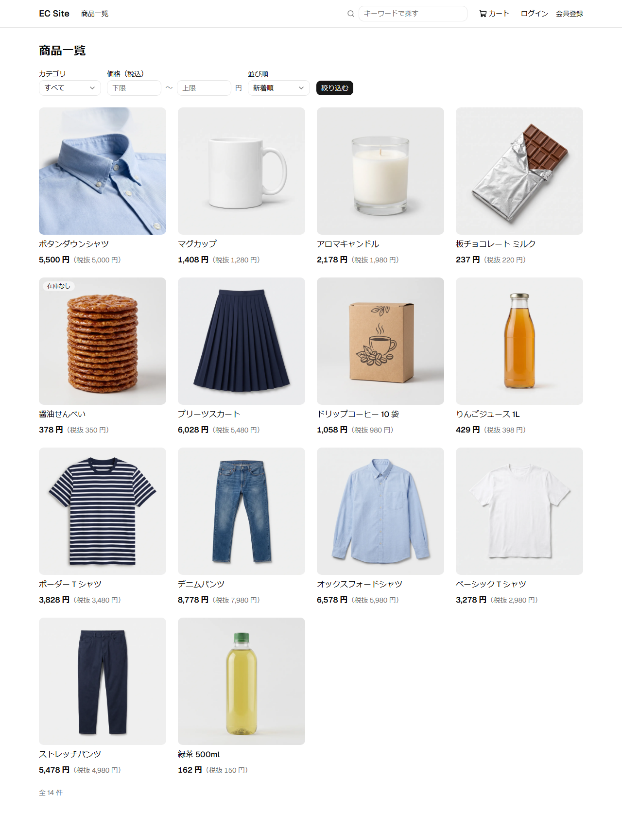
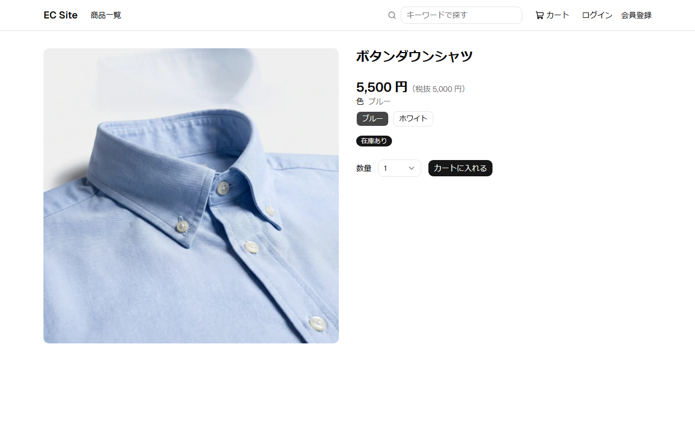

# 商品の登録と公開の流れ

運営者が商品を登録して公開し、消費者が店舗で見られるようになるまでの流れである。

## 登場する人

| 登場する人 | 役割 |
|------------|------|
| 運営者 | 商品を登録し、公開する |
| 消費者 | 公開された商品を店舗で見て買う |
| 画像のサービス（外部） | 商品の画像を保存し、変換する |

## 業務の流れ

- 公開期間を設定すると、運営者の操作なしに、その時刻に表示が切り替わる。
- 店舗に表示したことがある商品は削除できない。取り扱いをやめるときは、販売終了にする。
- 公開した直後は、店舗の一覧に表示されるまで少し時間がかかることがある。

## 公開の状態

| 状態 | 意味 |
|------|------|
| 非公開 | 店舗に表示されない。登録した直後の状態 |
| 公開 | 店舗に表示される。公開期間を設定していれば、その期間内だけ |
| 販売終了 | 店舗に表示されず、公開に戻せない |

どの操作で状態がどう変わるかは、[商品カタログモジュール](../03-機能仕様/catalog.md)の「状態の遷移」を参照。

## 画面の操作の流れ

画像は、seed のデータがあるローカル環境で、script が商品を登録して撮影したものである。画面を変えたら再撮影する（手順は [開発環境の起動](../06-手順書/setup.md)の「機能紹介のページのスクリーンショット」）。

1. 商品の基本の情報と、バリアントを分ける軸（色など）を入力して登録する。

   

2. 登録した商品に画像を加える。

   

3. 色ごとのバリアントを追加する。

   

4. バリアントごとに、入荷した数を入力して在庫を調整する。

   

5. 公開すると、状態が公開になる。

   

6. 店舗の商品一覧に表示される。

   

7. 消費者は、商品の詳細で色を選び、在庫の有無を見てカートに入れる。

   

## 詳しく知るには

- [商品カタログの設計](../02-設計/catalog.md)
- [商品カタログモジュール](../03-機能仕様/catalog.md)
- [在庫モジュール](../03-機能仕様/inventory.md)
