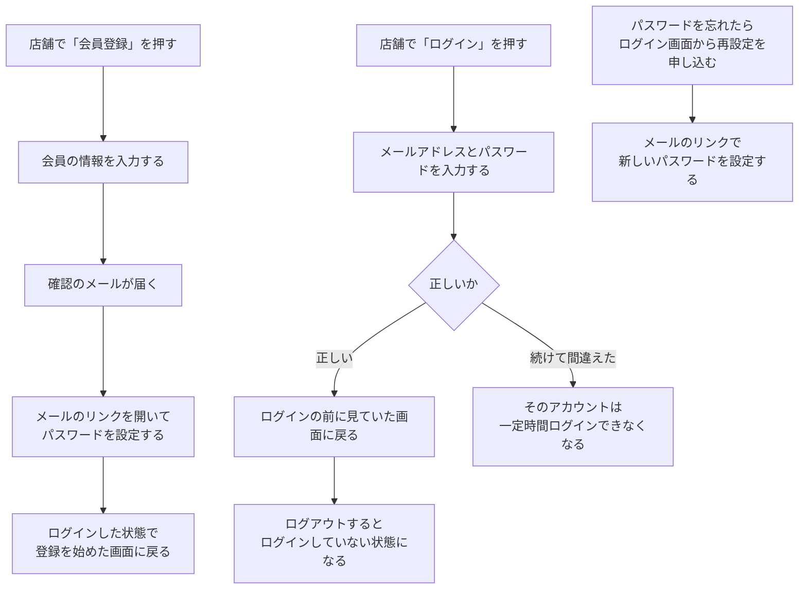
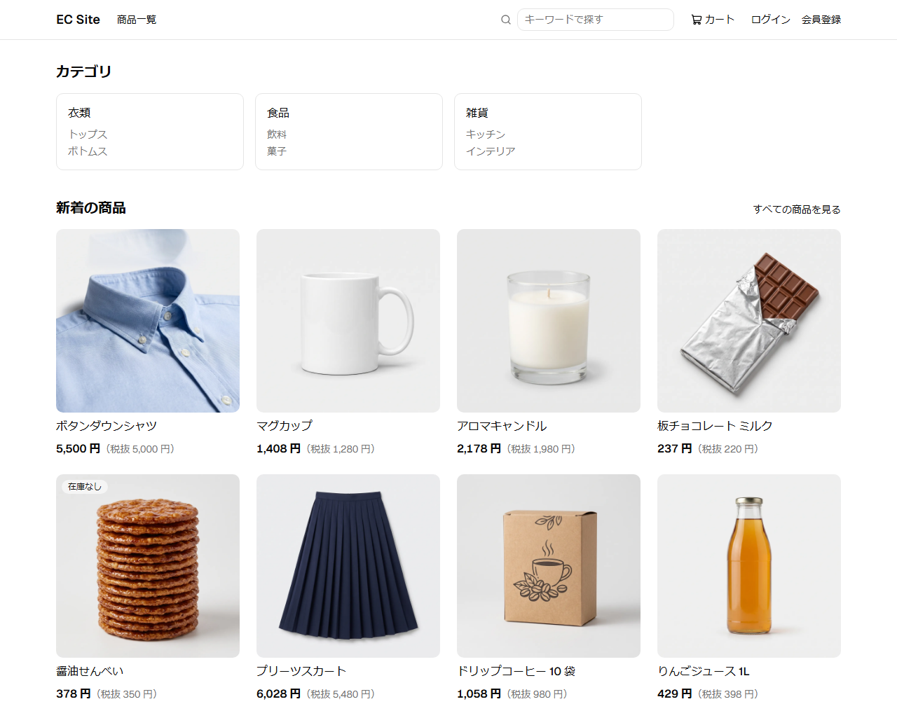
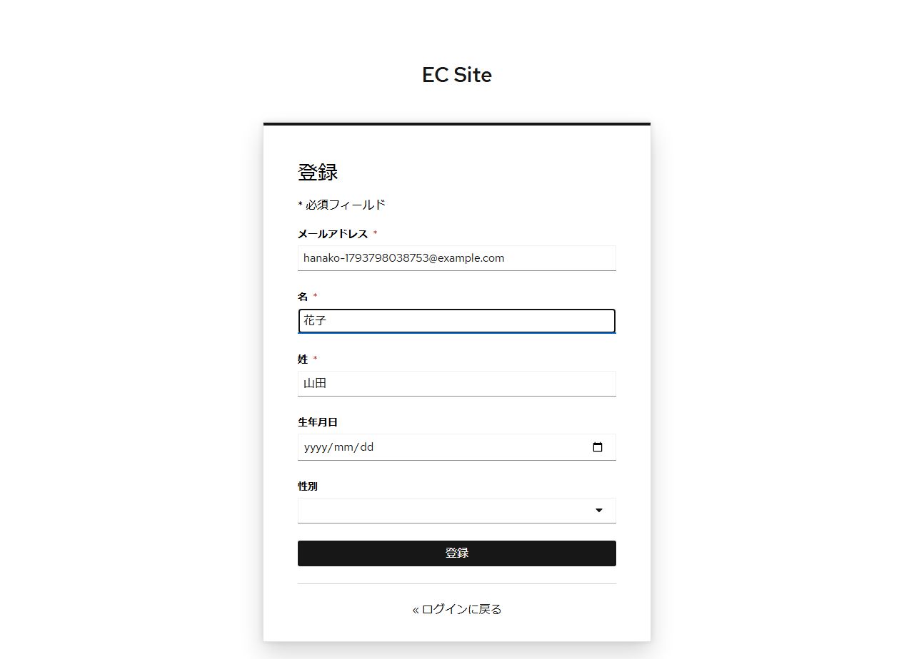
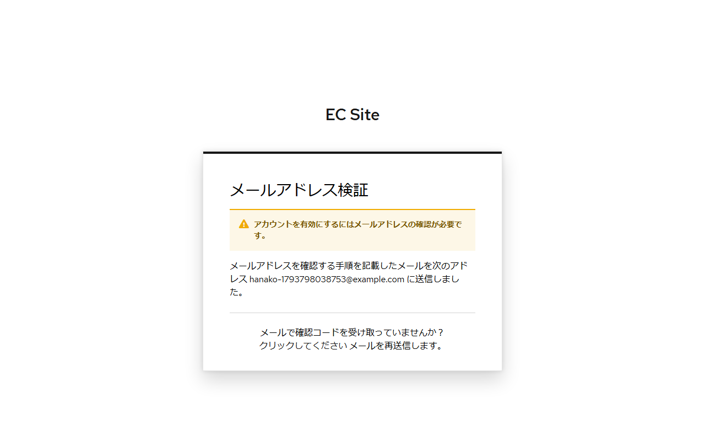
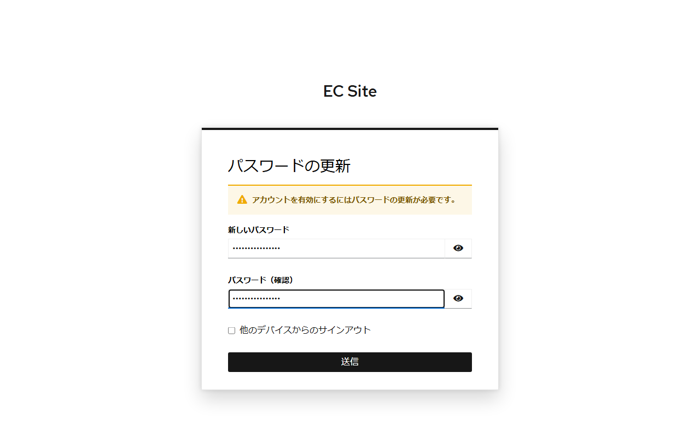
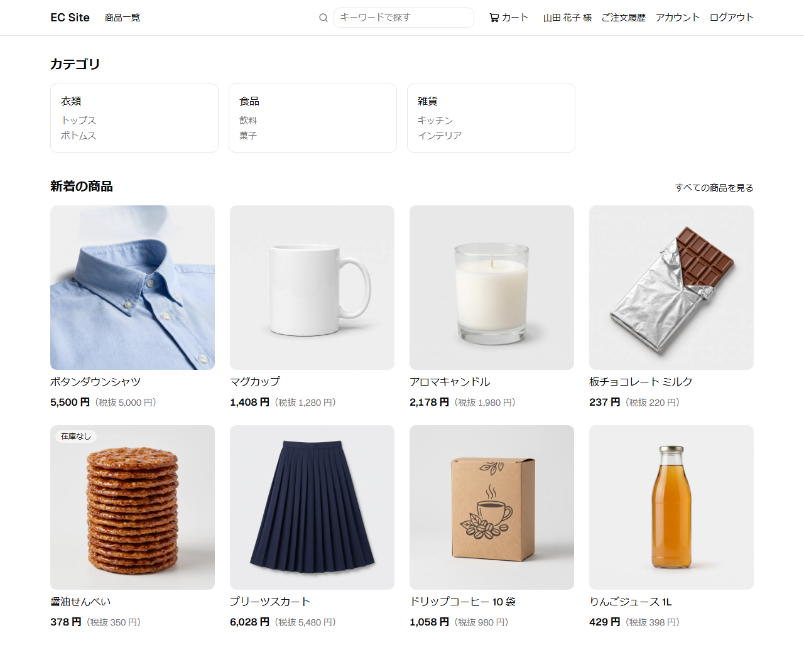
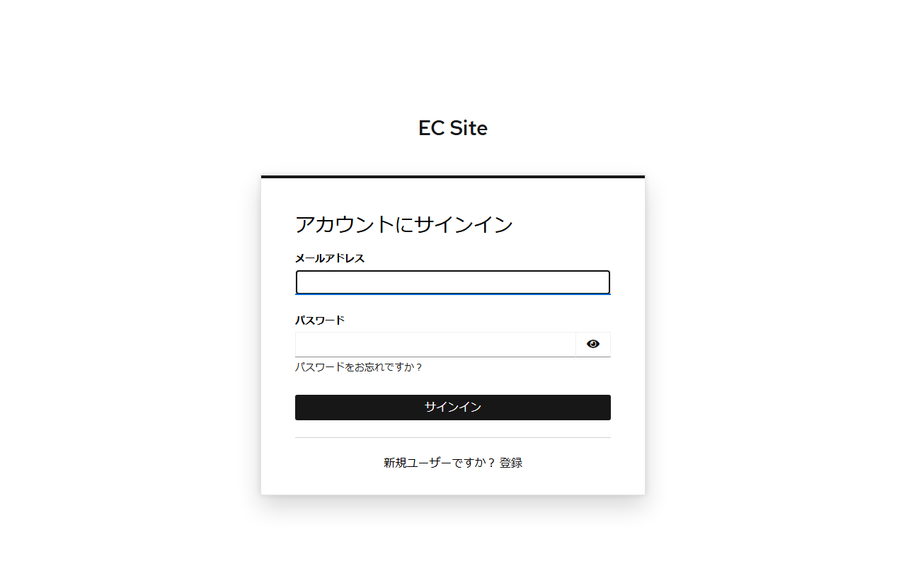

# 会員登録とログインの流れ

消費者が会員登録し、ログインして買い物をするまでの流れである。

## 登場する人

| 登場する人 | 役割 |
|------------|------|
| 消費者 | 会員登録し、ログインする |
| ログインのサービス（外部） | 会員登録画面とログイン画面を表示し、パスワードを預かる |
| メールのサービス（外部） | 確認のメールを届ける |

## 業務の流れ

- メールアドレスを確認するまで、ログインできない。
- ログインせずにカートに入れた商品は、ログインすると会員のカートに移る。
- ログインの状態は、最後に操作してから一定時間続く。
- 登録されていないメールアドレスで再設定を申し込んでも、同じ表示にする。会員かどうかを推測できないようにするためである。
- ログインしている会員は、店舗からアカウント画面に移り、パスワードと氏名などを変更できる。
- 登録を始めたのとは別のブラウザーでメールのリンクを開いたときは、パスワードを設定した後に店舗に戻ってログインする。
- 会員登録画面とログイン画面は、ログインのサービスが表示する。

## 画面の操作の流れ

画像は、seed のデータがあるローカル環境で、script が会員を登録して撮影したものである。画面を変えたら再撮影する（手順は [開発環境の起動](../06-手順書/setup.md)の「機能紹介のページのスクリーンショット」）。

1. 店舗画面の右上の「会員登録」を押す。

   

2. メールアドレスなどの会員の情報を入力して登録する。

   

3. 確認のメールを送ったことが表示される。

   

4. メールのリンクを開き、パスワードを設定する。

   

5. ログインした状態で店舗画面に戻る。画面の右上に氏名が表示される。

   

6. 次からは、ログイン画面でメールアドレスとパスワードを入力する。

   

## 詳しく知るには

- [会員の設計](../02-設計/member.md)
- [会員モジュール](../03-機能仕様/member.md)
