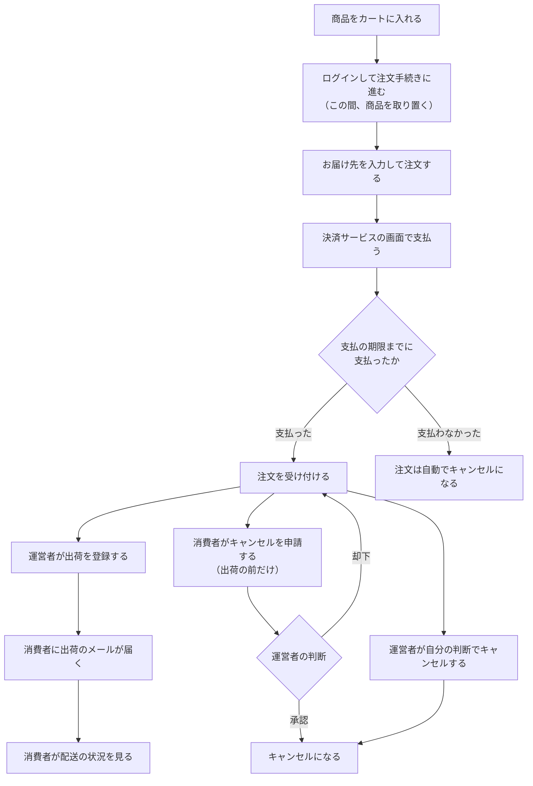
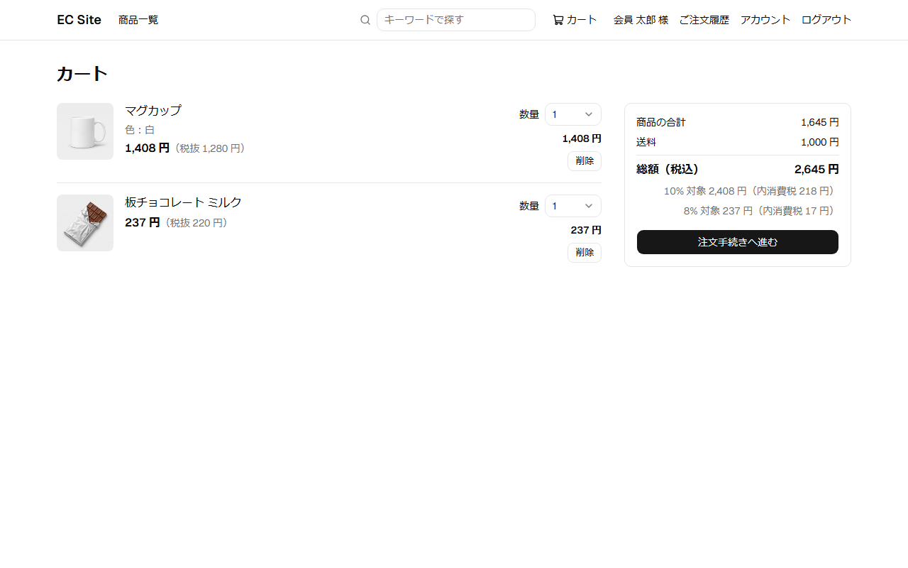
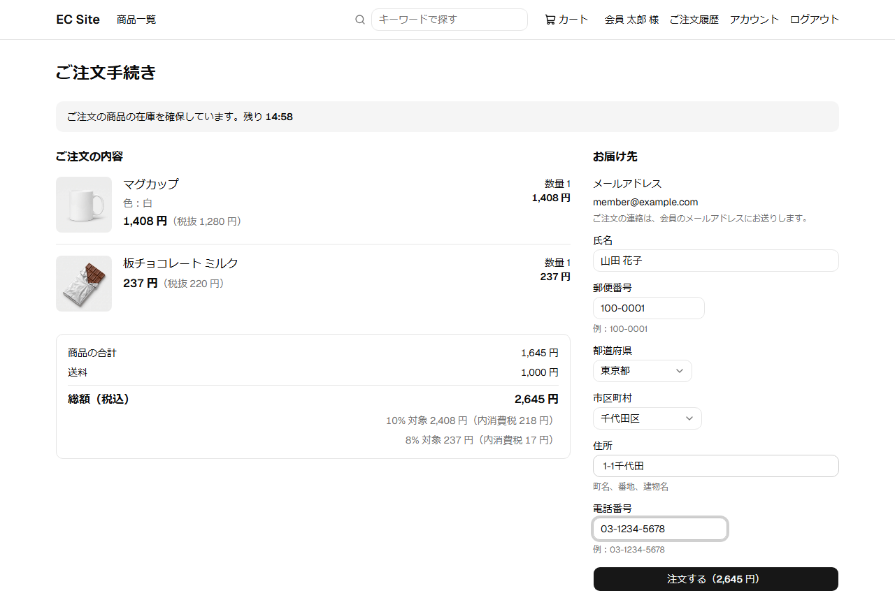
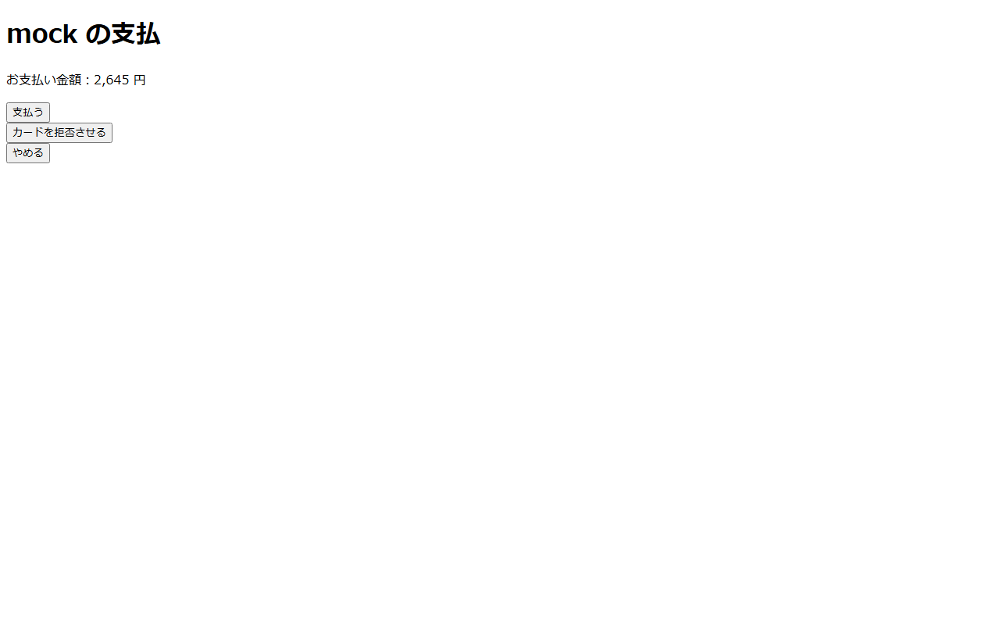
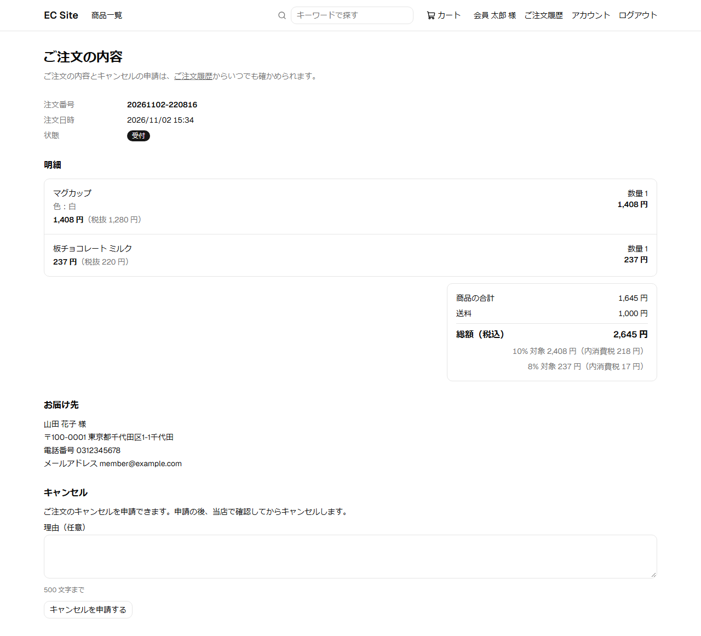
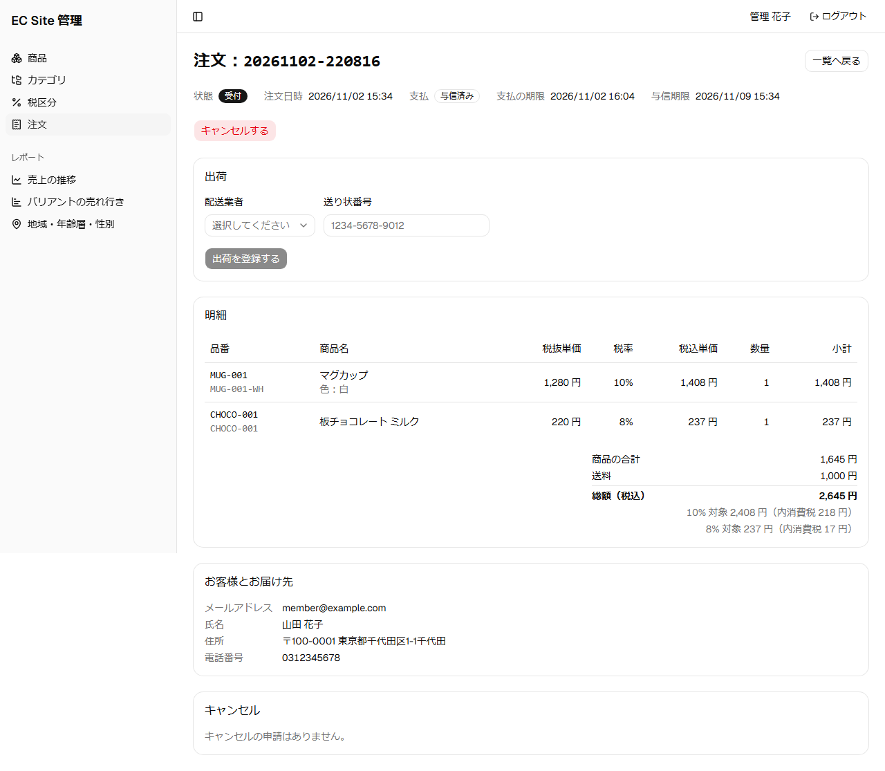
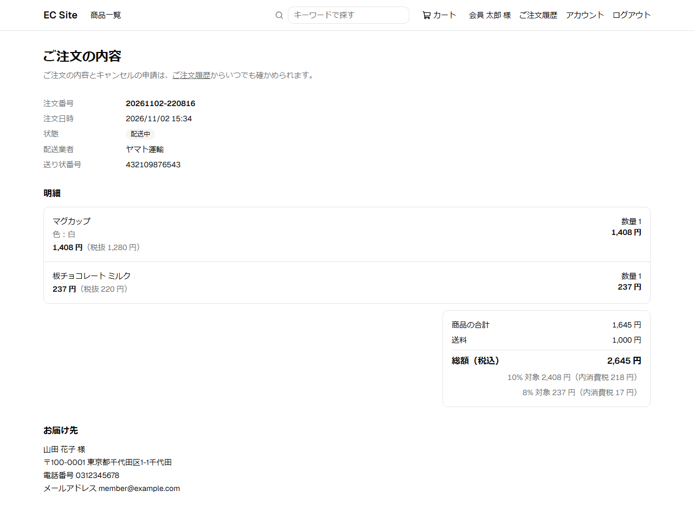

# 注文の流れ

会員が商品を買い、運営者が発送するまでの流れである。

## 登場する人

| 登場する人 | 役割 |
|------------|------|
| 消費者 | 商品を買う。注文できるのは会員だけ |
| 運営者 | 注文を確認して出荷する。キャンセルの申請を承認か却下する |
| 決済サービス（外部） | 支払を受け付ける |

## 業務の流れ

1. 消費者は、商品をカートに入れ、ログインして注文手続きに進む。この間、商品は取り置かれる。
2. お届け先を入力して注文し、決済サービスの画面で支払う。
3. 支払が確認されると、注文を受け付ける。支払の期限までに支払わないと、注文は自動でキャンセルになる。
4. 運営者が出荷を登録すると、消費者に出荷のメールが届き、消費者は配送の状況を見られる。
5. 受け付けた後、出荷の前なら、消費者はキャンセルを申請できる。運営者が承認か却下する。運営者は、自分の判断でもキャンセルできる。

## 注文の状態

| 状態 | 意味 |
|------|------|
| 支払待ち | 注文したが、支払がまだ確認されていない |
| 受付 | 支払が確認され、注文を受け付けた。出荷を待っている |
| キャンセル申請中 | 消費者がキャンセルを申請し、運営者の判断を待っている |
| 出荷済み | 運営者が出荷を登録した |
| キャンセル | 注文が取り消された |

どの操作で状態がどう変わるかは、[注文モジュール](../03-機能仕様/order.md)の「状態の遷移」を参照。

## 画面の操作の流れ

画像は、ローカル環境の画面を seed のデータで script が撮影したものである。画面を変えたら再撮影する（手順は [開発環境の起動](../06-手順書/setup.md)の「機能紹介のページのスクリーンショット」）。

1. カートで、買う商品と数量を確認し、注文手続きに進む。

   

2. 注文手続きで、金額を確認し、お届け先を入力して注文する。この間、商品は取り置かれる。

   

3. 決済サービスの画面で支払う（ローカル環境では、決済サービスを模した画面）。

   

4. 支払が確認されると、注文は受付になる。

   

5. 運営者は、管理画面で注文を見て、配送業者と送り状番号を入力して出荷を登録する。

   

6. 消費者は、注文の画面で配送の状況を見られる。

   

## 詳しく知るには

- [注文の設計](../02-設計/order.md)
- [注文モジュール](../03-機能仕様/order.md)
