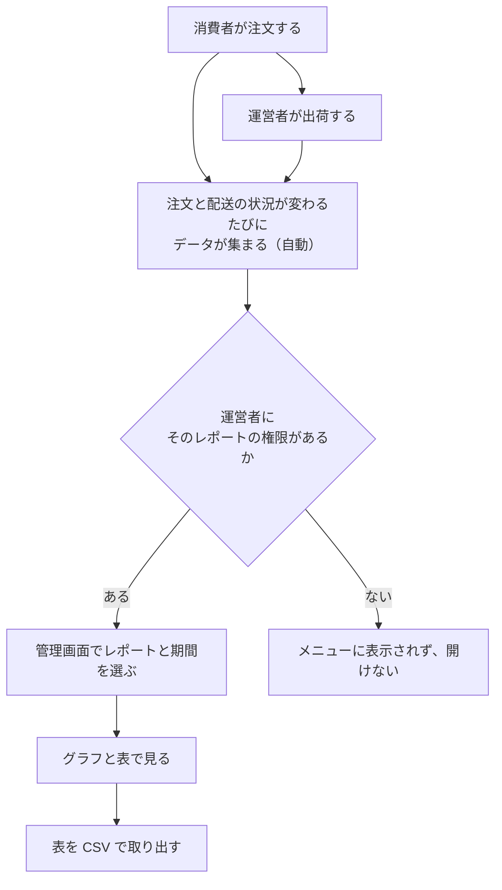
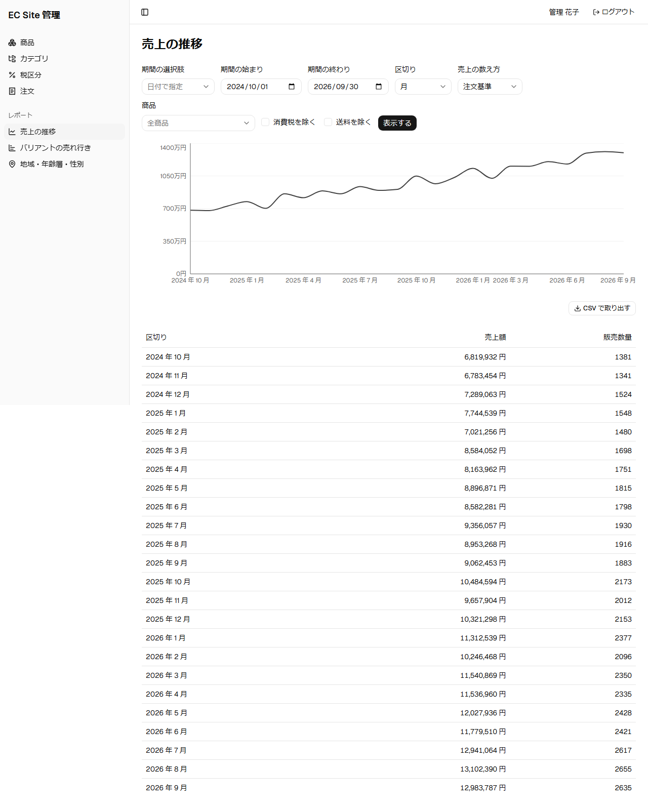
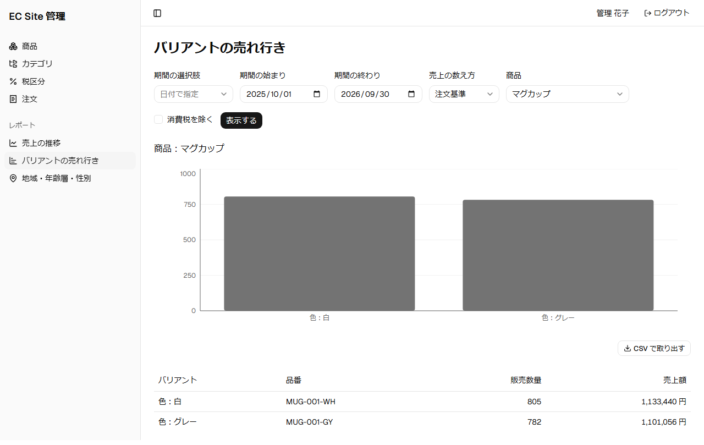
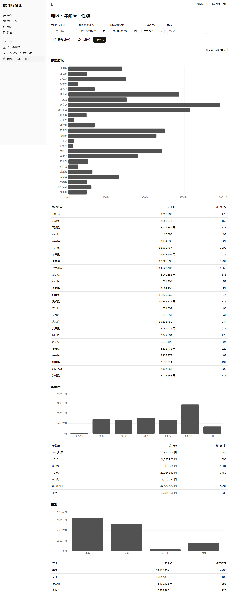

# レポートの流れ

注文と出荷のデータが集まり、運営者が管理画面で売上のレポートを見るまでの流れである。

## 登場する人

| 登場する人 | 役割 |
|------------|------|
| 消費者 | 商品を注文する |
| 運営者 | 注文を出荷する。権限のあるレポートを見る |

## 業務の流れ

- レポートは、売上の推移、バリアント（色やサイズの組み合わせ）の売れ行き、地域・年齢層・性別の 3 つである。
- データは、注文の状態にかかわらず、全ての注文について集める。どの注文を数えるかは、レポートごとに決める。支払待ちの注文とキャンセルになった注文は、売上に数えない。
- 売上の数え方は、注文の日で数える注文基準と、出荷の日で数える出荷基準を切り替えられる。
- データは業務の処理（注文、出荷）とは別に集めるので、レポートへの反映は少し遅れることがある。
- レポートのデータに、氏名や連絡先、生年月日は含めない。
- 見られるレポートは、運営者の役割ごとに決まる。管理者と管理職は 3 つとも見られる。営業は売上の推移以外の 2 つを見られる。閲覧者は見られない。

## 画面の操作の流れ

画像は、ローカル環境の画面を、seed のレポート用の注文で script が撮影したものである。画面を変えたら再撮影する（手順は [開発環境の起動](../06-手順書/setup.md)の「機能紹介のページのスクリーンショット」）。

1. 売上の推移。期間と区切り（週、月、四半期、年）を選び、売上額と販売数量を折れ線グラフと表で見る。商品を選ぶと、その商品だけの推移を見られる。表は CSV で取り出せる。

   

2. バリアントの売れ行き。商品を 1 つと期間を選び、色やサイズの組み合わせごとの販売数量と売上額を見る。

   

3. 地域・年齢層・性別。お届け先の都道府県、年齢層、性別ごとの売上額と注文件数を見る。

   

## 詳しく知るには

- [レポートの設計](../02-設計/reporting.md)
- [レポートモジュール](../03-機能仕様/reporting.md)
