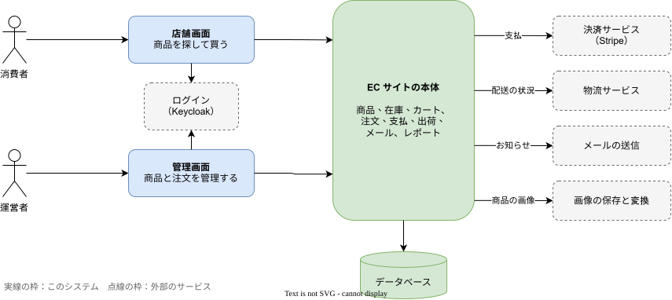

# システムの全体像

日本向けで日本円だけの、自社の通販サイトである。個人のポートフォリオとして作り、実際の運用に近いやり方を試す。

## 全体図

- 消費者は店舗画面で買い物をする。
- 運営者は管理画面で商品と注文を管理する。
- ログインは、専用のサービスに任せる。
- 支払は、外部の決済サービスで行う。
- 配送の状況は、外部の物流サービスから受け取る。
- メールの送信、商品の画像の保存と変換は、それぞれ外部のサービスを使う。

## できること

| 利用者 | できること |
|--------|------------|
| 消費者 | 会員登録とログイン・商品を見る・カートに入れる・注文する・支払う・注文と配送の状況を見る |
| 運営者 | 商品登録・価格変更・在庫管理・注文管理・出荷の連絡・データ収集と簡単なレポート |

主な流れは、商品を見る → カートに入れる → 注文する → 支払う → 発送する → 配送の状況を見る、の順である。購入できるのは会員だけである。

## 詳しく知るには

- [全体構成](../02-設計/overview.md)
- [注文の流れ](order.md)
- [商品の登録と公開の流れ](catalog.md)
- [会員登録とログインの流れ](member.md)
- [レポートの流れ](reporting.md)
