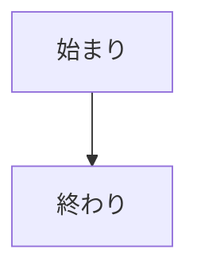

# 概要の雛形

## この雛形の使い方

概要（`docs/01-概要/`）の文書を書くときに、下の骨組みを写して使う。

| 項目 | 内容 |
|------|------|
| 読者 | エンジニアでない人（業務の担当者、採用の担当者など） |
| 置くもの | 全体像と図。専門の語は使わないか、平易な言葉に言い換える |
| 置かないもの | 数値（時間・期限・保存期間など）、項目の一覧、エラー、API、識別子 |
| 詳しいこと | 設計（`docs/02-設計/`）と機能仕様（`docs/03-機能仕様/`）へのリンクで指す |

1 つの事実の正本は 1 つにする。概要に書いた内容が設計や機能仕様と食い違うときは、設計と機能仕様を正とする。

## 骨組み

````markdown
# <機能の名前>

<何ができるかを 1〜2 文で書く。>

## 登場する人

<この機能に関わる人と外部のサービスを、役割とともに箇条書きにする。>

## 業務の流れ

<Mermaid の flowchart で流れを描く。ノードは 15 個程度まで。図の下に、流れを文でも説明する。>



## 画面の操作の流れ

<画面のスクリーンショットを、操作の順に置く。Playwright の script で seed のデータから作り、手動で撮らない。>

## 詳しく知るには

<エンジニア向けの設計と、規則の正本へのリンクを、文書の名前だけの箇条書きにする（説明を付けない）。>
````
