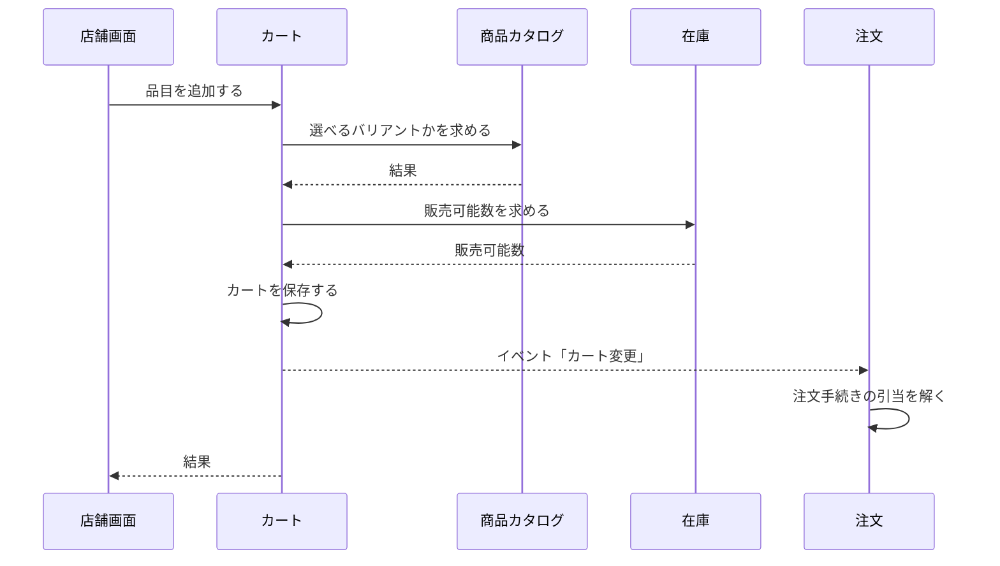
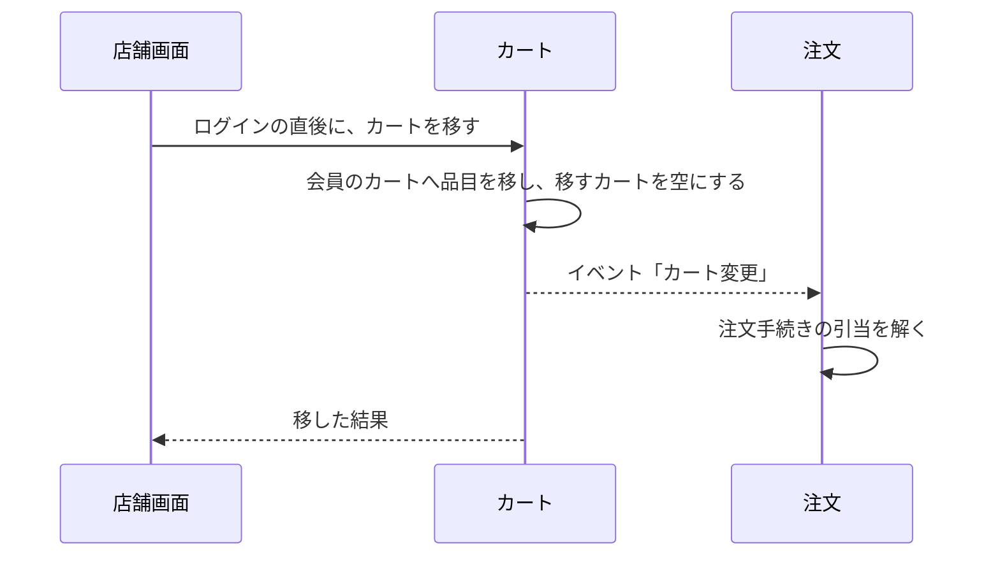

# カートの設計

カートモジュールは、消費者のカートと、その品目（バリアントと数量）を管理する。業務規則は [カートモジュール](../03-機能仕様/cart.md) にある。

## 境界

依存は写さず、[全体構成](overview.md) の「モジュールの依存とイベント」を指す。会員の API を使うのは presentation だけである。

### 他のモジュールへの公開

| 種類 | 内容 | 利用者 |
|------|------|--------|
| API | カートの品目・バージョン・会員 ID（期限切れは品目が空） | 注文 |
| API | 注文した品目を除く（注文が受付になるのと同じトランザクション） | 注文 |
| イベント | カート変更（カート ID） | 注文（引当を解く） |

## 処理の流れ

### カートへの追加

業務規則は [カートモジュール](../03-機能仕様/cart.md) の「品目の追加と変更」に書く。



数量の変更は商品カタログを呼ばず、増やすときだけ在庫を確認する。

### カートを移す

業務規則は [カートモジュール](../03-機能仕様/cart.md) の「カートを移す」に書く。商品カタログと在庫は呼ばない。



注文した品目をカートから除く処理は、[注文の設計](order.md) の「支払と受付」に描く。

## API

リクエストとレスポンスの項目、エラーコード、状態コードは OpenAPI（[店舗 API](../../api/openapi/store.yaml)）が正本である。管理 API はない。カートの表示（`getCart`）は、店舗モジュールが受ける。

| 画面 | 操作 | メソッドとパス | operationId |
|------|------|----------------|-------------|
| 店舗 | カートを作る | `POST /carts` | `createCart` |
| 店舗 | カートに入れる | `POST /carts/{cartId}/items` | `addCartItem` |
| 店舗 | 品目の数量の変更 | `PUT /carts/{cartId}/items/{variantId}` | `changeCartItemQuantity` |
| 店舗 | 品目の削除 | `DELETE /carts/{cartId}/items/{variantId}` | `removeCartItem` |
| 店舗 | 会員のカート | `GET /me/cart` | `getMemberCart` |
| 店舗 | カートを移す | `POST /me/cart/merge` | `mergeCart` |

## パッケージの構成

クラスの名前と設定の値は書かない（正本はコード）。

```
cart/
├── api/                # 注文に公開するカートの API
├── event/              # カート変更
├── presentation/       # 店舗 API の実装
├── application/        # カートの操作、期限切れの片付け
│   ├── model/          # 表示の型
│   └── port/           # リポジトリ、他モジュールの port
├── domain/             # カート、品目、移した結果、エラー
└── infrastructure/
    ├── persistence/    # リポジトリの実装
    └── directory/      # 他モジュールの腐敗防止層
```
