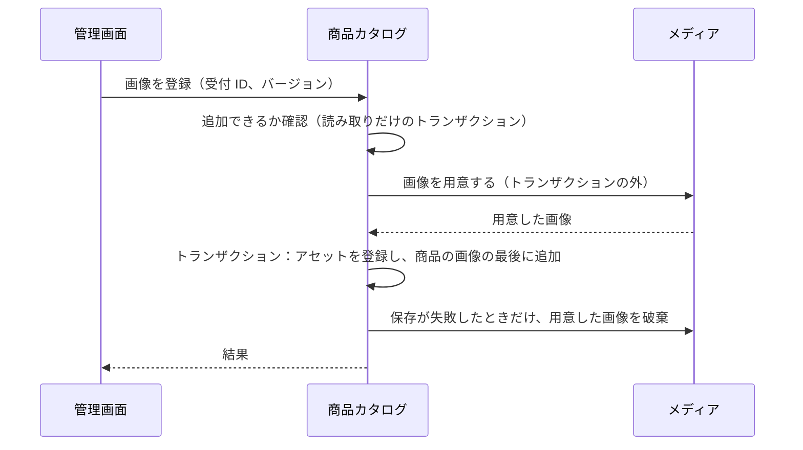
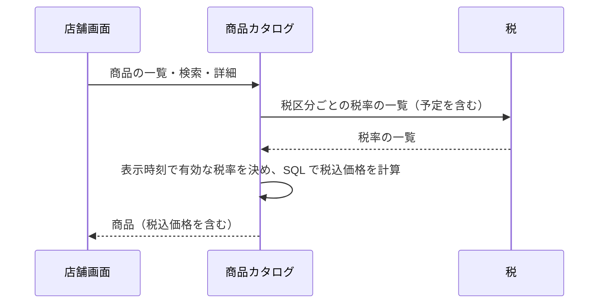

# 商品カタログの設計

商品カタログモジュールは、商品・バリアント・カテゴリ・公開状態・商品検索を管理する。業務規則は [商品カタログモジュール](../03-機能仕様/catalog.md) にある。

| 項目 | 内容 |
|------|------|
| レベル | A（軸の組み合わせの一意性、公開の条件など、不変条件が多い） |

## 境界

依存は写さず、[全体構成](overview.md) の「モジュールの依存とイベント」を指す。

### 他のモジュールへの公開

| 種類 | 内容 | 利用者 |
|------|------|--------|
| API | C 側向けの商品一覧・検索・詳細（税込価格を含む）、カテゴリの木 | 店舗 |
| API | 複数のバリアントの、注文に使う情報 ※1 | カート、注文 |
| API | 複数のバリアントの商品 ID、商品のバリアントの一覧（品番、軸の値。バリアントの表示順） | レポート |
| イベント | バリアント登録、バリアント削除、商品削除 | 在庫 |
| イベント | 商品公開、商品非公開、商品販売終了、商品価格変更 | なし |

※1：商品 ID・商品品番・バリアント品番・商品名・軸の値・税抜価格・税区分・画像の URL・C 側に表示されるか・販売停止か。存在しないバリアントは含めない。

イベントはどれも、イベント ID、発生時刻、商品 ID を持つ。バリアント登録・削除はバリアント ID も、商品価格変更は変更後の税抜価格も持つ。品番は持たない。状態の切り替えで状態が変わらなかったときは登録しない。

リスナーのない 4 つ（商品公開、商品非公開、商品販売終了、商品価格変更）も残す。理由：商品の状態と価格の変化を知らせる公開のイベントとして、登録をテストで確認しているため。

## 処理の流れ

### 商品画像の追加

業務規則（トランザクションの分け方を含む）は [商品カタログモジュール](../03-機能仕様/catalog.md) の「商品画像」に書く。



### C 側の商品一覧と検索

業務規則は [商品カタログモジュール](../03-機能仕様/catalog.md) の「C 側の表示と検索」に書く。



## API

リクエストとレスポンスの項目、エラーコード、状態コードは OpenAPI（[店舗 API](../../api/openapi/store.yaml)、[管理 API](../../api/openapi/admin.yaml)）が正本である。

| 画面 | 操作 | メソッドとパス | operationId |
|------|------|----------------|-------------|
| 店舗 | 商品一覧 | `GET /products` | `listProducts` |
| 店舗 | キーワード検索 | `GET /products/search` | `searchProducts` |
| 店舗 | 商品の詳細 | `GET /products/{productId}` | `getProduct` |
| 店舗 | カテゴリの木 | `GET /categories` | `listCategories` |
| 管理 | カテゴリの木 | `GET /categories` | `listCategories` |
| 管理 | カテゴリの登録 | `POST /categories` | `createCategory` |
| 管理 | 兄弟カテゴリの並び順を変更する | `PUT /categories/order` | `reorderCategories` |
| 管理 | カテゴリの取得 | `GET /categories/{categoryId}` | `getCategory` |
| 管理 | カテゴリ名の変更 | `PUT /categories/{categoryId}` | `renameCategory` |
| 管理 | カテゴリの削除 | `DELETE /categories/{categoryId}` | `deleteCategory` |
| 管理 | 商品の一覧・絞り込み | `GET /products` | `listProducts` |
| 管理 | 商品の登録 | `POST /products` | `createProduct` |
| 管理 | 商品の詳細（バリアントを含む） | `GET /products/{productId}` | `getProduct` |
| 管理 | 商品の編集 | `PUT /products/{productId}` | `updateProduct` |
| 管理 | 商品の削除 | `DELETE /products/{productId}` | `deleteProduct` |
| 管理 | 公開する | `PUT /products/{productId}/publish` | `publishProduct` |
| 管理 | 非公開にする | `PUT /products/{productId}/unpublish` | `unpublishProduct` |
| 管理 | 販売終了にする | `PUT /products/{productId}/discontinue` | `discontinueProduct` |
| 管理 | 公開期間の設定 | `PUT /products/{productId}/publication-period` | `setPublicationPeriod` |
| 管理 | バリアントの登録 | `POST /products/{productId}/variants` | `addVariant` |
| 管理 | バリアントの表示順を変更する | `PUT /products/{productId}/variants/order` | `reorderVariants` |
| 管理 | バリアントの削除 | `DELETE /products/{productId}/variants/{variantId}` | `deleteVariant` |
| 管理 | バリアントを販売停止にする | `PUT /products/{productId}/variants/{variantId}/suspend` | `suspendVariant` |
| 管理 | バリアントの販売停止を解除する | `PUT /products/{productId}/variants/{variantId}/resume` | `resumeVariant` |
| 管理 | 画像のアップロードを受け付ける | `POST /products/{productId}/image-uploads` | `createImageUpload` |
| 管理 | 受け付けた画像を登録する | `POST /products/{productId}/images` | `addProductImage` |
| 管理 | 画像の並び順の変更 | `PUT /products/{productId}/images/order` | `reorderProductImages` |
| 管理 | 画像の削除 | `DELETE /products/{productId}/images/{imageId}` | `deleteProductImage` |
| 管理 | バリアントの画像の指定 | `PUT /products/{productId}/variants/{variantId}/image` | `setVariantImage` |

## パッケージの構成

クラスの名前と設定の値は書かない（正本はコード）。

```
catalog/
├── api/                # 注文向けのバリアント、店舗向けの参照、レポート向けの写し
├── event/              # 商品・バリアントの状態の変化
├── presentation/       # 店舗 API・管理 API の実装
├── application/        # 他のモジュール向けの参照
│   ├── product/        # 商品・バリアント・画像の操作と参照
│   ├── category/       # カテゴリの更新と参照
│   ├── model/          # 入力、条件、表示の型
│   └── port/           # 参照用リポジトリ、検索、税とメディアの port
├── domain/             # 表示順の再採番、エラーの定義
│   ├── product/        # 商品（集約）、バリアント、画像、値
│   └── category/       # カテゴリ（集約）
└── infrastructure/
    ├── persistence/    # リポジトリ、参照用リポジトリ、キーワード検索
    └── directory/      # 税・メディアの腐敗防止層、税率の一覧のキャッシュ
```
