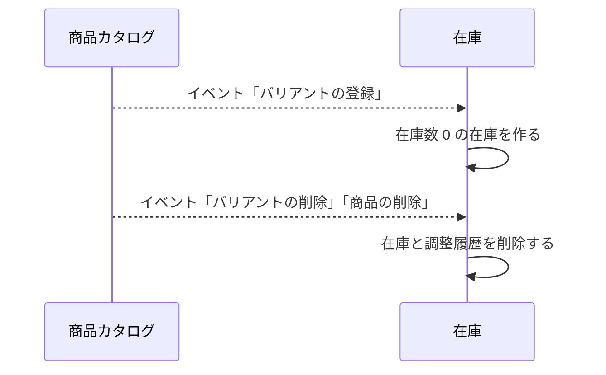
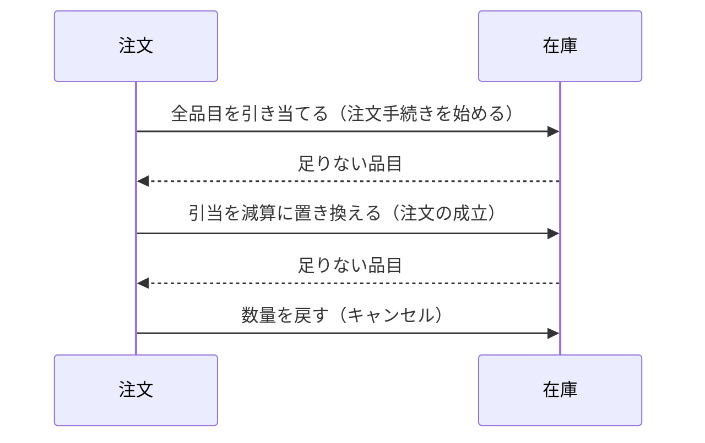

# 在庫の設計

在庫モジュールは、バリアントごとの在庫数と調整履歴、注文手続き中の引当を管理する。業務規則は [在庫モジュール](../03-機能仕様/inventory.md) にある。

| 項目 | 内容 |
|------|------|
| レベル | A（並行して調整されても失われないこと、引当と減算） |

在庫は、レベル A の例外（集約のクラスを持たない）にあたる。理由は[バックエンドのアーキテクチャ](backend-architecture.md)の「モジュール内のアーキテクチャレベル」の例外の規則に書く。

## 境界

依存は[全体構成](overview.md)の「モジュールの依存とイベント」。

### 他のモジュールへの公開

| 種類 | 内容 | 利用者 |
|------|------|--------|
| API | 複数のバリアントの在庫の有無（判定は [在庫モジュール](../03-機能仕様/inventory.md)の「引当」） | 店舗 |
| API | 販売可能数（引当の持ち主を指定すると、その引当を除く） | カート、注文 |
| API | 引き当てる、解く、減算に置き換える、戻す | 注文 |

## 処理の流れ

### 在庫の作成と削除

業務規則は [在庫モジュール](../03-機能仕様/inventory.md) の「業務規則」に書く。



### 注文による引当と在庫数の変更

注文モジュールのトランザクションに参加する。注文側の流れは [注文の設計](order.md) に書く。



- 引当を減算に置き換える操作は、持ち主の引当を先に削除してから、在庫の行をバリアント ID の順にロックする。つまり、引当の行、在庫の行の順にロックする。注文手続きの開始も、前の引当を解いてから引き当てるので、同じ順序になり、開始と注文は循環して待たない。理由：引当の行を持ったまま在庫の行を待つ処理と、在庫の行を持ったまま引当の行を待つ処理が重なると、デッドロックになるため。
- 持ち主の引当を先に削除しても、判定は変わらない。販売可能数は、持ち主自身の引当を数えないため。
- 足りない品目があるとき、減算に置き換える操作は、在庫数を変えず、足りない品目を返す。先に削除した引当は削除したまま返るので、呼び出し元（注文）が例外を投げてトランザクションをロールバックし、引当を元に戻す。注文の側の扱いは [注文の設計](order.md) の「同時の注文」。

### 在庫の調整

業務規則は [在庫モジュール](../03-機能仕様/inventory.md) の「在庫の調整は「差分の加算」」に書く。

- 在庫数は、増減量を加える条件付きの更新（`JooqStockItemRepository`）で変える。条件は上の業務規則のとおり。引当の判定は、行ロックして読んだ在庫で行う。理由：集約を読み込んで書き戻すと、並行した調整で増減が失われるため。

## API

操作の一覧は[ロールと権限の対応表](role-permissions.md)、リクエストとレスポンスの項目は OpenAPI（[店舗 API](../../api/openapi/store.yaml)、[管理 API](../../api/openapi/admin.yaml)）。

店舗 API に在庫の operation はない。店舗の在庫の有無は、商品の応答の `inStock` に含まれる。

## パッケージの構成

```
inventory/
├── api/                # 在庫の有無、販売可能数、引当の操作
├── presentation/       # 管理 API の実装
├── application/        # 在庫の調整、参照、引当、作成と削除、片付け
│   ├── model/          # コマンド、表示の型
│   └── port/           # 参照用リポジトリ
├── domain/             # エラーの定義
│   └── stock/          # 在庫の調整、行ロックした在庫、引当の判定
│       └── port/       # 在庫と引当のリポジトリ
└── infrastructure/     # 片付けの設定
    └── persistence/    # リポジトリの実装、有効な引当の条件
```
