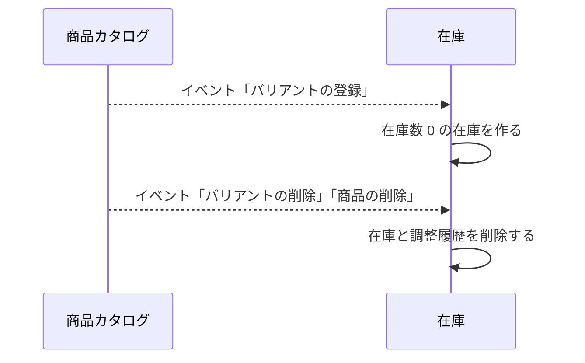
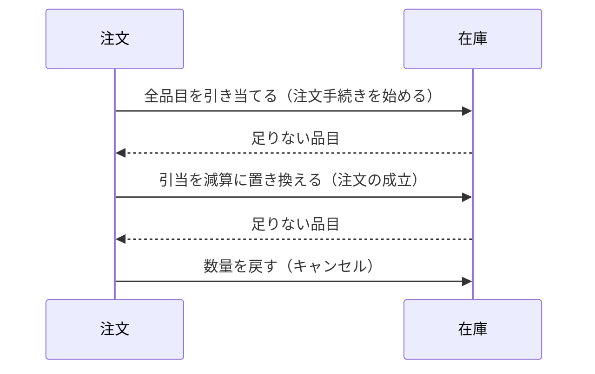

# 在庫の設計

在庫モジュールは、バリアントごとの在庫数と調整履歴、注文手続き中の引当を管理する。業務規則は [在庫モジュール](../03-機能仕様/inventory.md) にある。

## 境界

依存は写さず、[全体構成](overview.md) の「モジュールの依存とイベント」を指す。

### 他のモジュールへの公開

| 種類 | 内容 | 利用者 |
|------|------|--------|
| API | 複数のバリアントの在庫の有無（判定は [在庫モジュール](../03-機能仕様/inventory.md)の「引当」） | 店舗 |
| API | 販売可能数（引当の持ち主を指定すると、その引当を除く） | カート、注文 |
| API | 引き当てる、解く、減算に置き換える、戻す | 注文 |

## 処理の流れ

### 在庫の作成と削除

業務規則は [在庫モジュール](../03-機能仕様/inventory.md) の「業務規則」に書く。



### 注文による引当と在庫数の変更

注文モジュールのトランザクションに参加する。注文側の流れは [注文の設計](order.md) に書く。



## API

リクエストとレスポンスの項目、エラーコード、状態コードは OpenAPI（[管理 API](../../api/openapi/admin.yaml)）が正本である。店舗 API に在庫の operation はない。店舗の在庫の有無は、商品の応答の `inStock` に含まれる。

| 画面 | 操作 | メソッドとパス | operationId |
|------|------|----------------|-------------|
| 管理 | バリアントの在庫数 | `GET /inventory/variants/{variantId}` | `getStock` |
| 管理 | 在庫の調整 | `POST /inventory/variants/{variantId}/adjustments` | `adjustStock` |
| 管理 | 在庫調整の履歴 | `GET /inventory/variants/{variantId}/adjustments` | `listStockAdjustments` |
| 管理 | 商品ごとの在庫数の合計 | `GET /inventory/stock-summaries` | `listStockSummaries` |

## パッケージの構成

クラスの名前と設定の値は書かない（正本はコード）。

```
inventory/
├── api/                # 在庫の有無、販売可能数、引当の操作
├── presentation/       # 管理 API の実装
├── application/        # 在庫の調整、参照、引当、作成と削除、片付け
│   ├── model/          # コマンド、表示の型
│   └── port/           # 参照用リポジトリ
├── domain/             # エラーの定義
│   └── stock/          # 在庫の調整、行ロックした在庫、引当の判定
│       └── port/       # 在庫と引当のリポジトリ
└── infrastructure/     # 片付けの設定
    └── persistence/    # リポジトリの実装、有効な引当の条件
```
