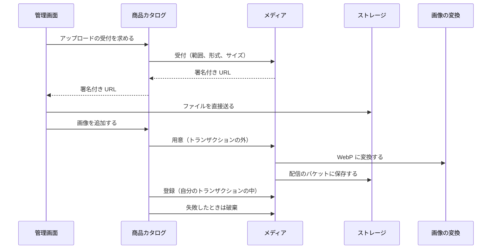
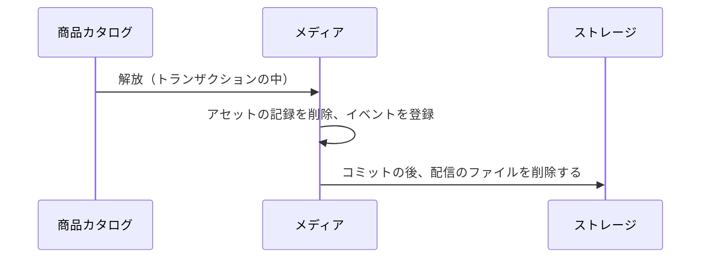

# メディアの設計

メディアモジュールは、利用者がアップロードするファイル（今は画像だけ）を受け付けて検証し、保存して配信 URL を返し、削除する。業務規則は [メディアモジュール](../03-機能仕様/media.md) にある。

| 項目 | 内容 |
|------|------|
| レベル | B（業務の不変条件はなく、ストレージとの連携が中心） |

## 境界

依存は写さず、[全体構成](overview.md) の「モジュールの依存とイベント」を指す。

### 他のモジュールへの公開

| 種類 | 内容 | 利用者 |
|------|------|--------|
| API | 画像のアップロードの受付・用意・登録・破棄、アセットの解放、配信 URL の取得（まとめて） | 商品カタログ |

イベント（アセット解放）はモジュールの中だけで使い、他のモジュールへは公開しない。

### 外部のサービス

| 役割 | 実装 | 設定 |
|------|------|------|
| ストレージ | Amazon S3（AWS SDK v2）。ローカルと CI は SeaweedFS | `ecsite.media.storage` |
| 画像の変換 | 別コンテナの imgproxy を HTTP で呼ぶ | `ecsite.media.converter` |

どちらも port（`ObjectStorage`、`ImageConverter`）の実装として置く。ストレージの操作は、AWS（S3）と GCP（GCS）の両方にあるものだけにする。署名付き PUT の URL、ファイルの情報、先頭の読み取り、書き込み、削除が該当する。画像の変換は同期に行う。タイムアウトと失敗の分け方は、[バックエンドのアーキテクチャ](backend-architecture.md)の「外部連携」に書く。それに加えて、imgproxy の応答が WebP でない（先頭のバイトで判定）ときも、画像を変換できないエラー（400）にする。アップロードの受付は署名付き URL を手元で作り、ストレージを呼ばない。

## 処理の流れ

### 画像のアップロード

商品カタログが、メディアの API を順に呼ぶ。業務規則は [メディアモジュール](../03-機能仕様/media.md) の「アップロードの流れ」に書く。



- 用意は、使う側がトランザクションの外で呼ぶ（変換と保存の間、DB の接続を持たない）。メディアは DB を使わないので、自分ではトランザクションを始めない。
- 登録は、使う側のトランザクションの中で呼び、トランザクションがなければ失敗する。
- 破棄は、削除に失敗しても例外を投げず、警告のログに保存先のキーを出力する（使う側の元の失敗を隠さないため）。

### アセットの解放

商品カタログが画像や商品を削除するとき、自分のトランザクションの中で解放を呼ぶ。配信のファイルは、コミットの後にメディアの中のイベントで削除する。業務規則は [メディアモジュール](../03-機能仕様/media.md) の「アセットの解放」に書く。



- イベントのリスナーは DB を使わないので、トランザクションを始めない（ストレージを待つ間に DB の接続を持たない）。

## API

なし。メディアは、他のモジュールから API で呼ばれるだけで、店舗 API・管理 API の operation を持たない。画像のアップロードの operation（`createImageUpload` など）は、商品カタログの API に置く。

## パッケージの構成

クラスの名前と設定の値は書かない（正本はコード）。

```
media/
├── api/                    # 他のモジュールへの公開
├── application/            # アップロードの流れ、解放のイベント
│   ├── model/              # 表示の型
│   └── port/               # リポジトリ、変換、ファイルの置き場所
├── domain/                 # アセット、キーの決まり、画像の形式
└── infrastructure/
    ├── persistence/        # リポジトリの実装
    ├── converter/          # imgproxy による画像の変換
    └── storage/            # S3 互換のオブジェクトストレージ
```
