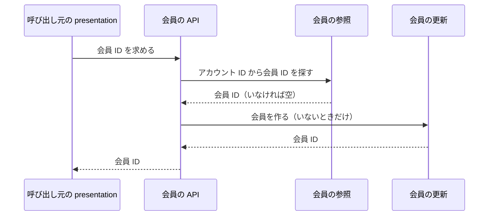

# 会員の設計

会員モジュールは、IdP（Keycloak）のアカウントと、EC の会員 ID の対応を管理する。業務規則は [会員モジュール](../03-機能仕様/member.md) にある。

## 境界

依存は写さず、[全体構成](overview.md) の「モジュールの依存とイベント」を指す。会員の API を呼ぶのは、カート、注文、店舗の presentation である。

token から会員の情報を取り出すクラスは、会員モジュールの外の `common/security` にある（[共通コード・ログ・可観測性](common.md)）。

### 他のモジュールへの公開

| 種類 | 内容 | 利用者 |
|------|------|--------|
| API | 要求した会員の会員 ID を求める（初めてなら作る） | カート、注文、店舗 |

## 処理の流れ

### 会員 ID を求める

ログインした全てのリクエストで動く。規則は [会員モジュール](../03-機能仕様/member.md) の「会員を求める」に書く。



## API

会員モジュールは、店舗 API と管理 API の operation を持たない。

## パッケージの構成

クラスの名前と設定の値は書かない（正本はコード）。

```
member/
├── api/                    # 会員 ID を求める入口
├── application/            # 会員の参照、会員の更新
│   └── port/               # リポジトリ
├── domain/                 # 会員
└── infrastructure/
    └── persistence/        # リポジトリの実装
```
