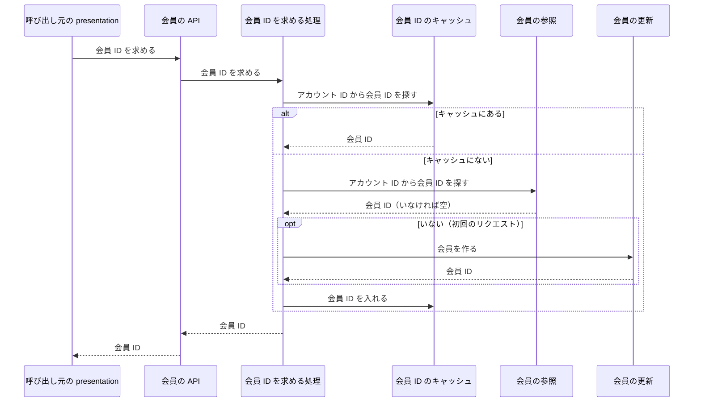

# 会員の設計

会員モジュールは、IdP（Keycloak）のアカウントと、EC の会員 ID の対応を管理する。業務規則は [会員モジュール](../03-機能仕様/member.md) にある。

| 項目 | 内容 |
|------|------|
| レベル | B（不変条件は「1 つのアカウントに 1 人の会員」だけ） |

## 境界

依存は[全体構成](overview.md)の「モジュールの依存とイベント」。会員の API を呼ぶのは、カート、注文、店舗の presentation である。

token から会員の情報を取り出すクラスは、会員モジュールの外の `common/security` にある（[共通コード・ログ・可観測性](common.md)）。

### 他のモジュールへの公開

| 種類 | 内容 | 利用者 |
|------|------|--------|
| API | 要求した会員の会員 ID を求める（初めてなら作る） | カート、注文、店舗 |

## 処理の流れ

### 会員 ID を求める

ログインした全てのリクエストで動く。規則は [会員モジュール](../03-機能仕様/member.md) の「会員を求める」に書く。



キャッシュは、アカウント ID から会員 ID への対応を、件数の上限と期限を付けてメモリに持つ。会員 ID は、見つけたとき、または会員を作ったときに入れる。インスタンスごとに中身が違ってよい。対応は作った後に変わらず、期限で古い値が残り続けないためである。

| 識別子 | 内容 |
|--------|------|
| `ecsite.member.id-cache.maximum-size` | キャッシュに持つ件数の上限 |
| `ecsite.member.id-cache.expire-after-write` | 有効期間 |

既定値は[環境変数](../06-手順書/environment.md)に書く。

## API

会員モジュールは、店舗 API と管理 API の operation を持たない。

## パッケージの構成

```
member/
├── api/                    # 会員 ID を求める入口
├── application/            # 会員 ID を求める処理、参照、更新
│   └── port/               # リポジトリ
├── domain/                 # 会員
└── infrastructure/
    └── persistence/        # リポジトリの実装
```
