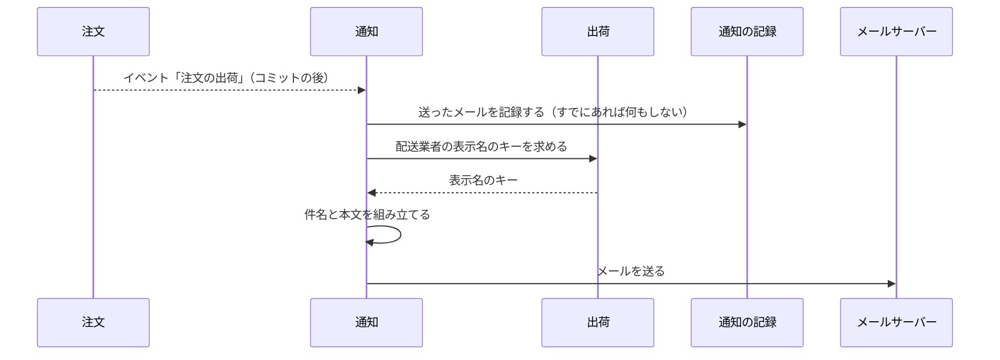

# 通知の設計

通知モジュールは、消費者へのメールを送る。今は出荷通知メールだけである。業務規則は [通知モジュール](../03-機能仕様/notification.md) にある。

## 境界

依存は写さず、[全体構成](overview.md) の「モジュールの依存とイベント」を指す。注文は、イベント「注文の出荷」だけを受ける（注文の API は呼ばない）。出荷は、公開 API の「配送業者の表示名のキーを返す」操作だけを使う。配送業者の表示名は出荷モジュールが決めるので、文言のキーを文字列で組み立てずに、出荷の公開 API から得る。port（`ShippingDirectory`）を application に置き、`infrastructure/directory/` の実装が出荷の公開 API を呼ぶ。

### 他のモジュールへの公開

なし。

### 外部のサービス

| 役割 | 実装 | 設定 |
|------|------|------|
| メールの送信 | Spring Boot のメール（`spring-boot-starter-mail`）で SMTP に送る。ローカル・テスト・E2E は Mailpit | `spring.mail.*`、`ecsite.notification` |

- port（`Mailer`）の実装として置く。SMTP の型とエラーを `infrastructure` の外に出さない。
- ローカル・E2E は compose の Mailpit に送る。SMTP はホストの `localhost:2525`（ポートは `MAILPIT_SMTP_PORT` で変えられる）、届いたメールは `http://localhost:8025` で確認する。統合テストは Testcontainers の Mailpit に送る。
- タイムアウトと失敗の扱いは、[通知モジュール](../03-機能仕様/notification.md)の「業務規則」に書く。

## 処理の流れ

### 出荷通知メールの送信

出荷の登録は [注文の設計](order.md) に描く。ここは、イベント「注文の出荷」を受けた後の流れである。業務規則は [通知モジュール](../03-機能仕様/notification.md) の「出荷通知メール」「1 通だけ送る」に書く。



記録が挿入できなかったときは、これ以降を行わない。

## API

なし。

## パッケージの構成

クラスの名前と設定の値は書かない（正本はコード）。

```
notification/
├── application/        # 出荷のリスナー、メールの作成
│   └── port/           # メール送信、記録、配送業者の表示名
└── infrastructure/
    ├── directory/      # 出荷の腐敗防止層
    ├── mail/           # SMTP での送信、通知の設定
    └── persistence/    # 送ったメールの記録の実装
```
