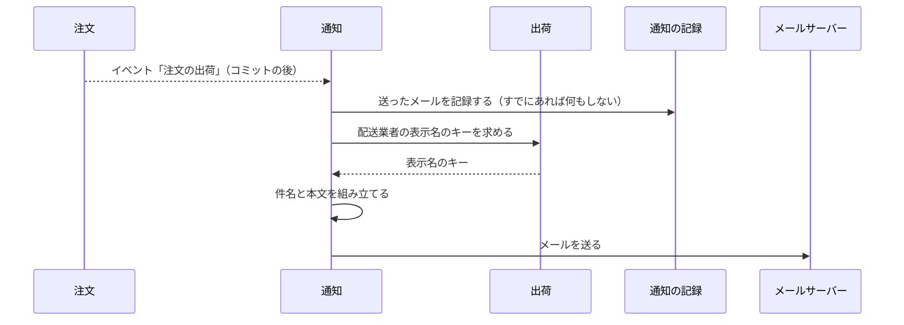

# 通知の設計

通知モジュールは、消費者へのメールを送る。今は出荷通知メールだけである。業務規則は [通知モジュール](../03-機能仕様/notification.md) にある。

| 項目 | 内容 |
|------|------|
| レベル | B（業務の規則は「同じ注文に同じ種類のメールは 1 通」だけで、集約に守らせる不変条件がない） |

## 境界

依存は[全体構成](overview.md)の「モジュールの依存とイベント」。通知は、注文のイベント「注文の出荷」だけを受け、注文の API は呼ばない。通知は、出荷の公開 API のうち「配送業者の表示名のキーを返す」操作だけを、腐敗防止層（`ShippingDirectory`）を通して使う。理由：表示名は出荷モジュールが決めるので、文言のキーを文字列で組み立てないため。

### 他のモジュールへの公開

なし。

### 外部のサービス

| 役割 | 実装 | 設定 |
|------|------|------|
| メールの送信 | Spring Boot のメール（`spring-boot-starter-mail`）で SMTP に送る。ローカル・テスト・E2E は Mailpit | `spring.mail.*`、`ecsite.notification` |

- port は `Mailer`。SMTP の型とエラーを `infrastructure` の外に出さない。
- ローカル・E2E は compose の Mailpit に送る（SMTP のポートと、届いたメールを見る URL は[開発環境の起動](../06-手順書/setup.md)の「起動」）。統合テストは Testcontainers の Mailpit に送る。
- 失敗の扱いは、[通知モジュール](../03-機能仕様/notification.md)の「1 通だけ送る」に書く。
- タイムアウトの値は `application.yml` の `mail.smtp.*`。理由：タイムアウトがないと、応答しない SMTP サーバーでメールのリスナーが止まったままになるため。

## 処理の流れ

### 出荷通知メールの送信

出荷の登録は [注文の設計](order.md) に描く。ここは、イベント「注文の出荷」を受けた後の流れである。業務規則は [通知モジュール](../03-機能仕様/notification.md) の「出荷通知メール」「1 通だけ送る」に書く。



## API

なし。

## パッケージの構成

```
notification/
├── application/        # 出荷のリスナー、メールの作成
│   └── port/           # メール送信、記録、配送業者の表示名
└── infrastructure/
    ├── directory/      # 出荷の腐敗防止層
    ├── mail/           # SMTP での送信、通知の設定
    └── persistence/    # 送ったメールの記録の実装
```
