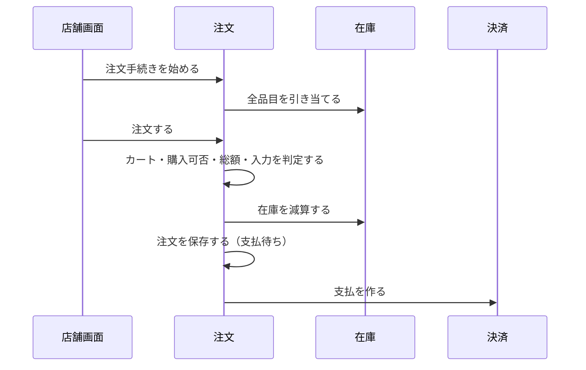
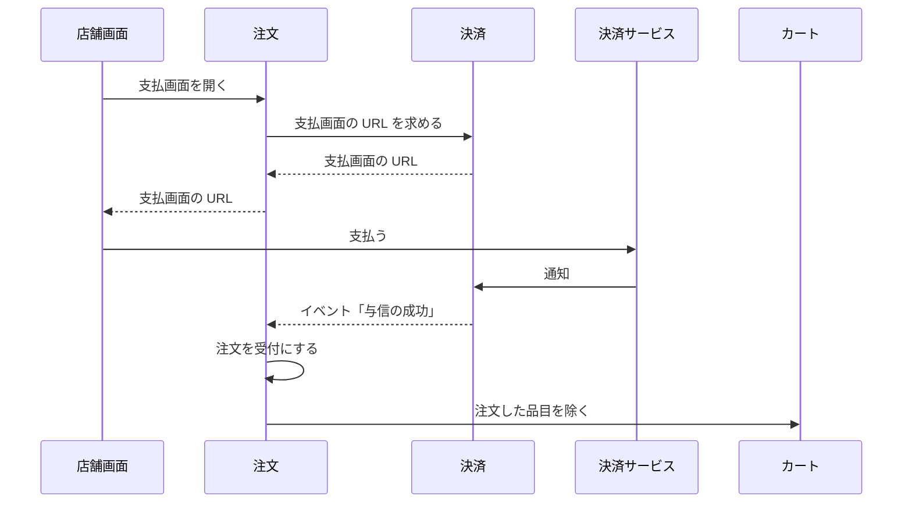
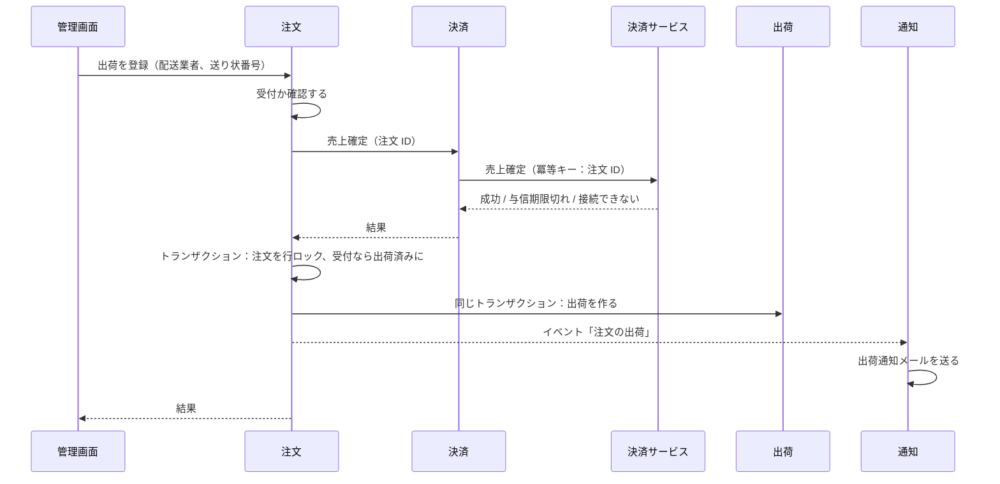

# 注文の設計

注文モジュールは、見積もり、注文手続き、注文を管理する。支払の結果による状態の変更、出荷の登録、キャンセルも扱う。業務規則は [注文モジュール](../03-機能仕様/order.md) にある。

## 境界

依存は写さず、[全体構成](overview.md) の「モジュールの依存とイベント」を指す。会員の API を使うのは presentation だけである。

### 他のモジュールへの公開

| 種類 | 内容 | 利用者 |
|------|------|--------|
| API | 見積もり（カートの表示用） | 店舗 |
| API | レポート用の注文の写し ※1 | レポート |
| イベント | 注文の出荷 | 通知（出荷通知メール） |
| イベント | 注文の状態の変化 | レポート |

※1：注文 ID で、次を返す。注文番号・会員 ID・注文日時・状態。キャンセル（日時・種類・在庫に戻したか）。お届け先の郵便番号と都道府県。注文時の年齢と性別。金額（総額・送料・消費税の合計・送料の消費税）。明細（商品・バリアント・軸の値・数量・税率・税込小計・税抜小計）。氏名・住所・電話番号・メールアドレスは返さない。送料の消費税は、送料と、注文日時の送料の税区分の税率から求める。理由：税率ごとの消費税額を、明細と送料を合わせて求めるため。出荷の情報は、レポートが出荷のイベントから受け取って持つ。

## 処理の流れ

### 注文手続きと注文の成立

業務規則は [注文モジュール](../03-機能仕様/order.md) の「注文手続き」「注文の成立」に書く。



### 支払と受付

業務規則は [注文モジュール](../03-機能仕様/order.md) の「支払」に書く。



### 出荷の登録



業務規則は [注文モジュール](../03-機能仕様/order.md) の「出荷の登録」に書く。売上確定を出荷より先にする理由は、[出荷の登録で、注文を出荷済みにする前に売上を確定する](../04-決定記録/order-capture-before-shipment.md) に書く。

## API

リクエストとレスポンスの項目、エラーコード、状態コードは OpenAPI（[店舗 API](../../api/openapi/store.yaml)、[管理 API](../../api/openapi/admin.yaml)）が正本である。

| 画面 | 操作 | メソッドとパス | operationId |
|------|------|----------------|-------------|
| 店舗 | 注文手続きに進む | `POST /carts/{cartId}/checkouts` | `startCheckout` |
| 店舗 | 注文手続きの表示 | `GET /checkouts/{checkoutId}` | `getCheckout` |
| 店舗 | 注文する | `POST /checkouts/{checkoutId}/order` | `placeOrder` |
| 店舗 | 自分の注文の一覧 | `GET /me/orders` | `listMemberOrders` |
| 店舗 | 注文の表示 | `GET /orders/{orderId}` | `getOrder` |
| 店舗 | キャンセルの申請 | `PUT /orders/{orderId}/cancellation-request` | `requestOrderCancellation` |
| 店舗 | 支払画面を開く | `POST /orders/{orderId}/payment-page` | `openOrderPaymentPage` |
| 管理 | 注文一覧 | `GET /orders` | `listOrders` |
| 管理 | 注文の詳細 | `GET /orders/{orderId}` | `getOrder` |
| 管理 | キャンセルの申請の承認 | `PUT /orders/{orderId}/cancellation-request/approve` | `approveOrderCancellation` |
| 管理 | キャンセルの申請の却下 | `PUT /orders/{orderId}/cancellation-request/reject` | `rejectOrderCancellation` |
| 管理 | 運営者の判断によるキャンセル | `PUT /orders/{orderId}/cancel` | `cancelOrder` |
| 管理 | 出荷の登録 | `POST /orders/{orderId}/shipment` | `shipOrder` |

## パッケージの構成

クラスの名前と設定の値は書かない（正本はコード）。

```
order/
├── api/                # 見積もり、レポート用の写し
├── event/              # 状態の変化、出荷
├── presentation/       # 店舗 API・管理 API の実装
├── application/        # 注文の参照、キャンセル
│   ├── checkout/       # 注文手続き、注文の成立
│   ├── payment/        # 支払の結果、支払画面
│   ├── shipment/       # 出荷の登録
│   ├── model/          # 表示の型
│   └── port/           # 一覧の検索、他モジュールの port
├── domain/             # エラーの定義
│   ├── quote/          # 見積もり、金額の内訳
│   ├── checkout/       # 注文手続き
│   └── order/          # 注文（集約）と値
└── infrastructure/
    ├── persistence/    # リポジトリ、一覧の検索
    └── directory/      # 他モジュールの腐敗防止層
```
