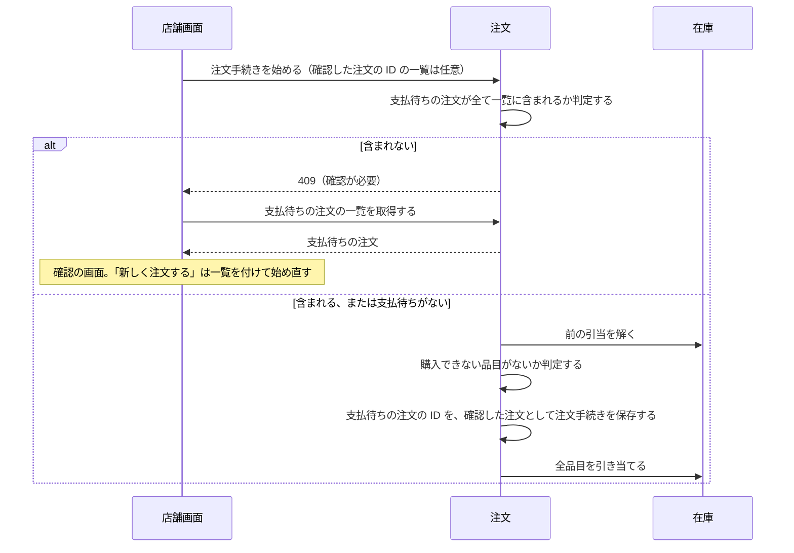
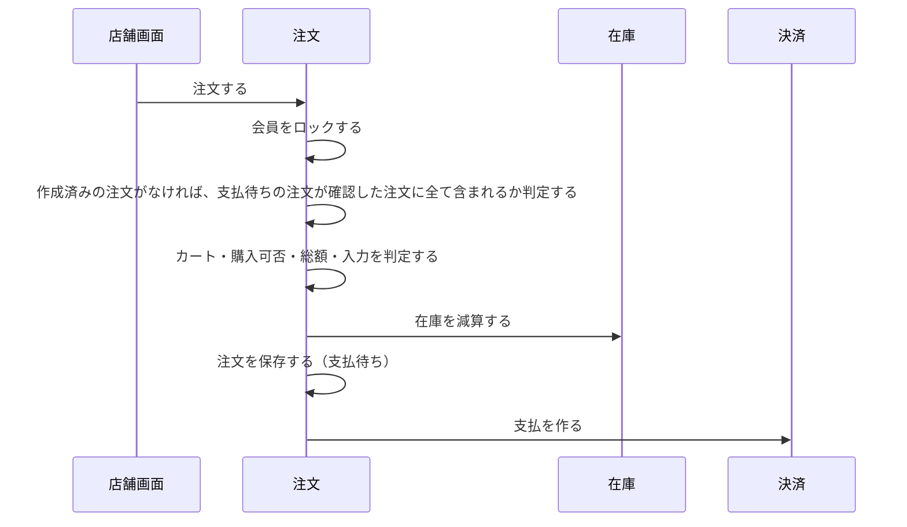
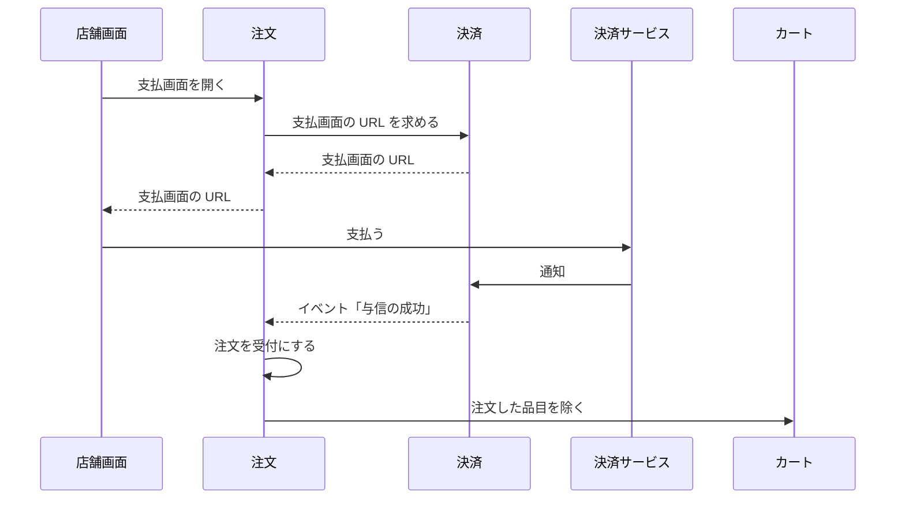
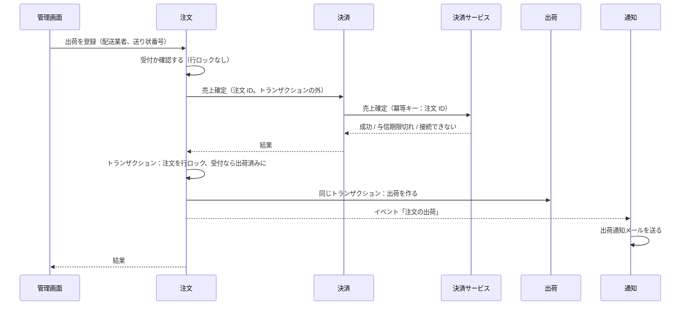

# 注文の設計

注文モジュールは、見積もり、注文手続き、注文を管理する。支払の結果による状態の変更、出荷の登録、キャンセルも扱う。業務規則は [注文モジュール](../03-機能仕様/order.md) にある。

| 項目 | 内容 |
|------|------|
| レベル | A（状態の遷移、注文時点の写し、在庫との強い一貫性） |

## 境界

依存は[全体構成](overview.md)の「モジュールの依存とイベント」。会員の API を使うのは presentation だけである。

### 他のモジュールへの公開

| 種類 | 内容 | 利用者 |
|------|------|--------|
| API | 見積もり（カートの表示用） | 店舗 |
| API | レポート用の注文の写し | レポート |
| イベント | 注文の出荷 | 通知（出荷通知メール） |
| イベント | 注文の状態の変化 | レポート |

#### レポート用の注文の写し

- 注文 ID で返す。項目は `OrderReportSnapshot`（`module/order/api/`）にある。
- 氏名・住所・電話番号・メールアドレスは返さない。
- 送料の消費税は、送料と、注文日時の送料の税区分の税率から求める。理由：税率ごとの消費税額を、明細と送料を合わせて求めるため。
- 出荷の情報は、レポートが出荷のイベントから受け取って持つ。

## 処理の流れ

### 注文手続きと注文の成立

業務規則は [注文モジュール](../03-機能仕様/order.md) の「注文手続き」「注文の成立」に書く。

#### 注文手続きを始める



開始で購入の可否を判定するときは、前の引当を解いた状態で行う。自分の前の引当で、販売可能数が足りなくなるのを防ぐため。拒否すれば、解いた引当はトランザクションのロールバックで元に戻る。

開始の時点の判定は、利用者を確認の画面へ案内するためにある。開始の時点の順序は、[注文モジュール](../03-機能仕様/order.md)の「注文手続き」。

#### 注文する



注文の時点の判定が最終の判定で、注文手続きに保存した「確認した注文」と、その時点の支払待ちの注文を比べる。

確認は誤操作を防ぐためで、不正を防ぐためではない。API を直接呼ぶ会員は、支払待ちの注文の ID を読んで送れば確認できる。

注文の時点の判定の順序は、会員のロック、注文手続きの行ロックと持ち主の確認、メールアドレスの確認、作成済みの注文の確認、支払待ちの注文の判定、以降は従来のとおり。

判定は注文手続きの application に集める。

#### 同時の注文

会員ごとのロックで、判定と注文の保存を 1 つずつ処理する。

- 注文のトランザクションの最初に、会員 ID のアドバイザリロック（PostgreSQL の、トランザクションの終わりで外れるロック）を取る。キーが衝突しても短く待つだけで、正しさに影響しない。同じトランザクションで、ロックの後に支払待ちの注文を読む。READ COMMITTED では、ロックを待った後の読み取りに先に成立した注文が見えるため、後の注文は拒否される。
- ロックの順序は、会員、注文手続きの行、引当の行、在庫の行である。引当の行と在庫の行の順序と、足りないときの扱いは、[在庫の設計](inventory.md)の「注文による引当と在庫数の変更」に従う。在庫が足りなければ、注文は例外を投げてトランザクションをロールバックする。
- 会員のロックを取るのは注文だけで、開始では取らない（開始の判定は案内のため）。

### 支払と受付

業務規則は [注文モジュール](../03-機能仕様/order.md) の「支払」に書く。



### 出荷の登録



業務規則は [注文モジュール](../03-機能仕様/order.md) の「出荷の登録」に書く。売上確定を出荷より先にする理由は、[出荷の登録で、注文を出荷済みにする前に売上を確定する](../04-決定記録/order-capture-before-shipment.md) に書く。

## API

操作の一覧は[ロールと権限の対応表](role-permissions.md)、リクエストとレスポンスの項目は OpenAPI（[店舗 API](../../api/openapi/store.yaml)、[管理 API](../../api/openapi/admin.yaml)）。

## パッケージの構成

```
order/
├── api/                # 見積もり、レポート用の写し
├── event/              # 状態の変化、出荷
├── presentation/       # 店舗 API・管理 API の実装
├── application/        # 注文の参照、キャンセル
│   ├── checkout/       # 注文手続き、注文の成立
│   ├── payment/        # 支払の結果、支払画面
│   ├── shipment/       # 出荷の登録
│   ├── model/          # 表示の型
│   └── port/           # 一覧の検索、他モジュールの port
├── domain/             # エラーの定義
│   ├── quote/          # 見積もり、金額の内訳
│   ├── checkout/       # 注文手続き
│   └── order/          # 注文（集約）と値
└── infrastructure/
    ├── persistence/    # リポジトリ、一覧の検索
    └── directory/      # 他モジュールの腐敗防止層
```
