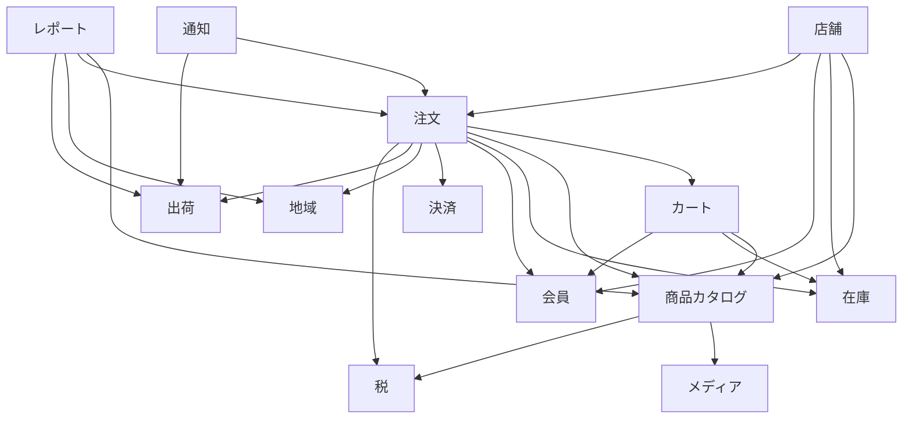
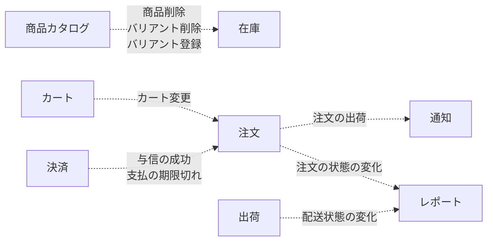
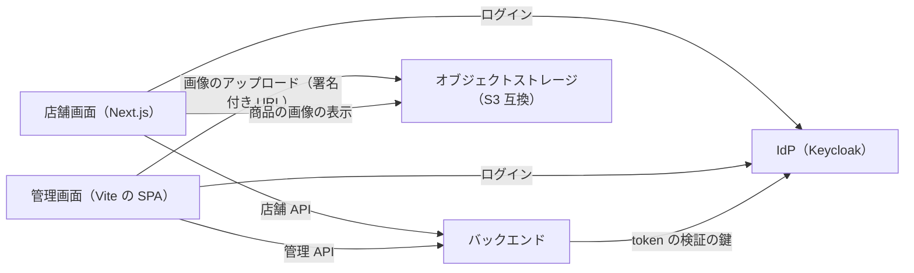
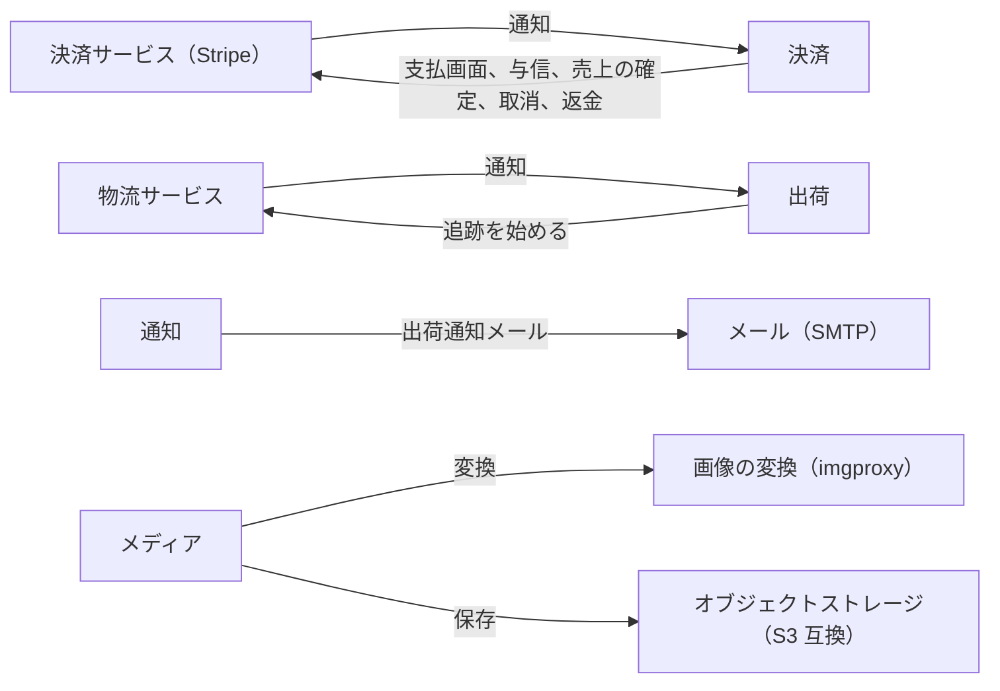

# 全体構成

システムの全体を 1 ページで示す。モジュールの依存とイベント、外部システムとの境界を載せる。詳しい設計は [バックエンドのアーキテクチャ](backend-architecture.md)、モジュールの設計（`docs/02-設計/<モジュール>.md`）、[フロントのアーキテクチャ](frontend-architecture.md) に書く。モジュールの論理名は [用語集](../03-機能仕様/glossary.md) に書く。

## モジュールの依存とイベント

図は、依存の図とイベントの図の 2 つに分ける。どちらも `ModuleDiagramTest`（`backend/ecsite/src/test/java/com/ecsite/modulith/ModuleDiagramTest.java`）がコードから作る。手動で修正しない。モジュールとイベントの名前は用語集の論理名から作り（モジュールは末尾の「モジュール」を除く）、用語集にない名前があるとテストが失敗する。

- 依存は package-info の `allowedDependencies` で宣言し、`ModulithTest` が守らせる（[バックエンドのアーキテクチャ](backend-architecture.md)の「モジュラーモノリス」）。
- モジュールの依存かイベントが変わるか、用語集のモジュールかイベントの論理名が変わると、テストが失敗する。`backend/ecsite` で `./gradlew test --tests ModuleDiagramTest -PupdateDocs` を実行すると 2 つの図を再生成するので、差分を確認して commit する。

### モジュールの依存

実線は、モジュールが相手の公開 API かイベントの型に依存することを表す（`allowedDependencies`。矢印の向きが依存の向き）。

<!-- generated:module-dependencies -->

<!-- /generated:module-dependencies -->

### モジュール間のイベント

点線は、イベントを発行するモジュールから受けるモジュールへ向かい、線の上にイベントの名前を書く。他のモジュールが受けるイベントだけを書く。リスナーのない公開イベントは図に出ない。イベントの型だけに依存するモジュールの間は、依存の図でも実線になる。

<!-- generated:module-events -->

<!-- /generated:module-events -->

## 外部システムとの境目

図は手動で書く。`ModuleDiagramTest` は図の `module_<名前>` のノードがコードのモジュールであることだけを確認し、外部システムとの線は確認しない。外部サービスと接続するモジュールを加えるとき、外部サービスを変えるときは、「モジュールと外部サービス」の図と下の表も修正する。

<!-- external-systems -->
### 画面と認証

画面、IdP、オブジェクトストレージと、バックエンドの間の線を描く。バックエンドは 1 つのノードにし、中のモジュールは描かない。

### モジュールと外部サービス

外部と接続するモジュール（決済、出荷、通知、メディア）だけを描く。

<!-- /external-systems -->

| 外部システム | 図にない補足 | 詳しい文書 |
|--------------|--------------|------------|
| IdP | モジュールは接続しない ※1 | [バックエンドのアーキテクチャ](backend-architecture.md)の「認証・認可」、[会員モジュール](../03-機能仕様/member.md) |
| 決済サービス | ローカルの既定は mock。通知は webhook | [決済の設計](payment.md)の「外部のサービス」、[バックエンドのアーキテクチャ](backend-architecture.md)の「外部連携」 |
| 物流サービス | mock だけ（本番の実装はまだない） | [出荷の設計](shipping.md)の「外部のサービス」 |
| メール | ローカルは Mailpit | [通知の設計](notification.md)の「外部のサービス」 |
| オブジェクトストレージ、画像の変換 | ストレージはローカルでは SeaweedFS | [メディアの設計](media.md)の「外部のサービス」 |

※1：画面がログインし、バックエンドは共通の設定で access token を検証するだけである。token の subject と会員 ID は、会員モジュールが対応づける。

画面は 2 つある。店舗画面は Next.js で、サーバーから API を呼ぶ。管理画面は Vite の SPA で、ブラウザーから API を呼ぶ。構成は [フロントのアーキテクチャ](frontend-architecture.md) に書く。
