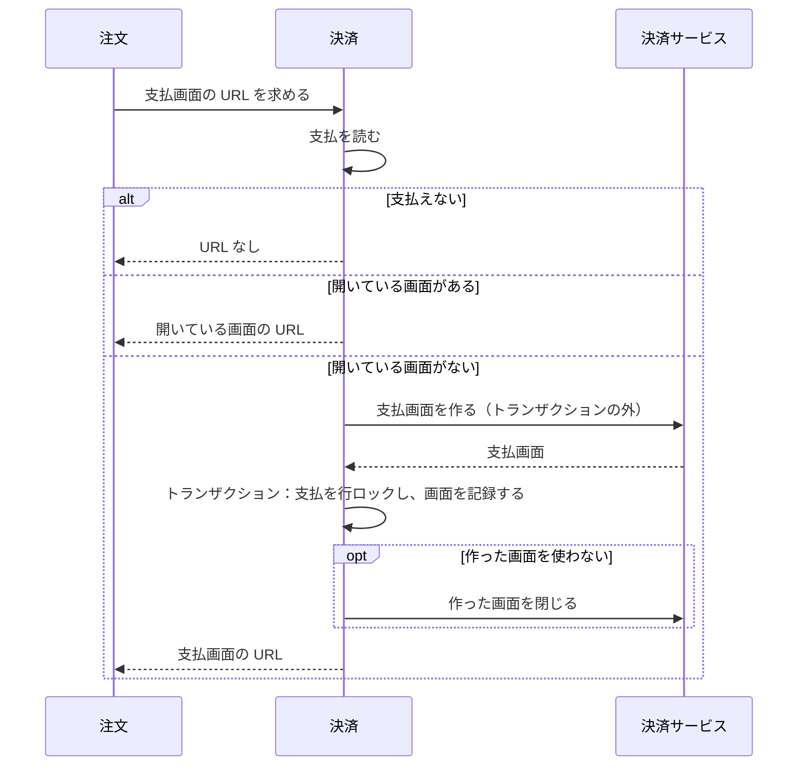
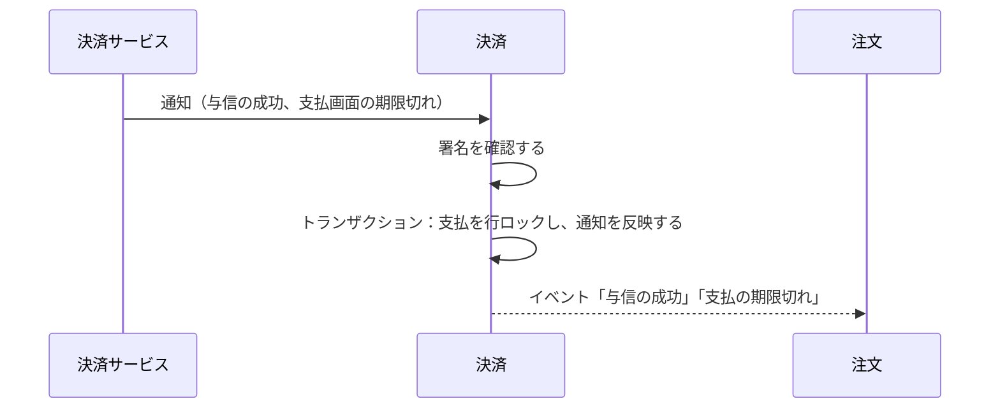
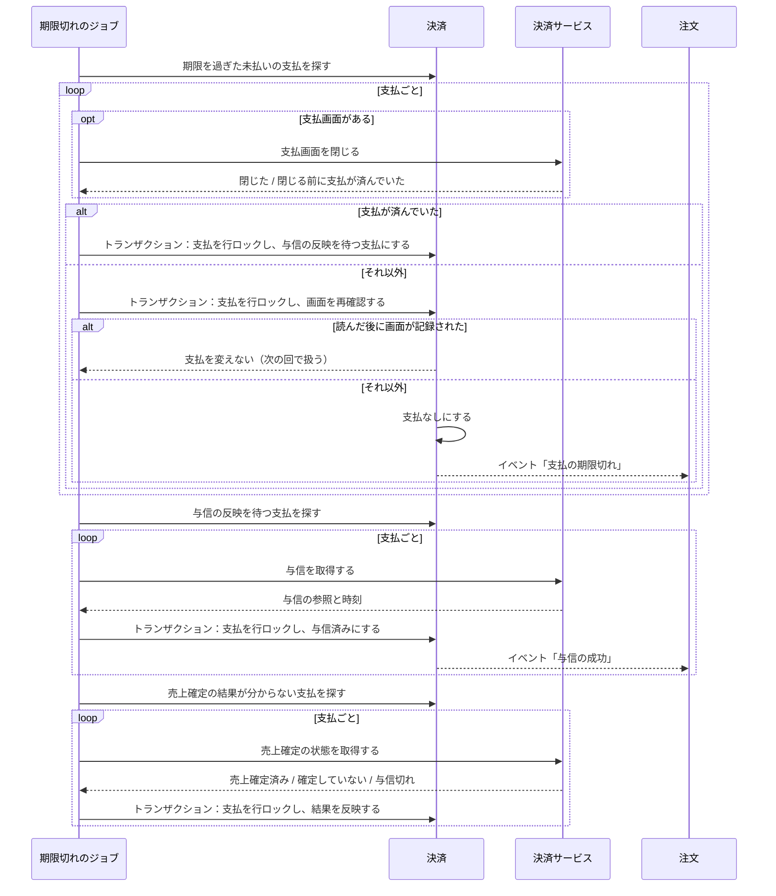
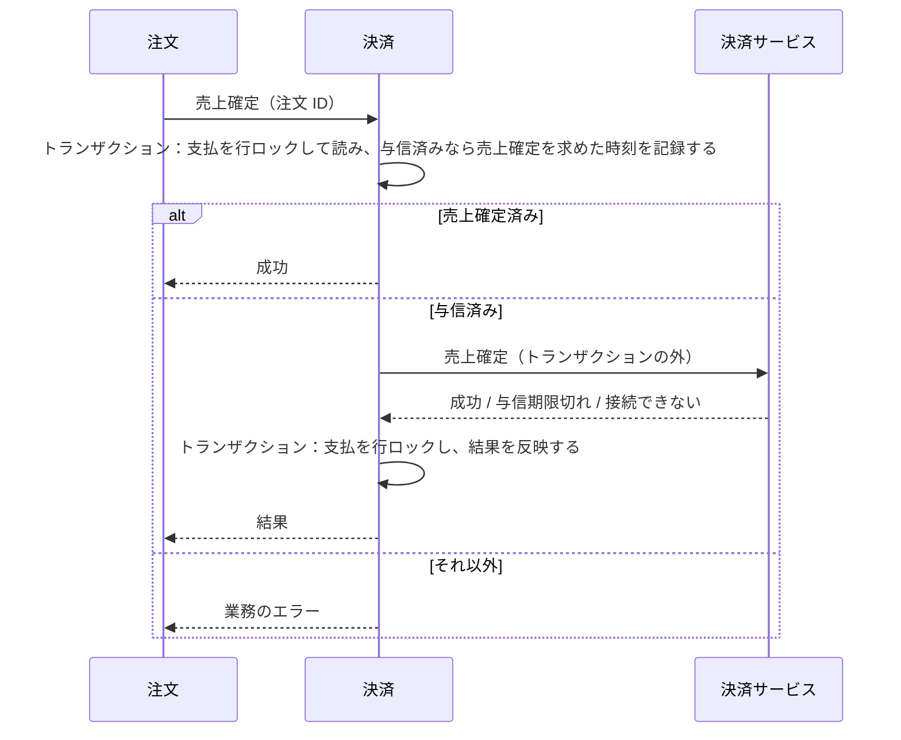
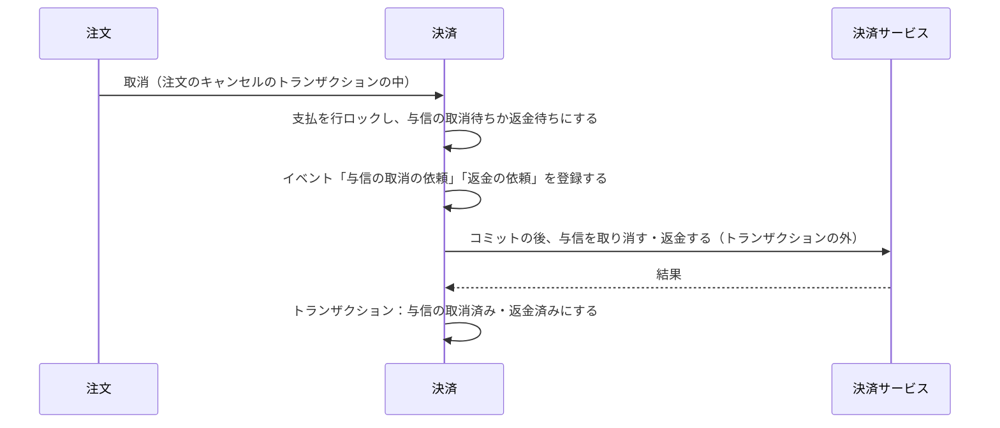

# 決済の設計

決済モジュールは、注文の代金の支払（カードの与信、売上確定、返金）を管理し、外部の決済サービス（Stripe）との連携を受け持つ。業務規則は [決済モジュール](../03-機能仕様/payment.md) にある。

| 項目 | 内容 |
|------|------|
| レベル | A（支払の状態遷移、外部からの通知の重複と順序の入れ替わり、期限切れとの競合） |

## 境界

依存は[全体構成](overview.md)の「モジュールの依存とイベント」。決済は注文のイベントを受けない。受けると、モジュールが循環するため。

### 他のモジュールへの公開

| 種類 | 内容 | 利用者 |
|------|------|--------|
| API | 支払を作る | 注文 |
| API | 支払画面の URL を得る | 注文 |
| API | 取消 | 注文 |
| API | 売上確定 | 注文 |
| API | 支払の状態（注文 ID でまとめて） | 注文 |
| API | 与信期限と「期限が近い」（注文 ID でまとめて） | 注文 |
| API | 期限が近い注文 ID の一覧 | 注文 |
| API | 支払える注文 ID（注文 ID でまとめて） | 注文 |
| API | 支払 1 回の金額の範囲 | 注文 |
| イベント | 与信の成功 | 注文 |
| イベント | 支払の期限切れ | 注文 |

イベント「与信の取消の依頼」と「返金の依頼」は、モジュールの中だけで使い、他のモジュールへは公開しない。

### 外部のサービス

| 役割 | 実装 | 設定 |
|------|------|------|
| 決済サービス | Stripe（`stripe-java`）。ローカル・E2E・統合テストは mock。選び方は下の「実装の選択」 | Stripe は `ecsite.payment.stripe`、mock は `ecsite.payment.mock` |

Stripe の API のバージョンは、`stripe-java` のものに固定される。ライブラリのバージョンを上げると変わる。

#### port

次の 7 つの操作を持つ：支払画面を作る・支払画面を閉じる・与信を取得する・与信を取り消す・売上を確定する・売上確定の状態を取得する・返金する。次の 3 つの操作は、結果を決済サービスの応答から変換する。

| 操作 | 変換先 |
|------|--------|
| 売上確定 | 成功・与信期限切れ・接続できない |
| 売上確定の状態の取得 | 売上確定済み・売上を確定していない・与信が切れた |
| 与信の取消 | 取り消した・売上確定済み |

- 売上確定の状態の取得は、読むだけで、売上を確定しない。上の 3 つのどれでもない状態は、例外（システムのエラー）にする。
- 決済サービスの型とエラーは `infrastructure` の外に出さない。
- 外部のサービスの失敗の分け方は、[バックエンドのアーキテクチャ](backend-architecture.md)の「外部連携」の表に従う。操作ごとの失敗の扱いは、[決済モジュール](../03-機能仕様/payment.md)の「決済サービスとの通信」に書く。

| 項目 | 内容 |
|------|------|
| 実装の選択 | mock フラグ（`ecsite.payment.mock.enabled`）が有効なら mock、そうでなければ Stripe を使う。フラグが有効でなく、Stripe の鍵が不足していれば、起動に失敗する ※1 |
| 支払画面から戻る先 | 店舗の注文の画面。URL は設定（`ecsite.payment.return-url`）の雛形に注文 ID を入れて作る。リクエストから受け取らない ※2 |

※1：設定を忘れたまま、mock で注文を受けないため。mock フラグは、ローカル・E2E・統合テストの設定ファイルだけに書く。

※2：戻る先をリクエストから受け取ると、任意のサイトへ移す踏み台（オープンリダイレクト）にされるため。

#### mock

- 決済の mock フラグを立てたときだけ動く。フラグがなければ、mock の支払画面のパスは 401 で拒む（[バックエンドのアーキテクチャ](backend-architecture.md)の「業務のコードとの境界」）。
- バックエンドが `/mock-payment/{支払画面の ID}` に簡易な HTML を返す。「支払う」「カードを拒否させる」「やめる」の操作を持つ。応答の規則は [API の規約](../05-開発規則/api-conventions.md)の「OpenAPI の外のエンドポイント」にある。
- 「支払う」は与信の成功の通知を、HTTP を通さずに通知の処理に直接渡してから、店舗の注文の画面に戻す。「カードを拒否させる」は画面に拒否を示し、状態を変えない。
- 本番の mock は、port と支払画面の操作（支払う、支払を済ませる、与信の成功を通知する、画面と与信の参照を読む）だけを持つ。売上を確定した与信の取消は、Stripe を呼ぶ実装と同じく、結果「売上確定済み」を返す。
- 本番の mock の売上確定の状態は、売上を確定した与信なら売上確定済み、それ以外は売上を確定していない、を返す。与信が切れた、は返さない。
- テストのコードは、mock をラップするテスト用の実装（テストで共有するソース `src/testFixtures` に置き、本番の jar に入らない）を使う。この実装は、次を発生させられる。
  - 与信の成功
  - 通知の遅れ・重複・順序の入れ替わり
  - 閉じる前に支払が済んでいたこと
  - 取消の失敗・売上確定の接続の失敗・与信の取得の失敗・返金の失敗
  - 売上確定の状態の取得の失敗
  - 売上確定の与信期限切れ
  - 売上確定の最中の処理（注文のキャンセルなど）
  - 売上確定の状態の取得の最中の処理（売上確定の再実行など）
  - 売上確定は成功するが、その応答が届かないこと（回数を指定）

  テストでは、売上確定・返金・取消の記録を確認する。統合テストでは、このテスト用の実装を決済サービスとして使う。

#### Stripe

| 項目 | 内容 |
|------|------|
| 支払画面 | Checkout Session（`mode=payment`、`capture_method=manual`、通貨 JPY、金額は総額の 1 行）。支払画面 ID は Session の ID |
| 画面の期限 | 作ってから 31 分（Stripe の最短の 30 分に、時計のずれの余裕を加える） |
| タイムアウトと再試行 | 上限は[環境変数](../06-手順書/environment.md)の「バックエンド」。通信の失敗は、`stripe-java` が 2 回まで再試行する。冪等キーは `stripe-java` が呼び出しごとに作り、その呼び出しの再試行には同じキーを付ける |
| 支払の方法 | Session では指定しない。ダッシュボードの設定で、カードだけを有効にする ※3 |
| 通知のエンドポイント | `POST /api/webhooks/stripe`。認証は付けず、署名で確認する。署名が合わない・古い通知は 400 で拒否する ※4 |
| 秘密の値 | `STRIPE_SECRET_KEY`、`STRIPE_WEBHOOK_SECRET`（[環境変数](../06-手順書/environment.md)） |

※3：Session では支払の方法を指定できない（Stripe の API が受け付けない）。カードで払うウォレット（Apple Pay、Google Pay、Link）は有効にしない。

※4：署名は、ヘッダー `Stripe-Signature` と鍵 `STRIPE_WEBHOOK_SECRET` で確認する。応答の規則は [API の規約](../05-開発規則/api-conventions.md)の「OpenAPI の外のエンドポイント」にある。

通知の種類と、支払への反映：

| 通知の種類 | 中身 | 反映 |
|------------|------|------|
| `checkout.session.completed` | Session の `status` は `complete`、`payment_status` は `unpaid`（与信だけで売上はまだ）。`payment_intent` が与信の ID | 与信の成功。与信の参照は `payment_intent` |
| `checkout.session.expired` | 期限切れ、または画面を閉じた Session | 支払画面の期限切れ |
| その他 | `payment_intent.*`、`charge.*` など | 受け付けて（200）、何もしない |

- 消費者が支払画面を離れても、通知は送られない。Session は期限まで開いたまま。カードの拒否は画面に表示されるだけで、Session の通知は送られない。
- 支払画面を閉じる（Session を期限切れにする）とき、`open` でない Session は Stripe が拒否する。拒否されたら Session を読み、`complete` なら「支払が済んでいた」、`expired` なら「閉じた」とする。
- 与信を取得するときは、PaymentIntent を含めて Session を読む。与信の参照は PaymentIntent の ID、与信の時刻は PaymentIntent の作成時刻にする。Session が `complete` でないか、PaymentIntent がないときは失敗にする。PaymentIntent の状態によって扱いを変えない。
- 与信を取り消す（PaymentIntent の取消）とき、取消済みと売上確定済みは Stripe が拒否する（`payment_intent_unexpected_state`）。拒否されたら PaymentIntent を読み、`canceled` なら成功、`succeeded` なら結果「売上確定済み」とする。
- 売上確定の状態を取得するときは、PaymentIntent を読む。`succeeded` なら売上確定済み、`requires_capture` なら売上を確定していない、`canceled` なら与信が切れた、とする。それ以外は失敗にする。

売上確定と返金の応答：

| 操作 | 呼ぶもの | 応答と結果 |
|------|----------|------------|
| 売上確定 | PaymentIntent の capture（総額。冪等キーは明示しない） | 成功なら PaymentIntent は `succeeded` |
| 売上確定済みの PaymentIntent の売上確定 | 同上 | 400 `payment_intent_unexpected_state`。PaymentIntent を読み、`succeeded` なら成功とする |
| 与信が切れた PaymentIntent の売上確定 | 同上 | 400 `payment_intent_unexpected_state`。PaymentIntent を読み、`canceled` なら与信期限切れとする ※5 |
| 返金 | Refund（PaymentIntent の総額。冪等キーは明示しない） | 成功なら Refund は `succeeded` |
| 返金済みの PaymentIntent の返金 | 同上 | 400 `charge_already_refunded`。成功とする |

※5：与信が切れると、Stripe が PaymentIntent を取り消す（`canceled`）。

- 売上確定と返金で冪等キーを明示しない理由：Stripe は、同じ冪等キーのリクエストに最初の応答（障害の応答を含む）を 24 時間返す。キーを注文ごとに固定すると、1 回目が Stripe の障害で終わったとき、その間は再実行しても同じ障害の応答が返るため。再実行での二重の売上確定と返金は、上の表の 400 で防ぐ。

## 処理の流れ

### 支払画面を開く

注文が決済の API を呼ぶ。業務規則は [決済モジュール](../03-機能仕様/payment.md) の「支払（集約）」に書く。注文での流れは [注文の設計](order.md) の「支払と受付」。



### 決済サービスからの通知

業務規則は [決済モジュール](../03-機能仕様/payment.md) の「決済サービスからの通知」に書く。



### 支払の期限切れ

期限切れのジョブは、支払画面を閉じて支払を更新する処理、与信の反映を待つ支払の与信を取得して与信済みにする処理、売上確定の結果が分からない支払を照合する処理を、この順に行う。業務規則は [決済モジュール](../03-機能仕様/payment.md) の「支払の期限」と「売上確定の照合」に書く。



| 項目 | 内容 |
|------|------|
| 設定 | 支払の期限とその上限、ジョブの間隔、警告までの時間、照合を始めるまでの時間は[環境変数](../06-手順書/environment.md)の「バックエンド」。上限の理由は `PaymentProperties` のコメント |
| 行ロック | 決済サービスを呼ぶ間、行ロックを持たない |
| 画面の再確認 | 読んだ後に画面が記録された支払は、支払を変えず、info のログに支払 ID を出力する ※6 |
| 1 回の件数 | 画面を閉じる処理、与信の取得、照合は、同じ上限（`PaymentExpiryJob`）まで ※7 |
| 検索の並び順 | 画面を閉じる処理は期限・支払 ID の順、与信の取得は待ち始めた時刻・支払 ID の順、照合は売上確定を求めた時刻・支払 ID の順 ※8 |
| 1 件の失敗 | 例外（種類を問わない）が起きたら、warn のログに支払 ID を出力して次の支払へ進み、次の回で再試行する |
| 打ち切り（与信の取得と照合） | 決済サービスへの接続の失敗が `PaymentExpiryJob` に定めた回数まで続いたら、warn のログに出力して、その回の処理を打ち切る。回数は 2 つの処理で別に数える ※9 |
| 与信の取得のログ | ジョブが与信を取得して与信済みにしたら、warn のログに支払 ID を出力する |
| 照合のログ | 照合で売上確定済みにしたら warn、注文がキャンセルされていて返金待ちにしたら別の warn、求めた時刻を削除したら info のログに、支払 ID を出力する |
| 与信の反映を待つ支払の警告 | 設定の時間を過ぎて与信の反映を待つ未払いの支払が 1 件以上あれば、ジョブの最後に毎回、件数を warn のログに出力する |

※6：次の回のジョブが、その画面を読んで閉じられるため（支払画面は一度記録したら変わらず、期限を過ぎた支払には記録しない）。画面が開いたままの時間は、ジョブの間隔だけ長くなる。業務規則は [決済モジュール](../03-機能仕様/payment.md) の「支払の期限」。

※7：取得に失敗し続ける支払が上限以上あると、新しく与信の反映を待ち始めた支払を処理できない。照合も同じで、状態を取得できない支払（決済サービスにない与信など）が上限以上あると、新しい照合の対象を処理できない。

※8：支払 ID は、期限（待ち始めた時刻、売上確定を求めた時刻）が同じ支払の順を決めるため。

※9：連続した回数に数えるのは接続の失敗だけにする。他の失敗と成功では、この回数を 0 に戻す。

### 売上確定

注文が出荷の登録の中で呼ぶ。業務規則は [決済モジュール](../03-機能仕様/payment.md) の「売上確定」に書く。注文での流れは [注文の設計](order.md) の「出荷の登録」。



- 売上確定を求めた時刻の記録の目的と、照合の規則は、[決済モジュール](../03-機能仕様/payment.md)の「売上確定の照合」。
- 冪等キーは「Stripe」の表。与信期限と「期限が近い」の長さの設定は[環境変数](../06-手順書/environment.md)の「バックエンド」。

### 注文のキャンセルと、与信の取消・返金

注文が、キャンセルのトランザクションの中で取消を呼ぶ。業務規則は [決済モジュール](../03-機能仕様/payment.md) の「与信の取消」と「返金」に書く。



- リスナーはトランザクションを持たず、コミットの後に決済サービスを呼ぶ。理由：決済サービスが応答しないときも、注文のキャンセルと在庫の戻しを止めないため。
- 失敗したら例外で終わり、未完了のイベントの再発行（[バックエンドのアーキテクチャ](backend-architecture.md)の「水平スケール」）で再試行する。
- 売上を確定した与信の取消は、結果「売上確定済み」を返す。リスナーは売上確定を反映する処理を呼び、返金待ちにしてイベント「返金の依頼」を登録する。

## API

なし。決済は、注文から API で呼ばれるだけで、店舗 API・管理 API の operation を持たない。決済サービスが呼ぶ通知のエンドポイント（`POST /api/webhooks/stripe`）と、mock の支払画面（`/mock-payment/{支払画面の ID}`）は、EC の API ではないので OpenAPI に書かない。

## パッケージの構成

通知のエンドポイントと mock の支払画面は、`presentation` でなく `infrastructure` に置く（[バックエンドの書き方](../05-開発規則/backend-coding.md)）。

```
payment/
├── api/                    # 注文への公開
│   └── model/              # API の引数と戻り値の型
├── event/                  # 与信の成功、支払の期限切れ
├── application/            # 支払の処理、ハンドラー
│   ├── model/view/         # 表示の型
│   ├── port/               # 決済サービス、通知の受信、参照
│   └── job/                # 支払の期限切れのジョブ
├── domain/                 # エラーの定義
│   └── payment/        # 支払（集約）、状態、依頼
│       └── port/       # 支払のリポジトリ
└── infrastructure/
    ├── persistence/        # リポジトリの実装
    ├── mock/               # mock の決済サービスと支払画面
    └── stripe/             # Stripe の連携、通知のエンドポイント
```
