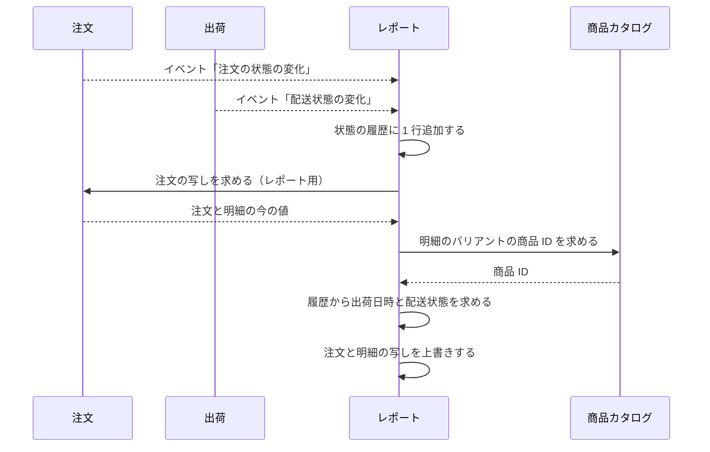
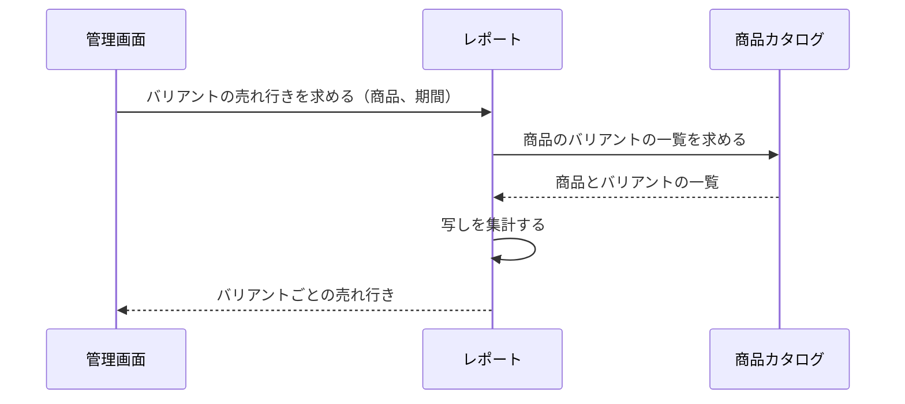
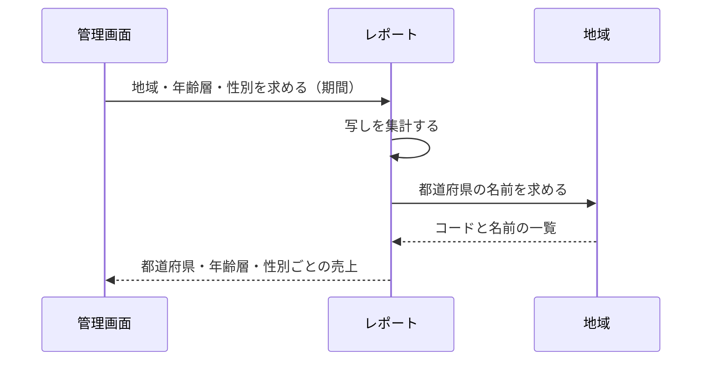

# レポートの設計

レポートモジュールは、注文と出荷のデータを写しとして持ち、運営者に売上のレポート（売上の推移、バリアントの売れ行き、地域・年齢層・性別）を返す。業務規則は [レポートモジュール](../03-機能仕様/reporting.md) にある。

| 項目 | 内容 |
|------|------|
| レベル | B（集約の不変条件がなく、写しと集計だけ。理由は ※1） |

※1：業務の状態を変える操作がなく、持つのは他のモジュールの写しと、受けたイベントの履歴だけ。写しは、イベントを受けるたびに注文の API から再読み込みして上書きするので、守る不変条件がない。集計は問い合わせのときに SQL で行い、結果を持たないので、CQRS の read model も必要ない。

## 境界

依存は[全体構成](overview.md)の「モジュールの依存とイベント」。他のモジュールはレポートに依存しない。

### 他のモジュールへの公開

なし（管理 API だけ）。

## 処理の流れ

### 写しの集め方

注文と出荷のイベントを受けて、写しを更新する。規則（受け取り方、冪等、失敗したときの再試行、ロック）は [レポートモジュール](../03-機能仕様/reporting.md) の「写しの更新」に書く。



### バリアントの売れ行き

規則は [レポートモジュール](../03-機能仕様/reporting.md) の「バリアントの売れ行き」に書く。



### 地域・年齢層・性別

規則は [レポートモジュール](../03-機能仕様/reporting.md) の「都道府県のコード」と「地域・年齢層・性別」に書く。



## API

操作の一覧は[ロールと権限の対応表](role-permissions.md)、リクエストとレスポンスの項目は OpenAPI（[店舗 API](../../api/openapi/store.yaml)、[管理 API](../../api/openapi/admin.yaml)）。

レポートの API は管理 API だけにある。

## パッケージの構成

```
reporting/
├── application/        # イベントの受信、写しの更新、3 つのレポートの集計、設定
│   ├── model/          # 問い合わせの条件、結果の型
│   └── port/           # 写しの保存、集計、他モジュールの port
├── domain/             # エラーの定義。集約はなく、用途で分ける
│   ├── snapshot/       # 注文の写し、状態の履歴
│   └── sales/          # 期間と区切り、売上の集計の値
├── infrastructure/
│   ├── persistence/    # 写しの保存、集計の SQL
│   └── directory/      # 他モジュールの腐敗防止層
└── presentation/       # 管理 API の実装
```
