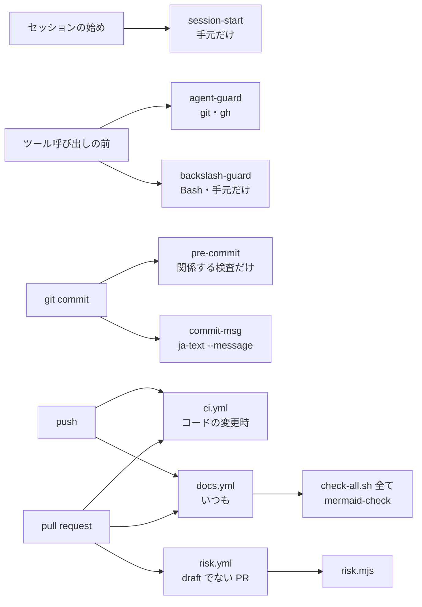

# scripts の設計

`scripts/` の下の検査と開発のツールについて、フォルダの役割と設計の判断、いつ何が動くかを書く。全体の構成を知りたいときに読む（個々の script の細部は、各 script の冒頭のコメント）。

| 知りたいこと | 文書 |
|--------------|------|
| 検査ごとの目的と、失敗したときの読み方 | [CI の検査の script](../06-手順書/ci-checks.md) |
| 検査を加える手順と、検査の script の約束（要約の行、終了コード、先頭のコメント） | [CI の検査の追加](../06-手順書/ci-adding-checks.md) |
| CI のジョブの一覧と、手元で同じ検査を実行するコマンド | [CI の検査](../06-手順書/ci.md) |
| git の hook の置き方 | [開発環境の起動](../06-手順書/setup.md)の「起動」 |
| Claude Code の手元の hook の設定 | skill `local-dev` の[手元の hook の設定](../../.claude/skills/local-dev/hooks.md) |

## フォルダと役割

`scripts/` の下は、次の 3 つに分かれる。

| フォルダ | 役割 |
|----------|------|
| `scripts/ci/` | CI と commit の前の hook が実行する検査と、CI の報告の補助。CI でも手元でも同じものを実行する |
| `scripts/dev/` | 手元の開発のツールと hook。CI では実行しない |
| `scripts/shared/` | `scripts/ci/`・`scripts/dev/`・`e2e/` のうち 2 つ以上が使うモジュール。CI でも実行する |

`scripts/ci/` の中は、次のとおり。

| 場所 | 置くもの |
|------|----------|
| `check-all.sh` | 検査を全てまとめて実行する入口 |
| `docs/`・`spec/`・`ja/`・`java/`・`config/`・`frontend/` | 引数なしで実行できる検査。フォルダは検査の対象で分ける。直下の検査は `check-all.sh` が全て実行する |
| `backend/`・`licenses/`・`mermaid/`・`report/`・`review/` | `check-all.sh` が実行しない補助（理由は[CI の検査の追加](../06-手順書/ci-adding-checks.md)の「補助の script の置き場所」） |
| `lib/` | 複数の検査が使うモジュール。用途で分ける（次の表） |

| 場所 | 用途 |
|------|------|
| `lib/docs/` | 参照の先の文書の決め方、検査の対象の文書の一覧（機能仕様、日本語の文書）、検査が読む画面のソースの定義（`screen-sources.mjs`） |
| `lib/git/` | git の分岐点と、shallow clone の確認 |
| `lib/source/` | ソースの中のコメントと行番号の読み取りと、読めない行の失敗の文 |
| `lib/output/` | 除外の一覧の読み方 |
| `lib/ac/` | `ac-check` だけが使う、AC 一覧の読み書きと照合 |
| `lib/frontend/` | `frontend-rules` だけが使う、ファイルの振り分けと規則のモジュール |

`scripts/dev/` の中は、次のとおり。

| 場所 | 置くもの |
|------|----------|
| 直下 | 人やエージェントが直接呼ぶ入口（スロット、データの再作成、画面と E2E の確認、Dependabot の pull request のマージの補助など）と、入口の shell が呼ぶ script（E2E が実行中かの確認）。スロットは、作業ツリーごとの手元の環境 |
| `hooks/` | git の hook（入口の `pre-commit`・`commit-msg` と処理の `.mjs`）と Claude Code の hook（`agent-guard.mjs` と規則のモジュール `agent-guard/`、`backslash-guard.mjs`、`session-start.mjs`） |
| `lib/` | ポートを使うプロセスの停止、Git Bash の場所など、入口が共有するモジュール。`lib/slot/` はスロットのポートの確認と停止 |
| `tools/` | 手動で使うツール（壊しての確認、commit のメッセージの書き換え、機能紹介のページの数字） |
| `windows/` | Windows だけのツール（ポートの予約から外す） |

`scripts/shared/` の中は、次のとおり。

| 場所 | 置くもの |
|------|----------|
| 直下 | 検査の結果の判定（`check-result.mjs`）、危険度の判定の規則と経路の一覧（`risk-rules.mjs`・`risk.json`）、子のプロセスの停止（`child-stop.mjs`）、E2E のロック（`lock.mjs`） |
| `git/` | git の環境変数の外し方、追加行の差分、対象のファイルの一覧 |
| `source/` | ソースの走査（コメント・文字列・正規表現の読み分けは `scan-code.mjs` の 1 か所に置く）、1 行のコードと括弧の対応、コメントの除去、テストのファイルと名前の読み取り |
| `docs/` | 文書の見出しとコードブロックの読み取り、spec のフォルダの一覧、spec の AC の定義の読み取り |
| `slot/` | スロットの値と環境変数の名前、ローカルのポートの一覧 `ports.json` |

- フォルダの中は、本体とそのテスト・json を 1 組として、10 組を目安にし、15 組を超えたら用途で分ける。役割が他と分かれないかぎり、1 組だけのフォルダは作らない。
- テストだけが使う補助（テストのファイルではないもの）は、1 つのフォルダとその下のテストだけが使うなら、そのフォルダの `support/` に置く（組の数に数えない）。2 つ以上のフォルダ（`scripts/ci/`・`scripts/dev/`・`e2e/`）のテストが使うなら、`scripts/shared/` に置く。
- `scripts/` の外の script（skill の `.cjs`）は本書の対象にしない。ただし、そのテストは `check-all.sh` が実行する。

## 設計の判断

| 判断 | 内容 |
|------|------|
| 既製のツールに任せる | 既製のツールで書ける規則はツールに任せ、script には残りだけを置く ※1 |
| 検査の入口は 1 つ | 手元・commit の前の hook・CI（`docs.yml`）が、同じ `check-all.sh` を使う。検査を加えても、入口と CI を直さない ※2 |
| git の hook は薄い入口 | `.git/hooks/` に 1 行を書く形で置き、`core.hooksPath` は使わない。shell の入口は `*-main.mjs` を呼ぶだけで、処理は `pre-commit.mjs`・`commit-msg.mjs` に置く ※3 |
| commit の前は関係する検査だけ | ステージしたファイルに関係する検査とテストだけを実行する。CI は全てを実行する ※4 |
| Claude Code の hook は 2 か所に分ける | チーム全員に適用する hook は `.claude/settings.json`、各自の手元の環境の hook は `.claude/settings.local.json` に書く ※5 |
| ワークフローは実行する時点で分ける | `ci.yml`・`docs.yml`・`risk.yml` に分ける ※6 |
| 共通のモジュールは 1 か所 | ソースの走査（`scan-code`）、読めない行のエラーメッセージ（`unreadable-line`）、除外の一覧の読み方（`exclusions`）、Git のファイルの一覧（`git-files`）を、検査ごとに書かない。検査だけが使うものは `scripts/ci/lib/`、2 つ以上のフォルダが使うものは `scripts/shared/` に置く ※7 |
| 依存の向き | `scripts/ci/` と `scripts/dev/` は互いに import しない。`scripts/shared/` は `scripts/ci/` と `scripts/dev/` を import しない。`e2e/` は、`scripts/` の下では `scripts/shared/` だけを import する。テストのファイルも同じ ※8 |

※1：自前の構文の読み取りは、誤検出と保守の費用が大きいため。

| ツール | 任せた規則 |
|--------|------------|
| ArchUnit | テストの名前、本番のクラスの読み込みの場所、テストで時間で待つ書き方など、クラスファイルで読める Java の規則 |
| Checkstyle | Lombok と Nullable の import |
| Biome（GritQL の plugin と noRestrictedImports） | フロントの単純な規則、機能の間の import、画面の文言と入力の制約、テストで時間で待つ書き方 |
| 各ツールの閾値 | カバレッジと mutation score の基準（[テストの実行方法](../06-手順書/running-tests.md)の「カバレッジと mutation score の基準の検査」） |
| js-yaml・smol-toml、spring-boot-configuration-processor | YAML・TOML の読み取りと、設定の既定値の一覧 |

script に残るのは、2 種類の規則である。1 つは、複数のファイルを比べる規則（文書とコードの照合、ポートの一覧、権限の対応表）。もう 1 つは、ツールが対象にしないもの（クラスファイルに残らない注釈、文書）を読む規則。例えば `java-rules` は、クラスファイルに残らない引数の式と注釈を読むので、ArchUnit で書けない。`frontend-rules` は、複数のファイルを比べる規則と、変数のスコープを追う規則を持つので、Biome の plugin で書けない。

※2：検査のフォルダの直下に置けば、`check-all.sh` が実行する。何も調べずに終わった検査を通さないため、`check-all.sh` は、終了コードが 0 でも最後の行が要約の行でなければ失敗にする。

※3：shell の入口が薄いのは、テストで処理を呼べるようにするため。`core.hooksPath` を使わないのは、各自が置いた他の hook と並べられるようにするため。

※4：全てを実行すると commit が遅いため。選び漏れは CI で見つかる。選び方は[CI の検査の script](../06-手順書/ci-checks.md)の「commit の前の hook」。検査はステージした内容を一時ディレクトリに取り出して実行し、作業ツリーを変えない。stash で退避すると、一部だけをステージしたファイルを戻すときに衝突するため（`scripts/dev/hooks/pre-commit.mjs` の冒頭のコメント）。

※5：`.claude/settings.json` には `agent-guard.mjs`（git・gh のコマンドを実行の前に判定する）を、`.claude/settings.local.json` には `session-start.mjs` と `backslash-guard.mjs` を置く。script が見つからないとき、`settings.json` の hook はコマンドを拒否し、`settings.local.json` の hook は拒否せずに通す。働きと書き先の決め方は[手元の hook の設定](../../.claude/skills/local-dev/hooks.md)。

※6：`docs.yml` は、文書だけを変えた push でも実行する。文書だけの変更でも参照や対応表が崩れるため、文書だけの push で実行しない `ci.yml` と分けた。`risk.yml` は、pull request の本文を書き換えたときにも実行する。そのたびに `ci.yml` の全体を実行しないため、分けた。ジョブの一覧と実行する時は[CI の検査](../06-手順書/ci.md)の「CI のジョブ」。

※7：`unreadable-line` は、検査が知らない書き方の行を失敗にする。読み飛ばすと検査が誤って通るため。

※8：CI の対象（`ci.yml` の paths は `scripts/dev/` を除く）と、手元だけのツールを、フォルダで分けるため。`scripts/dev/` のモジュールを CI が使うと、paths に例外の行が必要になる。検査は `scripts/ci/config/script-deps.mjs`。

## いつ何が動くか

表の「動く script」の列では、`scripts/` の下のパスの `scripts/` を省く。

| 時点 | 起動するもの | 動く script |
|------|--------------|-------------|
| セッションの始め・再開、文脈の圧縮の後 | Claude Code の SessionStart の hook（手元） | `dev/hooks/session-start.mjs` |
| Claude Code が git・gh を実行する前 | PreToolUse の hook（`settings.json`） | `dev/hooks/agent-guard.mjs` |
| Claude Code が Bash を実行する前 | PreToolUse の hook（手元） | `dev/hooks/backslash-guard.mjs` |
| git commit（メッセージの前） | git の pre-commit | `dev/hooks/pre-commit` → `pre-commit.mjs` → 選んだ検査とテスト（`ci/check-all.sh`） |
| git commit（メッセージを書いた後） | git の commit-msg | `dev/hooks/commit-msg` → `ci/ja/ja-text.mjs --message` |
| push（コードを含む）、pull request | `ci.yml` | バックエンドのビルドのジョブで `ci/backend/config-defaults.mjs`。バックエンド・PIT・管理画面・店舗画面のジョブで `ci/report/coverage-summary.mjs`。店舗画面のジョブで `ci/licenses/check-frontend.mjs`。E2E のジョブで `e2e/scripts/run.ts`（`shared/` を使う） |
| 全ての push、pull request | `docs.yml` | `ci/check-all.sh`（全て。差分の文体の注釈 `ja-text --changed` を含む）、`ci/mermaid/mermaid-check.mjs` |
| `develop` への draft でない pull request（本文の書き換えを含む） | `risk.yml` | `ci/config/risk.mjs` |
| 手動 | 人・エージェント | `dev/` の直下の入口と `dev/tools/`、`ci/review/test-diff.mjs`、個々の検査 |

`main-source.yml` と `pages.yml` は `scripts/` の script を使わないので、表に入れない。
