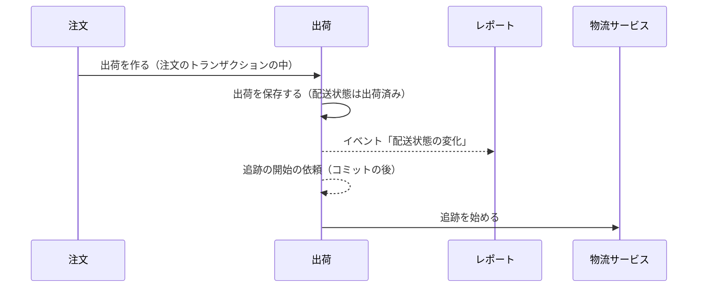
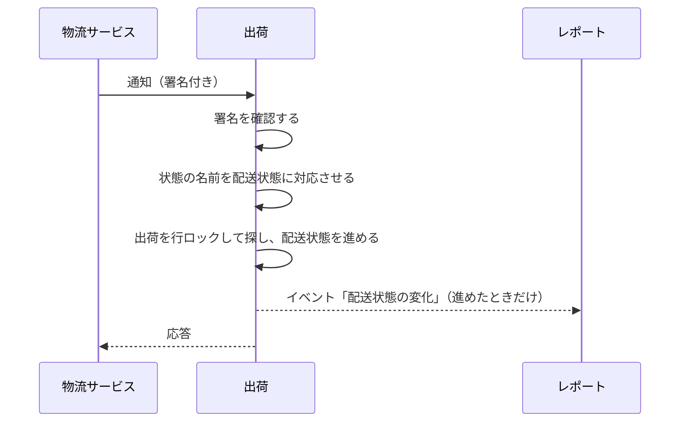

# 出荷の設計

出荷モジュールは、注文の出荷と配送状態を管理する。物流サービス（配送業者）の腐敗防止層でもある。業務規則は [出荷モジュール](../03-機能仕様/shipping.md) にある。

| 項目 | 内容 |
|------|------|
| レベル | B（不変条件は配送状態の順位だけで、状態の履歴に業務の価値がない。理由は ※1） |

※1：状態は 4 つで、遷移の規則は「今より高い順位にだけ進める」の 1 つだけ。レベル A（フル）の構成（集約ごとのパッケージ、CQRS）を置くほど複雑ではない。配送状態の履歴は見せないので、イベントストア（レベル C）にして read model を追加する理由がない。

## 境界

依存は[全体構成](overview.md)の「モジュールの依存とイベント」。出荷は注文のイベントを受けない。理由：受けると、注文と出荷が循環するため。配送状態の変化を注文に知らせる必要もなく、注文は出荷の API で読む。配送状態の変化のイベントを受けるのはレポートだけで、レポートには注文も出荷も依存しないので、循環しない。

### 他のモジュールへの公開

| 種類 | 内容 | 利用者 |
|------|------|--------|
| API | 出荷を作る（作った出荷を返す）、注文 ID でまとめて出荷を読む、配送状態が「返送」の注文 ID の一覧 | 注文 |
| API | 配送業者の表示名の文言のキーを返す | 通知 |
| イベント | 配送状態の変化 | レポート |

### 外部のサービス

| 役割 | 実装 | 設定 |
|------|------|------|
| 物流サービス | mock だけ。本番の実装はまだない | 有効にするフラグ `ecsite.shipping.mock.enabled` |
| 通知の署名の鍵 | 環境変数 `CARRIER_WEBHOOK_SECRET` で渡す | `ecsite.shipping.webhook-secret` |

物流サービスは port（追跡を始める）の実装として `infrastructure` に置く。物流サービスの型とエラーは `infrastructure` の外に出さない。mock のフラグが有効でなければ、起動に失敗し、フラグの名前を示す。通知のエンドポイントは、EC の API ではないので OpenAPI に書かず、`infrastructure` に置く（[API の規約](../05-開発規則/api-conventions.md)の「OpenAPI の外のエンドポイント」）。通知の署名と応答は、下の「通知のエンドポイント」に書く。

#### mock

- バックエンドが `/mock-carrier` に簡易な HTML を返す。出荷の一覧と、出荷ごとに「配送中」「配達完了」「返送」のボタンを持つ。
- 画面の一覧に表示する「最近の出荷」は、出荷日時の新しい順に、上限の件数まで返す。本番の処理は使わないため、出荷のリポジトリの port には置かない。mock と同じ条件（物流の mock フラグ）のときだけ有効にする。
- ボタンを押すと、mock が署名付きの通知を作り、HTTP で自分のエンドポイントに送る。本物の物流サービスと同じ経路（署名の検証を含む）を通すため。ボタンは、ヤマト運輸の表示の名前（配送中は「配達中」、配達完了は「配達完了」、返送は「返品」）で送る。
- 送り先は、画面を返したサーバーのエンドポイント（リクエストと同じ接続先）。設定で URL を持たない。
- 対応の表を持つのはヤマト運輸だけなので、ほかの配送業者の出荷にはボタンを表示しない。
- mock の画面が配送業者の型から直接、表示名のキーを得るのは、infrastructure が同じモジュールの api に依存しない規則のためである。
- テストのコードから、通知の重複・順序の入れ替わり・途中の欠け・署名の誤り・合わない送り状番号を送れる（mock は、正しい署名の通知を作る操作と、HTTP でエンドポイントに送る操作を公開する）。署名の誤りの作り方と、追跡を始めた送り状番号の記録は、テストだけで使うので、テストで共有するソース（`src/testFixtures`）の、mock を包む実装に置く（[バックエンドのアーキテクチャ](backend-architecture.md)の「外部連携」）。
- 追跡を始めても、mock は何も送信しない。
- 自動では進めない。

### 通知のエンドポイント

業務規則は [出荷モジュール](../03-機能仕様/shipping.md) の「通知のエンドポイント」に書く。

| 項目 | 内容 |
|------|------|
| パス | `POST /api/webhooks/carrier` |
| 認証 | 付けない。署名で確認する（BR-22） |
| 署名 | ヘッダー `X-Carrier-Signature` に `sha256=` と、本文（受け取ったままのバイト列）の HMAC-SHA256（16 進、小文字）（BR-22） |
| 鍵 | 設定は「外部のサービス」 |
| 本文 | JSON。配送業者、送り状番号、物流サービスの状態の名前、発生日時 |

本文の項目：

| 項目 | 内容 |
|------|------|
| `carrier` | 配送業者（`YAMATO` など） |
| `trackingNumber` | 送り状番号 |
| `status` | 物流サービスの状態の名前（ヤマト運輸なら「配達中」など） |
| `occurredAt` | 状態が変わった日時（ISO 8601） |

応答：

| 場合 | 応答 | 理由 |
|------|------|------|
| 署名がない・合わない | 401 | 処理しない（BR-22） |
| 署名が合うが、本文が読めない | 400 | 再送しても成功しないが、送信元に知らせる |
| 登録済みのどの出荷とも合わない（配送業者と送り状番号） | 200。記録して何も変えない | 再送させても合うようにならない |
| 状態の名前が対応の表にない | 200。記録して何も変えない | 同上。表に追加すれば、次の通知から反映される |
| 反映した、または順位が上がらず何もしなかった | 200 | 重複して届いても同じ結果（BR-22） |
| 処理に失敗した（DB の障害など） | 5xx | 物流サービスの再送で再処理する（BR-22） |

- 署名の時刻は確認しない。重複して届いても反映は 1 回だけなので、盗まれた通知の再送で状態が戻ることも、先へ進むこともない。

## 処理の流れ

### 出荷の作成と追跡の開始

注文が出荷の API を呼ぶ流れの全体は、[注文の設計](order.md)の「出荷の登録」に描く。ここでは出荷の側だけを描く。業務規則は [出荷モジュール](../03-機能仕様/shipping.md) の「物流サービス」に書く。



- 追跡を始めることは、実在の物流サービスでは、送り状番号の通知を受け取る登録に当たる。mock は何もしない。
- コミットの後に非同期で呼び、失敗したら例外で終わって、未完了のイベントの再発行で再試行する（決済の与信の取消と同じ形）。リスナーは DB を使わないので、トランザクションを持たない（物流サービスを待つ間に DB の接続を持たない）。

### 物流サービスの通知の反映

業務規則は [出荷モジュール](../03-機能仕様/shipping.md) の「通知のエンドポイント」「状態の遷移」に書く。



## API

出荷モジュールが公開する EC の API（OpenAPI の operation）はない。出荷の登録（`shipOrder`）は注文の API で、[注文の設計](order.md)の「API」に書く。

## パッケージの構成

```
shipping/
├── api/                    # 注文と通知への公開
├── event/                  # 配送状態の変化
├── application/            # 出荷の作成と参照、通知の反映
│   └── port/               # リポジトリ、追跡、通知の受信
├── domain/                 # 出荷、配送業者、配送状態、送り状番号
└── infrastructure/
    ├── persistence/        # リポジトリの実装
    ├── carrier/            # 通知の受信、署名、状態の名前の対応
    └── mock/               # mock の物流サービスと画面
```
