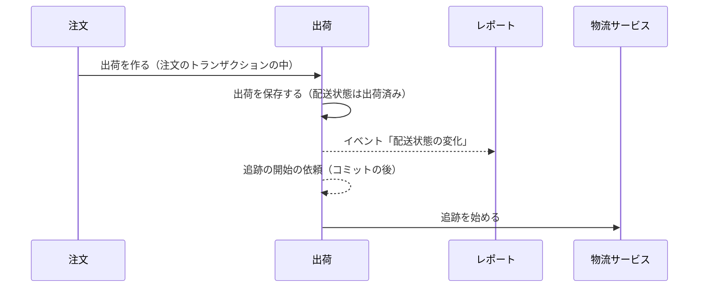
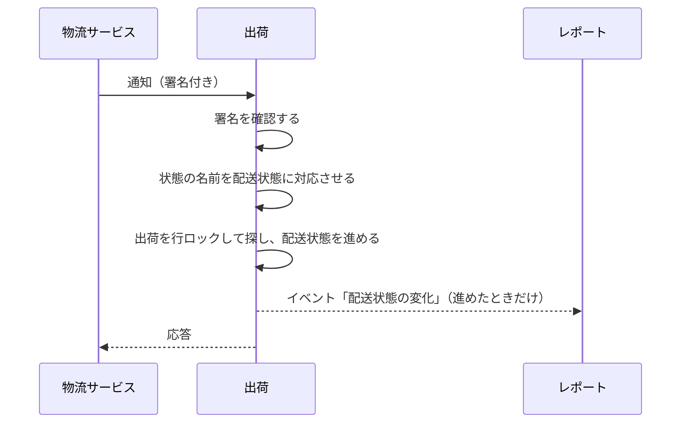

# 出荷の設計

出荷モジュールは、注文の出荷と配送状態を管理する。物流サービス（配送業者）の腐敗防止層でもある。業務規則は [出荷モジュール](../03-機能仕様/shipping.md) にある。

## 境界

依存は写さず、[全体構成](overview.md) の「モジュールの依存とイベント」を指す。出荷は注文のイベントを受けない。理由：受けると、注文と出荷が循環するため。配送状態の変化を注文に知らせる必要もなく、注文は出荷の API で読む。配送状態の変化のイベントを受けるのはレポートだけで、レポートには注文も出荷も依存しないので、循環しない。

### 他のモジュールへの公開

| 種類 | 内容 | 利用者 |
|------|------|--------|
| API | 出荷を作る、注文 ID でまとめて出荷を読む、配送状態が「返送」の注文 ID の一覧 | 注文 |
| API | 配送業者の表示名の文言のキーを返す | 通知 |
| イベント | 配送状態の変化 | レポート |

### 外部のサービス

| 役割 | 実装 | 設定 |
|------|------|------|
| 物流サービス | mock だけ。本番の実装はまだない | 有効にするフラグ `ecsite.shipping.mock.enabled` |
| 通知の署名の鍵 | 環境変数 `CARRIER_WEBHOOK_SECRET` で渡す | `ecsite.shipping.webhook-secret` |

物流サービスは port（追跡を始める）の実装として `infrastructure` に置く。物流サービスの型とエラーは `infrastructure` の外に出さない。mock のフラグが有効でなければ、起動に失敗する。通知のエンドポイントは、EC の API ではないので OpenAPI に書かず、`infrastructure` に置く（[API の規約](../05-開発規則/api-conventions.md)の「OpenAPI の外のエンドポイント」）。通知の署名、応答、タイムアウトなどの規則は、[出荷モジュール](../03-機能仕様/shipping.md)の「業務規則」に書く。

## 処理の流れ

### 出荷の作成と追跡の開始

注文が出荷の API を呼ぶ流れの全体は、[注文の設計](order.md)の「出荷の登録」に描く。ここでは出荷の側だけを描く。業務規則は [出荷モジュール](../03-機能仕様/shipping.md) の「物流サービス」に書く。



### 物流サービスの通知の反映

業務規則は [出荷モジュール](../03-機能仕様/shipping.md) の「通知のエンドポイント」「状態の遷移」に書く。



## API

出荷モジュールが公開する EC の API（OpenAPI の operation）はない。出荷の登録（`shipOrder`）は注文の API で、[注文の設計](order.md)の「API」に書く。物流サービスの通知のエンドポイントは OpenAPI に書かない（上の「外部のサービス」）。

## パッケージの構成

クラスの名前と設定の値は書かない（正本はコード）。

```
shipping/
├── api/                    # 注文と通知への公開
├── event/                  # 配送状態の変化
├── application/            # 出荷の作成と参照、通知の反映
│   └── port/               # リポジトリ、追跡、通知の受信
├── domain/                 # 出荷、配送業者、配送状態、送り状番号
└── infrastructure/
    ├── persistence/        # リポジトリの実装
    ├── carrier/            # 通知の受信、署名、状態の名前の対応
    └── mock/               # mock の物流サービスと画面
```
