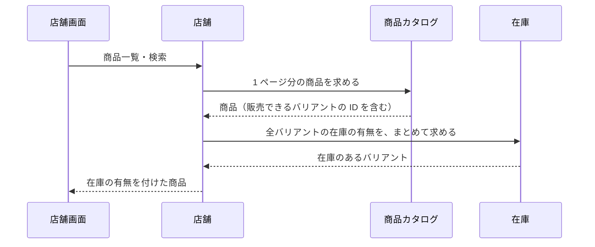
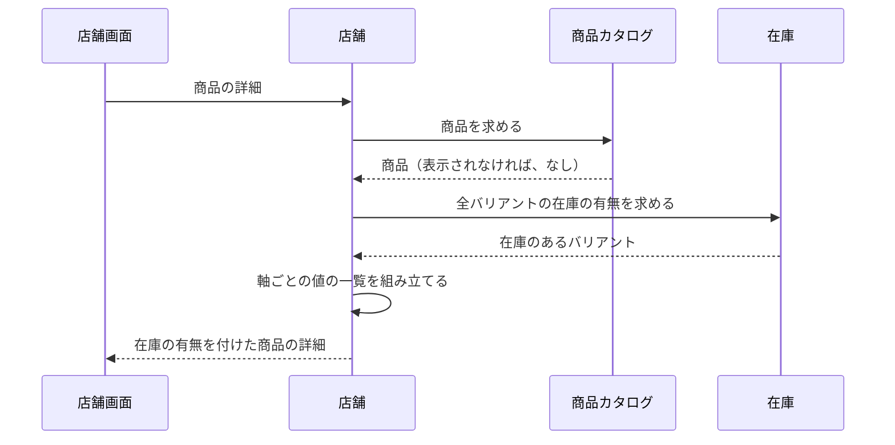
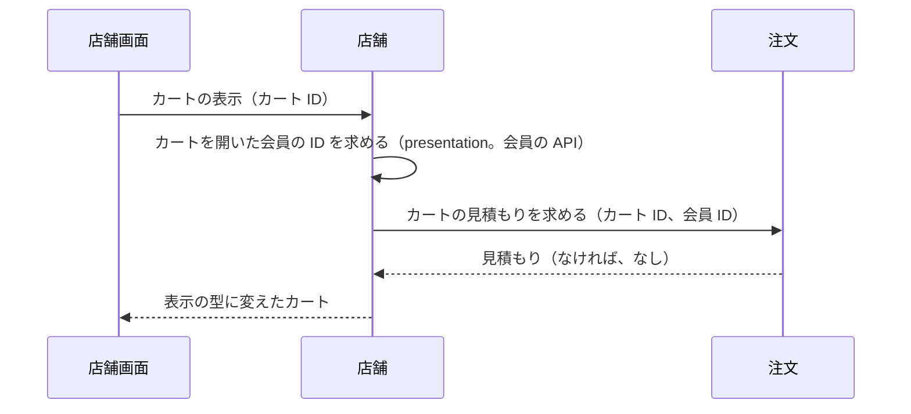

# 店舗の設計

店舗モジュールは、C 側 API のために複数のモジュールの結果を組み合わせる、参照専用の層である。業務規則は [店舗モジュール](../03-機能仕様/storefront.md) にある。

## 境界

依存は写さず、[全体構成](overview.md) の「モジュールの依存とイベント」を指す。会員の API を使うのは presentation だけである。

C 側の画面は、商品の情報と在庫の有無を同時に必要とする。在庫は商品カタログのイベントを購読しているので、商品カタログが在庫を呼ぶと依存が循環する。両方を呼んで組み合わせる層として、店舗モジュールを置く。

### 他のモジュールへの公開

他のモジュールへ公開する API とイベントはない。

## 処理の流れ

### 商品一覧・検索

組み合わせの規則は [店舗モジュール](../03-機能仕様/storefront.md) の「在庫の有無」に書く。



### 商品詳細



業務規則は [店舗モジュール](../03-機能仕様/storefront.md) の「在庫の有無」「商品の詳細」に書く。

### カートの表示



業務規則は [店舗モジュール](../03-機能仕様/storefront.md) の「カートの表示」に書く。見積もりの規則は [注文モジュール](../03-機能仕様/order.md) の「見積もり」に書く。

## API

リクエストとレスポンスの項目、エラーコード、状態コードは OpenAPI（[店舗 API](../../api/openapi/store.yaml)）が正本である。

| 画面 | 操作 | メソッドとパス | operationId |
|------|------|----------------|-------------|
| 店舗 | 商品一覧 | `GET /products` | `listProducts` |
| 店舗 | キーワード検索 | `GET /products/search` | `searchProducts` |
| 店舗 | 商品の詳細 | `GET /products/{productId}` | `getProduct` |
| 店舗 | カテゴリの木 | `GET /categories` | `listCategories` |
| 店舗 | カートの表示 | `GET /carts/{cartId}` | `getCart` |
| 店舗 | 店舗の情報 | `GET /shop` | `getShop` |

## パッケージの構成

クラスの名前と設定の値は書かない（正本はコード）。

```
storefront/
├── presentation/       # 店舗 API の実装、表示の型の変換
├── application/        # 組み合わせ、店舗の情報の設定
│   ├── model/          # 表示の型、商品の一覧の条件
│   └── port/           # 腐敗防止層の port と型
└── infrastructure/
    └── directory/      # 他モジュールの腐敗防止層
```

店舗の情報の設定は、値の型を application に置き、infrastructure の設定のクラスが有効にする。
