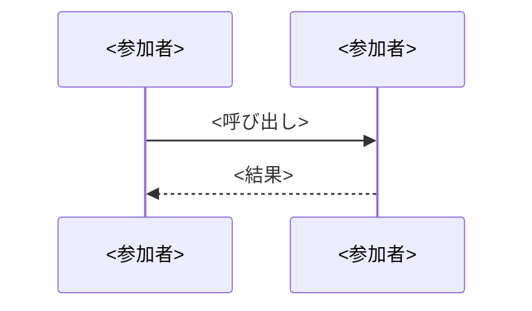

# モジュールの設計の雛形

## この雛形の使い方

モジュールごとの設計の文書（`docs/02-設計/<モジュール>.md`）を書くときに、この雛形を写して使う。

| 項目 | 内容 |
|------|------|
| 読者 | エンジニア。モジュールの境界と処理の流れを知りたい人 |
| 置くもの | 依存と公開、処理の流れの図、API の operation の一覧、パッケージの構成 |
| 置かないもの | 業務規則・状態の遷移・データモデル・有効な AC（[機能仕様](../03-機能仕様)）。決定の理由（[決定記録](../04-決定記録)）。リクエストとレスポンスの項目・コード（OpenAPI） |

1 つの事実の正本は 1 つにする。置かないものは写さず、その文書を指す。

## 写して使う骨組み

````markdown
# <モジュールの論理名>の設計

<モジュールの責務を 1 文で書く。業務規則は [<モジュールの論理名>モジュール](../03-機能仕様/<モジュール>.md) にあると書く>

## 境界

<他のモジュールへの公開を表にする。依存は写さず、[全体構成](overview.md) の「モジュールの依存とイベント」を指す>

### 他のモジュールへの公開

| 種類 | 内容 | 利用者 |
|------|------|--------|
| API | <内容> | <モジュール> |
| イベント | <内容> | <モジュール> |

## 処理の流れ

<モジュールをまたぐ処理ごとに、Mermaid の sequenceDiagram を 1 つ描く。参加者と矢印を合わせて 15 程度までにし、ラベルは日本語で書く。出典のない手順は描かない。業務規則の細部は図に入れず、機能仕様を指す>

### <処理の名前>



## API

<operation の一覧を表にする。表の前に、OpenAPI へのリンクを置く。リクエストとレスポンスの項目、エラーコード、状態コードの正本は OpenAPI だと書く>

| 画面 | 操作 | メソッドとパス | operationId |
|------|------|----------------|-------------|
| <店舗または管理> | <summary から AC 番号を除いた語> | <メソッドとパス> | <operationId> |

## パッケージの構成

<ソースのパッケージのツリーを、コードブロックに書く。各行の右に、役割を 15 字程度で添える。クラスの名前と設定の値は書かない（正本はコード）>

```
<モジュール>/
├── api/
├── event/
├── presentation/
├── application/
├── domain/
└── infrastructure/
```
````
