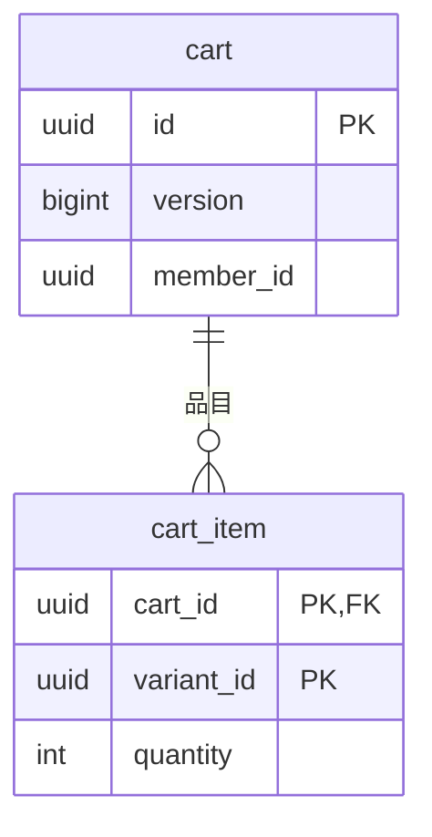

# カートモジュール

消費者のカートと、その品目（バリアントと数量）を管理する。モジュールのレベルと境界、処理の流れ、API の案内、パッケージの構成は、[カートの設計](../02-設計/cart.md)に書く。

## 業務規則

### カート

- カートは、品目の一覧、バージョン、最終更新日時を持つ。品目は、バリアント、数量、入れた日時を持つ。
- 価格は持たない。表示のたびに注文モジュールの見積もりで今の価格を求める。
- カート ID は推測できない UUID。ログインせずに作ったカート（会員なし）は、ID を知っている人だけが使える。
- 変更（追加・数量の変更・削除・空にする・注文した品目を除く）のたびにバージョンを上げる（注文モジュールが、注文手続きの後の変更を見つけるため）。
- 注文の与信が成功したら、注文モジュールが、注文した品目（バリアント）を数量によらず行ごと除かせる。注文の後に追加した品目は残る。支払の期限が切れても、カートから再び注文できるようにするため。

### 品目の追加と変更

| 決まり | 内容 |
|--------|------|
| 合算 | 同じバリアントは数量を合算する。品目は入れた順に並べる |
| 上限 | 数量は 1〜10、品目は 30 まで（合算の結果で判定）。数量の上限は、ドメインの定数、契約の `maximum`、カートの品目と注文の明細の DB の CHECK の 4 か所に同じ値で置く。変えるときは全てを変える（カートの上限の数量で注文できることを、注文の統合テストで確認する） |
| 追加の確認 | 商品カタログで「C 側に表示される商品の、販売停止でないバリアント」であることと、在庫で販売可能数が入れた後の数量以上であることの 2 つを確認する（BR-11） ※1 |
| 増量の確認 | 在庫で販売可能数が変更後の数量以上かだけを確認する（BR-11）。商品カタログは確認しない ※1 |
| 減量・削除 | 確認しない |

※1：確認するのは追加と増量の時点だけ。その後に買えなくなった品目と、増量の時点で商品カタログの条件を満たさない品目は、カートの表示と注文で扱う。追加と増量で確認する販売可能数は、操作している消費者の引当も数える。カートは注文手続きを知らないため。注文手続きの途中でカートに戻って同じ品目を増やすと、その引当の分だけ少なく判定されることがあるが、引当はカートの変更や 15 分の期限で解かれるので受け入れる。

### 期限

- 最終更新から 30 日たったカートは、読むときに空として扱い、次に書くときに品目を削除してから書く。
- 期限が切れたカートは、片付けのジョブが品目と共に削除する。件数の上限ごとに削除するループとログ出力は、共通の `ExpiredDataCleanup` を使う（[バックエンドのアーキテクチャ](../02-設計/backend-architecture.md)の「水平スケール」）。削除したカートを使う操作は 404 になり、店舗画面は新しいカートを作る。会員のカートは、次に求めたときに再作成する。
- 読み込んだ後に片付けで削除されたカートを保存すると、同時の変更（409）になる。

### 会員のカート

- 会員のカートは会員 ID を持ち、会員ごとに 1 つ。会員が初めて使うとき（`/me/cart`）に作る。ログインせずに作ったカートが、後から会員を持つことはない。
- 持ち主の会員だけが読み書きできる。他の人にはカートがないときと同じく 404（存在を推測させない）。
- 持ち主の確認は、カートと要求した会員 ID（ログインしていなければなし）で行う。会員なしのカートは、だれでも使える。

### カートを移す

ログインせずに使っていたカートの品目を、会員のカートへ移す。店舗画面のサーバーが、ログインの直後に 1 回呼ぶ。処理の流れは[カートの設計](../02-設計/cart.md)の「カートを移す」。

- 移すカートの品目を、元のカートに入れた順に入れる。同じバリアントは合算し、10 を超えたら 10 に切り詰める。品目が 30 に達したら残りは移さない。
- 切り詰めた品目と移せなかった品目（バリアントと数量）を返し、画面が一度だけ知らせる。
- 商品カタログ・在庫は確認しない（買えない品目は、表示と注文で扱う）。
- 移し終えたら移すカートを空にする（2 回呼ばれても 2 回目は何も起きない）。
- 移す元にできるのは会員なしのカートだけ（会員のカートなら 404）。期限切れのカートは空として扱う。
- 会員のカートや移すカートが変わったら、カート変更のイベントを出す。

## 状態の遷移

なし。カートは状態を持たない。

## データモデル

列の正本は Flyway のマイグレーション。

- schema は `cart`。
- バリアントと会員は他のモジュールの ID なので、外部キーは張らない。
- 品目は入れた順の連番を持つ。保存では品目を削除して再挿入するので、連番は再採番される。
- 保存は、保存済みのバージョンが読み込んだときの値と一致するときだけ行う（同時の変更は 409）。
- 会員ごとに 1 つは一意制約で守る（同じ会員の初回の要求が同時に来ても 1 つ）。

## 今有効な AC

<!-- generated:module-ac -->
| AC | 今の内容 | 元の spec |
|----|----------|-----------|
| AC-72 | C 側に表示される商品（BR-2）の、選べるバリアント（販売停止でなく、在庫あり）を、数量を指定してカートに入れられる。選べないバリアントは入れられない。 | MVP-002 |
| AC-73 | ログインしていない間は、カートを持っていなければ最初に商品を入れたときに作り、そのブラウザーの Cookie のカート ID でだけ使う。ログインしている間は、会員ごとに 1 つの会員のカートを使う。根拠は[カートモジュール](cart.md)の「会員のカート」、[店舗画面の構成](../02-設計/apps/store.md)の「使うカートの選び方」。 | MVP-002 |
| AC-74 | カートにあるバリアントをもう一度入れると、数量を合算する。 | MVP-002 |
| AC-75 | 1 品目の数量は 1〜10。1 つのカートに入れられるのは 30 品目まで。超える場合は拒否される。 | MVP-002 |
| AC-76 | 入れた後の数量が、その時点の販売可能数（BR-11）を超える場合は拒否される。販売可能数そのものは示さない（AC-64）。カートに入れても在庫は引き当てない。 | MVP-002 |
| AC-77 | 品目ごとに商品名、軸の値、画像、単価（BR-4）、数量、小計を表示し、あわせて商品の合計、送料（BR-6）、総額、税率ごとの消費税額（BR-8）を表示する。 | MVP-002 |
| AC-78 | 品目の数量を変更（AC-75、76 の範囲で）・削除できる。 | MVP-002 |
| AC-79 | 単価は常に現在の価格で表示する。カートに入れた時点の価格は保持しない。 | MVP-002 |
| AC-80 | 購入できなくなった品目は、理由とともに「購入できません」と示し、合計に含めない。理由は次のいずれか：商品が C 側に表示されなくなった（BR-2）、バリアントが販売停止になった、販売可能数がない、またはカートの数量より少ない。 | MVP-002 |
| AC-81 | 最後に変更してから 30 日経過したカートは、空のカートとして扱い、期限が切れたカートは片付けのジョブが削除する。根拠は[カートモジュール](cart.md)の「期限」。 | MVP-002 |
| AC-120 | ログインしていなくても、カートを使える。 | MVP-003 |
| AC-121 | ログインしている間は、会員のカートを使う。会員のカートは会員ごとに 1 つで、どの端末やブラウザーからログインしても同じカートになる（ログインしていないときは AC-73 のとおり）。 | MVP-003 |
| AC-122 | ログインしたとき、そのブラウザーのカート（ログインせずに使っていたもの）に品目があれば、会員のカートに移す。同じバリアントは数量を合算する。移した後、ブラウザーのカートは空になる。 | MVP-003 |
| AC-123 | 移した結果が上限（AC-75）を超える場合は、数量を 10 に切り詰め、30 品目を超える分は移さない。切り詰めたことと移せなかった品目を表示する。販売可能数（AC-76）は移す時点では確認せず、カートの表示（AC-80）に反映する。 | MVP-003 |
| AC-124 | ログアウトすると、そのブラウザーのカートは空に見える。会員のカートは残り、次にログインしたときに使える。 | MVP-003 |
<!-- /generated:module-ac -->
