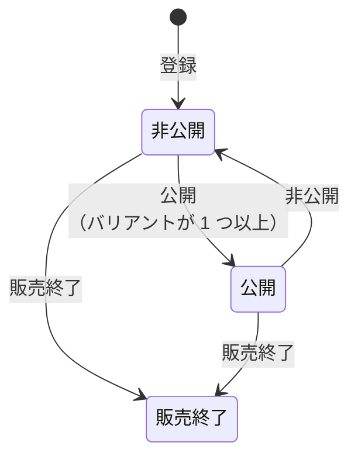
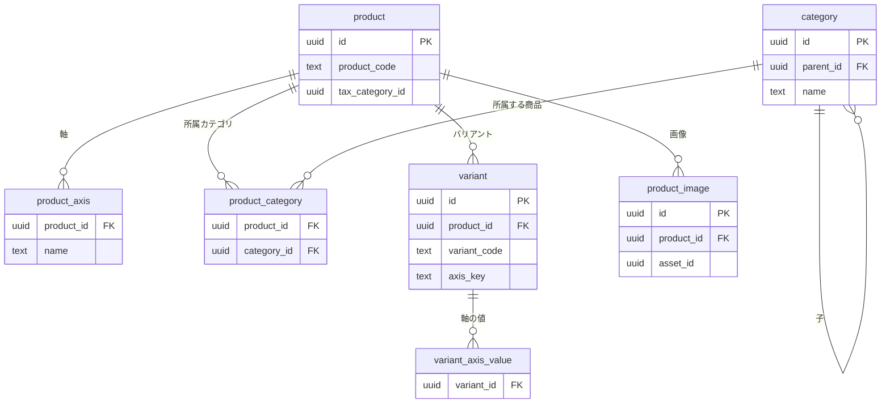

# 商品カタログモジュール

商品、バリアント、カテゴリ、公開状態、商品検索を管理する。モジュールのレベル、境界、処理の流れ、API の一覧、パッケージの構成は、[商品カタログの設計](../02-設計/catalog.md)に書く。

## 業務規則

### 商品（集約）

- 商品は、商品品番、名称、説明、税区分、税抜価格、所属カテゴリ、バリアント軸（最大 3 つ）、公開状態、初回表示日時、公開期間、バリアント、画像を持つ。
- 税抜価格は 1 円以上 9,999,999 円以下の整数。上限は、税込価格とカートの品目の小計の計算が long と DB の bigint の範囲に収まる大きさで、契約・ドメイン・DB の CHECK に同じ値を置く。
- バリアントは、バリアント品番、軸の値、表示順、販売停止、画像を持つ。価格は持たず、商品の価格を使う（バリアントごとの価格は持たない）。
- 商品とバリアントは 1 つの集約（軸の値の組み合わせが商品内で一意であることは、商品単位の不変条件のため）。
- 品番は属性で、他のデータからの参照には使わない（BR-5）。
- バージョンは商品に 1 つ。バリアントの登録・削除・並び替えも、商品のバージョンを上げる。
- 商品の集約を、商品とバリアントなどに分けない。分けるとトランザクションの境界が変わり、そのリスクが利点を上回るため。

### 登録と編集

| 項目 | 決まり |
|------|--------|
| 税区分 | 登録時と変えたときに、今有効な税率があるかを税モジュールに確認する。存在しない税区分も、有効な税率がないのと同じく 400 |
| 所属カテゴリ | 存在しないカテゴリは 400（削除と同時に起きた外部キーの違反も 400） |
| バリアント軸 | 名前は 1〜30 文字で商品内で重複しない。値は 1〜50 文字 |
| 販売終了の商品 | 編集とバリアントの登録はできる（C 側には表示されない） |

### バリアント

- 登録は並びの最後に追加する。軸の値の数は商品の軸の数と同じ。
- 軸キーは、軸の値を U+001F（単位区切り文字）で連結した値。軸のない商品では空になるので、軸キーの一意制約でバリアントが 1 つに限られることも DB で守れる。
- 軸の値の組み合わせの重複は 409、軸のない商品への 2 つ目のバリアントは 400。
- 並び替えは、商品の全てのバリアントを送る（過不足は 400）。
- 公開中の商品の最後のバリアントは削除できない。

### 初回表示日時

C 側に最初に表示された（される予定の）日時。新着順の基準で、商品・バリアントを削除できるかの判定にも使う。定期ジョブを使わず、操作時点の現在時刻と比べて判定する。

- 公開したとき、または公開中に公開期間を変えたときに、「公開した時刻と公開開始日時の遅いほう」を設定する。それが公開終了日時以降なら空にする。
- 過去になったら確定し、以後は変わらない（再公開しても新着順は上がらない）。
- 未来の間はまだ表示されていない。非公開・販売終了にしたら空に戻し、公開期間を変えたら再計算する。
- 削除できるのは、初回表示日時が空か未来の商品（C 側に一度も表示されていない）。

### 公開期間

- 基本情報と同じくバージョンを受け取って変える（他の人の変更を黙って上書きしないため）。どの状態の商品にも設定できる。
- 期間の外かどうかは表示時点の現在時刻で判定し、運営者の操作なしにその時刻で切り替わる。

### 商品画像

画像は商品集約の一部で、メディアモジュールのアセット ID と並び順を持つ。ファイルの受け付け・検証・配信・削除はメディアモジュール（[media.md](media.md)）が行い、商品カタログはその API を通して呼ぶ。

- 1 商品 20 枚まで。先頭が代表画像。並び替えは商品の全ての画像を送る。
- バリアントには、その商品の画像を 1 枚指定できる（任意。なければ代表画像）。画像を削除すると、その指定は外れる。
- 画像の登録・削除・並び替え、バリアントの画像の指定は、バージョンを受け取る。
- 登録は、画像の変換と保存の間に DB の接続を持たないよう、トランザクションを分ける（受付の範囲は商品 ID。流れは [商品カタログの設計](../02-設計/catalog.md)の「商品画像の追加」の図）。
  - 画像を加えられること（商品がある、バージョンが一致する、枚数が上限に達していない）の確認は、読み取りだけのトランザクションで行う。
  - メディアモジュールで画像を用意するのは、トランザクションの外。
  - アセットの登録と、商品の画像の最後への追加は、1 つのトランザクションで行う。用意の間にほかの操作が商品を変えていれば、バージョンの不一致で失敗する。
  - このトランザクションが失敗したら、用意した画像を破棄し、元の失敗を返す。
- 画像・商品を削除したら、同じトランザクションでアセットを解放する。
- C 側・B 側に返す画像の URL は、メディアモジュールからまとめて取る。

### カテゴリ（集約）

- カテゴリは、親、名称、深さ（1〜3）、表示順を持つ。商品とは ID でだけつながる。
- 深さは親の深さ ＋ 1。親を変える操作はないので、登録後に変わらない。
- 登録したカテゴリは兄弟の最後に置く（表示順は兄弟の最大 ＋ 1。同じになったら登録日時と ID の順）。

#### 並び替え

兄弟の全体を送って変える。

- 送る ID は、その親の今の子と過不足なく一致しなければ 400（画面を開いた後に増減していたらもう一度並べ替えてもらう）。
- `version` は送らない。兄弟の行を ID の順にロックするので、同時の変更は直列になり、後の変更が残る。
- 表示順が変わったカテゴリはバージョンを上げる（並べ替えの前に開いた画面で名称を変えると 409）。

#### 削除

子カテゴリを持つカテゴリは削除できない。削除と子の登録が同時に起きた外部キーの違反も業務のエラーに変える（削除は 400、登録は親がない 404）。

### C 側の表示と検索

#### 表示される条件

公開状態が「公開」で、公開期間内（BR-2）。この条件はドメインと参照用の SQL の 2 か所にある ※1。

※1：SQL は 1 か所にまとめて一覧と検索で使い（検索だけに非公開の商品が表示される不具合を防ぐ）、ドメインと一致することを統合テストで確認する。

#### 税込価格での並べ替え・絞り込み

税区分ごとに税率が違うので、税抜の順と税込の順は一致しない（1,000 円・8% は 1,080 円、990 円・10% は 1,089 円）。そこで一覧の SQL で税込価格を計算する（流れは [商品カタログの設計](../02-設計/catalog.md)の「C 側の商品一覧と検索」の図）。

- 税モジュールから取る税区分ごとの税率の一覧（予定を含む）は、インスタンス内で 30 秒キャッシュする。
- 有効な税率は表示時刻で決め、税区分ごとの率を SQL に埋め込む。
- 税込価格は、価格帯の絞り込み（下限・上限ともその値を含む）と並べ替えに使う。
- キャッシュの影響は、税率の登録・変更の反映が最大 30 秒遅れることだけ（予定の税率もキャッシュに持ち、表示時刻で有効な税率を決めるので、切り替えの時刻ちょうどに切り替わる）。
- 有効な税率のない税区分の商品は、税込価格を計算できないので表示しない（最後の税率は無期限なので、通常は起きない）。
- 税込価格の計算は税モジュール（Java）とここ（SQL）の 2 か所にあり、端数の境界値を含めて一致を統合テストで確認する。

#### キーワード検索

- 専用の窓口（商品検索）の後ろに置き、通常の商品照会（カテゴリ・価格帯・並べ替え）とはコードもクエリも分ける。
- 商品名と説明の部分一致。精度は求めない（チューニングや形態素解析なし）。ワイルドカード文字はエスケープし、並びは新着順で固定、専用のインデックスは作らない。

### B 側の商品一覧

状態に関係なく全ての商品が対象。並びは登録日時の新しい順、同じなら ID の順。

| 絞り込み | 決まり |
|----------|--------|
| 品番 | 商品品番かバリアント品番の前方一致。英小文字は大文字として扱う |
| 商品名 | 部分一致。英字の大文字・小文字を区別しない |
| カテゴリ | 子孫のカテゴリの商品も含む（C 側と同じ） |

絞り込みの文字列中のワイルドカード文字（`%`、`_`）は、ただの文字として扱う。

## 状態の遷移

状態を持つのは、商品の公開状態とバリアントの販売停止である。

| 操作 | すでにその状態のとき | できない状態 |
|------|----------------------|--------------|
| 公開 | 公開なら状態を変えずに成功を返す | 販売終了。バリアントのない商品 |
| 非公開 | 非公開なら状態を変えずに成功を返す | 販売終了 |
| 販売終了 | 販売終了なら状態を変えずに成功を返す | — |
| バリアントの販売停止、解除 | すでにその状態なら状態を変えずに成功を返す | — |

- 状態の切り替えはバージョンを受け取らず、保存時に他の更新と衝突したときだけ 409。販売終了からは、公開にも非公開にも戻せない。
- 公開・非公開・販売終了にしたときは、初回表示日時を更新する（[初回表示日時](#初回表示日時)）。

### 状態ごとにできる操作

商品の詳細の応答（`admin.yaml` の `ProductActions`）に、今できる操作のフラグを返す。値はドメインの `ProductActions` から作り、画面は同じ判定を持たない。

| フラグ | できるとき |
|----|------------|
| 公開 | 非公開のとき |
| 非公開 | 公開のとき |
| 販売終了 | 販売終了でないとき |
| 商品の削除、バリアントの削除 | C 側に表示されたことがないとき |
| バリアントの追加 | 軸があるか、バリアントがないとき |

削除できないとき（C 側に表示されたことがあるとき）は、応答の `deleteBlockedReason` に理由（`ALREADY_SHOWN`）を返す。削除できるときは省く。

集約が別の理由で拒む操作（バリアントのない商品の公開、公開中の最後のバリアントの削除）はフラグで止めず、操作したときのエラーで知らせる。

## データモデル

列の正本は Flyway のマイグレーション。

- schema は `catalog`。
- 同じ親の下でのカテゴリの名称の一意性は、最上位（親が null）同士も含める（`UNIQUE NULLS NOT DISTINCT`）。
- 商品の一部（軸、所属カテゴリ、バリアント、軸の値、画像）は商品の削除で一緒に削除される（`ON DELETE CASCADE`）。所属カテゴリからカテゴリへの外部キーは CASCADE にしない（商品が所属しているカテゴリの削除を拒むため）。
- 税区分とアセットは他のモジュールの ID なので外部キーは張らない。1 つのアセットを持つのは 1 つの画像だけ。
- バリアントの画像は同じ商品の画像だけを指せる（商品 ID と画像 ID の組で外部キー）。画像を削除すると、バリアントの指定だけが外れる（`ON DELETE SET NULL (image_id)`）。
- 画像はファイルの置き場所を持たず、メディアモジュールのアセット ID を持つ。
- 税抜価格の CHECK は 1 円以上 9,999,999 円以下。

## 今有効な AC

選んだ基準は、[AC 一覧](acceptance-criteria.md)の列「モジュール」が `catalog` で、状態が「有効」か「変更」の AC であること。

<!-- generated:module-ac -->
| AC | 今の内容 | 元の spec |
|----|----------|-----------|
| AC-6 | 現時点で有効な税率を持たない税区分は、商品に割り当てられない。 | [001](../08-spec/archive/mvp/001-catalog-and-inventory/spec.md) |
| AC-8 | カテゴリを、名称と親カテゴリ（任意）で登録できる。親がなければ最上位になる。 | [001](../08-spec/archive/mvp/001-catalog-and-inventory/spec.md) |
| AC-9 | 階層は最大 3 階層。4 階層目の登録は拒否される。 | [001](../08-spec/archive/mvp/001-catalog-and-inventory/spec.md) |
| AC-10 | 同じ親の下で名称は重複できない。 | [001](../08-spec/archive/mvp/001-catalog-and-inventory/spec.md) |
| AC-11 | 名称と、兄弟カテゴリ間の並び順を変更できる。 | [001](../08-spec/archive/mvp/001-catalog-and-inventory/spec.md) |
| AC-12 | 子カテゴリを持つ、または商品が所属しているカテゴリは削除できない。 | [001](../08-spec/archive/mvp/001-catalog-and-inventory/spec.md) |
| AC-13 | 商品品番、商品名、説明、税区分、税抜価格、所属カテゴリ（0 個以上、複数可）、バリアント軸（0〜3 個）を指定して登録できる。 | [001](../08-spec/archive/mvp/001-catalog-and-inventory/spec.md) |
| AC-14 | 商品品番は全商品で一意。 | [001](../08-spec/archive/mvp/001-catalog-and-inventory/spec.md) |
| AC-15 | 商品品番は半角の英大文字・数字とハイフンで 1〜32 文字。ハイフンは英数字の間にだけ置ける（先頭・末尾・連続は不可。例：`ABC-001` は可、`-ABC`、`ABC--1`、`abc-001` は不可）。登録後は画面・API から変更できない。 | [001](../08-spec/archive/mvp/001-catalog-and-inventory/spec.md) |
| AC-16 | 税区分は必須。 | [001](../08-spec/archive/mvp/001-catalog-and-inventory/spec.md) |
| AC-17 | 登録直後の商品は非公開。 | [001](../08-spec/archive/mvp/001-catalog-and-inventory/spec.md) |
| AC-18 | 商品名、説明、税区分、税抜価格、所属カテゴリは変更できる。 | [001](../08-spec/archive/mvp/001-catalog-and-inventory/spec.md) |
| AC-19 | 税区分を変更すると、税込価格が変更後の税率で計算される。 | [001](../08-spec/archive/mvp/001-catalog-and-inventory/spec.md) |
| AC-20 | バリアント品番と軸の値（例：色＝白、サイズ＝M）を指定してバリアントを登録できる。 | [001](../08-spec/archive/mvp/001-catalog-and-inventory/spec.md) |
| AC-21 | バリアント品番は全バリアントで一意。形式と変更不可の扱いは AC-15 と同じ。 | [001](../08-spec/archive/mvp/001-catalog-and-inventory/spec.md) |
| AC-22 | 商品に軸があれば、バリアントは全ての軸の値を持つ。 | [001](../08-spec/archive/mvp/001-catalog-and-inventory/spec.md) |
| AC-23 | 同じ商品の中で、軸の値の組み合わせは重複できない。 | [001](../08-spec/archive/mvp/001-catalog-and-inventory/spec.md) |
| AC-24 | 軸を持たない商品のバリアントは 1 つだけ。 | [001](../08-spec/archive/mvp/001-catalog-and-inventory/spec.md) |
| AC-25 | 税抜価格は 1 円以上 9,999,999 円以下の整数。根拠は[商品カタログモジュール](catalog.md)の「商品（集約）」。 | [001](../08-spec/archive/mvp/001-catalog-and-inventory/spec.md) |
| AC-26 | 価格の変更は C 側に反映される。 | [001](../08-spec/archive/mvp/001-catalog-and-inventory/spec.md) |
| AC-27 | バリアントの表示順を変更できる。 | [001](../08-spec/archive/mvp/001-catalog-and-inventory/spec.md) |
| AC-28 | バリアントを販売停止・解除できる。販売停止中のバリアントも C 側の選択肢には表示するが、選択できない（在庫切れと同様に、選べない状態として示す）。 | [001](../08-spec/archive/mvp/001-catalog-and-inventory/spec.md) |
| AC-29 | 公開にすると、C 側の一覧・検索・詳細に表示される。 | [001](../08-spec/archive/mvp/001-catalog-and-inventory/spec.md) |
| AC-30 | 非公開にすると、C 側に表示されない。 | [001](../08-spec/archive/mvp/001-catalog-and-inventory/spec.md) |
| AC-31 | バリアントのない商品は公開できない。 | [001](../08-spec/archive/mvp/001-catalog-and-inventory/spec.md) |
| AC-32 | 状態は「非公開」「公開」「販売終了」。販売終了の商品は C 側に表示されず、公開に戻せない。 | [001](../08-spec/archive/mvp/001-catalog-and-inventory/spec.md) |
| AC-33 | C 側に一度も表示されていない商品は削除できる。表示されたことのある商品は削除できず、販売終了にする。公開の予約をしただけで、開始日時の前に取り消した商品は、表示されていないものとして扱う。 | [001](../08-spec/archive/mvp/001-catalog-and-inventory/spec.md) |
| AC-34 | 公開開始日時と公開終了日時（いずれも任意）を設定できる。 | [001](../08-spec/archive/mvp/001-catalog-and-inventory/spec.md) |
| AC-35 | 公開状態でも、開始日時より前と終了日時以降は C 側に表示されない。運営者の操作なしに、その時刻で切り替わる。 | [001](../08-spec/archive/mvp/001-catalog-and-inventory/spec.md) |
| AC-36 | 終了日時は開始日時より後。 | [001](../08-spec/archive/mvp/001-catalog-and-inventory/spec.md) |
| AC-37 | 商品に画像を複数登録し、並び順を変えられる。先頭が代表画像。 | [001](../08-spec/archive/mvp/001-catalog-and-inventory/spec.md) |
| AC-38 | バリアントに画像を 1 枚指定できる（任意）。なければ商品の代表画像を使う。 | [001](../08-spec/archive/mvp/001-catalog-and-inventory/spec.md) |
| AC-40 | 1 商品あたり最大 20 枚。 | [001](../08-spec/archive/mvp/001-catalog-and-inventory/spec.md) |
| AC-47 | 状態に関係なく、全ての商品を一覧できる。 | [001](../08-spec/archive/mvp/001-catalog-and-inventory/spec.md) |
| AC-48 | 商品品番・バリアント品番の前方一致、商品名の部分一致、状態、カテゴリで絞り込める。 | [001](../08-spec/archive/mvp/001-catalog-and-inventory/spec.md) |
| AC-49 | 商品品番、商品名、状態、バリアント数、在庫数の合計を表示する。 | [001](../08-spec/archive/mvp/001-catalog-and-inventory/spec.md) |
| AC-50 | ページ単位で取得できる。 | [001](../08-spec/archive/mvp/001-catalog-and-inventory/spec.md) |
| AC-51 | C 側に表示される商品（BR-2）だけが含まれる。 | [001](../08-spec/archive/mvp/001-catalog-and-inventory/spec.md) |
| AC-52 | カテゴリで絞り込める。子孫カテゴリの商品も含む。 | [001](../08-spec/archive/mvp/001-catalog-and-inventory/spec.md) |
| AC-53 | 税込価格の範囲で絞り込める。 | [001](../08-spec/archive/mvp/001-catalog-and-inventory/spec.md) |
| AC-54 | 新着順（既定）、価格の安い順、高い順で並べ替えられる。新着順の基準は、最初に C 側へ表示された日時（予約公開なら公開開始日時）。再公開しても順位は上がらない。 | [001](../08-spec/archive/mvp/001-catalog-and-inventory/spec.md) |
| AC-55 | 商品名、代表画像、価格（BR-4）を表示する。 | [001](../08-spec/archive/mvp/001-catalog-and-inventory/spec.md) |
| AC-57 | ページ単位で取得できる。 | [001](../08-spec/archive/mvp/001-catalog-and-inventory/spec.md) |
| AC-58 | 商品名または説明にキーワードを含む商品が表示される。 | [001](../08-spec/archive/mvp/001-catalog-and-inventory/spec.md) |
| AC-59 | 対象は C 側に表示される商品（BR-2）だけ。 | [001](../08-spec/archive/mvp/001-catalog-and-inventory/spec.md) |
| AC-60 | 精度（表記ゆれ、類義語、関連度順）は問わない。 | [001](../08-spec/archive/mvp/001-catalog-and-inventory/spec.md) |
| AC-61 | ページ単位で取得できる。 | [001](../08-spec/archive/mvp/001-catalog-and-inventory/spec.md) |
| AC-62 | 商品名、説明、画像、価格（BR-4）、バリアント軸と選択肢を表示する。選択肢には、在庫切れや販売停止で選べない値も含め、選べない状態として示す。 | [001](../08-spec/archive/mvp/001-catalog-and-inventory/spec.md) |
| AC-65 | C 側に表示されない商品は、存在しない商品と同じ結果になる。 | [001](../08-spec/archive/mvp/001-catalog-and-inventory/spec.md) |
| AC-66 | URL は品番が変わっても変わらない。 | [001](../08-spec/archive/mvp/001-catalog-and-inventory/spec.md) |
| AC-71 | C 側に一度も表示されていない商品のバリアントは削除できる。表示されたことのある商品のバリアントは削除できない。 | [001](../08-spec/archive/mvp/001-catalog-and-inventory/spec.md) |
| AC-269 | 管理 API の商品の応答は、商品を削除できないときの理由を返す。管理画面は、削除できない理由をこれで表示する。 | [016](../08-spec/archive/mvp/016-master-data/spec.md) |
| AC-270 | 管理 API の分類の応答は、子の分類を追加できるかを返す。管理画面は、子の分類を追加する操作の表示をこれで切り替え、分類の深さを持たない。 | [016](../08-spec/archive/mvp/016-master-data/spec.md) |
| AC-273 | 管理 API の契約は、分類の深さの上限を示し、バックエンドの上限と一致する。 | [016](../08-spec/archive/mvp/016-master-data/spec.md) |
| AC-276 | 管理 API の商品のバリアントの追加は、作ったバリアントの URL を応答の Location に入れる（[API の規約](../05-開発規則/api-conventions.md)の「URL」）。 | [016](../08-spec/archive/mvp/016-master-data/spec.md) |
| AC-282 | 分類の深さの上限は、バックエンドの 1 か所で決める。上限を変えたとき、データベースの制約と分類の絞り込みが追従しなければ、テストで失敗する。 | [016](../08-spec/archive/mvp/016-master-data/spec.md) |
<!-- /generated:module-ac -->
