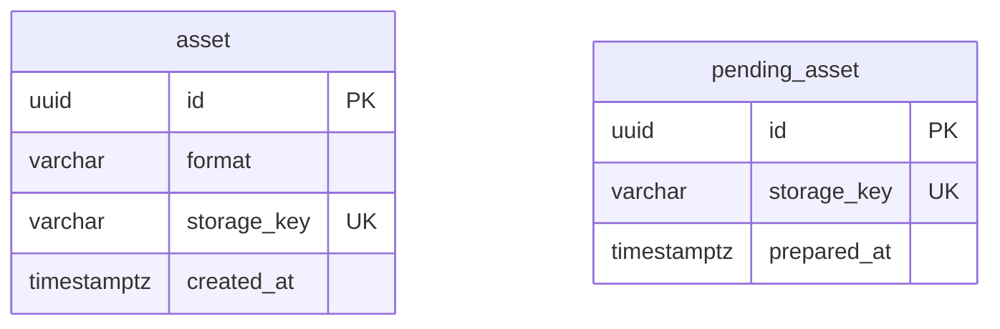

# メディアモジュール

利用者がアップロードするファイル（今は画像だけ）の受け付け、検証、保存、配信 URL、削除を管理する。ファイルが何に使われるか（どの商品の何枚目か、代表画像か）は持たず、使う側（商品カタログなど）が持つ。モジュールのレベルと境界、処理の流れ、API の案内、パッケージの構成は、[メディアの設計](../02-設計/media.md)に書く。

## 業務規則

### アセット

アセットは、検証して配信の場所に保存した 1 つのファイル。ID、形式（JPEG など）、配信キーを持つ。

- サイトの静的ファイル（ロゴ、CSS、JavaScript）は範囲外。フロントのビルド成果物として、CDN が配信する。
- 使う側はアセット ID だけを持つ。配信キーや URL の形は外に出さない。
- 配信キーはアセット ID で作り（`assets/{assetId}.{拡張子}`）、上書きしないのでキャッシュの有効期間を長くする。
- アセットは使う側が持ち主として扱い、不要になったら解放する。複数の持ち主で共有しない。

### アップロードの流れ

ファイルはブラウザーからアップロードのバケットへ直接送る（署名付き URL）。バックエンドは中継しない。呼ぶ順序と、操作ごとのトランザクションの扱いは [メディアの設計](../02-設計/media.md)の「画像のアップロード」。操作ごとの規則は次のとおり。

- **アップロードの受付**：形式とサイズを確認し、アップロードのバケットへの署名付き URL を返す。DB には記録しない。
  - 使う側は持ち主を表す範囲（商品 ID など）を渡す。アップロードのキーは `{範囲}/{uploadId}` で、別の範囲のアップロードを用意できない。
  - 枚数の上限など使う側の規則は、使う側がアップロードの受付の前に確認する。
- **用意**：アップロードしたファイルのサイズと、先頭のバイトで判定した形式を確認し（クライアントが申告した形式は使わない）、WebP に変換する。配信バケットに書く前に仮のアセットを短いトランザクションで記録し、書いた後に、用意した画像（アセット ID だけを持つ）を返す。アセットは記録しない。
  - 変換では、向きを画素に反映してメタデータを除く ※1。
  - 変換と保存の間に DB の接続を持たないため、使う側は用意をトランザクションの外で呼ぶ。
  - 配信バケットへの書き込みが失敗しても、仮のアセットは残る。
- **登録**：使う側のトランザクションの中で、仮のアセットを削除し、アセットを記録する。使う側の保存が失敗すると、この削除も記録も取り消され、仮のアセットが残る。
  - 仮のアセットがない（片付けのジョブが削除した後など）ときは例外にし、使う側の保存も取り消す。削除済みのファイルを指すアセットを記録しないため。
- **破棄**：用意した画像の配信のファイルを削除し、成功したら仮のアセットを短いトランザクションで削除する。登録しなかったとき（使う側の保存の失敗）に呼ぶ。
  - ファイルと仮のアセットのどちらの削除が失敗しても、例外を投げない。警告のログに配信キーを出力する。
  - ファイルを削除できなかったときは、仮のアセットを残し、片付けのジョブが後で削除する。
- 用意しなかったファイルは、アップロードのバケットのライフサイクル規則で 1 日後に削除される。
- 同じ受付 ID で用意を繰り返しても、仮のアセットはそれぞれ残り、保存期間の後に片付けのジョブが削除する。

※1：変換・保存に失敗したら、その場でエラーにしてアセットを記録しない。ファイルを読めないときは画像を変換できないエラー（400）、変換のサービスに届かないときは外部サービスのエラー（502）にする。失敗の分け方（画像を変換できないエラーと外部サービスのエラー）は [バックエンドのアーキテクチャ](../02-設計/backend-architecture.md)の「外部連携」と [メディアの設計](../02-設計/media.md)の「外部のサービス」。

#### 仮のアセットの片付け

用意の後、登録・破棄の前にプロセスが停止すると、仮のアセットと配信のファイルが残る。片付けのジョブが、次の規則で削除する。流れは [メディアの設計](../02-設計/media.md)の「仮のアセットの片付け」。

- 用意した時刻から保存期間を過ぎた仮のアセットを、1 回の実行で件数の上限まで削除する。残りは次の回に削除する。間隔、保存期間、上限の既定は[環境変数](../06-手順書/environment.md)の「バックエンド」。
- 削除した仮のアセットごとに、アセット解放のイベントを、同じトランザクションの中で登録する。
- 配信のファイルは、コミットの後にそのイベントで削除する。ファイルの削除が失敗したときは、イベントの再発行で再実行する。
- 保存期間は 1 分以上にする。0 にすると、用意から登録までの間の仮のアセットを削除しうるため。

#### 受け付ける画像

| 項目 | 決まり |
|------|--------|
| 形式 | JPEG、PNG、WebP、BMP、HEIC / HEIF、AVIF。用意のときに先頭のバイトで判定する |
| サイズ | 1 バイト以上、10MB まで |
| 配信の形式 | 全て WebP ※2 |

※2：用意で作るアセットが WebP で、配信キーは `assets/{アセット ID}.webp`。配信は、アセットに記録した形式と配信キーのままで行うので、WebP でない形式のアセットもある。

管理 API の画像の「アップロードの受付」は、申告の形式（MIME タイプ）とサイズの上限を契約にも書く。契約の外の申告は入力の検証のエラー（`INVALID_REQUEST`）になり、受付まで届かない。契約の値と上の決まりの一致は、契約のテスト（`FieldConstraintContractTest`）で確認する。

使う側で決まりの変更が必要になったら、アップロードの受付・用意に決まりを渡せるようにする。

### アセットの解放

使う側は、アセットが不要になったら（画像の削除、商品の削除）、自分のトランザクションの中で解放を呼ぶ。流れは [メディアの設計](../02-設計/media.md)の「アセットの解放」の図。

- 解放は、アセットの記録の削除と、内部のイベント（アセット解放）の登録を、使う側のトランザクションの中で行う。配信のファイルはコミット後にそのイベントで削除する（使う側の保存が失敗すれば、解放も取り消される）。
- イベントは、実際に削除した記録の分だけ登録する。同時に解放しても、同じアセットのイベントは重複しない。解放済みのアセットを再度解放しても、イベントは登録せず成功にする。
- ファイルの削除は冪等なので、再発行などでイベントが重複して届いてもよい。

### ストレージと変換

- ストレージと画像の変換のタイムアウトは、[環境変数](../06-手順書/environment.md)の「バックエンド」。
- 実装の選択、設定、使えるストレージの操作は、[メディアの設計](../02-設計/media.md)の「外部のサービス」に書く。

## 状態の遷移

なし。アセットと仮のアセットは、記録するか削除するかのどちらかで、状態を持たない。

## データモデル

列の正本は Flyway のマイグレーション。

- schema は `media`。
- 使う側からの外部キーは受けない。
- 仮のアセット（`pending_asset`）は、アセットの表とは別の表。使う側からの外部キーは受けない。配信キー（`storage_key`）は一意にし、用意した時刻（`prepared_at`）から保存期間を数える。
- 配信キー（`storage_key`）は、アセットごとに記録し、一意にする。用意で作るアセットは `assets/{アセット ID}.webp`、商品カタログから移したアセットは `products/{productId}/{imageId}.{拡張子}`（拡張子は記録した形式）。

## 今有効な AC

<!-- generated:module-ac -->
| AC | 今の内容 | 元の spec |
|----|----------|-----------|
| AC-39 | 形式は JPEG、PNG、WebP（AC-67 の形式も受け付ける）。1 ファイル 10MB まで。 | MVP-001 |
| AC-67 | BMP、HEIC / HEIF など一般的な画像形式も受け付ける。 | MVP-001 |
| AC-68 | 全ての画像を WebP に変換して配信する。 | MVP-001 |
| AC-69 | 変換時に位置情報などのメタデータを除去する。 | MVP-001 |
| AC-70 | 変換に失敗した画像は登録されず、運営者にその旨が表示される。変換のサービスがファイルを読めないときは、画像を変換できないエラー（400）を返す。変換のサービスに接続できない、時間内に応答がない、変換のサービスの側の故障のときは 502 を返す。根拠は[メディアモジュール](media.md)の「アップロードの流れ」、[API の規約](../05-開発規則/api-conventions.md)の「HTTP ステータス」。 | MVP-001 |
| AC-272 | 管理 API の契約は、商品の画像の形式・大きさの上限・枚数の上限を、型の制約で示す（説明の文だけにしない）。管理画面は、この値を契約から取得する。 | MVP-016 |
| AC-296 | 画像の確定で、画像の変換のサービスに接続できない、時間内に応答がない、変換のサービスの側の故障のときは 502 を返す。 | MVP-017 |
| AC-297 | 画像の確定で、変換のサービスがファイルを読めない（ファイルの側の問題）ときだけ、画像を変換できないエラー（400）を返す。 | MVP-017 |
| AC-298 | 画像の確定で、ファイル保存のサービスのエラーなら 502 を返す（アップロードの受付は署名付き URL をバックエンドの中で生成し、ファイル保存のサービスを呼ばない）。 | MVP-017 |
| AC-304 | 画像の確定は、画像の変換と保存のサービスを、データベースのトランザクションの外で呼ぶ。トランザクションの対象は、画像の登録と、商品への画像の追加だけにする。 | MVP-017 |
| AC-305 | 画像を公開の保存先に置いた後に、画像の登録か商品への追加が失敗したら、置いたファイルを削除する。削除するのに失敗したら、警告のログに保存先のキーを出力し、元の失敗を返す。 | MVP-017 |
<!-- /generated:module-ac -->
