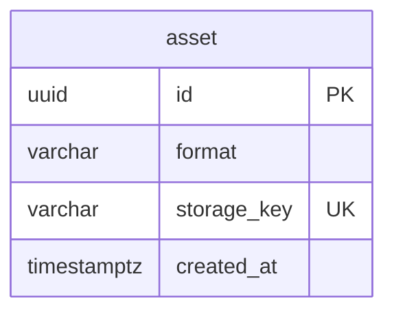

# メディアモジュール

利用者がアップロードするファイル（今は画像だけ）の受け付け、検証、保存、配信 URL、削除を管理する。ファイルが何に使われるか（どの商品の何枚目か、代表画像か）は持たず、使う側（商品カタログなど）が持つ。モジュールの境界、処理の流れ、API の一覧、パッケージの構成は、[メディアの設計](../02-設計/media.md)に書く。

| 項目 | 内容 |
|------|------|
| レベル | B（業務の不変条件はなく、ストレージとの連携が中心） |
| 範囲外 | サイトの静的ファイル（ロゴ、CSS、JavaScript）。フロントのビルド成果物として、フロントの配信（CDN）が配信する |

## 業務規則

### アセット

アセットは、検証して配信の場所に保存した 1 つのファイル。ID、形式（JPEG など）、配信キーを持つ。

- 使う側はアセット ID だけを持つ。配信キーや URL の形は外に出さない。
- 配信キーはアセット ID で作り（`assets/{assetId}.{拡張子}`）、上書きしないのでキャッシュの有効期間を長くする。
- アセットは使う側が持ち主として扱い、不要になったら解放する。複数の持ち主で共有しない。

### アップロードの流れ

ファイルはブラウザーからアップロードのバケットへ直接送る（署名付き URL）。バックエンドは中継しない。

1. **アップロードの受付**（`requestImageUpload`）：形式とサイズを確認し、アップロードのバケットへの署名付き URL を返す。DB には記録しない。
   - 使う側は持ち主を表す範囲（商品 ID など）を渡す。アップロードのキーは `{範囲}/{uploadId}` で、別の範囲のアップロードを用意できない。
   - 枚数の上限など使う側の規則は、使う側がアップロードの受付の前に確認する。
2. **用意**（`prepareImage`）：アップロードしたファイルのサイズと、先頭のバイトで判定した形式を確認し（申告は信用しない）、WebP に変換して配信バケットに保存する。アセットは記録せず、用意した画像（`PreparedImage`、アセット ID だけを持つ）を返す。
   - 使う側はトランザクションの外で呼ぶ（変換と保存の間、DB の接続を持たない）。DB を使わないので、自分ではトランザクションを始めない。
   - 変換は imgproxy で同期に行い、向きを画素に反映してメタデータを除く ※1。
3. **登録**（`registerImage`）：用意した画像をアセットとして記録する。使う側のトランザクションの中で呼び、トランザクションがなければ失敗する。使う側の保存が失敗すると、アセットの記録も取り消される。
4. **破棄**（`discardImage`）：用意した画像の配信のファイルを削除する。登録しなかったとき（使う側の保存の失敗）に呼ぶ。削除に失敗しても例外を投げず、警告のログに保存先のキーを出力する（使う側の元の失敗を隠さないため）。
5. 用意しなかったファイルは、アップロードのバケットのライフサイクル規則で 1 日後に削除される。用意の後、登録・破棄の前にプロセスが停止すると、配信のファイルが残る（だれも参照しない。登録のないファイルの検出と削除は行わない）。

※1：変換・保存に失敗したら、その場でエラーにしてアセットを記録しない。imgproxy が応答した失敗（4xx と 500）と、応答が WebP でない（先頭のバイトで判定）ときは、画像を変換できないエラー（400）。imgproxy・ストレージに届かない、時間内に応答がない、その側の故障（imgproxy の 502・503・504、ストレージの 5xx）は、外部サービスのエラー（`IMAGE_SERVICE_UNAVAILABLE`、502）にする（[バックエンドのアーキテクチャ](../02-設計/backend-architecture.md)の「外部連携」）。アップロードの受付は署名付き URL を手元で作り、ストレージを呼ばない。

#### 受け付ける画像

| 項目 | 決まり |
|------|--------|
| 形式 | JPEG、PNG、WebP、BMP、HEIC / HEIF、AVIF。用意のときに先頭のバイトで判定する |
| サイズ | 1 バイト以上、10MB まで |
| 配信の形式 | 全て WebP ※2 |

※2：用意で作るアセットが WebP で、配信キーは `assets/{アセット ID}.webp`。配信は、アセットに記録した形式と配信キーのままで行うので、WebP でない形式のアセットもある。

管理 API の画像の「アップロードの受付」は、申告の形式（MIME タイプ）とサイズの上限を契約にも書く。契約の外の申告は入力の検証のエラー（`INVALID_REQUEST`）になり、受付まで届かない。契約の値と上の決まりの一致は、契約のテスト（`FieldConstraintContractTest`）で確認する。

使う側で決まりの変更が必要になったら、アップロードの受付・用意に決まりを渡せるようにする。

### アセットを手放す

使う側は、アセットが不要になったら（画像の削除、商品の削除）、自分のトランザクションの中で `release` を呼ぶ。

- アセットの記録を削除し、内部のイベント（アセット解放）を登録する。配信のファイルはコミット後にそのイベントで削除する（使う側の保存が失敗すれば、解放も取り消される）。
- ファイルの削除は冪等なので、イベントが重複して届いてもよい。解放済みのアセットを再度解放しても成功にする。
- イベントのリスナーは DB を使わないので、トランザクションを始めない（ストレージを待つ間に DB の接続を持たない）。

### ストレージと変換

- ストレージは Amazon S3（AWS SDK v2）で、ローカルと CI は SeaweedFS。タイムアウトは 1 回の試行 10 秒、再試行を含めた全体 30 秒（設定は `ecsite.media.storage`）。
- 画像の変換は別コンテナの imgproxy を HTTP で呼ぶ。タイムアウトは接続 5 秒、応答 30 秒（設定は `ecsite.media.converter`）。
- ストレージの操作は、AWS（S3）と GCP（GCS）の両方にあるものだけにする。署名付き PUT の URL、ファイルの情報、先頭の読み取り、書き込み、削除が該当する。
- ストレージと変換の呼び出しの境界は、[メディアの設計](../02-設計/media.md)の「外部のサービス」に書く。

## 状態の遷移

なし。アセットは、記録するか削除するかのどちらかで、状態を持たない。

## データモデル

列の正本は Flyway のマイグレーション。

- schema は `media`。
- 使う側からの外部キーは受けない。
- 配信キー（`storage_key`）は、アセットごとに記録し、一意にする。用意で作るアセットは `assets/{アセット ID}.webp`、商品カタログから移したアセットは `products/{productId}/{imageId}.{拡張子}`（拡張子は記録した形式）。

## 今有効な AC

選んだ基準は、[AC 一覧](acceptance-criteria.md)の列「モジュール」が `media` で、状態が「有効」か「変更」の AC であること。

<!-- generated:module-ac -->
| AC | 今の内容 | 元の spec |
|----|----------|-----------|
| AC-39 | 形式は JPEG、PNG、WebP（AC-67 の形式も受け付ける）。1 ファイル 10MB まで。 | [001](../08-spec/archive/mvp/001-catalog-and-inventory/spec.md) |
| AC-67 | BMP、HEIC / HEIF など一般的な画像形式も受け付ける。 | [001](../08-spec/archive/mvp/001-catalog-and-inventory/spec.md) |
| AC-68 | 全ての画像を WebP に変換して配信する。 | [001](../08-spec/archive/mvp/001-catalog-and-inventory/spec.md) |
| AC-69 | 変換時に位置情報などのメタデータを除去する。 | [001](../08-spec/archive/mvp/001-catalog-and-inventory/spec.md) |
| AC-70 | 変換に失敗した画像は登録されず、運営者にその旨が表示される。変換のサービスがファイルを読めないときは、画像を変換できないエラー（400）を返す。変換のサービスに接続できない、時間内に応答がない、変換のサービスの側の故障のときは 502 を返す。根拠は[メディアモジュール](media.md)の「アップロードの流れ」、[API の規約](../05-開発規則/api-conventions.md)の「HTTP ステータス」。 | [001](../08-spec/archive/mvp/001-catalog-and-inventory/spec.md) |
| AC-272 | 管理 API の契約は、商品の画像の形式・大きさの上限・枚数の上限を、型の制約で示す（説明の文だけにしない）。管理画面は、この値を契約から取得する。 | [016](../08-spec/archive/mvp/016-master-data/spec.md) |
| AC-296 | 画像の確定で、画像の変換のサービスに接続できない、時間内に応答がない、変換のサービスの側の故障のときは 502 を返す。 | [017](../08-spec/archive/mvp/017-stability/spec.md) |
| AC-297 | 画像の確定で、変換のサービスがファイルを読めない（ファイルの側の問題）ときだけ、画像を変換できないエラー（400）を返す。 | [017](../08-spec/archive/mvp/017-stability/spec.md) |
| AC-298 | 画像の確定で、ファイル保存のサービスのエラーなら 502 を返す（アップロードの受付は署名付き URL をバックエンドの中で生成し、ファイル保存のサービスを呼ばない）。 | [017](../08-spec/archive/mvp/017-stability/spec.md) |
| AC-304 | 画像の確定は、画像の変換と保存のサービスを、データベースのトランザクションの外で呼ぶ。トランザクションの対象は、画像の登録と、商品への画像の追加だけにする。 | [017](../08-spec/archive/mvp/017-stability/spec.md) |
| AC-305 | 画像を公開の保存先に置いた後に、画像の登録か商品への追加が失敗したら、置いたファイルを削除する。削除するのに失敗したら、警告のログに保存先のキーを出力し、元の失敗を返す。 | [017](../08-spec/archive/mvp/017-stability/spec.md) |
<!-- /generated:module-ac -->
