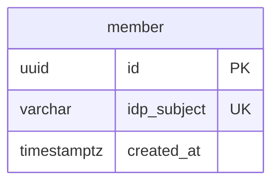

# 会員モジュール

IdP（Keycloak）のアカウントと、EC の会員 ID の対応を管理する。モジュールのレベルと境界、処理の流れ、API の一覧、パッケージの構成は、[会員の設計](../02-設計/member.md)に書く。

## 業務規則

### 会員

- 会員は、会員 ID（UUID）、IdP のアカウント ID（token の subject）、登録日時を持つ。
- 会員は、IdP のアカウントで識別する（BR-13）。メールアドレスは変わりうるので、識別に使わない（BR-13）。
- カート・注文手続き・注文が持つのは会員 ID。IdP を変更する・アカウントを移行するときは、この対応だけを書き換える。
- メールアドレスと氏名は持たない（IdP が正本で、必要なときに token から読む）。注文には注文時点のメールアドレスを写す。

### 会員を求める

- 会員の token で初めて API を呼んだときに作る。IdP の登録を EC に知らせる仕組みは作らない。
- 同じアカウントの初回のリクエストが同時に来ても、会員は 1 人だけ作る ※1。
- 会員を求める処理は、ログインした全てのリクエストで動く。会員を探す操作（読み取り専用のトランザクション）と、会員を作る操作を分ける。会員がいるとき（初回より後のリクエスト）は、読み取り専用のトランザクションだけで済む。

※1：アカウント ID の一意制約で守り、作れなければ（先に作られた）再読み込みする。作る処理は、一意制約の違反で失敗しない挿入（`ON CONFLICT DO NOTHING`）で行う。

### token の会員の情報

presentation が token から取り出す会員の情報は、次の 7 つである。アカウント ID、メールアドレス、確認済みか、姓、名、生年月日、性別。

- 生年月日（claim `birthdate`）と性別（claim `gender`）は、会員が IdP の会員登録とアカウントの画面で入力する任意の属性。会員モジュールは持たず、注文が成立のときに token から読んで、年齢と性別を記録する（[注文モジュール](order.md)「注文時の年齢と性別」）。
- token の値は文字列のまま渡し、形と範囲は注文が確認する。

| 店舗 API の操作 | token がないとき |
|-----------------|------------------|
| 会員の操作 | filter で 401 |
| 任意の操作（カート） | ログインしていない人として扱う |

## 状態の遷移

なし。会員は状態を持たない。

## データモデル

schema は `member`。

- 会員 ID とは別に、アカウント ID を一意で持つ。
- 登録日時は、会員を作った日時（IdP で登録した日時ではない）。
- 列の正本は Flyway のマイグレーション。

## 今有効な AC

選んだ基準は、[AC 一覧](acceptance-criteria.md)の列「モジュール」が `member` で、状態が「有効」か「変更」の AC であること。

<!-- generated:module-ac -->
| AC | 今の内容 | 元の spec |
|----|----------|-----------|
| AC-108 | 店舗から会員登録の画面に遷移し、メールアドレス、パスワード、氏名で登録できる。会員登録とログインの画面は IdP が表示する。 | [003](../08-spec/archive/mvp/003-auth/spec.md) |
| AC-109 | 登録済みのメールアドレスでは登録できない。 | [003](../08-spec/archive/mvp/003-auth/spec.md) |
| AC-110 | パスワードの条件（長さなど）を満たさない登録は拒否される。 | [003](../08-spec/archive/mvp/003-auth/spec.md) |
| AC-111 | 登録すると確認メールが届く。メールのリンクでメールアドレスを確認するまでは、ログインできない。 | [003](../08-spec/archive/mvp/003-auth/spec.md) |
| AC-112 | メールアドレスの確認が済むと、ログインした状態で店舗（会員登録を始めた画面）に戻る。会員登録を始めたブラウザーとは別のブラウザーで確認メールのリンクを開いたときは、IdP の画面から店舗に戻り、ログインする。 | [003](../08-spec/archive/mvp/003-auth/spec.md) |
| AC-113 | 店舗からログインの画面に遷移し、メールアドレスとパスワードでログインできる。ログインすると、ログインの前に見ていた画面に戻る。 | [003](../08-spec/archive/mvp/003-auth/spec.md) |
| AC-114 | ログインしている間、店舗の画面に会員の氏名とログアウトの操作を表示する。 | [003](../08-spec/archive/mvp/003-auth/spec.md) |
| AC-115 | ログアウトすると、店舗でも IdP でもログインしていない状態になる。同じブラウザーで、パスワードを入れずに再ログインすることはできない。 | [003](../08-spec/archive/mvp/003-auth/spec.md) |
| AC-116 | パスワードを続けて間違えると、そのアカウントは一定時間ログインできなくなる。 | [003](../08-spec/archive/mvp/003-auth/spec.md) |
| AC-117 | ログインの状態は、最後に操作してから一定時間続く。過ぎたら、再ログインする必要がある。 | [003](../08-spec/archive/mvp/003-auth/spec.md) |
| AC-118 | ログインの画面からメールアドレスを入力して、パスワードの再設定を申し込める。届いたメールのリンクから、新しいパスワードを設定できる。登録されていないメールアドレスでも同じ表示にし、会員かどうかを推測させない。 | [003](../08-spec/archive/mvp/003-auth/spec.md) |
| AC-119 | ログインしている会員は、店舗から IdP のアカウントの画面に遷移し、パスワードと氏名を変更できる。 | [003](../08-spec/archive/mvp/003-auth/spec.md) |
| AC-209 | IdP の会員登録の画面で、生年月日を入れられる。 | [010](../08-spec/archive/mvp/010-sales-report/spec.md) |
| AC-210 | 生年月日は任意とする。入れなくても登録でき、注文できる。理由：属性の収集のために購入を妨げないため。 | [010](../08-spec/archive/mvp/010-sales-report/spec.md) |
| AC-211 | 会員は、IdP のアカウントの画面で、後から生年月日を入れる・修正することができる。 | [010](../08-spec/archive/mvp/010-sales-report/spec.md) |
| AC-221 | IdP の会員登録の画面で性別（BR-29）を選べる。任意とし、後から IdP のアカウントの画面で修正できる。 | [010](../08-spec/archive/mvp/010-sales-report/spec.md) |
<!-- /generated:module-ac -->
