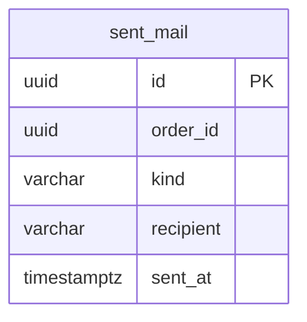

# 通知モジュール

消費者へのメールを送る。今は出荷通知メールだけ。モジュールのレベルと境界、処理の流れ、API の一覧、パッケージの構成は、[通知の設計](../02-設計/notification.md)に書く。

## 業務規則

### 出荷通知メール

- イベント「注文の出荷」をコミットの後に受け、注文のメールアドレスへ送る。流れは[通知の設計](../02-設計/notification.md)の「出荷通知メールの送信」。
- メールに必要な値（宛先、注文番号、配送業者、送り状番号）は、イベント「注文の出荷」に載っている（載せる値は [注文モジュール](order.md)の「出荷の登録」）。
- 件名と本文は日本語のテキスト。雛形はメッセージのファイル（`messages.properties` の `ecsite.notification.*`）に置き、注文番号、配送業者の表示名、送り状番号を差し込む。
- 送信元は設定 `ecsite.notification.from`。
- 消費者が配送業者のサイトで追跡できるよう、送り状番号は、イベントの値のまま載せる。

### 1 通だけ送る

| 項目 | 内容 |
|------|------|
| 記録 | 送ったメールを、注文 ID とメールの種類の組で記録する（一意制約） |
| 同じトランザクション | 記録の挿入と送信を同じトランザクションで行う。すでに記録があれば何もせず、挿入できたときだけ送る |
| 失敗 | 送信に失敗したら例外で終わり、記録も巻き戻る。未完了のイベントの再発行（[バックエンドのアーキテクチャ](../02-設計/backend-architecture.md)の「水平スケール」）で再送する |
| 重複して届いた | 記録があるので送らない。同時に届いたら、後の挿入は先のコミットを待ってから何もしない |

- 送信が済んでからコミットに失敗したときだけ、2 通になりうる。DB のコミットの失敗はまれなので許容する。
- メールの送信は、外部サービスをトランザクションの外で呼ぶ決まり（[バックエンドの書き方](../05-開発規則/backend-coding.md)の「トランザクションは application」）の例外にする。記録と送信を同じトランザクションにし、送信に失敗したら記録も取り消して再送するため（トランザクションの外で送ると、送った後に記録が失敗したとき 2 通になる）。SMTP にはタイムアウト（下の表）があり、リスナーは利用者のリクエストと別のスレッドで動くので、DB の接続を持つ時間は限られる。

### メールの送信

メールの送信の実装と設定は、[通知の設計](../02-設計/notification.md)の「外部のサービス」に書く。

| 項目 | 内容 |
|------|------|
| port | 「メールを送る」の 1 つ（宛先、件名、本文）。送れなければ実行時例外を投げる |
| タイムアウト | 接続・読み・書きをそれぞれ 10 秒。タイムアウトで失敗したら、上の「失敗」と同じく再発行で再送する ※1 |

※1：タイムアウトがないと、応答しない SMTP サーバーでメールのリスナーが止まったままになる。

## 状態の遷移

なし。

## データモデル

- schema は `notification`。注文は他のモジュールの ID なので、外部キーは張らない。
- 列の正本は Flyway のマイグレーション。

- 送ったメールは、注文 ID、メールの種類（`SHIPMENT`）、宛先、送った日時を持つ。
- 注文 ID とメールの種類の組で一意。

## 今有効な AC

選んだ基準は、[AC 一覧](acceptance-criteria.md)の列「モジュール」が `notification` で、状態が「有効」か「変更」の AC であること。

<!-- generated:module-ac -->
| AC | 今の内容 | 元の spec |
|----|----------|-----------|
| AC-183 | 出荷を登録すると、注文のメールアドレスに、注文番号、配送業者、送り状番号を書いた出荷通知メールを送る。 | [009](../08-spec/archive/mvp/009-shipping/spec.md) |
| AC-184 | 出荷登録は、メール送信の結果を待たない。送信に失敗したら、送れるまで再試行する。理由：メールサーバーが応答しないときも、出荷を止めないため。 | [009](../08-spec/archive/mvp/009-shipping/spec.md) |
| AC-185 | 再試行しても、1 つの出荷につき出荷通知メールは 1 通だけ届く。 | [009](../08-spec/archive/mvp/009-shipping/spec.md) |
<!-- /generated:module-ac -->
