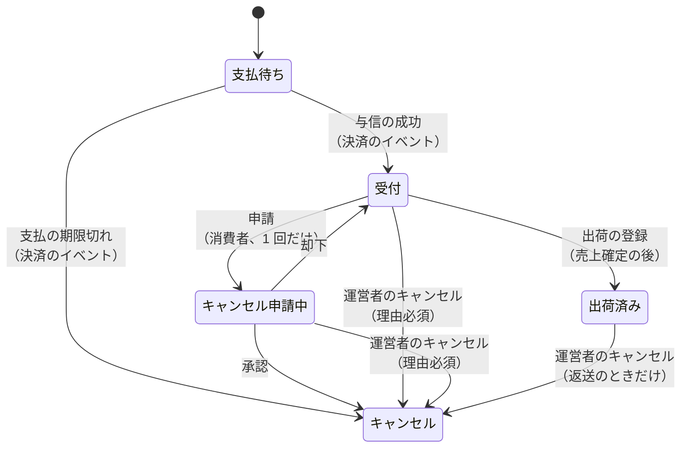
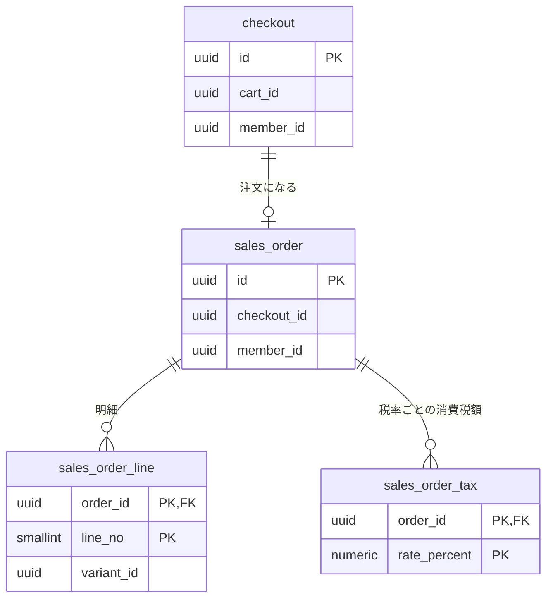

# 注文モジュール

見積もり（金額と購入できるか）、注文手続き、注文を管理する。支払の結果による状態の変更、出荷の登録、キャンセルも扱う。モジュールのレベルと境界、処理の流れ、API の一覧、パッケージの構成は、[注文の設計](../02-設計/order.md)に書く。

## 業務規則

### 見積もり

カートの表示、注文手続き、注文の成立は、どれも同じ見積もりで金額を求める（BR-7）。

- 入力は、品目（バリアントと数量）、時点、引当の持ち主（注文手続き中なら自分の引当を販売可能数から除く）。
- 品目ごとに、商品カタログから注文できるバリアントの情報を受け取る。品番と商品名、軸の値、税抜価格、税区分に加えて、表示されるかと販売停止かを受け取る。在庫からは販売可能数を受け取る。
- 購入できない品目には理由を付け、合計に含めない。
- 税込単価と税率ごとの消費税額は、税モジュールに計算させる。
- 小計は税込単価 × 数量、総額は小計の合計に送料を加えた額。価格と税率を適用する時点は、カートと注文手続きでは表示の時点、注文では注文日時（BR-7）。
- 送料は全国一律で、1 注文に 1 回かかり、商品の合計によらない。購入できる品目が 1 つ以上あるときだけかける。金額（既定 1,000 円、税込）と税区分（標準税率）は設定で決める（BR-6）。

### 注文手続き

- 注文手続きは、引当の持ち主になる。会員、カート、始めたときのカートのバージョン、引当の期限を持つ。
- 始められるのは、会員本人のカートだけ（会員の token が必要）。参照・注文できるのは始めた会員だけ（他の人は 404）。
- 始めるときに、購入できない品目がないことを確認してから、全品目を引き当てる。
- 同じカートで再び始めたら、新しい注文手続きを作り、前の引当を解く。
- カート変更のイベントを受けたら、そのカートの注文手続きの引当を解く ※1。
- 期限から保存期間（既定 1 日）を過ぎた注文手続きは、注文になったものも、片付けのジョブが削除する。削除の繰り返しとログ出力は、共通の期限切れデータの削除の仕組みを使う（[バックエンドのアーキテクチャ](../02-設計/backend-architecture.md)の「水平スケール」）。注文の表示と操作は注文手続きを読まない。削除した注文手続きを読む・注文する操作は 404 ※2。

※1：イベントの処理に失敗しても、引当は期限で数えられなくなるので実害は小さい。

※2：与信の成功の処理は、注文した品目をカートから除くために注文手続きからカートを参照する。注文手続きを削除した後に与信の成功を受信する（決済サービスの通知の再送は数日に及ぶことがある）と、注文は受付になるが、カートの品目は残る。カートに品目が残るだけなので受け入れる。

### 注文（集約）

- 注文は、注文番号、注文手続き、注文日時、状態を持つ。明細、金額の内訳、会員、メールアドレス、お届け先も持つ。注文時の年齢と性別、キャンセルの申請、キャンセルも持つ。キャンセルは、種類、運営者のキャンセルの理由、在庫に戻したかからなる。
- 支払（状態、支払の期限、与信期限）は決済が持つ。出荷（配送業者、送り状番号、配送状態、出荷日時）は出荷が持つ。注文は持たず、表示と判定のときに決済・出荷の API から読む。
- 明細は、注文時点の商品品番とバリアント品番、商品名と軸の値、税抜単価と税率、税込単価と数量と小計の写しを持つ。バリアント ID は在庫の戻しにだけ使う。
- 金額の内訳は、商品の合計、送料、総額、税率ごとの対象額と消費税額。
- 注文と明細は 1 つの集約。成立後、明細と金額は変わらない。
- メールアドレスはリクエストで受けず、会員の token のメールアドレスを写す（確認済みでなければ注文しない）。
- お届け先は、氏名と郵便番号、都道府県と市区町村、市区町村より下の住所、電話番号を持つ。都道府県と市区町村は、コードと名前を持つ。名前は、地域のマスターデータの注文時点の写しで、後でマスターデータが変わっても変えない（BR-35） ※3。
- 運営者の判断（承認・却下）とキャンセルには、運営者 ID と氏名の写しを別々に残す ※4。表示は写しを使う。

※3：明細が注文の時点の商品名と価格を写すのと同じ考え方。市区町村の合併などで名前やコードが変わっても、送った先の記録を変えない。

※4：却下の後に運営者がキャンセルすることがあるため、2 組を持つ。

| 操作 | できる人 | それ以外 |
|------|----------|----------|
| 参照、キャンセルの申請 | 注文した会員 | 他の会員は 404、ログインしていなければ 401 |
| 自分の注文の一覧 | 会員（注文日時の新しい順、ページ単位） | — |

- 注文番号とメールアドレスによる注文の照会は、店舗 API に置かない。会員だけが注文できるので、会員は自分の注文の一覧で照会する。

### 注文時の年齢と性別

レポートで会員の年齢層と性別を見るために、注文の成立のときに、会員の token の生年月日と性別から求めて記録する。会員の属性は IdP が正本で、会員モジュールは持たない（[会員モジュール](member.md)）。

| 項目 | 記録する値 | 記録しない（不明）とき |
|------|------------|------------------------|
| 年齢 | 注文日（日本時間）の時点の満年齢 ※5 | 生年月日がない、`YYYY-MM-DD` の形でない、注文日より後、注文日の 120 年より前 |
| 性別 | 男性（`MALE`）、女性（`FEMALE`）、その他（`OTHER`）、回答しない（`UNDISCLOSED`）（BR-29） | 値がない、一覧にない値 |

- 生年月日は記録しない。成立の後に会員が生年月日や性別を修正しても、記録した値は変えない。
- 「回答しない」は不明と分けて記録する（まとめるのはレポートの側）。

※5：2 月 29 日生まれは、うるう年でない年は 3 月 1 日に 1 つ年を取る。

### 注文の成立

- 判定を全て済ませてから、在庫の減算 → 注文の保存（支払待ち） → 支払を作る（決済の API）、の順に行う。判定は、カートの変更、購入できるか、総額、入力。カートはこの時点では変えない。
- お届け先の都道府県と市区町村は、リクエストでコードだけを受け、地域の API で確認する。都道府県がない、または市区町村がない・その都道府県に属さないときは 400（エラーコードは OpenAPI）。名前は地域の API から取る。
- 同じ注文手続きの注文は 1 つだけ（DB の一意制約でも守る）。
- 注文番号は、注文ごとに一意で、人が読み上げられる番号。識別子ではなく属性である。形式は、注文日（日本時間）の 8 桁、ハイフン、ランダムな 6 桁（BR-10）。在庫の調整履歴にも写すので、減算の前に、使われていない番号を確認して決める ※6。

※6：確認してから保存するまでに重なったら（ごくまれ）、重複してもトランザクションを中断しない挿入で衝突を検出し、409 にする。

### 支払

- 支払画面の URL は、店舗 API が決済の API から得る。持ち主だけが求められ、支払待ちで支払の期限の前でなければ 409。決済の API は決済サービスを呼ぶので、トランザクションの外で呼ぶ。
- 決済のイベント（与信の成功、支払の期限切れ）は、コミットの後に非同期で受ける。注文を行ロックしてから状態を変えるので、何度受信しても結果は同じ。
- 支払の期限切れの後に届いた与信は、決済の中で取り消され、注文には反映されない。

### 出荷の登録

1. 注文を行ロックせずに読み、受付でなければ 409 にする（売上を確定しない）。
2. トランザクションの外で、決済の API に売上確定を求める。与信期限切れは 409、決済サービスに接続できないときは 502 にし、出荷は作らない。
3. トランザクションで注文を行ロックし、受付なら出荷済みにして、出荷の API で出荷を作り、イベント「注文の出荷」を登録する。
4. 確定の後に注文が受付でなくなっていたら（キャンセル申請など）、409 にする。支払は売上確定済みのまま残り、再登録すると決済サービスを呼ばずに進む。キャンセルになったら返金される。

理由は [出荷の登録で、注文を出荷済みにする前に売上を確定する](../04-決定記録/order-capture-before-shipment.md)。

- 出荷では在庫を変えない。在庫数は注文の成立で減らしているため。
- 与信期限が切れた注文を、自動でキャンセルしない。期限が近い注文は一覧で絞り込めるので、運営者が確認し、キャンセルするかを判断する。
- 送り状番号の形は、売上確定の前にリクエストの検証で確認する（形は OpenAPI）。
- イベント「注文の出荷」には、メールアドレス、注文番号、配送業者、送り状番号（ハイフンを除いたもの）を載せる。

### 一覧の絞り込み

- 管理画面の注文一覧は、状態と注文番号、注文日の範囲で絞り込める。与信期限が近い注文と、配送状態が返送の注文でも絞り込める。
- 与信期限が近い注文と返送の注文は、決済・出荷の API から注文 ID の一覧を受け取り、注文の検索に ID の条件として渡す ※7。

※7：他のモジュールのテーブルは結合できない（[バックエンドのアーキテクチャ](../02-設計/backend-architecture.md)の「モジュール間の連携」）。件数が増えたら、注文に写しを持たせる方式を再検討する。

## 状態の遷移

| 操作 | すでにその状態のとき | できない状態 |
|------|----------------------|--------------|
| 与信の成功 | 支払待ちでなければ何もしない | — |
| 支払の期限切れ | 支払待ちでなければ何もしない | — |
| 申請 | 申請中なら成功して何もしない | 支払待ち、却下済み（申請は 1 回だけ）、キャンセル |
| 承認 | キャンセルなら成功して何もしない | 受付（申請がない） |
| 却下 | — | キャンセル、受付 |
| 運営者のキャンセル | キャンセルなら成功して何もしない | 支払待ち ※8、配送状態が返送でない出荷済み |
| 出荷の登録 | — | 受付以外（キャンセル申請中、出荷済みを含む） |

- 図の遷移は、受付・キャンセル申請中・キャンセルの間の遷移（BR-9）、支払待ちからの遷移（BR-14）、出荷済みへの遷移と出荷済みからのキャンセル（BR-18）の規則である。キャンセルからは、どの状態にも戻せない（BR-9）。配送状態は注文の状態と別に、出荷が持つ（BR-18）。
- キャンセルになるとき、同じトランザクションで在庫に明細の数量を戻させ（調整理由は「注文のキャンセル」）、決済の API で支払を取り消させる。与信の取消と返金は、決済がコミットの後に行い、注文は結果を待たない。
- 出荷済みの注文のキャンセルは、運営者が「在庫に戻す」かを必ず選ぶ（返送された商品が売れる状態とは限らないため）。戻さないときは在庫を変えない。出荷済みでない注文は、指定によらず戻す。キャンセルに、在庫に戻したかを記録する。
- キャンセルは種類（申請の承認、運営者の判断、支払期限切れ）を持つ。支払期限切れは、運営者と理由を持たない。
- 受付になるとき、同じトランザクションでカートから注文した品目（バリアント）を除かせる。注文の後にカートに追加した品目は残る。
- 状態が変わるたびに（作成の「支払待ち」を含む）、イベント「注文の状態の変化」を登録する。載せるのは、注文 ID、前と後の状態（作成では前はない）、発生日時、キャンセルのときはキャンセルの種類と在庫に戻したか。申請の却下（キャンセル申請中から受付）も 1 つの変化として登録する。
- 出荷では、さらにイベント「注文の出荷」を登録する。

※8：支払待ちの注文は、支払の期限で自動でキャンセルになるため。

### 状態ごとにできる操作

注文の状態ごとに、画面でできる操作と、そのとき真にするフラグは次のとおり。表にないフラグは偽である。

フラグは注文の詳細の応答（`actions`）で返す。画面は、真のフラグの操作だけを表示し、同じ判定を持たない。フラグの名前は OpenAPI の `OrderActions`（店舗は `store.yaml`、管理は `admin.yaml`）。

| 状態 | 店舗画面 | 管理画面 |
|------|----------|----------|
| 支払待ち | `pay`：支払う（支払の期限の前だけ） | — |
| 受付 | `requestCancellation`：キャンセルを申請する（まだ申請していないときだけ） | `cancel`：キャンセルする `ship`：出荷を登録する |
| キャンセル申請中 | — | `approveCancellation`：申請を承認する `rejectCancellation`：申請を却下する `cancel`：キャンセルする |
| 出荷済み | — | 配送状態が返送のときだけ： `cancel`：キャンセルする `cancelAsksRestock`：キャンセルのときに、在庫に戻すかを聞く |
| キャンセル | — | — |

`cancelAsksRestock` は操作でなく、キャンセルの画面に在庫の選択を表示するかを示す。偽のときは聞かずに、在庫に必ず戻す。

## データモデル

列の正本は Flyway のマイグレーション。

- schema は `ordering`（`order` は SQL の予約語のため）。
- カート・バリアント・会員（`cart_id`・`variant_id`・`member_id`）は他のモジュールの ID なので、外部キーは張らない。
- 注文の `checkout_id` は一意制約だけで、外部キーは張らない。
- 注文手続きと注文は会員 ID を必須で持つ。
- 明細の写しの軸の値は、変わらない一覧なので JSON で持つ。
- キャンセルの申請とキャンセルは注文に 1 回ずつなので、注文の列に持つ。在庫に戻したかも、注文の列に持つ。
- 注文時の年齢と性別は、分からなければ空（不明）。
- お届け先の都道府県と市区町村は、コードと名前を持つ。地域のマスターデータの表に外部キーは張らない。住所は市区町村より下だけを持つ。
- 金額の整合（総額 ＝ 商品の合計 ＋ 送料、小計 ＝ 税込単価 × 数量）は CHECK 制約でも守る。

## 今有効な AC

選んだ基準は、[AC 一覧](acceptance-criteria.md)の列「モジュール」が `order` で、状態が「有効」か「変更」の AC であること。注文手続き、注文（参照と一覧を含む）、注文のキャンセル、注文の画面とフォームを扱う AC が該当する。次は入れない。

- 他のモジュールの AC（在庫・決済・出荷・カート・レポート・通知など）。判断に迷う AC は、表示するデータを持つモジュールの表に入れる。支払や出荷の状態を画面に表示するだけの AC は、決済・出荷の表に入る
- モジュールが `common` の AC

<!-- generated:module-ac -->
| AC | 今の内容 | 元の spec |
|----|----------|-----------|
| AC-82 | カートから注文手続きに進むと、全品目をカートの数量だけ 15 分間引き当てる。1 品目でも引き当てられなければ、どれも引き当てず、引き当てられなかった品目を示す。 | [002](../08-spec/archive/mvp/002-cart-and-order/spec.md) |
| AC-84 | 引当は、再び始める、カート変更のイベントを受ける、15 分が経過する、のいずれかで解ける。注文の成立では減算に置き換わる。根拠は[注文モジュール](order.md)の「注文手続き」、[注文モジュール](order.md)の「注文の成立」。 | [002](../08-spec/archive/mvp/002-cart-and-order/spec.md) |
| AC-85 | 注文手続きで、カートの内容と送料、総額、税率ごとの消費税額を確認し、お届け先を入力して注文できる。根拠は[注文モジュール](order.md)の「注文（集約）」。 | [002](../08-spec/archive/mvp/002-cart-and-order/spec.md) |
| AC-86 | お届け先の入力の形式：郵便番号は数字 7 桁（ハイフンは任意）、電話番号は数字 10〜11 桁（ハイフンは任意）、氏名と住所は空白不可（長さの上限は OpenAPI）。都道府県と市区町村はコードだけを受け付け、地域の API で確認する（誤りは 400）。根拠は[注文モジュール](order.md)の「注文の成立」。 | [002](../08-spec/archive/mvp/002-cart-and-order/spec.md) |
| AC-87 | 全品目の在庫数を注文数だけ減らし、引当を解く。1 品目でも足りなければ、どの在庫も減らさず拒否する。注文の保存と支払の作成は、減算の後。根拠は[注文モジュール](order.md)の「注文の成立」。 | [002](../08-spec/archive/mvp/002-cart-and-order/spec.md) |
| AC-88 | 空のカート、または購入できない品目を含むカートは注文できない。 | [002](../08-spec/archive/mvp/002-cart-and-order/spec.md) |
| AC-89 | 確認した総額と、注文時点で計算した総額が異なる場合は、注文を拒否し、変わったことを示す。 | [002](../08-spec/archive/mvp/002-cart-and-order/spec.md) |
| AC-90 | 注文の成立で注文番号を採番する。注文した品目をカートから除くのは、与信の成功で受付になるとき。根拠は[注文モジュール](order.md)の「注文の成立」、[注文モジュール](order.md)の「状態の遷移」。 | [002](../08-spec/archive/mvp/002-cart-and-order/spec.md) |
| AC-91 | 同じ注文の送信が繰り返されても、注文は 1 件だけ作られる。 | [002](../08-spec/archive/mvp/002-cart-and-order/spec.md) |
| AC-92 | 注文時点の商品品番とバリアント品番、商品名と軸の値、税抜単価と税率と税込単価を、注文に写しとして残す。後で商品や税率が変わっても、注文の内容と金額は変わらない。 | [002](../08-spec/archive/mvp/002-cart-and-order/spec.md) |
| AC-93 | 注文の画面に、注文番号、注文日時、明細、金額の内訳（BR-7、8）、お届け先、状態を表示する。注文すると決済サービスの支払画面に移り、支払画面から戻ったときに与信の結果をまだ受信していなければ、「確認中」と示す。根拠は[店舗画面の構成](../02-設計/apps/store.md)の「支払画面への移動と戻り」。 | [002](../08-spec/archive/mvp/002-cart-and-order/spec.md) |
| AC-94 | 注文の参照は注文した会員だけができ、他の会員は 404。根拠は[注文モジュール](order.md)の「注文（集約）」。 | [002](../08-spec/archive/mvp/002-cart-and-order/spec.md) |
| AC-95 | 会員が受付の注文のキャンセルを申請できる（理由は任意、500 文字まで）。申請で「キャンセル申請中」になり、在庫は戻らない。根拠は[注文モジュール](order.md)の「注文（集約）」、[注文モジュール](order.md)の「状態の遷移」。 | [002](../08-spec/archive/mvp/002-cart-and-order/spec.md) |
| AC-96 | キャンセルの申請は、1 つの注文につき 1 回だけ。申請中の注文にもう一度申請しても、成功し、何も変わらない。却下された注文は、もう一度申請できない。 | [002](../08-spec/archive/mvp/002-cart-and-order/spec.md) |
| AC-97 | 全ての注文を、注文日時の新しい順に一覧できる。 | [002](../08-spec/archive/mvp/002-cart-and-order/spec.md) |
| AC-98 | 注文番号の前方一致、状態、注文日の範囲で絞り込める。 | [002](../08-spec/archive/mvp/002-cart-and-order/spec.md) |
| AC-99 | ページ単位で取得できる。 | [002](../08-spec/archive/mvp/002-cart-and-order/spec.md) |
| AC-100 | 注文番号と注文日時と状態、明細と金額の内訳、メールアドレスとお届け先、キャンセルの申請の日時と理由と結果、運営者の判断によるキャンセルの理由を表示する。 | [002](../08-spec/archive/mvp/002-cart-and-order/spec.md) |
| AC-101 | キャンセル申請中の注文を承認するとキャンセルになる。同じトランザクションで在庫を戻し、決済の API で支払を取り消させる。根拠は[注文モジュール](order.md)の「注文（集約）」、[注文モジュール](order.md)の「状態の遷移」。 | [002](../08-spec/archive/mvp/002-cart-and-order/spec.md) |
| AC-102 | 申請を却下すると「受付」に戻る。 | [002](../08-spec/archive/mvp/002-cart-and-order/spec.md) |
| AC-103 | 運営者は受付かキャンセル申請中の注文を、理由（必須、500 文字まで）付きでキャンセルできる。出荷済みは配送状態が返送のときだけで、支払待ちはキャンセルできない。[注文モジュール](order.md)の「状態の遷移」 | [002](../08-spec/archive/mvp/002-cart-and-order/spec.md) |
| AC-104 | キャンセルと在庫の戻しは、両方とも実行されるか、どちらも実行されない。 | [002](../08-spec/archive/mvp/002-cart-and-order/spec.md) |
| AC-105 | キャンセル済みの注文へのキャンセル・承認は、成功し、在庫は戻さない。キャンセル済みの注文の申請は却下できない。 | [002](../08-spec/archive/mvp/002-cart-and-order/spec.md) |
| AC-106 | キャンセル済みの注文も、一覧・詳細に表示される。 | [002](../08-spec/archive/mvp/002-cart-and-order/spec.md) |
| AC-125 | 注文手続きに進むには、ログインが必要。 | [003](../08-spec/archive/mvp/003-auth/spec.md) |
| AC-126 | 注文手続きは、それを始めた会員だけが操作・参照できる。他の会員やログインしていない人には「見つからない」と示す。 | [003](../08-spec/archive/mvp/003-auth/spec.md) |
| AC-127 | 注文の連絡先のメールアドレスには、会員のメールアドレス（確認済み）を使い、注文手続きでは入力しない。注文には、注文時点のメールアドレスの写しを残す。 | [003](../08-spec/archive/mvp/003-auth/spec.md) |
| AC-128 | 注文は、注文した会員に結び付く。 | [003](../08-spec/archive/mvp/003-auth/spec.md) |
| AC-129 | ログインしている会員は、自分の注文を注文日時の新しい順に一覧できる。ページ単位で取得できる。 | [003](../08-spec/archive/mvp/003-auth/spec.md) |
| AC-130 | 一覧から注文の詳細（AC-93 と同じ内容）に遷移し、キャンセルを申請できる（AC-95、96）。 | [003](../08-spec/archive/mvp/003-auth/spec.md) |
| AC-131 | 注文の参照とキャンセルの申請は注文した会員だけができる。他の会員は 404、ログインしていなければ 401。根拠は[注文モジュール](order.md)の「注文（集約）」。 | [003](../08-spec/archive/mvp/003-auth/spec.md) |
| AC-142 | キャンセルの申請の承認・却下と、運営者の判断によるキャンセルに、操作した運営者の氏名の写しを残し、注文の詳細に表示する（在庫の調整履歴は、ここでは含めない）。 | [003](../08-spec/archive/mvp/003-auth/spec.md) |
| AC-143 | 注文手続きで注文すると、注文は「支払待ち」で作られ、決済サービスの支払画面に移る。 | [007](../08-spec/archive/mvp/007-payment/spec.md) |
| AC-144 | 「支払待ち」の注文を作ると、全品目の在庫数を減らす。カートはこの時点では変えない。 | [007](../08-spec/archive/mvp/007-payment/spec.md) |
| AC-146 | 決済サービスで総額の与信が成功すると、注文は「受付」になる。売上は確定しない。 | [007](../08-spec/archive/mvp/007-payment/spec.md) |
| AC-147 | 与信が成功すると、注文した品目（バリアント）をカートから除く。注文の後にカートに追加した品目は残る。 | [007](../08-spec/archive/mvp/007-payment/spec.md) |
| AC-151 | 支払の期限の前なら、「支払待ち」の注文から、支払画面に再び遷移して支払える。 | [007](../08-spec/archive/mvp/007-payment/spec.md) |
| AC-153 | 支払の期限までに与信が成功しなかった注文は、キャンセルになり、明細の数量だけ在庫数を戻す。 | [007](../08-spec/archive/mvp/007-payment/spec.md) |
| AC-154 | 期限切れのキャンセルは、期限から一定時間のうちに行われる。 | [007](../08-spec/archive/mvp/007-payment/spec.md) |
| AC-155 | 期限切れのキャンセルの理由は「支払期限切れ」とし、注文の詳細に表示する。 | [007](../08-spec/archive/mvp/007-payment/spec.md) |
| AC-156 | 期限の直前に与信が成功した注文は、期限切れでキャンセルしない。 | [007](../08-spec/archive/mvp/007-payment/spec.md) |
| AC-157 | 期限切れでキャンセルした後に与信の成功を受信したら、その与信を取り消す。注文はキャンセルのまま。 | [007](../08-spec/archive/mvp/007-payment/spec.md) |
| AC-158 | 「支払待ち」の注文は、消費者のキャンセルの申請も、運営者のキャンセルもできない。 | [007](../08-spec/archive/mvp/007-payment/spec.md) |
| AC-161 | 管理画面の注文の一覧で、状態「支払待ち」で絞り込める。 | [007](../08-spec/archive/mvp/007-payment/spec.md) |
| AC-162 | 与信済みの注文がキャンセルになると、与信を取り消す。キャンセルの理由によらない。 | [007](../08-spec/archive/mvp/007-payment/spec.md) |
| AC-163 | キャンセルは、与信の取消の結果を待たずに成立する。 | [007](../08-spec/archive/mvp/007-payment/spec.md) |
| AC-167 | 運営者は、「受付」の注文詳細で、配送業者と送り状番号を入力して出荷を登録できる。 | [009](../08-spec/archive/mvp/009-shipping/spec.md) |
| AC-168 | 出荷を登録すると、総額で売上を確定し、注文は「出荷済み」になる。 | [009](../08-spec/archive/mvp/009-shipping/spec.md) |
| AC-169 | 売上確定に失敗したら、出荷は登録されず、注文は「受付」のまま。管理画面に失敗の理由を表示する。 | [009](../08-spec/archive/mvp/009-shipping/spec.md) |
| AC-170 | 「受付」以外の注文は出荷を登録できない。「キャンセル申請中」の注文は、申請を承認か却下してから出荷する。 | [009](../08-spec/archive/mvp/009-shipping/spec.md) |
| AC-171 | 「出荷済み」の注文は、消費者はキャンセルを申請できない。運営者は、配送状態が「返送」のときだけキャンセルできる。 | [009](../08-spec/archive/mvp/009-shipping/spec.md) |
| AC-172 | 同じ注文に出荷を重複して登録しても、売上確定は 1 回だけ実行する。 | [009](../08-spec/archive/mvp/009-shipping/spec.md) |
| AC-182 | 管理画面の注文一覧で、状態「出荷済み」で絞り込める。「受付」で絞り込むと、出荷待ちの注文が表示される。 | [009](../08-spec/archive/mvp/009-shipping/spec.md) |
| AC-187 | 管理画面の注文一覧で、与信期限が近い注文を絞り込める。 | [009](../08-spec/archive/mvp/009-shipping/spec.md) |
| AC-188 | 与信期限を過ぎた注文を出荷すると、売上確定に失敗する。運営者はその注文をキャンセルできる。 | [009](../08-spec/archive/mvp/009-shipping/spec.md) |
| AC-189 | 管理画面の注文一覧で、配送状態「返送」の注文を絞り込める。 | [009](../08-spec/archive/mvp/009-shipping/spec.md) |
| AC-190 | 運営者は、配送状態が「返送」の注文を、理由を入力してキャンセルできる。 | [009](../08-spec/archive/mvp/009-shipping/spec.md) |
| AC-191 | 返送された注文をキャンセルするとき、運営者は在庫に戻すかを選ぶ。戻すときは明細の数量だけ在庫数を増やし、戻さないときは在庫数を変えない。 | [009](../08-spec/archive/mvp/009-shipping/spec.md) |
| AC-192 | 返送された注文をキャンセルすると、総額（送料を含む）を返金する。 | [009](../08-spec/archive/mvp/009-shipping/spec.md) |
| AC-193 | キャンセルは、返金の結果を待たずに成立する。 | [009](../08-spec/archive/mvp/009-shipping/spec.md) |
| AC-196 | キャンセルの後、店舗の注文一覧と注文詳細は「キャンセル」を表示する。消費者にメールは送らない。 | [009](../08-spec/archive/mvp/009-shipping/spec.md) |
| AC-212 | 注文の成立のときに、その時点の年齢を注文に記録する。後で生年月日を修正しても、成立済みの注文の年齢は変えない。 | [010](../08-spec/archive/mvp/010-sales-report/spec.md) |
| AC-213 | 未来の日付と、明らかにありえない日付（120 年より前など）は受け付けない。 | [010](../08-spec/archive/mvp/010-sales-report/spec.md) |
| AC-222 | 注文の成立のときに、その時点の性別を注文に記録する。後で修正しても、成立済みの注文の性別は変えない。 | [010](../08-spec/archive/mvp/010-sales-report/spec.md) |
| AC-248 | 注文手続きの画面のお届け先は、都道府県・市区町村・それより下の住所を、別の欄で入力する。都道府県と市区町村は一覧から選ぶ。 | [016](../08-spec/archive/mvp/016-master-data/spec.md) |
| AC-251 | 注文の確定は、選んだ都道府県に属さない市区町村、またはマスターデータにないコードを、入力の誤り（400）で拒否する。 | [016](../08-spec/archive/mvp/016-master-data/spec.md) |
| AC-252 | 注文の詳細（店舗画面・管理画面）は、お届け先を、都道府県名・市区町村名・それより下の住所の順に表示する。 | [016](../08-spec/archive/mvp/016-master-data/spec.md) |
| AC-258 | 注文は、お届け先の都道府県と市区町村をコードで持つ。 | [016](../08-spec/archive/mvp/016-master-data/spec.md) |
| AC-261 | 既存の注文は、都道府県名をコードに変換し、住所の先頭をマスターデータの市区町村名と照合して、住所から市区町村を切り出す。照合できない注文があれば、DB の移行を失敗させる。 | [016](../08-spec/archive/mvp/016-master-data/spec.md) |
| AC-264 | 注文手続きの画面は、入力の誤り（400）の欄ごとの文を、API の応答の文のまま表示する。画面で文を作るのは、応答がないときだけ。 | [016](../08-spec/archive/mvp/016-master-data/spec.md) |
| AC-265 | 店舗 API の入力の誤りの文は、消費者が読んで修正できる文にする。形の誤りに、正規表現などの検証ライブラリの既定の文を表示しない。 | [016](../08-spec/archive/mvp/016-master-data/spec.md) |
| AC-266 | エラーの文に上限・桁数などの値を入れるときは、数字を文に書かず、正本の値を差し込む。バックエンドのエラーの文と、画面の文言の両方に当てる。 | [016](../08-spec/archive/mvp/016-master-data/spec.md) |
| AC-267 | 店舗 API の注文の応答は、キャンセルの申請の結果（申請していない、申請中、承認、却下）を返す。 | [016](../08-spec/archive/mvp/016-master-data/spec.md) |
| AC-268 | 管理 API の注文の応答は、キャンセルのときに在庫を戻すか運営者に確認するかを返す。 | [016](../08-spec/archive/mvp/016-master-data/spec.md) |
| AC-271 | 店舗画面と管理画面は、API の応答の操作の可否と理由のほかに、注文の状態や商品の状態から操作の可否を決める判定を持たない。 | [016](../08-spec/archive/mvp/016-master-data/spec.md) |
| AC-284 | 片付けの定期ジョブが、期限から保存期間（既定 1 日）を過ぎた注文手続きを削除する。根拠は[注文モジュール](order.md)の「注文手続き」。 | [017](../08-spec/archive/mvp/017-stability/spec.md) |
| AC-285 | 保存期間と、片付けのジョブの間隔は、設定で変更できる。 | [017](../08-spec/archive/mvp/017-stability/spec.md) |
| AC-286 | 片付けは、注文を削除しない。注文になった注文手続きを削除しても、注文は表示・操作できる。 | [017](../08-spec/archive/mvp/017-stability/spec.md) |
| AC-287 | 片付けのジョブは、複数のインスタンスで動かしても同時に 1 つだけが動く（[バックエンドのアーキテクチャ](../02-設計/backend-architecture.md)の「水平スケール」）。 | [017](../08-spec/archive/mvp/017-stability/spec.md) |
| AC-288 | 片付けのジョブは、データごとに削除した件数をログに出力する。 | [017](../08-spec/archive/mvp/017-stability/spec.md) |
| AC-289 | 期限切れの注文手続きを削除した後に、その注文手続きを使う操作は、期限切れのときと同じ結果か、見つからない（404）になる。 | [017](../08-spec/archive/mvp/017-stability/spec.md) |
| AC-295 | 支払画面を作るとき、決済サービスのエラーなら 502 を返す。 | [017](../08-spec/archive/mvp/017-stability/spec.md) |
| AC-193-4 | 注文のフォームで欄に誤りがあるとき、その欄の誤りの文が、入力欄の説明として支援技術に伝わる。 | [193](../08-spec/archive/1to10/193-store-a11y/spec.md) |
| AC-193-5 | 誤りのある欄は、誤りのある状態として支援技術に伝わる。誤りのない欄は、その状態を伝えない。 | [193](../08-spec/archive/1to10/193-store-a11y/spec.md) |
| AC-193-6 | 欄の補足の文（郵便番号・住所・電話番号の入力の例）も、入力欄の説明として伝わる。誤りがあるときは、補足の文と誤りの文の両方が伝わる。 | [193](../08-spec/archive/1to10/193-store-a11y/spec.md) |
| AC-227-1 | 注文のフォームの送信が欄の誤りで失敗したとき、フォーカスは、選べる誤りの欄のうち画面の順で最初の欄に移る。選べない欄（一覧を取れていない市区町村の欄）は飛ばす。 | [227](../08-spec/archive/1to10/227-store-forms/spec.md) |
| AC-227-2 | 誤りのある欄が全て選べないときは、フォーカスを移さない。 | [227](../08-spec/archive/1to10/227-store-forms/spec.md) |
| AC-227-3 | 欄の誤りがない失敗（在庫不足、通信の失敗など、フォームの下に表示するもの）では、フォーカスを移さない。 | [227](../08-spec/archive/1to10/227-store-forms/spec.md) |
| AC-227-4 | フォーカスを移す処理は、送信の結果を受けたときだけ動く。結果を受けた後に欄を入力・選択しても、フォーカスを欄へ再び移さない。 | [227](../08-spec/archive/1to10/227-store-forms/spec.md) |
| AC-227-5 | 同じ誤りで再び送信に失敗したときも、AC-227-1 のとおりにフォーカスを移す。 | [227](../08-spec/archive/1to10/227-store-forms/spec.md) |
<!-- /generated:module-ac -->
