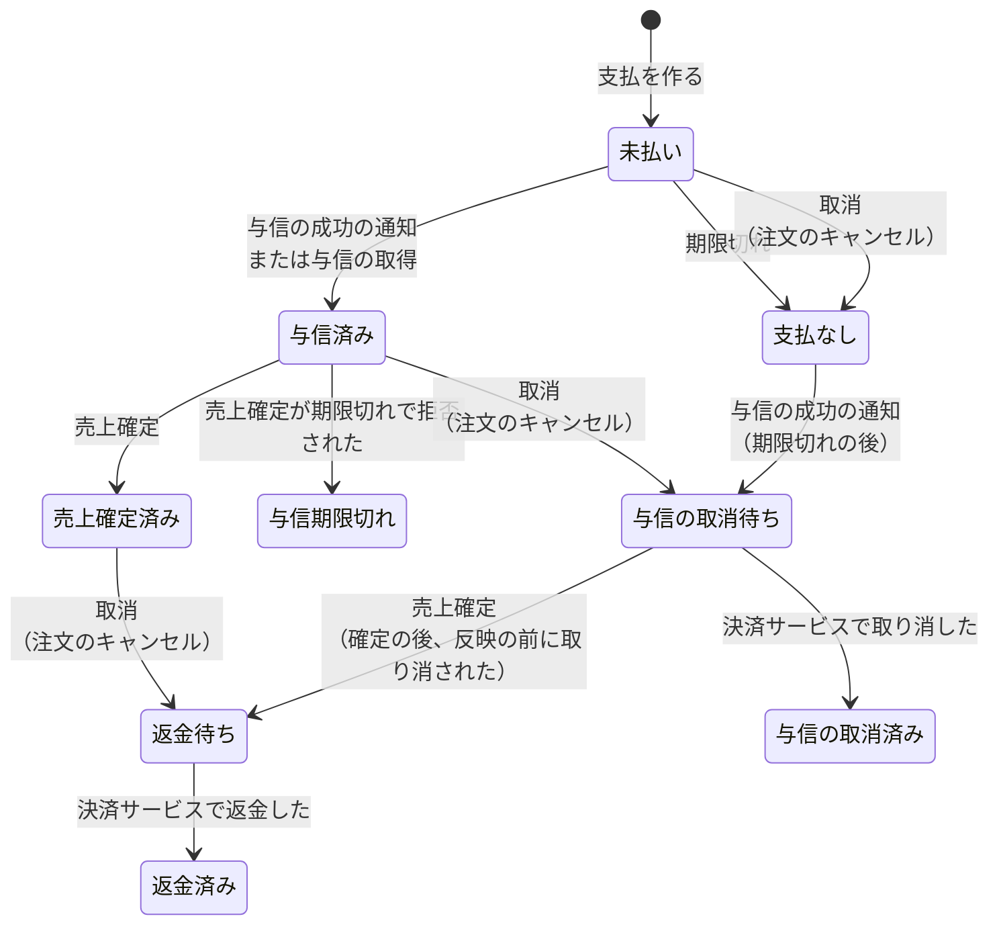
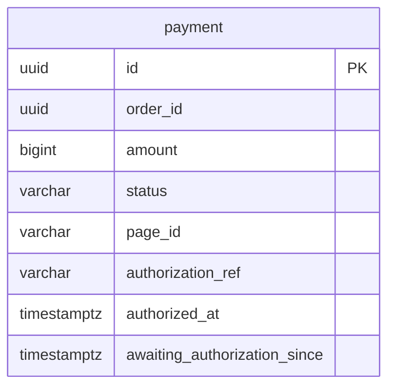

# 決済モジュール

注文の代金の支払（カードの与信、売上確定、返金）を管理する。決済サービス（Stripe）との連携は、このモジュールが腐敗防止層として受け持つ。モジュールのレベルと境界、処理の流れ、API の案内、パッケージの構成は、[決済の設計](../02-設計/payment.md)に書く。

## 業務規則

### 支払（集約）

- 支払は、注文 ID、金額（総額）、支払の期限、状態、支払画面（決済サービスでの ID と URL）、与信の参照（決済サービスで与信を取り消す・売上を確定する・返金するときに使う ID）、与信の時刻、与信の反映を待ち始めた時刻を持つ。
- 支払の状態は、注文の状態とは別に、注文ごとに持つ（BR-15）。
- 1 つの注文に支払は 1 つ（DB の一意制約でも守る）。注文の成立と同じトランザクションで作る。
- 支払画面は、同時に 1 つだけ開く。開いていれば同じ画面を使い、決済サービスに再作成させない。流れは [決済の設計](../02-設計/payment.md)の「支払画面を開く」。
- 支払える支払は、未払いで、期限より前のもの。支払画面を開けるのは、支払える支払だけ。
- 与信の時刻は、与信済みになったときに記録する（与信期限の起点）。通知で与信済みになった支払は、通知を受けた時刻にする。期限切れのジョブで与信済みになった支払は、決済サービスの与信の作成の時刻にする。

### 支払の状態

| 状態 | 意味 |
|------|------|
| 未払い | 与信がまだ成功していない（BR-15） |
| 与信済み | 総額の与信が成功し、売上は確定していない（BR-15） |
| 与信の取消待ち | 注文がキャンセルになり、与信の取消が完了していない（BR-15） |
| 与信の取消済み | 与信を取り消した（BR-15） |
| 支払なし | 与信が成功しないまま、注文がキャンセルになった（BR-15） |
| 売上確定済み | 総額で売上を確定した（BR-21） |
| 与信期限切れ | 与信期限を過ぎ、売上を確定できなかった（BR-21） |
| 返金待ち | 売上確定済みの注文がキャンセルになり、返金が済んでいない（BR-21） |
| 返金済み | 総額を返金した（BR-21） |

### 支払の期限

- 支払の期限は、注文日時に設定の時間（既定 30 分）を加えた時刻（BR-16）。注文が支払を作るときに渡す。
- 決済サービスの支払画面も、支払の期限を過ぎると使えなくなる（BR-16）。決済サービスの支払画面は、作ってから期限が切れるまでの時間に下限がある（[決済の設計](../02-設計/payment.md)の「Stripe」）。画面を再作成すると画面の期限が支払の期限より後になるので、期限切れのジョブが支払の期限に画面を閉じて、両方の期限を一致させる。
- 期限切れのジョブが、期限を過ぎた未払いの支払を処理する。流れ、設定、件数、ログは [決済の設計](../02-設計/payment.md)の「支払の期限切れ」。
  - 支払画面を閉じる前に支払が済んでいた支払は、未払いなら与信の反映を待つ支払にする（状態は未払いのまま、待ち始めた時刻を記録する）。
  - 与信の反映を待つ支払は、決済サービスから与信を取得して与信済みにする（BR-409-1）。取得できなければ待つ支払のまま残し、次の回で再試行する。先に与信の成功の通知が届いた支払は、通知で与信済みになる。
  - 支払画面を閉じられた支払と、支払画面がない支払は、未払いなら支払なしにする。

### 与信期限

- 与信期限は、与信の時刻に設定の期間（既定 7 日）を加えた時刻。与信期限を過ぎると、売上を確定できない（BR-20）。Stripe のオンラインのカード決済の与信が 7 日で切れるため。設定のキーは [決済の設計](../02-設計/payment.md)の「売上確定」。
- 「期限が近い」は、与信期限までの残りが設定の期間（既定 2 日）を下回ったとき（BR-20）。期限を過ぎたものも含む。対象は、与信済みと与信期限切れの支払。
- 期限切れは、ジョブで監視しない。売上確定が決済サービスに期限切れで拒否されたときに、与信期限切れにする。与信期限切れの注文を自動でキャンセルしない規則は [注文モジュール](order.md)の「出荷の登録」。

### 売上確定

流れ（トランザクション、行ロック、冪等キー）は [決済の設計](../02-設計/payment.md)の「売上確定」。売上確定済みの支払への再登録、与信期限切れと接続できないときのエラーなど、呼び出す注文の規則は [注文モジュール](order.md)の「出荷の登録」。

- 与信済みでなければ、売上確定は業務のエラーを返す。
- 決済サービスで総額の売上を確定する。成功なら売上確定済みにする。与信期限切れなら与信期限切れにする。
- 決済サービスが確定してから、確定を反映するまでの間に注文がキャンセルされると、支払は与信の取消待ちになっている。確定した与信は取り消せないので、反映のときに返金待ちにして返金する。
- 決済サービスに接続できないときは、支払は与信済みのまま残る。

### 与信の取消

流れ（コミットの後の呼び出し、リスナー、失敗したときの再試行）は [決済の設計](../02-設計/payment.md)の「注文のキャンセルと、与信の取消・返金」。

- 与信の取消待ちの支払は、決済サービスで与信を取り消し、成功したら与信の取消済みにする。
- 決済サービスで取消済みの与信の取消も、成功として扱う。
- 決済サービスで売上確定済みの与信は取り消せないので、再試行せず、返金待ちにして返金する。例：売上確定の応答が届かなかった支払をキャンセルしたとき。
- 決済サービスが取消を拒否し、その与信が取消済みでも売上確定済みでもないときは、与信の取消待ちのまま残し、再発行で再試行する。

### 返金

流れは [決済の設計](../02-設計/payment.md)の「注文のキャンセルと、与信の取消・返金」。

- 返金待ちの支払は、決済サービスで総額を返金し、成功したら返金済みにする。
- 返金済みの支払の取消も、成功として扱う。

### 決済サービスからの通知

流れは [決済の設計](../02-設計/payment.md)の「決済サービスからの通知」。

- 支払の結果は、決済サービスからの通知で受け取る。例外は期限切れのジョブで、決済サービスで支払済みと確認した支払は、決済サービスから与信を取得して反映する（BR-409-1）。
- 支払画面から戻ったときに、決済サービスに問い合わせない（BR-409-2）。
- 通知は、決済サービスの署名を確認し、確認できないものは処理しない（BR-17）。署名の確認と拒否の応答は [決済の設計](../02-設計/payment.md)の「Stripe」。
- 同じ通知を重複して受信しても、結果は 1 回だけ反映する（BR-17）。通知の ID は記録せず、支払の状態の遷移で守る。
- 通知の順序が入れ替わっても、支払の状態は図の遷移を外れない（BR-17）。遷移できない通知は、状態を変えずに無視する。
- 処理に失敗した通知は、決済サービスの再送で再処理する（BR-17）。
- 受け付ける通知は、与信の成功と、支払画面の期限切れ。登録にない支払画面の通知は、状態を変えずに無視する（与信の成功の通知のときは、warn のログを出す）。
- 支払画面の期限切れの通知は、支払の期限の後で未払いのときだけ、支払なしにする。期限の前の通知は無視し、期限切れのジョブに任せる。

### 決済サービスとの通信

- タイムアウトと再試行は、[決済の設計](../02-設計/payment.md)の「Stripe」。
- 売上確定は、接続できない・時間内に応答がない、決済サービスの側の障害、回数の制限を、「接続できない」の結果にする。与信済みのまま残り、再試行できる。
- 支払画面の作成と閉じる操作、与信の取得、与信の取消、返金は、同じ失敗を外部サービスのエラー（`PAYMENT_GATEWAY_UNAVAILABLE`、502）にする。与信の取得は、期限切れのジョブの次の回で再試行する。与信の取消と返金は、再発行で再試行する。
- 認証・権限・リクエストの誤りなど、上の他の拒否は、システムのエラーにする。

## 状態の遷移

図にない遷移の操作は、状態を変えない（冪等）。

| 操作 | すでにその状態のとき | できない状態 |
|------|----------------------|--------------|
| 与信の成功の通知、与信の取得 | 与信済みなら状態も与信の時刻も変えない | — |
| 期限切れ | 支払なしなら状態を変えない | — |
| 与信の反映を待つ | すでに待っていれば、状態も待ち始めた時刻も変えない（状態は未払いのまま、待ち始めた時刻だけを記録する） | 未払い以外なら時刻を記録しない（状態を変えない操作なので、図に出ない） |
| 売上確定 | 売上確定済みなら状態を変えない | — |
| 与信期限切れにする | 与信期限切れなら状態を変えない | — |
| 取消 | 与信の取消待ち・与信の取消済み・支払なし・返金待ち・返金済みなら状態を変えない | 与信期限切れなら状態を変えない（取り消すものがない） |
| 取消済みにする | 与信の取消済みなら状態を変えない | — |
| 返金済みにする | 返金済みなら状態を変えない | — |

- 図の遷移のうち、売上確定済み・与信期限切れ・返金待ち・返金済みが関わらないものは BR-15、関わるものは BR-21 の規則である。
- どの操作も冪等にする。遷移できない通知は、状態を変えずに無視する。
- 与信済みになったら「与信の成功」、期限切れで支払なしになったら「支払の期限切れ」のイベントを登録する。
- 与信の取消待ちになったら、決済の中のイベント「与信の取消の依頼」を、返金待ちになったら「返金の依頼」を登録する。
- 与信期限切れの支払の取消は、取り消すものがないので何もしない（与信は決済サービスで切れている）。与信期限切れの注文をキャンセルしても、与信を取り消さない（BR-21）。

## データモデル

列の正本は Flyway のマイグレーション。

- schema は `payment`。テーブルは支払 1 つだけで、他のテーブルとの関係はない。
- 注文 ID は他のモジュールの ID なので、外部キーは張らない。注文 ID に一意制約を付ける。
- 金額は円単位の整数。
- 支払画面 ID と URL は、両方あるか、両方ない（CHECK 制約でも守る）。支払画面 ID は、通知から支払を探すため、一意にする。
- 与信の参照、与信の時刻、与信の反映を待ち始めた時刻は、なければ空。

## 今有効な AC

<!-- generated:module-ac -->
| AC | 今の内容 | 元の spec |
|----|----------|-----------|
| AC-145 | カード番号は決済サービスの画面で入力する。EC の画面と API は、カード番号を受け取らない。 | MVP-007 |
| AC-148 | カードが拒否されたときは、決済サービスの画面で別のカードを入力して再試行できる。拒否では注文の状態は変わらない。 | MVP-007 |
| AC-149 | 支払を終える・やめると、決済サービスの画面から注文の画面に戻る。 | MVP-007 |
| AC-150 | 戻った時点で EC が与信の結果を受信していなければ、注文の画面に「支払の確認中」と表示する。画面を再度開くと、その時点の状態を表示する。 | MVP-007 |
| AC-152 | 同じ注文で支払画面に何度移っても、与信は 1 回だけ取られる。 | MVP-007 |
| AC-159 | 店舗の注文一覧と注文詳細に、「支払待ち」の注文の支払の期限を表示する。注文詳細には、支払画面に遷移する操作を表示する。 | MVP-007 |
| AC-160 | 管理画面の注文一覧と注文詳細に、支払の状態（BR-15）を表示する。 | MVP-007 |
| AC-164 | 与信の取消に失敗したら、取り消せるまで再試行する。売上確定済みで取り消せない与信は、再試行せず返金に進める。根拠は[決済モジュール](payment.md)の「与信の取消」。 | MVP-007 |
| AC-165 | 与信の取消が完了するまで、管理画面の注文詳細に「与信の取消待ち」と表示する。 | MVP-007 |
| AC-166 | 同じ与信の取消が重ねて行われても、成功し、何も変わらない。 | MVP-007 |
| AC-186 | 管理画面の注文一覧と注文詳細で、与信期限（BR-20）が近い「受付」の注文に、期限が近いことを表示する。 | MVP-009 |
| AC-194 | 返金が済むまで、管理画面の注文詳細に「返金待ち」と表示する。 | MVP-009 |
| AC-195 | 同じ注文の返金が重複して実行されても、返金は 1 回だけ。 | MVP-009 |
| AC-226 | 決済と物流に、それぞれ mock フラグがある。フラグを立てたサービスだけが mock を使い、立てなければ本番の実装を使う。 | MVP-015 |
| AC-227 | 決済のフラグを立てず、Stripe の設定（鍵）が足りなければ、バックエンドは起動に失敗し、足りない設定の名前をログに出力する。 | MVP-015 |
| AC-229 | mock の支払画面と、mock の配送業者の画面（通知の操作を含む）は、そのサービスのフラグを立てたときだけ使える。フラグがなければ、その URL は見つからない（404）。 | MVP-015 |
| AC-230 | 決済・物流のサービスは、フラグだけで選ぶ（mock か Stripe かを選ぶ別の設定を持たない）。 | MVP-015 |
| AC-231 | ローカルの設定は、決済と物流のフラグを立てる。Stripe の sandbox で動かす設定は、決済のフラグを下ろす。E2E の設定は、ローカルの設定のフラグを受け継ぐ。 | MVP-015 |
| AC-310 | 支払の期限切れのジョブは、1 件の支払で例外（種類を問わない）が起きても、その支払 ID をログに出力して、残りの支払を処理する。 | MVP-017 |
| AC-311 | 与信の反映を待つ支払が 1 回の処理の件数を超えて滞留しても、それより新しい期限切れの支払を処理する。根拠は[決済モジュール](payment.md)の「支払の期限」。 | MVP-017 |
| AC-312 | 与信の反映を待つ支払が、待ち始めてから決めた時間（設定で変更できる）を過ぎても残っていたら、警告のログに件数を出力する。根拠は[決済モジュール](payment.md)の「支払の期限」。 | MVP-017 |
| AC-407-1 | 売上確定の応答が届かなかった支払の注文をキャンセルすると、支払は返金済みになり、総額が 1 回だけ返金される。支払は与信の取消済みにならない。 | 407 |
| AC-407-2 | AC-407-1 の支払について、与信の取消の依頼が重複して処理されても、返金は 1 回だけ行う。 | 407 |
| AC-407-3 | 売上確定の最中に注文がキャンセルされ、与信の取消が売上確定の反映より先に処理されても、返金は 1 回だけ行う。 | 407 |
| AC-407-4 | 決済サービスが与信の取消を拒否し、その与信が取消済みでも売上確定済みでもないときは、支払は与信の取消待ちのまま残り、再発行で再試行する。 | 407 |
| AC-409-1 | 通知が届いていなくても、期限切れのジョブが決済サービスで支払済みと確認した支払は与信済みになり、注文は受付になる。 | 409 |
| AC-409-2 | AC-409-1 の支払の与信の時刻は、決済サービスの PaymentIntent の作成時刻になり、与信期限はこの時刻から計算する。 | 409 |
| AC-409-3 | AC-409-1 より前から与信の反映を待っていた支払も、次のジョブの実行で与信済みになる。 | 409 |
| AC-409-4 | AC-409-1 の後に与信の成功の通知が届いても、支払の状態と与信の時刻は変わらず、与信の成功のイベントは 1 回だけ発行される。 | 409 |
| AC-409-5 | AC-409-1 の処理の前に通知が届いていれば、与信の時刻は通知を受けた時刻のままで、与信の成功のイベントは 1 回だけ発行される。 | 409 |
| AC-409-6 | 決済サービスから与信を取得できないときは、その支払 ID を warn のログに出力し、支払は与信の反映を待つ支払のまま残す。打ち切る場合（AC-409-10）を除き、残りの支払を処理する。次のジョブの実行で再試行する。 | 409 |
| AC-409-7 | AC-409-1 で受付になった注文は、与信の参照で売上を確定できる（出荷の登録）。 | 409 |
| AC-409-8 | 決済サービスで与信が切れていた支払も与信済みになり、注文の出荷の登録は与信期限切れで失敗する。その注文を運営者がキャンセルできる。 | 409 |
| AC-409-9 | AC-409-1 の処理で与信済みにしたときは、その支払 ID を warn のログに出力する。 | 409 |
| AC-409-10 | 与信の取得で、決済サービスに接続できない失敗が 3 件続いたら、その回の与信の取得を打ち切り、その旨を warn のログに出力する。次のジョブの実行で再試行する。 | 409 |
<!-- /generated:module-ac -->
