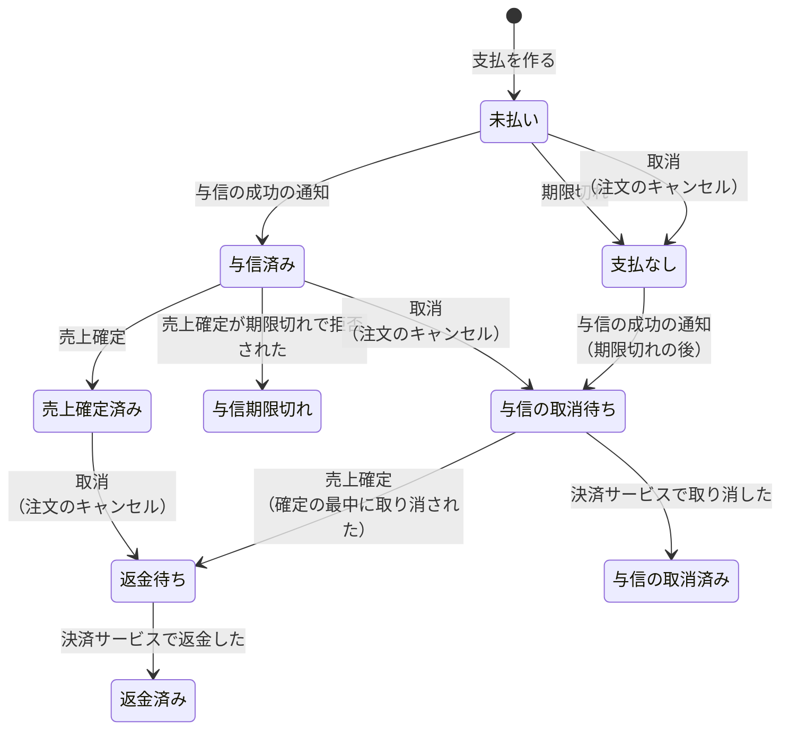
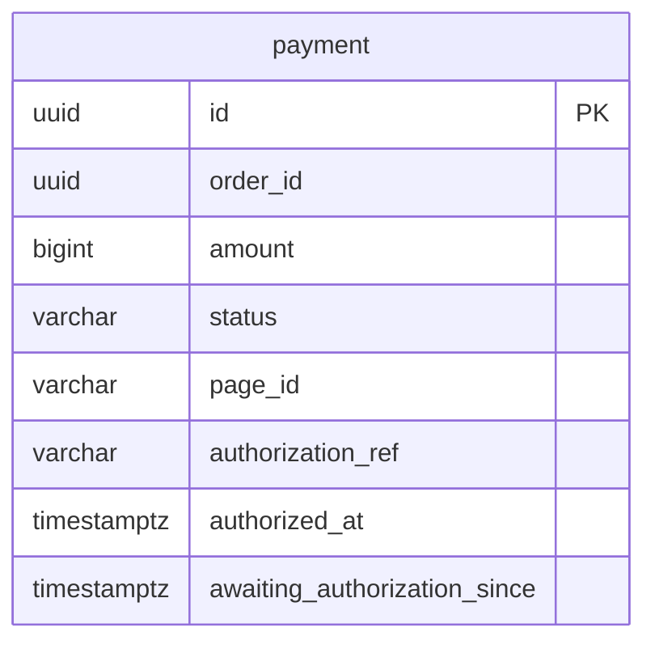

# 決済モジュール

注文の代金の支払（カードの与信、売上確定、返金）を管理する。決済サービス（Stripe）との連携は、このモジュールが腐敗防止層として受け持つ。モジュールのレベル、境界、処理の流れ、API の一覧、パッケージの構成は、[決済の設計](../02-設計/payment.md)に書く。

## 業務規則

### 支払（集約）

- 支払は、注文 ID、金額（総額）、支払の期限、状態、支払画面（決済サービスでの ID と URL）、与信の参照（決済サービスで与信を取り消す・売上を確定する・返金するときに使う ID）、与信の時刻、与信の通知を待ち始めた時刻を持つ。
- 支払の状態は、注文の状態とは別に、注文ごとに持つ（BR-15）。
- 1 つの注文に支払は 1 つ（DB の一意制約でも守る）。注文の成立と同じトランザクションで作る。
- 支払画面は、同時に 1 つだけ開く。開いていれば同じ画面を使い、決済サービスに再作成させない。流れは [決済の設計](../02-設計/payment.md)の「支払画面を開く」。
- 支払える支払は、未払いで、期限より前のもの。支払画面を開けるのは、支払える支払だけ。
- 与信の時刻は、与信の成功を受けて与信済みになったときに記録する（与信期限の起点）。

### 支払の状態

| 状態 | 意味 |
|------|------|
| 未払い | 与信がまだ成功していない（BR-15） |
| 与信済み | 総額の与信が成功し、売上は確定していない（BR-15） |
| 与信の取消待ち | 注文がキャンセルになり、与信の取消が完了していない（BR-15） |
| 与信の取消済み | 与信を取り消した（BR-15） |
| 支払なし | 与信が成功しないまま、注文がキャンセルになった（BR-15） |
| 売上確定済み | 総額で売上を確定した（BR-21） |
| 与信期限切れ | 与信期限を過ぎ、売上を確定できなかった（BR-21） |
| 返金待ち | 売上確定済みの注文がキャンセルになり、返金が済んでいない（BR-21） |
| 返金済み | 総額を返金した（BR-21） |

### 支払の期限

- 支払の期限は、注文日時に設定の時間（既定 30 分）を加えた時刻（BR-16）。注文が支払を作るときに渡す。
- 支払の期限の設定（`ecsite.payment.deadline`）の上限は 30 分で、超えるとアプリは起動に失敗する ※1。
- 決済サービスの支払画面も、支払の期限を過ぎると使えなくなる（BR-16）。決済サービスの支払画面は、作ってから期限が切れるまでの時間に下限がある（[決済の設計](../02-設計/payment.md)の「Stripe」）。画面を再作成すると画面の期限が支払の期限より後になるので、期限切れのジョブが支払の期限に画面を閉じて、両方の期限を一致させる。
- 期限切れのジョブ（設定 `ecsite.payment.expiry-interval` の間隔、既定 1 分。分散ロック付き）が、期限を過ぎた未払いの支払を処理する。流れは [決済の設計](../02-設計/payment.md)の「支払の期限切れ」。
  - 支払画面を閉じる前に支払が済んでいた支払は、未払いなら与信の通知を待つ支払にする（状態は未払いのまま、待ち始めた時刻を記録する）。与信の成功の通知で与信済みになる。
  - 支払画面を閉じられた支払と、支払画面がない支払は、未払いなら支払なしにする。
  - 決済サービスを呼ぶ間、行ロックを持たない。
- 1 回に処理するのは期限の古い順に 100 件まで。与信の通知を待つ支払は探さない。通知が届かない支払が蓄積しても、それより新しい期限切れの支払を処理するため。
- 1 件の処理で例外（種類を問わない）が起きたら、warn のログに支払 ID を出力して次の支払へ進む。その支払は次の回で再試行する。
- ジョブの最後に、与信の通知を待ち始めてから設定 `ecsite.payment.awaiting-authorization-warning`（既定 1 時間）を過ぎた未払いの支払を数え、1 件以上なら warn のログに件数を出力する。人が対応するまで、毎回出力する。通知が届かない原因（通知の設定など）を修正するのが先なので、決済サービスから与信を取得して補完しない。

※1：理由：支払画面は注文の後に作るので、画面の期限は注文日時より、画面を作ってからの期限の長さだけ後になる。その長さは上限より 1 分長い。上限が 30 分なら、画面の期限は支払の期限より 1 分以上後になり、時計のずれがあっても支払画面が支払の期限より前に閉じない。

### 与信期限

- 与信期限は、与信の時刻に設定 `ecsite.payment.authorization-validity`（既定 7 日）を加えた時刻。与信期限を過ぎると、売上を確定できない（BR-20）。Stripe のオンラインのカード決済の与信が 7 日で切れるため。
- 「期限が近い」は、与信期限まで設定 `ecsite.payment.authorization-warning`（既定 2 日）を切ったとき（BR-20）。期限を過ぎたものも含む。対象は、与信済みと与信期限切れの支払。
- 期限切れは、ジョブで監視しない。売上確定が決済サービスに期限切れで拒否されたときに、与信期限切れにする。与信期限切れの注文を自動でキャンセルしない規則は [注文モジュール](order.md)の「出荷の登録」。

### 売上確定

流れは [決済の設計](../02-設計/payment.md)の「売上確定」。売上確定済みの支払への再登録、与信期限切れと接続できないときのエラーなど、呼び出す注文の規則は [注文モジュール](order.md)の「出荷の登録」。

- 与信済みでなければ、売上確定は業務のエラーを返す。
- 決済サービスへの総額の売上確定は、トランザクションの外で行う。冪等キーは注文 ID から作る。
- 結果は、支払を行ロックして反映する。成功なら売上確定済みにする。与信期限切れなら与信期限切れにする。
- 決済サービスが確定してから、確定を反映するまでの間に注文がキャンセルされると、支払は与信の取消待ちになっている。確定した与信は取り消せないので、反映のときに返金待ちにして返金する。
- 決済サービスに接続できないときは、支払は与信済みのまま残る。

理由：決済サービスの応答を待つ間、行ロックを持たないため。

### 与信の取消

流れは [決済の設計](../02-設計/payment.md)の「注文のキャンセルと、与信の取消・返金」。

- 「与信の取消の依頼」のリスナーは、コミットの後に決済サービスへ取消を求め、成功したら与信の取消済みにする。リスナーはトランザクションを持たず、決済サービスをトランザクションの外で呼ぶ（待つ間に DB の接続を持たない）。
- 決済サービスが失敗したら、リスナーは例外で終わり、イベントは未完了で残る。未完了のイベントの再発行（[バックエンドのアーキテクチャ](../02-設計/backend-architecture.md)の「水平スケール」）で再試行する。
- 決済サービスで取消済みの与信の取消も、成功として扱う。
- 売上を確定した与信の取消は、決済サービスが拒否する。リスナーは例外で終わり、再発行のときには支払が返金待ちになっているので、何もしない。

理由：決済サービスが応答しないときも、注文のキャンセルと在庫の戻しを止めないため。

### 返金

与信の取消と同じ形にする。流れは [決済の設計](../02-設計/payment.md)の「注文のキャンセルと、与信の取消・返金」。

- 「返金の依頼」のリスナーは、コミットの後に決済サービスへ総額の返金を求め、成功したら返金済みにする。冪等キーは注文 ID から作る。与信の取消と同じく、リスナーはトランザクションを持たない。
- 決済サービスが失敗したら、リスナーは例外で終わり、イベントは未完了で残る。未完了のイベントの再発行で再試行する。
- 返金済みの支払の取消も、成功として扱う。

### 決済サービスからの通知

流れは [決済の設計](../02-設計/payment.md)の「決済サービスからの通知」。

- 支払の結果は、決済サービスからの通知だけで受け取る（BR-17）。支払画面から戻ったときに、決済サービスに問い合わせない。
- 通知は、決済サービスの署名を確認し、確認できないものは処理しない（BR-17）。署名の確認と拒否の応答は [決済の設計](../02-設計/payment.md)の「Stripe」。
- 同じ通知を重複して受信しても、結果は 1 回だけ反映する（BR-17）。通知の ID は記録せず、支払の状態の遷移で守る。
- 通知の順序が入れ替わっても、支払の状態は図の遷移を外れない（BR-17）。遷移できない通知は、状態を変えずに無視する。
- 処理に失敗した通知は、決済サービスの再送で再処理する（BR-17）。
- 受け付ける通知は、与信の成功と、支払画面の期限切れ。登録にない支払画面の通知は、状態を変えずに無視する（与信の成功の通知のときは、warn のログを出す）。
- 支払画面の期限切れの通知は、支払の期限の後で未払いのときだけ、支払なしにする。期限の前の通知は無視し、期限切れのジョブに任せる。

### 決済サービスとの通信

- タイムアウトと再試行は、[決済の設計](../02-設計/payment.md)の「Stripe」。
- 売上確定は、接続できない・時間内に応答がない、決済サービスの側の障害、回数の制限を、「接続できない」の結果にする。与信済みのまま残り、再試行できる。
- 支払画面の作成と閉じる操作、与信の取消、返金は、同じ失敗を外部サービスのエラー（`PAYMENT_GATEWAY_UNAVAILABLE`、502）にする。与信の取消と返金は、再発行で再試行する。
- 認証・権限・リクエストの誤りなど、上の他の拒否は、システムのエラーにする。

## 状態の遷移

| 操作 | すでにその状態のとき | できない状態 |
|------|----------------------|--------------|
| 与信の成功の通知 | 与信済みなら何もしない | 売上確定済み、与信期限切れ、返金待ち、返金済み、与信の取消待ち、与信の取消済みなら何もしない |
| 期限切れ | 支払なしなら何もしない | 未払い以外（与信済み、売上確定済み、与信期限切れ、返金待ち、返金済み、与信の取消待ち、与信の取消済み）なら何もしない |
| 与信の通知を待つ | すでに待っていれば何もしない（状態は未払いのまま、待ち始めた時刻だけを記録する） | 未払い以外なら何もしない |
| 売上確定 | 売上確定済みなら何もしない | 与信済み・与信の取消待ち以外（未払い、支払なし、与信の取消済み、与信期限切れ、返金待ち、返金済み）なら何もしない |
| 与信期限切れにする | 与信期限切れなら何もしない | 与信済み以外なら何もしない |
| 取消 | 与信の取消待ち・与信の取消済み・支払なし・返金待ち・返金済みなら何もしない | 与信期限切れなら何もしない（取り消すものがない） |
| 取消済みにする | 与信の取消済みなら何もしない | 与信の取消待ち以外なら何もしない |
| 返金済みにする | 返金済みなら何もしない | 返金待ち以外なら何もしない |

- 図の遷移のうち、売上確定済み・与信期限切れ・返金待ち・返金済みが関わらないものは BR-15、関わるものは BR-21 の規則である。
- どの操作も冪等にする。遷移できない通知は、状態を変えずに無視する。
- 与信済みになったら「与信の成功」、期限切れで支払なしになったら「支払の期限切れ」のイベントを登録する。
- 与信の取消待ちになったら、決済の中のイベント「与信の取消の依頼」を、返金待ちになったら「返金の依頼」を登録する。
- 与信期限切れの支払の取消は、取り消すものがないので何もしない（与信は決済サービスで切れている）。与信期限切れの注文をキャンセルしても、与信を取り消さない（BR-21）。

## データモデル

列の正本は Flyway のマイグレーション。

- schema は `payment`。テーブルは支払 1 つだけで、他のテーブルとの関係はない。
- 注文 ID は他のモジュールの ID なので、外部キーは張らない。注文 ID に一意制約を付ける。
- 金額は円単位の整数。
- 支払画面 ID と URL は、両方あるか、両方ない（CHECK 制約でも守る）。支払画面 ID は、通知から支払を探すため、一意にする。
- 与信の参照、与信の時刻、与信の通知を待ち始めた時刻は、なければ空。

## 今有効な AC

選んだ基準は、[AC 一覧](acceptance-criteria.md)の列「モジュール」が `payment` で、状態が「有効」か「変更」の AC であること。

<!-- generated:module-ac -->
| AC | 今の内容 | 元の spec |
|----|----------|-----------|
| AC-145 | カード番号は決済サービスの画面で入力する。EC の画面と API は、カード番号を受け取らない。 | [007](../08-spec/archive/mvp/007-payment/spec.md) |
| AC-148 | カードが拒否されたときは、決済サービスの画面で別のカードを入力して再試行できる。拒否では注文の状態は変わらない。 | [007](../08-spec/archive/mvp/007-payment/spec.md) |
| AC-149 | 支払を終える・やめると、決済サービスの画面から注文の画面に戻る。 | [007](../08-spec/archive/mvp/007-payment/spec.md) |
| AC-150 | 戻った時点で EC が与信の結果を受信していなければ、注文の画面に「支払の確認中」と表示する。画面を再度開くと、その時点の状態を表示する。 | [007](../08-spec/archive/mvp/007-payment/spec.md) |
| AC-152 | 同じ注文で支払画面に何度移っても、与信は 1 回だけ取られる。 | [007](../08-spec/archive/mvp/007-payment/spec.md) |
| AC-159 | 店舗の注文一覧と注文詳細に、「支払待ち」の注文の支払の期限を表示する。注文詳細には、支払画面に遷移する操作を表示する。 | [007](../08-spec/archive/mvp/007-payment/spec.md) |
| AC-160 | 管理画面の注文一覧と注文詳細に、支払の状態（BR-15）を表示する。 | [007](../08-spec/archive/mvp/007-payment/spec.md) |
| AC-164 | 与信の取消に失敗したら、取り消せるまで再試行する。 | [007](../08-spec/archive/mvp/007-payment/spec.md) |
| AC-165 | 与信の取消が完了するまで、管理画面の注文詳細に「与信の取消待ち」と表示する。 | [007](../08-spec/archive/mvp/007-payment/spec.md) |
| AC-166 | 同じ与信の取消が重ねて行われても、成功し、何も変わらない。 | [007](../08-spec/archive/mvp/007-payment/spec.md) |
| AC-186 | 管理画面の注文一覧と注文詳細で、与信期限（BR-20）が近い「受付」の注文に、期限が近いことを表示する。 | [009](../08-spec/archive/mvp/009-shipping/spec.md) |
| AC-194 | 返金が済むまで、管理画面の注文詳細に「返金待ち」と表示する。 | [009](../08-spec/archive/mvp/009-shipping/spec.md) |
| AC-195 | 同じ注文の返金が重複して実行されても、返金は 1 回だけ。 | [009](../08-spec/archive/mvp/009-shipping/spec.md) |
| AC-226 | 決済と物流に、それぞれ mock フラグがある。フラグを立てたサービスだけが mock を使い、立てなければ本番の実装を使う。 | [015](../08-spec/archive/mvp/015-security/spec.md) |
| AC-227 | 決済のフラグを立てず、Stripe の設定（鍵）が足りなければ、バックエンドは起動に失敗し、足りない設定の名前をログに出力する。 | [015](../08-spec/archive/mvp/015-security/spec.md) |
| AC-229 | mock の支払画面と、mock の配送業者の画面（通知の操作を含む）は、そのサービスのフラグを立てたときだけ使える。フラグがなければ、その URL は見つからない（404）。 | [015](../08-spec/archive/mvp/015-security/spec.md) |
| AC-230 | 決済・物流のサービスは、フラグだけで選ぶ（mock か Stripe かを選ぶ別の設定を持たない）。 | [015](../08-spec/archive/mvp/015-security/spec.md) |
| AC-231 | ローカルの設定は、決済と物流のフラグを立てる。Stripe の sandbox で動かす設定は、決済のフラグを下ろす。E2E の設定は、ローカルの設定のフラグを受け継ぐ。 | [015](../08-spec/archive/mvp/015-security/spec.md) |
| AC-310 | 支払の期限切れのジョブは、1 件の支払で例外（種類を問わない）が起きても、その支払 ID をログに出力して、残りの支払を処理する。 | [017](../08-spec/archive/mvp/017-stability/spec.md) |
| AC-311 | 決済サービスで支払済みのまま与信の通知を待つ支払が 1 回の処理の件数を超えて滞留しても、それより新しい期限切れの支払を処理する。 | [017](../08-spec/archive/mvp/017-stability/spec.md) |
| AC-312 | 与信の通知を待つ支払が、待ち始めてから決めた時間（設定で変更できる）を過ぎても残っていたら、警告のログに件数を出力する。 | [017](../08-spec/archive/mvp/017-stability/spec.md) |
<!-- /generated:module-ac -->
