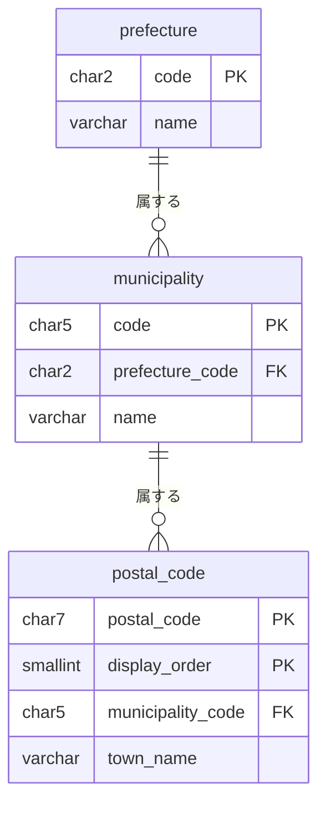

# 地域モジュール

都道府県・市区町村・郵便番号のマスターデータを持ち、参照だけを公開する。モジュールのレベルと境界、処理の流れ、API の案内、パッケージの構成は、[地域の設計](../02-設計/region.md)に書く。

## 業務規則

名前を「住所」にしないのは、お届け先や会員の住所録を管理するモジュールと混同しないため。

### マスターデータ

| 表 | 持つもの | コード |
|----|----------|--------|
| 都道府県 | コード、名前 | 地方公共団体コードの先頭 2 桁 |
| 市区町村 | コード、都道府県のコード、名前 | 地方公共団体コードの 5 桁（検査数字を除く） |
| 郵便番号 | 郵便番号（7 桁）、市区町村のコード、町域名、並び順 | 町域を識別するコードはない |

- 都道府県と市区町村は、地方公共団体コードで識別する。名前は表示にだけ使う（BR-34）。
- 使う側は、都道府県と市区町村をコードで参照する。注文は、注文の時点のコードと名前を写す（[注文モジュール](order.md)）。
- 市区町村は、市・町・村と東京都の特別区。政令指定都市は区を 1 つの市区町村とし、市そのものは持たない。郡を含む町村は、名前に郡を含む（例：西多摩郡瑞穂町）。
- 1 つの郵便番号に、町域が複数あることがある。2 つの市区町村にまたがることもある。
- 町域名は、住所でない注記（「以下に掲載がない場合」、括弧の中の補足など）を除いて持つ。注記だけの町域名は空。
- 郵便番号は、入力を補うためだけに使い、注文を受けるかの判断には使わない（BR-36）。
- 郵便番号の表は、他のデータから参照されない（BR-37）。注文は、補った町域を住所の文字として持つ（BR-37）。
- 郵便番号の表を更新するときは、表を全件置き換える（BR-37） ※1。

※1：郵便番号のデータには町域を識別するコードがなく、更新で町域の行が分かれる・まとまることがある。参照されなければ、差分を追跡せずに置き換えられる。各行は地方公共団体コードを持つので、市区町村の表とはコードで対応づけられる。

### 参照

店舗 API（`store.yaml` のタグ `region`）の 3 つの操作は、token なしで使える。

| 操作 | 応答 |
|------|------|
| 都道府県の一覧 | コードの順の、コードと名前 |
| 都道府県の市区町村の一覧 | コードの順の、コードと名前。都道府県がなければ 404 |
| 郵便番号で検索する | 住所の一覧（都道府県、市区町村、町域）。ないときは 200 で空の一覧 |

- 管理画面は、注文とレポートの応答にある名前を表示する。
- 地域の API の応答のキャッシュを、バックエンドに持たない。店舗画面が再取得する間隔で、最新の応答を取得する。

### 最初のデータ

都道府県・市区町村の全件と、郵便番号の一部を、Flyway のマイグレーションで入れる。郵便番号の全件は入れない（テストのデータベースを作るたびに読むと CI が遅くなるため）。外部から取り込んで更新する仕組みは、今は持たない。

| 項目 | 内容 |
|------|------|
| 出典 | 日本郵便の「住所の郵便番号（1 レコード 1 行、UTF-8 形式）」の CSV だけ。市区町村も同じ出典から、地方公共団体コードの重複を除いて作る ※2 |
| 作り方 | [地域の設計](../02-設計/region.md)の「最初のデータの作り方」 |
| 出典と利用の条件 | [依存とライセンス](../05-開発規則/licenses.md)の「データ」 |

※2：郵便番号の市区町村は、全て一覧にある。郵便番号のデータの地方公共団体コードは総務省のコードと同じなので、市区町村を国の API から取得するようにしても、郵便番号の表とはコードで対応づけられる。

## 状態の遷移

なし。地域は参照だけのマスターデータで、状態を持つ集約がない。

## データモデル

schema は `region`。列の正本は Flyway のマイグレーション（`backend/ecsite/src/main/resources/db/migration/` の `region` で始まる名前のもの。最初のデータは「最初のデータ」の節）。

- 主キーは、都道府県と市区町村がコード、郵便番号が郵便番号と並び順の組。
- 市区町村は都道府県に、郵便番号は市区町村に、外部キーを張る。他のモジュールの表からは外部キーを張らない。
- 市区町村のコードの先頭 2 桁が都道府県のコードであることは、CHECK 制約でも守る。
## 今有効な AC

<!-- generated:module-ac -->
| AC | 今の内容 | 元の spec |
|----|----------|-----------|
| AC-249 | 市区町村の一覧は、選んだ都道府県の市区町村だけを表示する。都道府県を再選択すると、市区町村の選択は解除される。 | MVP-016 |
| AC-250 | 都道府県と市区町村の一覧は、店舗 API のマスターデータから取得する。画面は都道府県・市区町村の表を持たない。 | MVP-016 |
| AC-253 | 店舗 API は、郵便番号から、都道府県・市区町村・町域を返す。 | MVP-016 |
| AC-254 | 1 つの郵便番号に複数の町域があるときは、全てを返す。 | MVP-016 |
| AC-255 | 注文手続きの画面で郵便番号（7 桁。全角の数字とハイフンの類を含む）を入れると、都道府県と市区町村を選んだ状態にする。町域が 1 つで、住所の欄が空のときは、町域を住所の欄に入れる。根拠は[店舗モジュール](storefront.md)の「お届け先の入力」。 | MVP-016 |
| AC-256 | マスターデータにない郵便番号は、何も補わず、消費者がそのまま入力を続けられる。郵便番号は、マスターデータにないことを理由に拒否しない。理由：最初のデータは一部だけのため。 | MVP-016 |
| AC-257 | 補った後も、消費者は都道府県・市区町村・住所を変えられる。 | MVP-016 |
| AC-259 | 都道府県と市区町村のマスターデータは、全国の都道府県（47）と市区町村を、最初のデータとして持つ。 | MVP-016 |
| AC-260 | 郵便番号のマスターデータは、構造と、開発とテストに使う一部の郵便番号だけを、最初のデータとして持つ。 | MVP-016 |
| AC-263 | 都道府県・市区町村・郵便番号の表は、マスターデータのほかに持たない（バックエンドの検証、画面、レポート、seed）。テストのデータは除く。 | MVP-016 |
| AC-283 | 郵便番号のデータの町域名にある、住所でない注記（「以下に掲載がない場合」、括弧の中の補足など）は、町域として返さない。町域名が注記だけの郵便番号は、都道府県と市区町村だけを返す。 | MVP-016 |
<!-- /generated:module-ac -->
