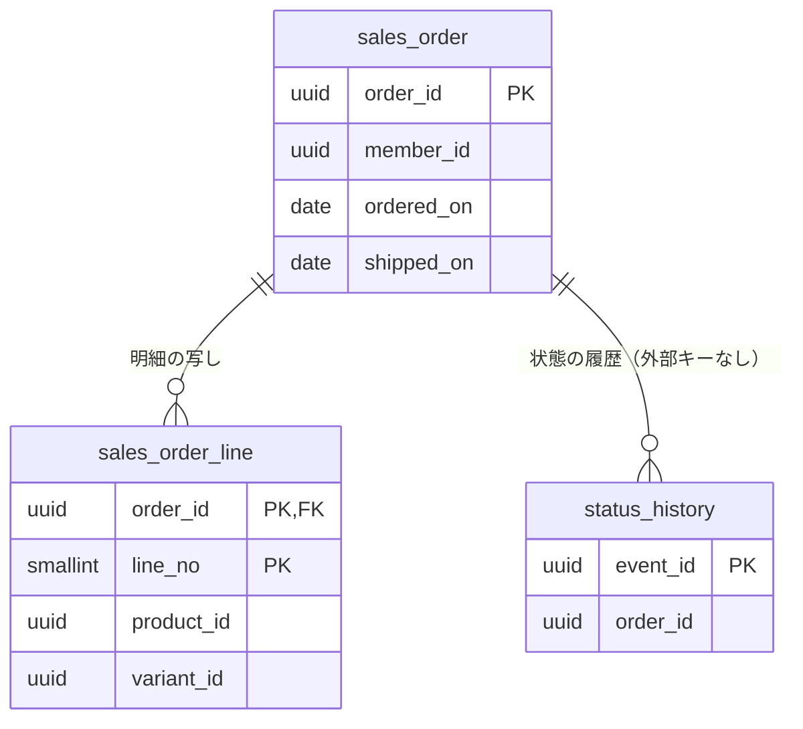

# レポートモジュール

注文と出荷のデータを写しとして持ち、運営者に売上のレポート（売上の推移、バリアントの売れ行き、地域・年齢層・性別）を返す。モジュールのレベルと境界、処理の流れ、API の一覧、パッケージの構成は、[レポートの設計](../02-設計/reporting.md)に書く。

## 業務規則

### 集めるデータ

データは広く集め、どう数えるかはレポートごとに決める。集めるときには絞らない（支払待ち、支払の期限切れ、キャンセル、返送の注文も集める）。後で別の見方（返送の率、受け取られにくい地域、会員の継続など）をしたくなっても、再収集せずに作れるようにするため。

| データ | 持つもの | 作り方 |
|--------|----------|--------|
| 注文の写し | 注文 ID、注文番号、会員 ID、注文日時、状態、出荷日時、配送状態、キャンセル（日時、種類、在庫に戻したか）、郵便番号、都道府県のコード、注文時の年齢と性別、総額、送料、消費税の合計、送料の消費税 | 下の「写しの更新」 |
| 明細の写し | 行番号、商品 ID、バリアント ID、商品品番、バリアント品番、商品名、軸の値、数量、税率、税込小計、税抜小計 | 同上 |
| 状態の履歴 | 受けたイベントごとに 1 行：出来事（注文の状態の変化、配送状態の変化）、注文 ID、前と後の状態、発生日時、キャンセルの種類と在庫に戻したか、元のイベント ID | イベントをそのまま追加する |

- 今の 3 つのレポートで使わない項目（会員 ID、郵便番号、日時の時刻、税率、状態の履歴）も持つ ※1。
- 氏名、住所、電話番号、メールアドレス、生年月日は持たない。会員 ID と郵便番号は、レポートの API で返さない。

※1：状態の履歴は後から再作成できない（注文は今の状態しか持たない）ので、使う前から集める。

### 写しの更新

注文のイベント「注文の状態の変化」と、出荷のイベント「配送状態の変化」を、コミットの後に非同期で受ける。流れは [レポートの設計](../02-設計/reporting.md) の「写しの集め方」の図に描く。どちらを受けても、履歴の追加と写しの上書きを、同じトランザクションで行う。

- 状態の履歴は、元のイベント ID で一意にし、すでにあれば追加しない。
- 注文と明細の写しは、注文の API（レポート用の注文の写し）で再読み込みした今の値で上書きする（明細は削除して再挿入する）。明細の商品 ID は、商品カタログの API で求める ※2。
- 出荷日時と配送状態は、状態の履歴から求める（下の表）。
- 同じ注文のイベントは、注文ごとのロックで 1 つずつ処理する。同時に処理すると、互いの履歴が見えないまま写しを上書きするため。

| 項目 | 状態の履歴からの求め方 |
|------|------------------------|
| 出荷日時 | 注文の状態が出荷済みになった変化、または配送状態が出荷済みになった変化の、早いほうの発生日時 |
| 配送状態 | 配送状態の変化の後の状態のうち、順位の最も高いもの（[出荷モジュール](shipping.md)「配送状態」） |

- イベントの中身で写しを差分で更新しない。再読み込みして上書きするので、イベントが何度・どの順で届いても、写しは同じになる。
- 処理に失敗したら例外で終わり、未完了のイベントの再発行（[バックエンドのアーキテクチャ](../02-設計/backend-architecture.md)の「水平スケール」）で再試行する。業務の処理（注文・出荷）は待たない。写しの遅れは、通常は数秒、上限は再発行の間隔。
- 注文の API が写しを返さない注文のイベントを受けたら、履歴だけ残して写しは作らない。

※2：注文の明細は商品 ID を持たず、品番は参照に使わない（[商品カタログモジュール](catalog.md)）。注文されたバリアントは削除できない（C 側に表示されたことがあるため）ので、商品 ID は変わらない。読めなかったときは、前の写しの商品 ID を残す。

### 都道府県のコード

写しは、注文のお届け先の都道府県のコード（全国地方公共団体コードの上 2 桁。北海道 `01` 〜 沖縄県 `47`）を、そのまま持つ。名前から改めて引かない。

- 都道府県別の売上の応答の名前は、問い合わせのときに地域の API から引く（腐敗防止層）。写しに名前を持たない。地域のマスターデータにないコードは、名前を空にする。
- コードのない写しは「不明」として扱う。

### 集計

レポートは、問い合わせのたびに写しを SQL で集計する。集計の結果は持たない ※3。

| 項目 | 規則 |
|------|------|
| 期間 | 始まりと終わりの日（日本時間、両端を含む）で指定する（BR-24）。始まりが終わりより後、または 5 年を超えると 400 |
| 数える注文（売上の数え方） | 注文基準：状態が受付・キャンセル申請中・出荷済みの注文を、注文日で数える。出荷基準：状態が出荷済みの注文を、出荷日で数える。既定は注文基準。支払待ちの注文と、キャンセルになった注文（支払の期限切れを含む）は、どちらの数え方でも数えない（BR-25） ※4 |
| 売上額 | 既定は総額（明細の税込小計の合計 ＋ 送料）。消費税を除くときは消費税の合計を、送料を除くときは送料（消費税を除くなら税抜の送料）を引く（BR-26） |
| 商品を選んだとき | その商品の明細の税込小計（消費税を除くなら税抜小計）だけを数え、送料は含めない。応答に「送料を除いた」を載せる（BR-26）。注文件数は、その商品の明細を含む注文の数（BR-26） |
| 販売数量 | 数える明細の数量の合計 |

※3：売上の数え方、消費税・送料を除くか、商品の選択の組み合わせごとに集計を持つと数が多くなるため。数万件なら索引で足りる。

※4：出荷の後のキャンセルは返送による返金だけなので、状態が出荷済みのものだけを数えれば、返金待ち・返金済みを除ける。決済のモジュールに依存しなくて済む。

#### 売上の推移

日の区切りは日本時間で行う。売上の推移の区切りは次のとおりで、バリアントの売れ行きと地域・年齢層・性別は区切らず、期間の合計を返す（BR-24）。

| 粒度 | 区切り |
|------|--------|
| 週 | 月曜から日曜 |
| 月 | 暦の月 |
| 四半期 | 会計年度の 3 か月ごと。会計年度の始まりの月は設定 `ecsite.reporting.fiscal-year-start-month`（既定 `4`） |
| 年 | 会計年度。年度は始まりの月の年で呼ぶ（4 月始まりなら、2026 年 4 月〜2027 年 3 月は 2026 年度） |

- 期間の全ての区切りを並べ、売れなかった区切りは 0 にする。
- 期間が区切りの途中で切れたら、その区切りは期間の中の日だけを数える（応答の区切りの始まりと終わりも、期間で切った日にする）（BR-24）。
- 日ごとに SQL で集計し、区切りへのまとめは Java で行う（会計年度の計算を単体テストで確認するため）。
- 会計年度の始まりの月は、レポートの設定の API（[レポートの設計](../02-設計/reporting.md)の「API」）でも返す。管理画面が期間の選択肢（今年度・前年度）を同じ会計年度で求めるため。

#### バリアントの売れ行き

- 商品を 1 つ選び、バリアントごとの販売数量と売上額を返す。送料は含めない。選んだ商品が商品カタログになければ 404。
- 商品カタログの API で商品のバリアントの一覧を受け、売れなかったバリアントも 0 として返す。商品カタログにないバリアントが売れていたら、注文の明細の写しにあるバリアント ID と品番で、後ろに追加する。
- 販売数量の多い順。同じなら、商品カタログの並び順。

#### 地域・年齢層・性別

| 分け方 | 並び | 不明 |
|--------|------|------|
| 都道府県 | 全国地方公共団体コードの順。売れた都道府県だけを返す | コードのない注文は「不明」として最後 |
| 年齢層 | 10 代以下、20 代、30 代、40 代、50 代、60 代以上、不明。売れなかった層も 0 として返す（BR-27） | 年齢を記録していない注文 |
| 性別 | 男性、女性、その他、不明。売れなかったものも 0 として返す | 性別を記録していない注文と「回答しない」は、「不明」として数える（BR-29） |

- 年齢層は、注文に記録した年齢（写しの年齢）から問い合わせのときに求める（層の切り方を変えても、写しを再作成せずに済むため）。

### 権限

権限の名前と、権限を持つ役割・操作の対応は、[ロールと権限の対応表](../02-設計/role-permissions.md)にある。

- 権限はレポートごとに分け、レポートの中の選択肢（粒度、商品など）ごとには分けない。
- 運営者がレポートの権限を設定する画面は、EC に作らない。IdP の役割で設定する。
- 役割と権限の対応は IdP（運営者の realm）に置く。管理者と管理職は 3 つとも、営業は売上の推移以外の 2 つを持つ。閲覧者は持たない（BR-28）。
- 管理職と営業は、レポート以外の管理画面の操作を、閲覧者と同じく参照だけできる（BR-28）。
- レポートの設定は秘密ではないので、権限は必要ない（ログインしていればよい）。

### 列指向のデータベースへの移し方の見通し

件数が増えて、索引と日付での分割で足りなくなったら、写しを列指向の分析用のデータベースに移す。写しを持つのはレポートだけなので、`infrastructure` の写しの保存と集計の実装を替えれば済み、他のモジュールは変わらない。導入のときに、依存とライセンスを確認する。

## 状態の遷移

なし。レポートは状態を持つ集約がなく、他のモジュールの状態を写しと履歴として持つだけである。

## データモデル

列の正本は Flyway のマイグレーション。

- schema は `reporting`。注文・バリアント・商品・会員は他のモジュールの ID なので、外部キーは張らない。
- 注文の写しは、注文 ID を主キーにする。注文日と出荷日（日本時間の日付）を列に持ち、索引を付ける（日で集計するため）。
- 明細の写しは、注文 ID と行番号を主キーにする。商品 ID に索引を付ける。
- 状態の履歴は、元のイベント ID を主キーにする。注文 ID に索引を付ける。

## 今有効な AC

選んだ基準は、[AC 一覧](acceptance-criteria.md)の列「モジュール」が `reporting` で、状態が「有効」か「変更」の AC であること。

<!-- generated:module-ac -->
| AC | 今の内容 | 元の spec |
|----|----------|-----------|
| AC-197 | 運営者は、期間と集計の粒度（週、月、四半期、年）を選び、粒度ごとの売上額と販売数量の推移を折れ線グラフで見られる。 | [010](../08-spec/archive/mvp/010-sales-report/spec.md) |
| AC-198 | 同じ数字を、粒度ごとの行の表でも見られる。 | [010](../08-spec/archive/mvp/010-sales-report/spec.md) |
| AC-199 | 商品を 1 つ選ぶと、その商品だけの推移を見られる。選ばなければ全商品の合計。 | [010](../08-spec/archive/mvp/010-sales-report/spec.md) |
| AC-200 | 売上の数え方（BR-25）を画面で切り替えられる。 | [010](../08-spec/archive/mvp/010-sales-report/spec.md) |
| AC-201 | 売れなかった区切りも、0 の行として示す。理由：線が途切れて読み違えないため。 | [010](../08-spec/archive/mvp/010-sales-report/spec.md) |
| AC-202 | 運営者は、商品を 1 つと期間を選び、バリアント（軸の値の組み合わせ）ごとの販売数量と売上額を棒グラフで見られる。 | [010](../08-spec/archive/mvp/010-sales-report/spec.md) |
| AC-203 | 同じ数字を表でも見られる。表は販売数量の多い順に並べる。 | [010](../08-spec/archive/mvp/010-sales-report/spec.md) |
| AC-204 | 期間に売れなかったバリアントも、0 として示す。 | [010](../08-spec/archive/mvp/010-sales-report/spec.md) |
| AC-205 | 運営者は、期間を選び、お届け先の都道府県ごとの売上額と注文件数を、グラフと表で見られる。 | [010](../08-spec/archive/mvp/010-sales-report/spec.md) |
| AC-206 | 同じ期間の、年齢層（BR-27）ごとの売上額と注文件数を、グラフと表で見られる。 | [010](../08-spec/archive/mvp/010-sales-report/spec.md) |
| AC-207 | 商品を 1 つ選ぶと、その商品を含む注文だけを数える。売上額はその商品の明細の分だけを数える。 | [010](../08-spec/archive/mvp/010-sales-report/spec.md) |
| AC-208 | 生年月日の分からない会員の注文は、年齢層「不明」として数える。 | [010](../08-spec/archive/mvp/010-sales-report/spec.md) |
| AC-214 | 運営者は、権限を持つレポートだけを、管理画面のメニューで見て開ける。 | [010](../08-spec/archive/mvp/010-sales-report/spec.md) |
| AC-215 | 権限のないレポートの API を呼ぶと 403 になる。 | [010](../08-spec/archive/mvp/010-sales-report/spec.md) |
| AC-216 | 権限はレポートごとに分ける。レポートの中の選択肢（粒度、商品など）ごとの権限は作らない。 | [010](../08-spec/archive/mvp/010-sales-report/spec.md) |
| AC-217 | 役割ごとの権限は BR-28 のとおり。 | [010](../08-spec/archive/mvp/010-sales-report/spec.md) |
| AC-218 | 運営者は、表示しているレポートの表を CSV で取り出せる。文字コードは表計算ソフトで文字化けしないもの。 | [010](../08-spec/archive/mvp/010-sales-report/spec.md) |
| AC-219 | 同じ期間の、性別（BR-29）ごとの売上額と注文件数を、グラフと表で見られる。性別の分からない会員の注文は「不明」として数える。 | [010](../08-spec/archive/mvp/010-sales-report/spec.md) |
| AC-220 | 都道府県は、全国地方公共団体コードの順（北海道から沖縄県）に並べる。 | [010](../08-spec/archive/mvp/010-sales-report/spec.md) |
| AC-223 | 状態によらず、全ての注文をレポートのデータに集める（支払待ち、支払の期限切れ、キャンセル、返送を含む）。 | [010](../08-spec/archive/mvp/010-sales-report/spec.md) |
| AC-224 | 注文の状態と配送状態が変わるたびに、何が・いつ・どの状態からどの状態に変わったかを、履歴として集める。 | [010](../08-spec/archive/mvp/010-sales-report/spec.md) |
| AC-225 | 集めたデータのうち、どの注文を数えるかは、レポートごとに決める（BR-25 など）。集めるときには絞らない。 | [010](../08-spec/archive/mvp/010-sales-report/spec.md) |
| AC-262 | 売上レポートの都道府県別の集計は、注文の都道府県のコードを使い、都道府県名から再度引かない。管理画面は、都道府県名を API の応答から表示し、画面の文言に都道府県の表を持たない。 | [016](../08-spec/archive/mvp/016-master-data/spec.md) |
| AC-278 | 売上レポートは、注文の状態を文字列で比べず、列挙で比べる。 | [016](../08-spec/archive/mvp/016-master-data/spec.md) |
<!-- /generated:module-ac -->
