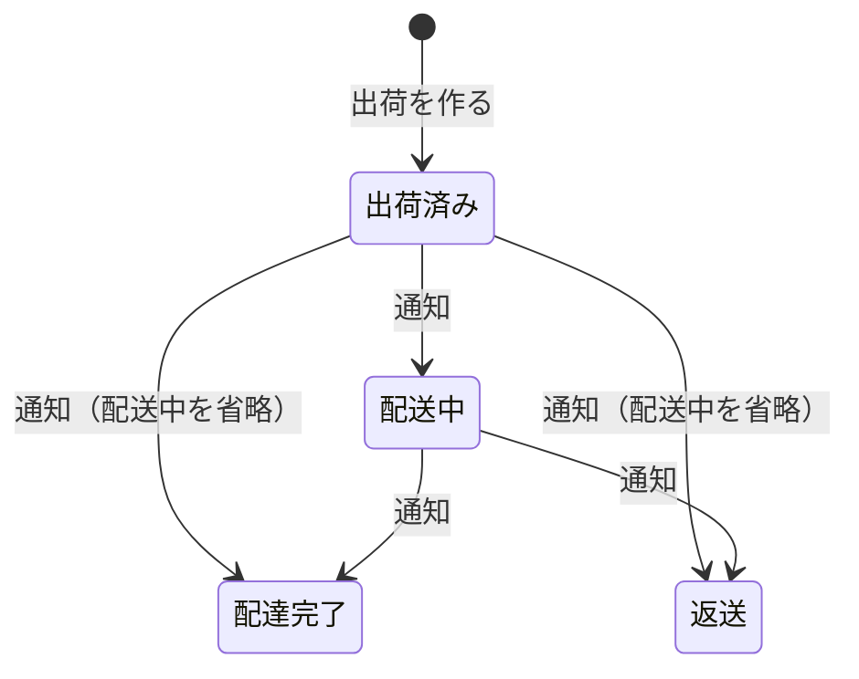
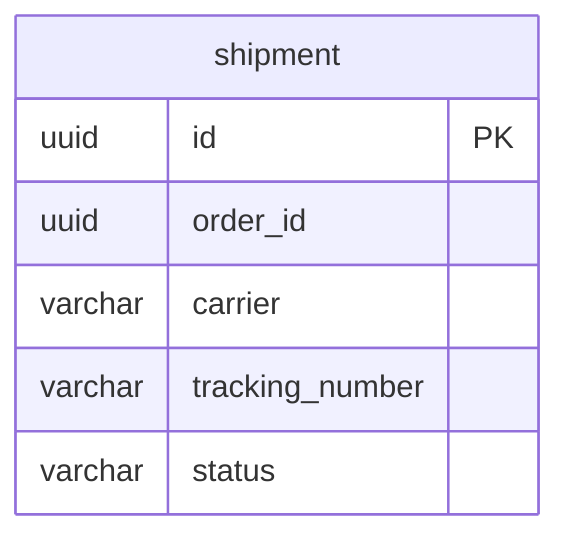

# 出荷モジュール

注文の出荷と、配送状態を管理する。物流サービス（配送業者）の腐敗防止層でもある。モジュールのレベルと境界、処理の流れ、API の案内、パッケージの構成は、[出荷の設計](../02-設計/shipping.md)に書く。

## 業務規則

### 出荷（集約）

- 出荷は、注文 ID、配送業者、送り状番号、配送状態、出荷日時、最後に通知を反映した日時を持つ。
- 1 つの注文に出荷は 1 つ（DB の一意制約でも守る）。注文の全ての明細を 1 回で出荷する（BR-23）。
- 出荷を作ると、配送状態は「出荷済み」。最後に通知を反映した日時は空。
- 同じ注文で出荷を重複して作ると、業務のエラー（409）にする。
- 出荷を編集する操作はない。配送状態は物流サービスの通知だけで進む。
- 注文が出荷を作る流れは、[注文モジュール](order.md)の「出荷の登録」に書く。

### 配送業者

ヤマト運輸（`YAMATO`）、佐川急便（`SAGAWA`）、日本郵便（`JAPAN_POST`）。決まった一覧から選ぶ。

配送業者は出荷モジュールの型なので、表示名も出荷モジュールの文言キー `ecsite.shipping.carrier.<小文字の名前>` で決める。キーの形は配送業者の型（ドメイン）の 1 か所で決める。キーを得る方法は、[出荷の設計](../02-設計/shipping.md)の「他のモジュールへの公開」と「mock」。

### 送り状番号

| 規則 | 内容 |
|------|------|
| 文字 | 半角の数字とハイフンだけ。数字が 1 つ以上必要 |
| 長さ | 前後の空白を除いて 30 文字まで（ハイフンを含む） |
| 保存 | ハイフンを除いて保存する。通知の送り状番号も同じ形にしてから検索する |

### 配送状態

配送状態は出荷ごとに持つ。業務の判断に使う区切り（出荷した、届いた、返ってきた）だけを状態にする（BR-19）。

| 配送状態 | 順位 | 意味 |
|----------|------|------|
| 出荷済み（`SHIPPED`） | 0 | 運営者が出荷を登録した。物流サービスはまだ荷物を受け取っていない |
| 配送中（`IN_TRANSIT`） | 1 | 物流サービスが荷物を受け取り、届けるまでの間 ※1 |
| 配達完了（`DELIVERED`） | 2 | 荷物を届けた |
| 返送（`RETURNED`） | 2 | 届けられず、荷物が送り主に戻った |

※1：物流サービスの途中の表示（ヤマト運輸の「荷物受付」「発送」「作業店通過」「配達中」「持戻」「保管中」など）は、全て「配送中」にまとめる。配送業者ごとの表示との対応は、「状態の名前の対応」にある。

### 物流サービス

- 物流サービスの port は 1 つで、操作は「追跡を始める」だけ。流れと失敗の扱いは[出荷の設計](../02-設計/shipping.md)の「出荷の作成と追跡の開始」に書く。
- 物流サービスの実装の選択、設定、mock（画面とテストでの使い方）は、[出荷の設計](../02-設計/shipping.md)の「外部のサービス」に書く。
- 物流サービスは、荷物の状態が変わるたびに、通知のエンドポイントへ通知を送る。

### 通知のエンドポイント

物流サービスの通知を受け取る流れは、[出荷の設計](../02-設計/shipping.md)の「物流サービスの通知の反映」に描く。パス、署名の形、本文の項目、応答は、[出荷の設計](../02-設計/shipping.md)の「通知のエンドポイント」に書く。

- 通知には認証を付けず、署名で確認する。署名がない・合わない通知は処理しない（BR-22）。
- 同じ通知が重複して届いても、結果は同じ（BR-22）。
- 処理に失敗した通知は、物流サービスの再送で再処理する（BR-22）。

### 状態の名前の対応

物流サービスの状態の名前から配送状態への対応は、配送業者ごとの表で持つ。表にない名前の通知は、記録だけして、状態は変えない（応答は[出荷の設計](../02-設計/shipping.md)の「通知のエンドポイント」）。

現在の表があるのは、ヤマト運輸だけ（mock が使う名前）。佐川急便と日本郵便の追跡の表示は確認していない。実在の物流サービスにつなぐときに確認して、表に追加する。

| 状態の名前 | 配送状態 |
|------------|----------|
| 荷物受付、発送、作業店通過、配達中、持戻、保管中 | 配送中 |
| 配達完了 | 配達完了 |
| 返品 | 返送 |

## 状態の遷移

| 操作 | すでにその状態のとき | できない状態 |
|------|----------------------|--------------|
| 配送中の通知 | 配送中なら、状態を変えずに成功を返す | 配達完了、返送（順位が低いので無視する） |
| 配達完了の通知 | 配達完了なら、状態を変えずに成功を返す | 返送（同じ順位は入れ替わらないので無視する） |
| 返送の通知 | 返送なら、状態を変えずに成功を返す | 配達完了（同じ順位は入れ替わらないので無視する） |

- 図の遷移と表のうち、順位が上がる遷移と、順位が上がらない通知を無視する扱いは BR-19、同じ状態の通知が重複して届いたときの扱いは BR-22 の規則である。
- 通知が欠けても、後の通知で正しい状態になる。反映したときだけ、最後に通知を反映した日時を更新する。
- 配送状態が変わるたびに（出荷を作ったときの「出荷済み」を含む）、イベント「配送状態の変化」を登録する。載せるのは、注文 ID、前と後の配送状態（作成では前はない）、発生日時。反映しなかった通知（重複して届いた、戻る）では登録しない。
- 配送状態の更新の行ロックは、[出荷の設計](../02-設計/shipping.md)の「物流サービスの通知の反映」。

## データモデル

列の正本は Flyway のマイグレーション。

- schema は `shipping`。
- 注文 ID は他のモジュールの ID なので、外部キーは張らない。注文 ID に一意制約を付ける。
- 配送業者と送り状番号は、通知から出荷を探すために索引を付ける（一意にはしない）。
- 送り状番号は、ハイフンを除いた数字だけを保存する（CHECK 制約でも守る）。
- 最後に通知を反映した日時は、まだ通知を反映していなければ空。
- 編集する操作がないので、`version` は持たない。

## 今有効な AC

<!-- generated:module-ac -->
| AC | 今の内容 | 元の spec |
|----|----------|-----------|
| AC-173 | 配送業者は決まった一覧から選ぶ。送り状番号は必須。 | 009 |
| AC-174 | 配送状態（BR-19）は、物流サービスからの通知で遷移する。 | 009 |
| AC-175 | 同じ通知が重複して届いても、1 回だけ反映する。 | 009 |
| AC-176 | 通知の順序が入れ替わっても、配送状態は戻らない（例：「配達完了」の後に「配送中」が届いても「配達完了」のまま）。 | 009 |
| AC-177 | 途中の状態の通知が届かなくても、後の状態に遷移する（例：「出荷済み」から「配達完了」）。 | 009 |
| AC-178 | 署名を確認できない通知と、登録済みのどの出荷にも一致しない通知は、処理しない。 | 009 |
| AC-179 | 店舗の注文詳細に、配送状態、配送業者、送り状番号を表示する。出荷後は、注文状態の代わりに配送状態を表示する。理由：注文状態と配送状態の「出荷済み」が並ばないようにするため。 | 009 |
| AC-180 | 店舗の注文一覧で、出荷後の注文は、注文状態の代わりに配送状態を表示する。 | 009 |
| AC-181 | 管理画面の注文詳細に、配送状態、配送業者、送り状番号、出荷日時を表示する。 | 009 |
| AC-228 | 物流のフラグを立てなければ、バックエンドは起動に失敗する。理由：物流の本番の実装がまだないため。 | 015 |
<!-- /generated:module-ac -->
