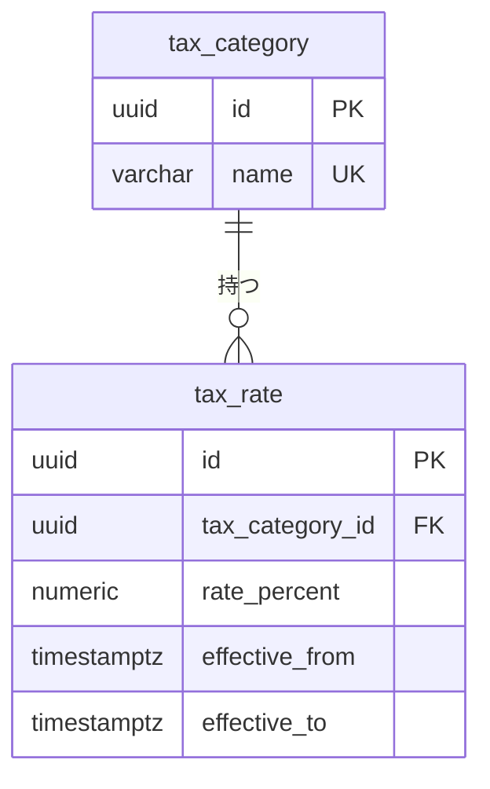

# 税モジュール

税区分と、適用期間付きの税率を管理する。指定時点の税率、税込価格、税率ごとの消費税額を返す。モジュールのレベルと境界、処理の流れ、API の一覧、パッケージの構成は、[税の設計](../02-設計/tax.md)に書く。

## 業務規則

### 税区分

- 税区分は、名称と税率の一覧を持つ。税率は、率と適用期間を持つ。
- 適用期間は開始を含み、終了を含まない。空なら無期限。
- 率は 0 以上 100 未満、小数第 2 位まで。

### 税率は一覧ごと置き換える

税率を 1 件ずつ変える操作は作らず、一覧ごと置き換える操作だけを作る ※1。置き換えでは、現在時刻と比較して次を検証する。

1. 期間が重複せず、途切れず、最後の税率の終了は空。
2. 既存の税率は、状態ごとに変えられる範囲が決まっている。

   | 既存の税率 | 変更・削除 |
   |------------|------------|
   | 開始済み（開始が空を含む） | 率と開始は変えられず、削除もできない。終了は現在より後に変えられる |
   | 終了済み | できない |
   | 未開始 | できる |

3. 新しく設定する開始・終了は、空か現在より後。

※1：期間限定の税率を追加するには、既存の税率の終了を変えて新しい税率を追加する操作を同時に行う必要があり、1 件ずつでは途中で期間が途切れるため。

指定時点の税率は、その時点を含む税率（期間は重ならないので 0 件か 1 件）。

### 不変条件の置き場所

| 不変条件 | ドメイン | DB |
|----------|----------|----|
| 期間が重複しない | 置き換え時の検証 | 排他制約 |
| 途切れがない、最後は無期限 | 置き換え時の検証 | なし（テストで担保） |
| 開始済み・終了済みの変更制限 | 置き換え時の検証 | なし |
| 率の範囲 | 率の値オブジェクト | CHECK 制約 |

### 税込価格

税込価格は、税抜価格 ×（100 ＋ 率）÷ 100 の 1 円未満を切り捨てた額（BR-1）。誤差の出ない十進数で計算する。商品カタログも、並べ替え・絞り込みのため SQL で同じ計算をする（[商品カタログモジュール](catalog.md)）。

### 税率ごとの消費税額

注文の金額は、適格請求書の端数処理に合わせ、税率ごとに 1 回だけ消費税額を計算する。

- 入力は、税率と税込金額の組の一覧（品目の小計と送料）。
- 税率ごとに税込金額を合計し、合計 × 率 ÷（100 ＋ 率）の 1 円未満を切り捨てる。品目ごとには端数処理しない（BR-8）。

## 状態の遷移

なし。

## データモデル

schema は `tax`。テーブルは、税区分（`tax_category`）と税率（`tax_rate`）。列の正本は Flyway のマイグレーション。

- 税区分の名称は重複できない（一意制約）。
- 税率の率は、0 以上 100 未満の CHECK 制約。適用期間は、開始が終了より前の CHECK 制約。
- 排他制約の範囲型は、null の端を無限として扱う。
- 排他制約の検査は、置き換えの書き込みが終わるまで遅延させる ※2。検査はリポジトリが書き込みの最後に行い、違反を業務のエラーに変える ※3。

※2：複数の税率を 1 件ずつ書き換えるので、途中で一時的に期間が重なることがあるため。

※3：コミット時まで遅延させると、違反がリポジトリの外で起き、業務のエラーに変えられないため。

## 今有効な AC

選んだ基準は、[AC 一覧](acceptance-criteria.md)の列「モジュール」が `tax` で、状態が「有効」か「変更」の AC であること。

<!-- generated:module-ac -->
| AC | 今の内容 | 元の spec |
|----|----------|-----------|
| AC-1 | 税区分を名称で登録できる。名称は重複できない。 | [001](../08-spec/archive/mvp/001-catalog-and-inventory/spec.md) |
| AC-2 | 税率は、率（%）、適用開始日時、適用終了日時を持つ。開始が空白なら「過去全て」、終了が空白なら「無期限」を意味する。終了日時ちょうどは含まない。 | [001](../08-spec/archive/mvp/001-catalog-and-inventory/spec.md) |
| AC-3 | 税区分の税率は、一覧としてまとめて登録・更新する。次を全て満たさない一覧は、全体が拒否される：期間が重複しない（空白は無限として扱う）、期間の間に途切れがない、最後の税率の終了日時は空白。 | [001](../08-spec/archive/mvp/001-catalog-and-inventory/spec.md) |
| AC-4 | 期間限定の税率に切り替え、元に戻せる（日時は全て日本時間。BR-3）：Given：「標準」に 10%（開始・終了とも空白）がある。現在は 2026-10-08、When：一覧を「10%（〜2027-04-01 00:00）」「8%（2027-04-01 00:00〜2028-04-01 00:00）」「10%（2028-04-01 00:00〜）」に更新する、Then：2027-03-31 23:59 は 10%、2027-04-01 00:00 から 2028-03-31 23:59 は 8%、2028-04-01 00:00 以降は 10% で計算される。 | [001](../08-spec/archive/mvp/001-catalog-and-inventory/spec.md) |
| AC-5 | 過去の根拠を変えない：現在より前の日時を、開始・終了として新たに設定できない（空白は可）、開始済みの税率（開始が空白のものを含む）は、率と開始日時を変更できず、削除もできない。終了日時は、現在より後の日時に変更できる、終了済みの税率は変更できない。未開始の税率は変更・削除できる。 | [001](../08-spec/archive/mvp/001-catalog-and-inventory/spec.md) |
| AC-7 | 税率は 0% 以上 100% 未満。 | [001](../08-spec/archive/mvp/001-catalog-and-inventory/spec.md) |
| AC-281 | ある時点に適用する税率の判定は 1 か所で決める。税込価格の端数を処理する規則を SQL でも実装する箇所は、Java と同じ結果になることをテストで確認する。 | [016](../08-spec/archive/mvp/016-master-data/spec.md) |
<!-- /generated:module-ac -->
