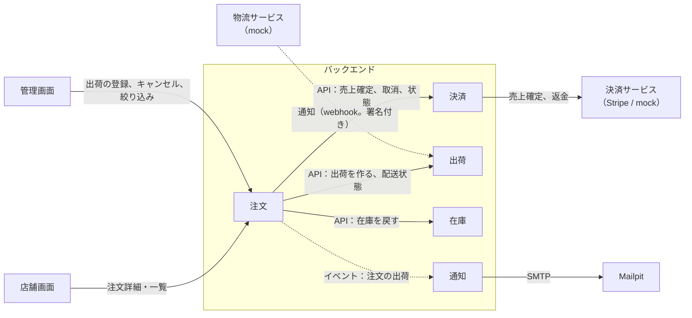
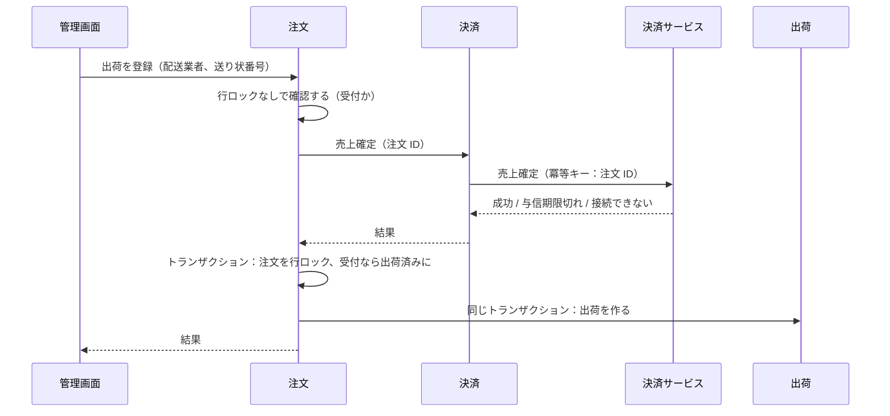

# Plan 009：出荷と配送状況

ステータス：承認済み（tasks 作成済み）　対象：[spec.md](spec.md)

本 spec で変更するモジュールの設計は、各モジュールの設計書に書く。本書には、モジュールをまたぐ決定と、実装の手順だけを書く。

| 対象 | 設計書 | 主な担当 |
|------|--------|----------|
| 出荷（新規） | shipping.md（段階 2 で作る） | 出荷と配送状態（BR-19、22、23）、物流サービスの mock、NFR-9 |
| 通知（新規） | notification.md（段階 4 で作る） | 出荷通知メール（US-38、NFR-11） |
| 決済（変更） | [payment.md](../../../../design/modules/payment.md) | 売上確定、与信期限、返金（BR-20、21、NFR-10） |
| 注文（変更） | [order.md](../../../../design/modules/order.md) | 出荷の登録、返送された注文のキャンセル、絞り込み（BR-18、US-35、39、40） |

用語と識別子の対応は[用語集](../../../../design/glossary.md)。

## 1. 全体の構成

| 決定 | 内容 |
|------|------|
| 依存の向き | 注文 → 決済、注文 → 出荷（API）。決済と出荷は注文に依存しない。通知は注文のイベントだけを受ける ※1 |
| 出荷登録の流れ | 注文が、売上確定（決済の API）→ 注文を「出荷済み」にし、出荷を作る（同じトランザクション）の順に実行する（第 2 節） |
| 配送状態 | 出荷が物流サービスの通知を受けて進める。注文は配送状態を持たず、表示と判定のときに出荷の API から読む |
| 返送された注文のキャンセル | 注文が、出荷の API で配送状態が「返送」であることを確認してからキャンセルする。返金は決済が、コミットの後に行う（第 3.3 節） |
| 出荷通知メール | 注文が「注文の出荷」のイベントを出し、通知がイベントを受け取り、メールを送信する。イベントに、宛先、注文番号、配送業者、送り状番号を載せる |

※1：出荷が注文のイベントを受けると、注文 → 出荷の依存と循環する。配送状態の変化を注文に知らせる必要はない（注文は読むだけ）ので、出荷はイベントを公開しない。

## 2. 出荷の登録と売上確定

| 決定 | 内容 | 確認方法 |
|------|------|----------|
| 売上確定の時点 | 注文を「出荷済み」にする前。決済サービスはトランザクションの外で呼ぶ | 統合テスト：確定に失敗したら出荷は作られない（AC-169） |
| 売上確定の冪等性 | 決済の API は、売上確定済みなら決済サービスを呼ばずに成功を返す。決済サービスにも冪等キー（注文 ID から作る）を渡す | 統合テスト：重ねて登録しても確定は 1 回（AC-172） |
| 売上確定の後に注文が変わっていた | 確定の後、注文が「受付」でなくなっていたら（キャンセル申請など）、出荷を作らず 409。売上確定済みのまま残し、出荷を再登録すれば確定せずに進む。キャンセルになったら返金する | 統合テスト |
| 「出荷済み」の注文に出荷を登録 | 409（AC-170） | 統合テスト |
| 失敗の種類 | 決済の API は、与信期限切れ（業務のエラー）と、決済サービスに接続できない（システムのエラー）を分けて返す。管理 API はそれぞれ別のエラーコードで 409 と 502 にする（AC-169） | 統合テスト |

理由：NFR-10 の「売上未確定のまま出荷済み」を作らないため、確定を先に行う。逆向き（確定済みで出荷なし）は、再登録するかキャンセルで返金すれば解消するので許す。

## 3. 決済の変更

### 3.1 状態

| 決定 | 内容 |
|------|------|
| 支払状態（BR-21） | 売上確定済み（`CAPTURED`）、与信期限切れ（`AUTHORIZATION_EXPIRED`）、返金待ち（`REFUND_PENDING`）、返金済み（`REFUNDED`）を追加する |
| 遷移 | 与信済み → 売上確定済み（売上確定）、与信済み → 与信期限切れ（売上確定が期限切れで失敗）、売上確定済み → 返金待ち（取消）→ 返金済み |
| 取消（注文のキャンセル） | 与信済みなら与信の取消待ち（今までどおり）、売上確定済みなら返金待ち、与信期限切れなら何もしない |

### 3.2 与信期限（BR-20）

| 決定 | 内容 |
|------|------|
| 与信の時刻 | 与信の成功を受けたときに、与信の時刻を支払に記録する（列を追加する） |
| 与信期限 | 与信の時刻 ＋ 設定 `ecsite.payment.authorization-validity`（既定 `7d`）。Stripe のオンラインのカード決済の与信は 7 日で切れる |
| 期限が近い | 与信期限まで設定 `ecsite.payment.authorization-warning`（既定 `2d`）を下回ったとき。期限を過ぎたものも含める |
| 期限切れの検知 | ジョブで監視しない。売上確定が決済サービスに「期限切れ」で拒否されたときに、与信期限切れにする（spec 第 7 節：自動キャンセルはしない） |
| 管理画面の表示 | 決済の API が、注文 ID ごとに与信期限と「期限が近い」を返す。期限が近い注文 ID の一覧も返す（第 5 節の絞り込み） |

### 3.3 返金

spec 007 の与信の取消（決済の設計書「与信の取消」）と同じ形にする。

1. 注文のキャンセルのトランザクションで、決済の API が支払を「返金待ち」にし、決済の中のイベント「返金の依頼」を登録する。
2. コミットの後、リスナーが決済サービスに総額の返金を求め、成功したら「返金済み」にする。冪等キーは注文 ID から作る。
3. 失敗したらリスナーが例外で終わり、未完了のイベントの再発行で再試行する（AC-193）。
4. 決済サービスで返金済みのときも、成功として扱う（AC-195）。

### 3.4 決済サービス

| 決定 | 内容 |
|------|------|
| port | 売上確定、返金の 2 つを追加する。結果は、成功・与信期限切れ・接続できない、の 3 つに変換する |
| Stripe | PaymentIntent の売上確定（capture）と Refund。期限切れのときの応答（エラーコードと PaymentIntent の状態）は、段階 5 の着手時に sandbox で確認して決める |
| mock | テストのコードから、売上確定の与信期限切れ・接続の失敗（N 回）、返金の失敗（N 回）を発生させられる |

## 4. 出荷モジュール

### 4.1 構成

| 決定 | 内容 |
|------|------|
| レベル | B（簡略）。バックエンドのアーキテクチャの「C【提案】」から変える ※1 |
| 集約 | 出荷：注文 ID、配送業者、送り状番号、配送状態、出荷日時、最後に通知を反映した日時。1 つの注文に 1 つ（DB の一意制約。BR-23） |
| 配送状態の遷移 | 状態に順位（出荷済み 0、配送中 1、配達完了・返送 2）を持たせ、今より高い順位にだけ進める。同じ順位の「配達完了」と「返送」は入れ替わらない（AC-176、177） |
| 公開する API | 出荷を作る、注文 ID で配送状態を読む（まとめて読む）、配送状態が「返送」の注文 ID の一覧 |
| イベント | 公開しない（第 1 節 ※1） |

※1：配送状態の履歴に業務の価値はなく（spec は今の状態だけを見せる）、イベントストアの保存方式と read model を追加する理由がない。状態は 4 つで順位の比較だけなので、レベル A（フル）の構成も必要ない。

### 4.2 物流サービスとの連携

| 決定 | 内容 |
|------|------|
| 配送業者（AC-173） | ヤマト運輸（`YAMATO`）、佐川急便（`SAGAWA`）、日本郵便（`JAPAN_POST`） |
| 送り状番号 | 半角の数字とハイフン、30 文字まで。前後の空白を除き、ハイフンは保存のときに除く |
| port | 「追跡を始める」の 1 つ（出荷を作った後、コミットの後に呼ぶ）。実在のサービスで、送り状番号の通知を受け取る登録に相当する。mock は何もしない |
| 通知のエンドポイント | `POST /api/webhooks/carrier`。認証は要求せず、署名（HMAC-SHA256、共有の鍵は環境変数）で確認する。OpenAPI には書かず、出荷の設計書に書く |
| 通知の中身 | 配送業者、送り状番号、物流サービスの状態の名前、発生日時。状態の名前から配送状態への対応は `infrastructure` に置く（BR-19 の ※1） |
| 一致しない通知（AC-178） | 署名が違えば 401。登録済みの出荷と一致しなければ、記録して 200（再送させない） |
| 実装の切り替え | 設定 `ecsite.shipping.carrier`。今は `mock` だけ |

### 4.3 mock

| 決定 | 内容 |
|------|------|
| 画面 | バックエンドが `/mock-carrier` に簡易な HTML を返す（`mock` のときだけ）。出荷の一覧と、出荷ごとに「配送中」「配達完了」「返送」のボタンを持つ |
| 通知の送り方 | ボタンを押すと、mock が署名付きの通知を作り、HTTP で自分のエンドポイント（`/api/webhooks/carrier`）に送る。本物の物流サービスと同じ経路で処理する ※2 |
| 状態の名前 | mock はヤマト運輸の表示の名前（「荷物受付」「配達中」「配達完了」「返品」など）で送り、対応の表で配送状態にする |
| テストからの操作 | テストのコードから、通知の重複・順序の入れ替わり・途中の欠け・署名の誤り・一致しない送り状番号を送れる（NFR-9） |
| 自動で進める | 作らない。必要になったら、設定で有効にする定期ジョブを追加する |

※2：決済の mock は通知を HTTP を通さずに渡すが、出荷では署名の検証（BR-22）を E2E と手動での確認でも通すため。

## 5. 注文の変更

| 決定 | 内容 |
|------|------|
| 注文状態 | 出荷済み（`SHIPPED`）を追加する |
| 出荷済みのキャンセル | 運営者のキャンセルの API で、配送状態が「返送」のときだけ受け付ける。それ以外の出荷済みは 409 |
| 在庫に戻すか（AC-191） | 運営者のキャンセルの要求に「在庫に戻す」を追加する。出荷済みのときは必須、それ以外は無視する（今までどおり戻す）。キャンセルに、在庫に戻したかを記録する |
| キャンセルの種類 | 今の「運営者の判断」を使う。理由は必須のまま |
| できる操作のフラグ | 管理画面：出荷の登録（受付のとき）、キャンセル（受付・キャンセル申請中、または出荷済みで返送のとき）。店舗画面：申請は受付のときだけ（今までどおり） |
| イベント「注文の出荷」 | 注文を出荷済みにしたときに登録する。宛先、注文番号、配送業者、送り状番号を載せる |
| 絞り込み（AC-182、187、189） | 管理画面の注文一覧に、状態「出荷済み」、与信期限が近い、配送状態「返送」を追加する。後の 2 つは、決済・出荷の API から注文 ID の一覧を得て、注文の検索に ID の条件として渡す ※1 |

※1：他のモジュールのテーブルは結合できない（バックエンドのアーキテクチャ 第 3 節）。MVP の件数では ID の一覧で足りる。件数が増えたら、注文に写しを持たせる方式をレビューする。

## 6. 通知モジュール

| 決定 | 内容 |
|------|------|
| 構成 | 新しいモジュール `notification`、レベル B。注文のイベントだけを受け、他のモジュールの API は呼ばない |
| 送信 | Spring Boot のメール（`spring-boot-starter-mail`、Apache License 2.0）で SMTP に送る。ローカル・テスト・E2E は compose の Mailpit（`localhost:1025`） |
| 本文 | 日本語のテキスト。件名と本文の雛形はメッセージのファイルに置く |
| 送信元 | 設定 `ecsite.notification.from` |
| 重複を防ぐ（AC-185） | 送ったメールを、注文 ID とメールの種類の組で記録する（一意制約）。記録があれば送らない。記録と送信は同じトランザクションで、送信に失敗したら巻き戻して、未完了のイベントの再発行で再試行する ※1 |

※1：送信が済んでコミットに失敗したときだけ 2 通になりうる。DB のコミットの失敗はまれなので許す。

## 7. API

項目の定義は OpenAPI（[admin.yaml](../../../../../api/openapi/admin.yaml)、[store.yaml](../../../../../api/openapi/store.yaml)）。

### 7.1 B 側（`/api/admin`）

| Method | Path | 変更 | AC |
|--------|------|------|----|
| POST | `/orders/{orderId}/shipment` | 新規。配送業者と送り状番号で出荷を登録する。与信期限切れは 409、決済サービスに接続できないときは 502 | 167〜173、188 |
| GET | `/orders` | 状態に「出荷済み」、絞り込みに与信期限が近い・配送状態「返送」を追加する。各行に配送状態と「与信期限が近い」を追加する | 182、186、187、189 |
| GET | `/orders/{orderId}` | 出荷（配送業者、送り状番号、配送状態、出荷日時）、与信期限、支払状態の追加分、できる操作「出荷の登録」を追加する | 181、186、194 |
| POST | `/orders/{orderId}/cancel` | 要求に「在庫に戻す」を追加する。出荷済みで返送のときに受け付ける | 171、190〜192 |

- 権限は既存の注文の参照・更新のまま。

### 7.2 C 側（`/api/store`）

| Method | Path | 変更 | AC |
|--------|------|------|----|
| GET | `/me/orders`、`/orders/{orderId}` | 状態に「出荷済み」、出荷（配送状態、配送業者、送り状番号）を追加する | 179、180、196 |

## 8. フロントエンド

| | store（C 側） | admin（B 側） |
|---|---|---|
| 注文詳細 | 出荷後は、注文状態の代わりに配送状態。配送業者と送り状番号 | 出荷登録のフォーム（配送業者の選択、送り状番号）。出荷の表示（配送状態、配送業者、送り状番号、出荷日時）。与信期限と「期限が近い」。返送のときのキャンセル（在庫に戻すかを選ぶ）。返金待ち・返金済み |
| 注文一覧 | 出荷後は、注文状態の代わりに配送状態 | 配送状態と「与信期限が近い」の表示。絞り込みに「出荷済み」「与信期限が近い」「返送」 |

- 列挙の表示名は `Record` で網羅する（フロントの書き方 第 2.4 節）。

## 9. 決めたこと

| 項目 | 決定 |
|------|------|
| 配送状態（BR-19） | 出荷済み（`SHIPPED`）、配送中（`IN_TRANSIT`）、配達完了（`DELIVERED`）、返送（`RETURNED`） |
| 用語集 | 出荷、配送業者、送り状番号、配送状態、売上確定、与信期限、返金を追加する。配送業者ごとの表示と配送状態の対応の表を追加する（ヤマト運輸は mock で使う名前、他の 2 社は分かる範囲で） |
| 依存とライセンス | `spring-boot-starter-mail`（Apache License 2.0）。[依存とライセンス](../../../../design/licenses.md) に追加する |
| 秘密の値 | 物流サービスの通知の鍵 `CARRIER_WEBHOOK_SECRET`。ローカルとテストは設定の既定値（テスト用）を使う |
| 機能紹介のページ | レビューの段階で、出荷の画面を再撮影するかを決める |

## 10. テスト

| 対象 | 単体 | 統合 | E2E |
|------|------|------|-----|
| 配送状態（BR-19） | 順位の遷移、戻らない、飛ばせる、配達完了と返送は入れ替わらない | 通知の重複・順序の入れ替わり・欠け（AC-175〜177）、署名の誤りと一致しない通知（AC-178） | |
| 売上確定（US-35） | 支払状態の遷移 | 出荷の登録で確定し出荷済みに（AC-168）、確定の失敗（AC-169）、重ねて登録（AC-172）、受付以外は登録できない（AC-170） | |
| 与信期限（US-39） | 期限が近いの判定 | 一覧の表示と絞り込み（AC-186、187）、期限切れの確定の失敗とキャンセル（AC-188） | |
| 返金（US-40） | 支払状態の遷移 | 返送のキャンセルで返金と在庫の選択（AC-190〜192）、失敗を再発行で再試行する（AC-193）、重ねても 1 回（AC-195）、返送以外の出荷済みはキャンセルできない（AC-171） | |
| 出荷通知メール（US-38） | 本文の組み立て | 出荷で送る（AC-183）、失敗を再試行する（AC-184）、1 通だけ（AC-185）。SMTP は Testcontainers の Mailpit で受ける | 出荷の後に Mailpit の API でメールを確認する |
| 店舗画面 | 配送状態の表示名、出荷後の状態の出し分け | | mock で出荷 → 配送中 → 配達完了が注文詳細に表示される |
| 管理画面 | 絞り込みの URL | 出荷の登録、キャンセル（在庫の選択）、表示（結合テスト） | 出荷を登録 → mock の画面で返送 → キャンセルし、返金済みになる |
| 横断 | | モジュール境界の検証（循環がない） | |

- Stripe の売上確定と返金は、段階 5 で sandbox で手動で確認する（自動のテストには入れない）。与信期限切れは sandbox で再現できない（7 日待つ）ので、mock で確認する。

## 11. 実装の順序

tasks は段階ごとに `tasks/` の 1 ファイルにする（[01](tasks/01-payment.md)、[02](tasks/02-shipping.md)、[03](tasks/03-order.md)、[04](tasks/04-notification.md)、[05](tasks/05-stripe.md)、[06](tasks/06-admin-ui.md)、[07](tasks/07-store-ui.md)、[08](tasks/08-e2e-ci.md)、[09](tasks/09-review.md)、[10](tasks/10-seed.md)）。タスク番号は `T9` ＋ 段階 ＋ 連番（例：T9101）。

| # | 段階 | 完了条件 |
|---|------|----------|
| 1 | 決済の変更（売上確定、与信期限、返金、mock、マイグレーション、payment.md） | 決済の単体・統合テストが通る |
| 2 | 出荷モジュール（出荷、配送状態、通知のエンドポイント、mock の画面、マイグレーション、shipping.md、バックエンドのアーキテクチャ、用語集） | 出荷の単体・統合テストが通る |
| 3 | 注文の変更（出荷の登録、返送のキャンセル、絞り込み、イベント、OpenAPI、order.md） | US-35、37、39、40 のバックエンドのテストが通る。既存のテストが全て通る |
| 4 | 通知モジュール（メール、notification.md、compose と開発環境の文書） | US-38 のテストが通る |
| 5 | Stripe の売上確定と返金 | sandbox で、出荷の登録から売上確定、返送のキャンセルから返金までを手動で確認する |
| 6 | 管理画面 | 出荷の登録、表示、絞り込み、返送のキャンセルが画面で確認できる（mock） |
| 7 | 店舗画面 | 配送状態の表示が画面で確認できる（mock） |
| 8 | E2E と CI | E2E が CI で通る |
| 9 | レビュー | 実装と文書の食い違い、読みにくさ、コメントの不足を修正し、テストが通る |
