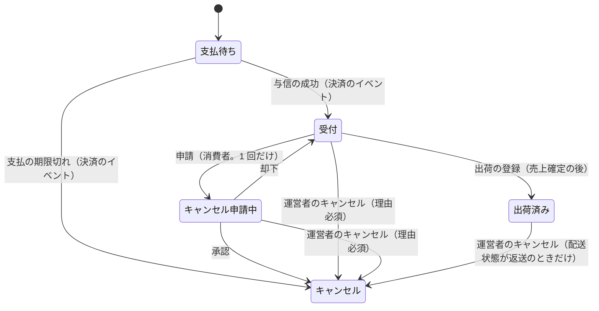

# 注文モジュール

見積もり（金額と購入できるか）、注文手続き、注文、支払の結果による状態の変更、出荷の登録、キャンセルを管理する。

| 項目 | 内容 |
|------|------|
| レベル | A（状態遷移、注文時点の写し、在庫との強い一貫性） |
| 依存 | カート（API、イベント）、決済（API、イベント）、出荷・商品カタログ・在庫・税（API）、会員（API。presentation だけ） |
| 関連 spec | [002](../../specs/002-cart-and-order)、[003](../../specs/003-auth)、[007](../../specs/007-payment)、[009](../../specs/009-shipping) |

## 見積もり

カートの表示、注文手続き、注文の成立は、どれも同じ見積もりで金額を求める。

- 入力は、品目（バリアントと数量）、時点、引当の持ち主（注文手続き中なら自分の引当を販売可能数から除く）。
- 品目ごとに、商品カタログから注文できるバリアントの情報（品番、商品名、軸の値、税抜価格、税区分、表示されるか、販売停止か）を、在庫から販売可能数を受け取る。
- 購入できない品目には理由を付け、合計に含めない。
- 税込単価と税率ごとの消費税額は、税モジュールに計算させる。送料は設定の金額と税区分を使い、購入できる品目が 1 つ以上あるときだけかける。

## 注文手続き

- 注文手続きは、会員、カート、始めたときのカートのバージョン、引当の期限を持ち、引当の持ち主になる。
- 始められるのは、会員本人のカートだけ（会員の token が必要）。参照・注文できるのは始めた会員だけ（他の人は 404）。
- 始めるときに、購入できない品目がないことを確かめてから、全品目を引き当てる。
- 同じカートで始め直したら、新しい注文手続きを作り、前の引当を解く。
- カート変更のイベントを受けたら、そのカートの注文手続きの引当を解く ※1。

※1：イベントの処理に失敗しても、引当は期限で数えられなくなるので実害は小さい。

## 注文（集約）

- 注文は、注文番号、注文手続き、注文日時、状態、明細、金額の内訳、会員、メールアドレス、お届け先、キャンセルの申請、キャンセル（種類、運営者のキャンセルの理由、在庫に戻したか）を持つ。
- 支払（状態、支払の期限、与信期限）は決済が、出荷（配送業者、送り状番号、配送状態、出荷日時）は出荷が持つ。注文は持たず、表示と判定のときに決済・出荷の API から読む。
- 明細は、注文時点の商品品番、バリアント品番、商品名、軸の値、税抜単価、税率、税込単価、数量、小計の写しを持つ。バリアント ID は在庫の戻しにだけ使う。
- 金額の内訳は、商品の合計、送料、総額、税率ごとの対象額と消費税額。
- 注文と明細は 1 つの集約。成立後、明細と金額は変わらない。
- メールアドレスはリクエストで受けず、会員の token のメールアドレスを写す（確認済みでなければ注文しない）。
- 運営者の判断（承認・却下）とキャンセルには、運営者 ID と氏名の写しを別々に残す ※2。表示は写しを使う。

※2：却下の後に運営者がキャンセルすることがあるため、2 組を持つ。

| 操作 | できる人 | それ以外 |
|------|----------|----------|
| 参照、キャンセルの申請 | 注文した会員 | 他の会員は 404、ログインしていなければ 401 |
| 自分の注文の一覧 | 会員（注文日時の新しい順、ページ単位） | — |

### 状態遷移

| 操作 | すでにその状態のとき | できない状態 |
|------|----------------------|--------------|
| 与信の成功 | 支払待ちでなければ何もしない | — |
| 支払の期限切れ | 支払待ちでなければ何もしない | — |
| 申請 | 申請中なら成功して何もしない | 支払待ち、却下済み（申請は 1 回だけ）、キャンセル |
| 承認 | キャンセルなら成功して何もしない | 受付（申請がない） |
| 却下 | — | キャンセル、受付 |
| 運営者のキャンセル | キャンセルなら成功して何もしない | 支払待ち ※4、配送状態が返送でない出荷済み |
| 出荷の登録 | — | 受付以外（キャンセル申請中、出荷済みを含む） |

- キャンセルになるとき、同じトランザクションで在庫に明細の数量を戻させ（調整理由は「注文のキャンセル」）、決済の API で支払を取り消させる。与信の取消と返金は、決済がコミットの後に行い、注文は結果を待たない。
- 出荷済みの注文のキャンセルは、運営者が「在庫に戻す」かを必ず選ぶ（返送された商品が売れる状態とは限らないため）。戻さないときは在庫を変えない。出荷済みでない注文は、指定によらず戻す。キャンセルに、在庫に戻したかを記録する。
- キャンセルは種類（申請の承認、運営者の判断、支払期限切れ）を持つ。支払期限切れは、運営者と理由を持たない。
- 受付になるとき、同じトランザクションでカートから注文した品目（バリアント）を除かせる。注文の後にカートに足した品目は残る。
- 状態を変えたら、ドメインイベント（注文成立、注文キャンセル、注文の出荷）を登録する。

※4：支払待ちの注文は、支払の期限で自動でキャンセルになるため。

### できる操作の旗

注文の詳細の応答に、今できる操作の旗（`actions`）を返す。値は上の表の規則から作り、画面は同じ判定を持たない。すでにその状態で何もしない操作は出さない。

| 画面 | 旗 |
|------|----|
| 管理画面（`admin.yaml` の `OrderActions`） | 承認・却下はキャンセル申請中、運営者のキャンセルは受付・キャンセル申請中か、出荷済みで配送状態が返送のとき。出荷の登録は受付のとき |
| 店舗画面（`store.yaml` の `OrderActions`） | 申請は受付で、まだ申請していないとき。支払うは支払待ちで、支払の期限の前のとき |

### 注文の成立

- 判定（カートの変更、購入できるか、総額、入力）をすべて済ませてから、在庫の減算 → 注文の保存（支払待ち） → 支払を作る（決済の API）、の順に書く。カートはこの時点では変えない。
- 同じ注文手続きの注文は 1 つだけ（DB の一意制約でも守る）。
- 注文番号は、注文日（日本時間）の 8 桁、ハイフン、ランダムな 6 桁。在庫の調整履歴にも写すので、減算の前に、使われていない番号を確かめて決める ※3。

※3：確かめてから保存するまでに重なったら（ごくまれ）、トランザクションを壊さない挿入で知り、409 にする。

### 支払

- 支払の画面の URL は、店舗 API が決済の API から得る。持ち主だけが求められ、支払待ちで支払の期限の前でなければ 409。決済の API は決済サービスを呼ぶので、トランザクションの外で呼ぶ。
- 決済のイベント（与信の成功、支払の期限切れ）は、コミットの後に非同期で受ける。注文を行ロックしてから状態を変えるので、何度届いても結果は同じ。
- 支払の期限切れの後に届いた与信は、決済の中で取り消され、注文には届かない。

### 出荷の登録

1. 注文を行ロックせずに読み、受付でなければ 409 にする（売上を確定しない）。
2. トランザクションの外で、決済の API に売上確定を求める。与信期限切れは 409、決済サービスに接続できないときは 502 にし、出荷は作らない。
3. トランザクションで注文を行ロックし、受付なら出荷済みにして、出荷の API で出荷を作り、イベント「注文の出荷」を登録する。
4. 確定の後に注文が受付でなくなっていたら（キャンセル申請など）、409 にする。支払は売上確定済みのまま残り、登録し直すと決済サービスを呼ばずに進む。キャンセルになったら返金される。

理由：売上が確定していないのに出荷済みになる注文を作らないため。逆向き（確定済みで出荷なし）は、登録し直すかキャンセルで片付く。

- 送り状番号の形（数字とハイフン、30 文字まで）は、売上確定の前に要求の検証で確かめる。
- イベント「注文の出荷」には、メールアドレス、注文番号、配送業者、送り状番号（ハイフンを除いたもの）を載せる。

### 一覧の絞り込み

- 管理画面の注文一覧は、状態、注文番号、注文日の範囲のほか、与信期限が近い、配送状態が返送、で絞り込める。
- 後の 2 つは、決済・出荷の API から注文 ID の一覧を受け取り、注文の検索に ID の条件として渡す ※5。

※5：他のモジュールのテーブルは結合できない（[バックエンドのアーキテクチャ](../architecture.md) 第 3 節）。件数が増えたら、注文に写しを持たせる方式を見直す。

## 他のモジュールへの公開

| 種類 | 内容 | 利用者 |
|------|------|--------|
| API | 見積もり（カートの表示用） | 店舗 |
| イベント | 注文の出荷 | 通知（出荷通知メール） |
| イベント | 注文成立、注文キャンセル | なし（将来のレポート用） |

## データモデル

[V202610111200__ordering_create_order.sql](../../../backend/ecsite/src/main/resources/db/migration/V202610111200__ordering_create_order.sql)、[V202610121200__ordering_add_member_id.sql](../../../backend/ecsite/src/main/resources/db/migration/V202610121200__ordering_add_member_id.sql)、[V202610151000__ordering_add_shipped.sql](../../../backend/ecsite/src/main/resources/db/migration/V202610151000__ordering_add_shipped.sql)、[V202610151010__ordering_add_cancellation_restocked.sql](../../../backend/ecsite/src/main/resources/db/migration/V202610151010__ordering_add_cancellation_restocked.sql)

- schema は `ordering`（`order` は SQL の予約語のため）。
- カート・バリアント・会員は他のモジュールの ID なので、外部キーは張らない。
- 注文手続きと注文は会員 ID を必須で持つ（認証を入れる前の、会員のない注文と引当はマイグレーションで消した）。
- 明細の軸の値の写しは、変わらない一覧なので JSON で持つ。
- キャンセルの申請とキャンセルは注文に 1 回ずつなので、注文の列に持つ。在庫に戻したかは、列を足す前のキャンセルを「戻した」とする。
- 金額の整合（総額 ＝ 商品の合計 ＋ 送料、小計 ＝ 税込単価 × 数量）は CHECK 制約でも守る。
