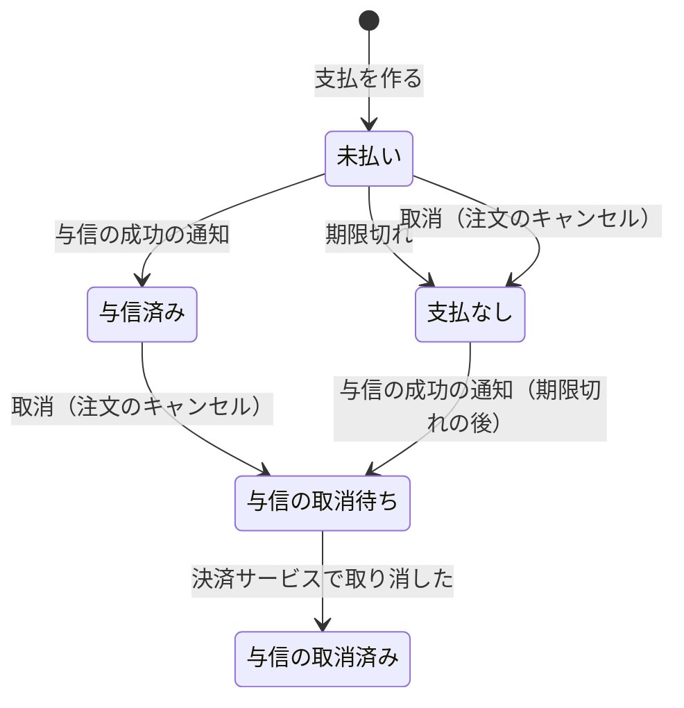

# 決済モジュール

注文の代金の支払（カードの与信）と、外部の決済サービスとのやり取りを管理する。決済サービスの腐敗防止層。

| 項目 | 内容 |
|------|------|
| レベル | A（支払の状態遷移、外部からの通知の重複と順序の入れ替わり、期限切れとの競合） |
| 依存 | なし（注文が決済の API を呼び、決済は結果をイベントで伝える ※1） |
| 関連 spec | [007](../../specs/007-payment) |

※1：決済が注文のイベントを受けると、モジュールが循環する。

## 支払（集約）

- 支払は、注文 ID、金額（総額）、支払の期限、状態、支払の画面（決済サービスでの ID と URL）、与信の参照（決済サービスで与信を取り消すときに使う ID）を持つ。
- 1 つの注文に支払は 1 つ（DB の一意制約でも守る）。注文の成立と同じトランザクションで作る。
- 支払の画面は、同時に 1 つだけ開く。開いていれば同じ画面を使い、決済サービスに作り直させない。
- 売上の確定は行わない（出荷の spec で足す）。

### 状態遷移

| 操作 | すでにその状態のとき・遷移できないとき |
|------|------------------------------------------|
| 与信の成功の通知 | 与信済み・与信の取消待ち・与信の取消済みなら何もしない |
| 期限切れ | 未払いでなければ何もしない |
| 取消 | 与信の取消待ち・与信の取消済み・支払なしなら何もしない |
| 取消済みにする | 与信の取消待ちでなければ何もしない |

- どの操作も冪等にする。決済サービスの通知は重ねて届き、順序が入れ替わるので、遷移できない通知は記録して無視する。通知の ID は記録しない。
- 与信済みになったら「与信の成功」、期限切れで支払なしになったら「支払の期限切れ」のイベントを登録する。
- 与信の取消待ちになったら、決済の中のイベント「与信の取消の依頼」を登録する。

## 支払の期限

- 支払の期限は、注文日時に設定の時間（既定 30 分）を足した時刻。注文が支払を作るときに渡す。
- 期限切れのジョブ（1 分ごと、分散ロック付き）が、期限を過ぎた未払いの支払を、次の順に処理する。
  1. 支払の画面があれば、決済サービスに閉じさせる。
  2. 閉じられなかった（その前に支払が済んでいた）ら、何もしない。与信の成功の通知で与信済みになる。
  3. 閉じられたら、支払を行ロックし、未払いなら支払なしにする。
- 決済サービスの支払の画面は、作ってから 30 分より短い期限を持てない（Stripe Checkout の制約）。画面を作り直すと、画面の期限が支払の期限より後になるので、ジョブが閉じてそろえる。

## 与信の取消

1. 注文のキャンセルのトランザクションで、決済の API が支払を与信の取消待ちにする。決済サービスはまだ呼ばない。
2. コミットの後、「与信の取消の依頼」のリスナーが決済サービスに取消を求め、成功したら与信の取消済みにする。
3. 決済サービスが失敗したら、リスナーは例外で終わり、イベントは未完了で残る。未完了のイベントの再発行（[バックエンドのアーキテクチャ](../architecture.md) 第 5 節）でやり直す。
4. 決済サービスで取消済みの与信の取消も、成功として扱う。

理由：決済サービスが応えないときも、注文のキャンセルと在庫の戻しを止めないため。

## 決済サービス

| 項目 | 内容 |
|------|------|
| port | 支払の画面を作る、支払の画面を閉じる、与信を取り消す。決済サービスの型とエラーは `infrastructure` の外に出さない |
| 実装 | mock（既定）と Stripe。設定 `ecsite.payment.gateway` で切り替える |
| 支払の画面から戻る先 | 店舗の注文の画面。URL は設定の雛形に注文 ID を入れて作る。要求から受け取らない ※2 |
| 通知 | 決済サービスからの通知を受けて、与信の成功・支払の画面の期限切れを支払に反映する。結果は通知だけで受け取り、支払の画面から戻ったときに決済サービスに問い合わせない |

※2：戻る先を要求から受け取ると、任意のサイトへ移す踏み台（オープンリダイレクト）にされるため。

### mock

- バックエンドが `/mock-payment/{支払の画面の ID}` に簡単な HTML を出す。「支払う」「カードを拒否させる」「やめる」の操作を持つ。
- 「支払う」は与信の成功の通知を、HTTP を通さずに通知の処理に直接渡してから、店舗の注文の画面に戻す。「カードを拒否させる」は画面に拒否を示し、状態を変えない。
- テストのコードから、与信の成功、通知の遅れ・重複・順序の入れ替わり、閉じる前に支払が済んでいたこと、取消の失敗（回数を指定）を起こせる。

### Stripe

| 項目 | 内容 |
|------|------|
| ライブラリ | `stripe-java`。API のバージョンはライブラリのものに固定される |
| 支払の画面 | Checkout Session（`mode=payment`、`capture_method=manual`、通貨 JPY、金額は総額の 1 行）。支払の画面 ID は Session の ID |
| 画面の期限 | 作ってから 31 分（Stripe の最短の 30 分に、時計のずれの余裕を足す） |
| 支払の方法 | Session では指定しない（Stripe の API が受け付けない）。ダッシュボードの設定で決まり、カードだけを有効にする。カードで払うウォレット（Apple Pay、Google Pay、Link）も与信だけを取れるが、MVP の後に見直す |
| 通知の受け口 | `POST /api/webhooks/stripe`。認証は付けず、署名（ヘッダー `Stripe-Signature`、鍵 `STRIPE_WEBHOOK_SECRET`）で確かめる。署名が合わない・古い通知は 400 で拒否する |
| 秘密の値 | `STRIPE_SECRET_KEY`、`STRIPE_WEBHOOK_SECRET`（[環境変数](../../dev/environment.md)） |

通知の種類と、支払への反映：

| 通知の種類 | 中身 | 反映 |
|------------|------|------|
| `checkout.session.completed` | Session の `status` は `complete`、`payment_status` は `unpaid`（与信だけで売上はまだ）。`payment_intent` が与信の ID | 与信の成功。与信の参照は `payment_intent` |
| `checkout.session.expired` | 期限切れ、または画面を閉じた Session | 支払の画面の期限切れ |
| その他 | `payment_intent.*`、`charge.*` など | 受け付けて（200）、何もしない |

- 消費者が支払の画面を離れても、通知は来ない。Session は期限まで開いたまま。カードの拒否は画面に出るだけで、Session の通知は来ない。
- 支払の画面を閉じる（Session を期限切れにする）とき、`open` でない Session は Stripe が拒否する。拒否されたら Session を読み、`complete` なら「支払が済んでいた」、`expired` なら「閉じた」とする。
- 与信を取り消す（PaymentIntent の取消）とき、取消済みは Stripe が拒否する（`payment_intent_unexpected_state`）。拒否されたら PaymentIntent を読み、`canceled` なら成功とする。
- Stripe が応えない、上の他の拒否は、システムのエラーにする。

## 他のモジュールへの公開

| 種類 | 内容 | 利用者 |
|------|------|--------|
| API | 支払を作る、支払の画面の URL を得る、取消、支払の状態（注文 ID でまとめて） | 注文 |
| イベント | 与信の成功、支払の期限切れ | 注文 |

## データモデル

- schema は `payment`。
- 注文 ID は他のモジュールの ID なので、外部キーは張らない。注文 ID に一意制約を付ける。
- 金額は円単位の整数。
