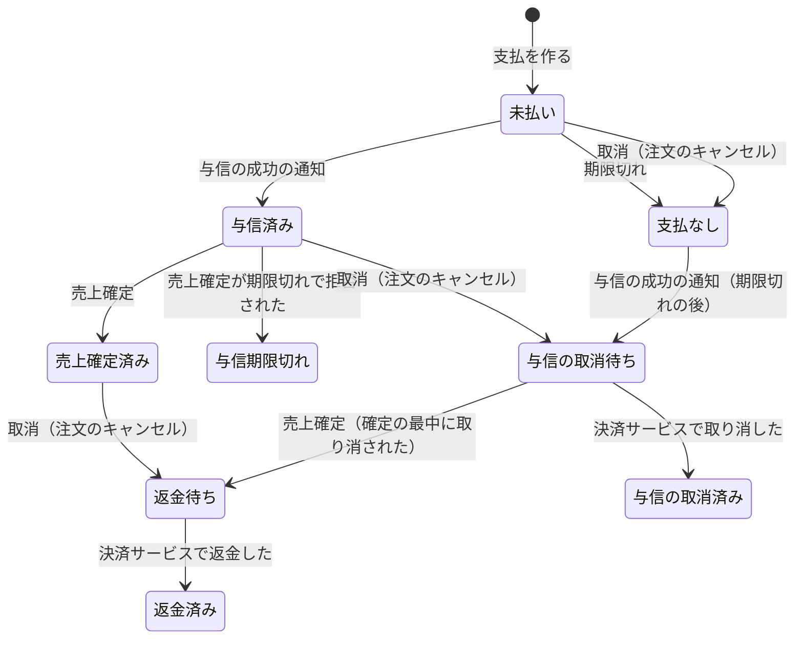

# 決済モジュール

注文の代金の支払（カードの与信、売上確定、返金）と、外部の決済サービスとの連携を管理する。決済サービスの腐敗防止層。

| 項目 | 内容 |
|------|------|
| レベル | A（支払の状態遷移、外部からの通知の重複と順序の入れ替わり、期限切れとの競合） |
| 依存 | なし（注文が決済の API を呼び、決済は結果をイベントで伝える ※1） |
| 関連 spec | [007](../../specs/archive/mvp/007-payment)、[009](../../specs/archive/mvp/009-shipping)、[013](../../specs/archive/mvp/013-backend-consistency)、[015](../../specs/archive/mvp/015-security)、[017](../../specs/archive/mvp/017-stability)、[018](../../specs/archive/mvp/018-docs-and-tools) |

※1：決済が注文のイベントを受けると、モジュールが循環する。

## 支払（集約）

- 支払は、注文 ID、金額（総額）、支払の期限、状態、支払画面（決済サービスでの ID と URL）、与信の参照（決済サービスで与信を取り消す・売上を確定する・返金するときに使う ID）、与信の時刻、与信の通知を待ち始めた時刻を持つ。
- 1 つの注文に支払は 1 つ（DB の一意制約でも守る）。注文の成立と同じトランザクションで作る。
- 支払画面は、同時に 1 つだけ開く。開いていれば同じ画面を使い、決済サービスに再作成させない。
- 与信の時刻は、与信の成功を受けて与信済みになったときに記録する（与信期限の起点）。

### 状態遷移



| 操作 | すでにその状態のとき・遷移できないとき |
|------|------------------------------------------|
| 与信の成功の通知 | 未払い・支払なし以外（与信済み、売上確定済み、与信期限切れ、返金待ち、返金済み、与信の取消待ち、与信の取消済み）なら何もしない |
| 期限切れ | 未払いでなければ何もしない |
| 与信の通知を待つ | 未払いでないか、すでに待っていれば何もしない（状態は未払いのまま、待ち始めた時刻だけを記録する） |
| 売上確定 | 与信済み・与信の取消待ち以外なら何もしない ※2 |
| 与信期限切れにする | 与信済みでなければ何もしない |
| 取消 | 与信の取消待ち・与信の取消済み・支払なし・与信期限切れ・返金待ち・返金済みなら何もしない |
| 取消済みにする | 与信の取消待ちでなければ何もしない |
| 返金済みにする | 返金待ちでなければ何もしない |

- どの操作も冪等にする。決済サービスの通知は重複して届き、順序が入れ替わるので、遷移できない通知は記録して無視する。通知の ID は記録しない。
- 与信済みになったら「与信の成功」、期限切れで支払なしになったら「支払の期限切れ」のイベントを登録する。
- 与信の取消待ちになったら、決済の中のイベント「与信の取消の依頼」を、返金待ちになったら「返金の依頼」を登録する。
- 与信期限切れの支払の取消は、取り消すものがないので何もしない（与信は決済サービスで切れている）。

※2：決済サービスが確定してから、確定を反映するまでの間に注文がキャンセルされると、支払は与信の取消待ちになっている。確定した与信は取り消せないので、反映のときに返金待ちにして返金する。

## 支払の期限

- 支払の期限は、注文日時に設定の時間（既定 30 分）を加えた時刻。注文が支払を作るときに渡す。
- 期限切れのジョブ（設定 `ecsite.payment.expiry-interval` の間隔、既定 1 分。分散ロック付き）が、期限を過ぎた未払いの支払を、次の順に処理する。
  1. 支払画面があれば、決済サービスに閉じさせる。
  2. 閉じられなかった（その前に支払が済んでいた）ら、支払を行ロックし、未払いなら与信の通知を待つ支払にする（待ち始めた時刻を記録する）。与信の成功の通知で与信済みになる。
  3. 閉じられたら、支払を行ロックし、未払いなら支払なしにする。
- 1 回に処理するのは期限の古い順に 100 件まで。与信の通知を待つ支払は探さない。通知が届かない支払が蓄積しても、それより新しい期限切れの支払を処理するため。
- 1 件の処理で例外（種類を問わない）が起きたら、warn のログに支払 ID を出力して次の支払へ進む。その支払は次の回で再試行する。
- ジョブの最後に、与信の通知を待ち始めてから設定 `ecsite.payment.awaiting-authorization-warning`（既定 1 時間）を過ぎた未払いの支払を数え、1 件以上なら warn のログに件数を出力する。人が対応するまで、毎回出力する。通知が届かない原因（通知の設定など）を修正するのが先なので、決済サービスから与信を取得して補完しない。
- 決済サービスの支払画面は、作ってから 30 分より短い期限を持てない（Stripe Checkout の制約）。画面を再作成すると、画面の期限が支払の期限より後になるので、ジョブが支払の期限に画面を閉じて、両方の期限を一致させる。

## 与信期限

- 与信期限は、与信の時刻に設定 `ecsite.payment.authorization-validity`（既定 7 日）を加えた時刻。Stripe のオンラインのカード決済の与信が 7 日で切れるため。
- 「期限が近い」は、与信期限まで設定 `ecsite.payment.authorization-warning`（既定 2 日）を切ったとき。期限を過ぎたものも含める。対象は、与信済みと与信期限切れの支払。
- 期限切れは、ジョブで監視しない。売上確定が決済サービスに期限切れで拒否されたときに、与信期限切れにする。自動ではキャンセルしない。

## 売上確定

1. 決済の API が、支払の状態を読む（行ロックなし）。売上確定済みなら、決済サービスを呼ばずに成功を返す。与信済みでなければ業務のエラーを返す。
2. トランザクションの外で、決済サービスに総額の売上確定を求める。冪等キーは注文 ID から作る。
3. 結果に応じて、支払を行ロックして更新する。成功なら売上確定済み（その間に与信の取消待ちになっていたら返金待ち）、与信期限切れなら与信期限切れにする。
4. 与信期限切れは業務のエラー、決済サービスに接続できないときはシステムのエラーを返す。接続できないときは与信済みのまま残る。

理由：決済サービスの応答を待つ間、行ロックを持たないため。

## 与信の取消

1. 注文のキャンセルのトランザクションで、決済の API が支払を与信の取消待ちにする。決済サービスはまだ呼ばない。
2. コミットの後、「与信の取消の依頼」のリスナーが決済サービスに取消を求め、成功したら与信の取消済みにする。リスナーはトランザクションを持たず、決済サービスをトランザクションの外で呼ぶ（待つ間に DB の接続を持たない）。読み取りと更新は、参照・更新のサービスのトランザクションで行う。
3. 決済サービスが失敗したら、リスナーは例外で終わり、イベントは未完了で残る。未完了のイベントの再発行（[バックエンドのアーキテクチャ](../backend-architecture.md) 第 5 節）で再試行する。
4. 決済サービスで取消済みの与信の取消も、成功として扱う。
5. 売上を確定した与信の取消は、決済サービスが拒否する。リスナーは例外で終わり、再発行のときには支払が返金待ちになっているので、何もしない。

理由：決済サービスが応答しないときも、注文のキャンセルと在庫の戻しを止めないため。

## 返金

与信の取消と同じ形にする。

1. 注文のキャンセルのトランザクションで、決済の API が売上確定済みの支払を返金待ちにし、決済の中のイベント「返金の依頼」を登録する。決済サービスはまだ呼ばない。
2. コミットの後、「返金の依頼」のリスナーが決済サービスに総額の返金を求め、成功したら返金済みにする。冪等キーは注文 ID から作る。与信の取消と同じく、リスナーはトランザクションを持たない。
3. 決済サービスが失敗したら、リスナーは例外で終わり、イベントは未完了で残る。未完了のイベントの再発行で再試行する。
4. 返金済みの支払の取消も、成功として扱う。

## 決済サービス

| 項目 | 内容 |
|------|------|
| port | 支払画面を作る、支払画面を閉じる、与信を取り消す、売上を確定する、返金する。売上確定の結果は、成功・与信期限切れ・接続できない、の 3 つに変換する。決済サービスの型とエラーは `infrastructure` の外に出さない |
| 実装 | mock と Stripe。mock フラグ（`ecsite.payment.mock.enabled`）が有効なら mock、そうでなければ Stripe を使う。フラグが有効でなく、Stripe の鍵が不足していれば、起動に失敗する ※5 |
| 支払画面から戻る先 | 店舗の注文の画面。URL は設定の雛形に注文 ID を入れて作る。要求から受け取らない ※3 |
| 通知 | 決済サービスからの通知（与信の成功、支払画面の期限切れ）を受けて、与信の成功と支払の期限切れを支払に反映する。結果は通知だけで受け取り、支払画面から戻ったときに決済サービスに問い合わせない |

※3：戻る先を要求から受け取ると、任意のサイトへ移す踏み台（オープンリダイレクト）にされるため。

※5：設定を忘れたまま、mock で注文を受けないため。mock フラグは、ローカル・E2E・統合テストの設定ファイルだけに書く。

### mock

- 決済の mock フラグを立てたときだけ動く。フラグがなければ、mock の支払画面は 404。
- バックエンドが `/mock-payment/{支払画面の ID}` に簡易な HTML を返す。「支払う」「カードを拒否させる」「やめる」の操作を持つ。
- 「支払う」は与信の成功の通知を、HTTP を通さずに通知の処理に直接渡してから、店舗の注文の画面に戻す。「カードを拒否させる」は画面に拒否を示し、状態を変えない。
- 本番の mock は、port と支払画面の操作（支払う、支払を済ませる、与信の成功を通知する、画面と与信の参照を読む）だけを持つ。売上を確定した与信の取消は、Stripe と同じく拒否する。
- テストのコードは、mock をラップするテスト用の実装（`TestPaymentGateway`。テストで共有するソース `src/testFixtures` に置き、本番の jar に入らない）を使う。与信の成功、通知の遅れ・重複・順序の入れ替わり、閉じる前に支払が済んでいたこと、取消の失敗（回数を指定）、売上確定の与信期限切れ、売上確定の接続の失敗（回数を指定）、返金の失敗（回数を指定）、売上確定の最中の処理（注文のキャンセルなど）を発生させ、売上確定・返金・取消の記録を確認する。統合テストでは、これを決済サービスとして使う（`TestPaymentGatewayConfig`）。

### Stripe

| 項目 | 内容 |
|------|------|
| ライブラリ | `stripe-java`。API のバージョンはライブラリのものに固定される |
| 支払画面 | Checkout Session（`mode=payment`、`capture_method=manual`、通貨 JPY、金額は総額の 1 行）。支払画面 ID は Session の ID |
| 画面の期限 | 作ってから 31 分（Stripe の最短の 30 分に、時計のずれの余裕を加える） |
| 支払の方法 | Session では指定しない（Stripe の API が受け付けない）。ダッシュボードの設定で決まり、カードだけを有効にする（カードで払うウォレット（Apple Pay、Google Pay、Link）は有効にしない） |
| 通知のエンドポイント | `POST /api/webhooks/stripe`。認証は付けず、署名（ヘッダー `Stripe-Signature`、鍵 `STRIPE_WEBHOOK_SECRET`）で確認する。署名が合わない・古い通知は 400 で拒否する |
| 秘密の値 | `STRIPE_SECRET_KEY`、`STRIPE_WEBHOOK_SECRET`（[環境変数](../../guides/environment.md)） |
| タイムアウト | 接続 5 秒、応答 20 秒（1 回の要求ごと）。通信の失敗は SDK が同じ冪等キーで 2 回まで再試行する |

通知の種類と、支払への反映：

| 通知の種類 | 中身 | 反映 |
|------------|------|------|
| `checkout.session.completed` | Session の `status` は `complete`、`payment_status` は `unpaid`（与信だけで売上はまだ）。`payment_intent` が与信の ID | 与信の成功。与信の参照は `payment_intent` |
| `checkout.session.expired` | 期限切れ、または画面を閉じた Session | 支払の期限切れ（支払の期限の後で未払いのときだけ。期限の前は無視し、期限切れのジョブに任せる） |
| その他 | `payment_intent.*`、`charge.*` など | 受け付けて（200）、何もしない |

- 消費者が支払画面を離れても、通知は送られない。Session は期限まで開いたまま。カードの拒否は画面に表示されるだけで、Session の通知は送られない。
- 支払画面を閉じる（Session を期限切れにする）とき、`open` でない Session は Stripe が拒否する。拒否されたら Session を読み、`complete` なら「支払が済んでいた」、`expired` なら「閉じた」とする。
- 与信を取り消す（PaymentIntent の取消）とき、取消済みは Stripe が拒否する（`payment_intent_unexpected_state`）。拒否されたら PaymentIntent を読み、`canceled` なら成功とする。
- Stripe に接続できない・時間内に応答がない、Stripe の 5xx、回数の制限（429）は、外部サービスのエラー（`PAYMENT_GATEWAY_UNAVAILABLE`、502）にする。認証・権限・要求の誤りなど上の他の拒否は、システムのエラーにする。

売上確定と返金（sandbox で確認した応答）：

| 操作 | 呼ぶもの | 応答と結果 |
|------|----------|------------|
| 売上確定 | PaymentIntent の capture（総額。冪等キー `capture-<注文 ID>`） | 成功なら PaymentIntent は `succeeded`。同じ冪等キーで再送すると、最初と同じ応答 |
| 売上確定済みの売上確定 | 同上（冪等キーが違う） | 400 `payment_intent_unexpected_state`。PaymentIntent を読み、`succeeded` なら成功とする |
| 与信が切れた PaymentIntent の売上確定 | 同上 | 与信が切れると Stripe が PaymentIntent を取り消す（`canceled`）。400 `payment_intent_unexpected_state` を受けたら PaymentIntent を読み、`canceled` なら与信期限切れとする ※4 |
| 返金 | Refund（PaymentIntent の総額。冪等キー `refund-<注文 ID>`） | 成功なら Refund は `succeeded`。同じ冪等キーで再送すると、最初と同じ応答 |
| 返金済みの返金 | 同上（冪等キーが違う） | 400 `charge_already_refunded`。成功とする |

- Stripe に接続できない、Stripe の 5xx、回数の制限は、売上確定では「接続できない」の結果にする（与信済みのまま残り、再試行できる）。返金では外部サービスのエラーにし、再発行で再試行する。
- 上の他の拒否は、システムのエラーにする。

※4：与信は 7 日待たないと切れないので、sandbox では与信を取り消した PaymentIntent で、同じ応答（400 `payment_intent_unexpected_state`、状態 `canceled`）になることを確認した。

## 構成

```
payment/
├── api/                    # 支払の作成・取消・売上確定、支払画面の URL、支払の参照、与信の期限
├── event/                  # 与信の成功、支払の期限切れ
├── application/            # 支払の作成と参照、決済サービスの通知の反映、売上確定、支払画面、期限切れのジョブ、返金・与信取消の依頼のリスナー
│   ├── model/              # 表示の型（view）
│   └── port/               # 決済サービス、通知の受信、参照用リポジトリ
├── domain/
│   └── payment/            # 支払（集約）、状態、与信の有効期間、支払画面、返金・与信取消の依頼、エラー。port/ はリポジトリ
└── infrastructure/
    ├── persistence/        # リポジトリと参照用リポジトリの実装
    ├── mock/               # mock の決済サービス、mock の支払画面
    └── stripe/             # Stripe の決済サービス（腐敗防止層）、通知のエンドポイント（Webhook）と署名の検証
```

## 他のモジュールへの公開

| 種類 | 内容 | 利用者 |
|------|------|--------|
| API | 支払を作る、支払画面の URL を得る、取消、売上確定、支払の状態（注文 ID でまとめて）、与信期限と「期限が近い」（注文 ID でまとめて）、期限が近い注文 ID の一覧、支払える（未払いで支払の期限の前の）注文 ID（注文 ID でまとめて） | 注文 |
| イベント | 与信の成功、支払の期限切れ | 注文 |

## データモデル

[V202610140910__payment_create_payment.sql](../../../backend/ecsite/src/main/resources/db/migration/V202610140910__payment_create_payment.sql)、[V202610150900__payment_add_authorized_at.sql](../../../backend/ecsite/src/main/resources/db/migration/V202610150900__payment_add_authorized_at.sql)、[V202610201200__payment_add_awaiting_authorization_since.sql](../../../backend/ecsite/src/main/resources/db/migration/V202610201200__payment_add_awaiting_authorization_since.sql)

- schema は `payment`。
- 注文 ID は他のモジュールの ID なので、外部キーは張らない。注文 ID に一意制約を付ける。
- 金額は円単位の整数。
