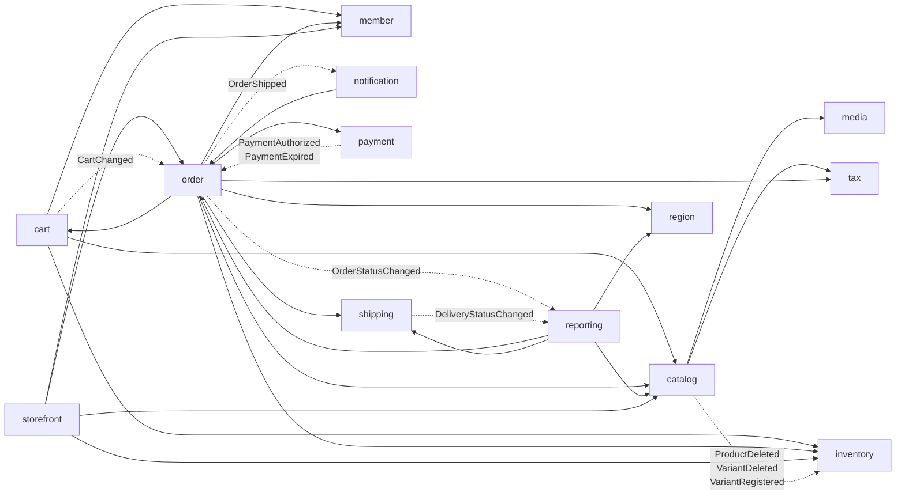
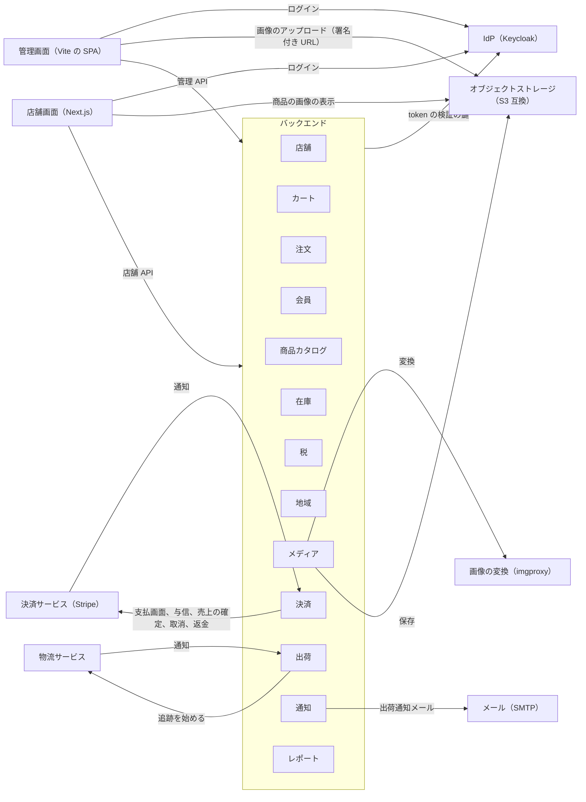

# 全体構成

システムの全体を 1 ページで示す。モジュールの依存とイベント、外部システムとの境目を載せる。詳しい設計は [バックエンドのアーキテクチャ](../backend/architecture.md)、[モジュールの設計書](../backend/modules/)、[フロントのアーキテクチャ](../frontend/architecture.md) に書く。モジュールの名前の論理名は [用語集](../reference/glossary.md) に書く。

## 1. モジュールの依存とイベント

- 図は `ModuleDiagramTest`（`backend/ecsite/src/test/java/com/ecsite/modulith/ModuleDiagramTest.java`）がコードから作る。手動で修正しない。
- 実線は、モジュールが相手の API を呼ぶ（矢印の向きが依存の向き）。点線は、イベントを発行するモジュールから受けるモジュールへ向かい、線の上にイベントの名前を書く。
- 他のモジュールが受けるイベントだけを書く。受け手のない公開イベントは図に出ない。
- 依存は package-info の `allowedDependencies` で宣言し、`ModulithTest` が守らせる（[バックエンドのアーキテクチャ](../backend/architecture.md) 第 1 節）。
- モジュールの依存かイベントが変わると、テストが失敗する。`backend/ecsite` で `./gradlew test --tests ModuleDiagramTest -PupdateDocs` を実行すると図を再生成するので、差分を確認して commit する。

<!-- generated:modules -->

<!-- /generated:modules -->

## 2. 外部システムとの境目

図は手動で書く。`ModuleDiagramTest` が比べるのはモジュールの名前の一覧だけで、モジュールを追加する・削除するとテストが失敗する。外部システムとの線は比べないので、境目を変えたらこの図も修正する。

<!-- external-systems -->

<!-- /external-systems -->

| 外部システム | 使うもの | 接続するモジュール | 詳しい文書 |
|--------------|----------|--------------------|------------|
| IdP | Keycloak | なし ※1 | [バックエンドのアーキテクチャ](../backend/architecture.md) 第 7 節、[会員モジュール](../backend/modules/member.md) |
| 決済サービス | Stripe（ローカルの既定は mock） | 決済。通知（webhook）を受ける | [決済モジュール](../backend/modules/payment.md)、[バックエンドのアーキテクチャ](../backend/architecture.md) 第 8 節 |
| 物流サービス | mock だけ（本番の実装はまだない） | 出荷。通知を受ける | [出荷モジュール](../backend/modules/shipping.md) |
| メール | SMTP（ローカルは Mailpit） | 通知 | [通知モジュール](../backend/modules/notification.md) |
| オブジェクトストレージ | S3 互換（ローカルは SeaweedFS）と、画像の変換（imgproxy） | メディア | [メディアモジュール](../backend/modules/media.md) |

※1：画面がログインし、バックエンドは access token を検証するだけで、モジュールでなく共通の設定が行う。会員モジュールが token の subject と会員 ID を結ぶ。

画面は 2 つある。店舗画面は Next.js で、サーバーから API を呼ぶ。管理画面は Vite の SPA で、ブラウザーから API を呼ぶ。構成は [フロントのアーキテクチャ](../frontend/architecture.md) に書く。
