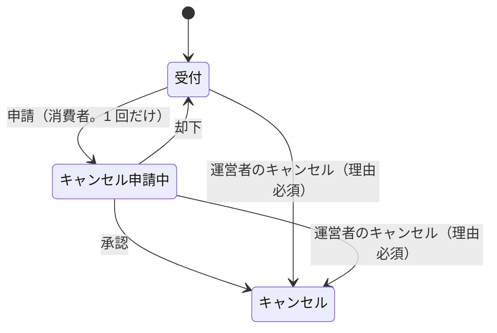

# 注文モジュール

見積もり（金額と購入できるか）、注文手続き、注文、キャンセルを管理する。

- レベル：A（状態遷移、注文時点の写し、在庫との強い一貫性）
- 依存：カートモジュール（API、イベント）、商品カタログモジュール（API）、在庫モジュール（API）、税モジュール（API）、会員モジュール（API。presentation 層だけ）
- 関連 spec：002（US-15〜21）、003（US-26、27）
- 用語と識別子：[用語集](../glossary.md)

## 見積もり

カートの表示、注文手続き、注文の成立は、どれも同じ見積もりで金額を求める（BR-7）。

- 入力は、品目（バリアントと数量）、時点、引当の持ち主（注文手続き中なら自分の引当を販売可能数から除くため）。
- 品目ごとに、商品カタログから注文できるバリアントの情報（品番、商品名、軸の値、税抜価格、税区分、表示されるか、販売停止か）を、在庫から販売可能数を受け取る。
- 購入できない品目には理由を付け、合計に含めない（AC-80）。
- 税込単価と、税率ごとの消費税額（BR-8）は、税モジュールに計算させる。送料は設定の金額と税区分を使い、購入できる品目が 1 つ以上あるときだけかける（[plan 002](../specs/002-cart-and-order/plan.md) 第 4 節）。

## 注文手続き

- 注文手続きは、会員、カート、始めたときのカートのバージョン、引当の期限を持つ。引当の持ち主になる。
- 注文手続きを始められるのは、会員の token を持つ人の、自分の会員のカートだけ（AC-125）。ログインせずに作ったカートや、ほかの会員のカートからは始められない（404）。
- 注文手続きは、始めた会員だけが参照・注文できる。ほかの会員には 404（AC-126）。
- 始めるときに、見積もりで購入できない品目がないことを確かめてから、在庫モジュールで全品目を引き当てる（AC-82）。
- 同じカートで始め直したら、新しい注文手続きを作り、前の注文手続きの引当を解く。
- カート変更のイベントを受けたら、そのカートの注文手続きの引当を解く（AC-84）。イベントの処理に失敗しても、引当は期限で数えられなくなるので実害は小さい。

## 注文（集約）

- 注文は、注文番号、注文手続き、注文日時、状態、明細、金額の内訳、会員、メールアドレス、お届け先、キャンセルの申請、運営者のキャンセルの理由を持つ。
- メールアドレスは、注文のリクエストでは受けず、会員の token のメールアドレスを写す（AC-127）。token のメールアドレスが確認済みでなければ注文しない（IdP の設定で確認前はログインできないが、念のため）。
- 注文の参照とキャンセルの申請は、注文した会員だけができる。ほかの会員には 404（AC-131）。ログインしていなければ、ほかの会員の操作と同じく 401（店舗画面はログインの画面へ移り、ログインした後に持ち主でなければ「見つからない」と示す）。
- 会員は自分の注文を、注文日時の新しい順に、ページ単位で一覧できる（AC-129）。
- 明細は、注文時点の商品品番、バリアント品番、商品名、軸の値、税抜単価、税率、税込単価、数量、小計を写しとして持つ（AC-92）。バリアント ID も持つが、在庫の戻しに使うだけで、表示には写しを使う。
- 金額の内訳は、商品の合計、送料、総額、税率ごとの対象額と消費税額。
- 注文と明細は 1 つの集約にする。注文の成立後、明細と金額は変わらない。

### 状態遷移（BR-9）

| 操作 | すでにその状態のとき | できない状態 |
|------|----------------------|--------------|
| 申請 | 申請中なら成功して何もしない | 却下済み（申請は 1 回だけ）、キャンセル |
| 承認 | キャンセルなら成功して何もしない | 受付（申請がない） |
| 却下 | | キャンセル、受付 |
| 運営者のキャンセル | キャンセルなら成功して何もしない | |

- キャンセルになるとき、同じトランザクションで在庫モジュールに明細の数量を戻させる（AC-101、103、104）。調整履歴の理由は「注文のキャンセル」。
- 状態を変えたら、ドメインイベント（注文成立、注文キャンセル）を登録する。

### 注文の成立

手順と排他は [plan 002](../specs/002-cart-and-order/plan.md) 第 2 節。

- 注文番号は、注文日（日本時間）の 8 桁、ハイフン、ランダムな数字 6 桁。在庫の調整履歴にも写すので、在庫を減らす前に、使われていない番号を確かめて決める。確かめてから保存するまでの間に重なったら（ごくまれ）、保存しない（トランザクションを壊さない挿入）ことで知り、409 にする。
- 判定（カートの変更、購入できるか、総額、入力）をすべて済ませてから、在庫の減算 → 注文の保存 → カートを空にする、の順に書く。
- 同じ注文手続きの注文は 1 つだけ（DB の一意制約でも守る）。

## 他モジュールへの公開

| 種類 | 内容 | 利用者 |
|------|------|--------|
| API | 見積もり（カートの表示用） | 店舗 |
| イベント | 注文成立、注文キャンセル | なし（将来の決済・出荷・レポート用） |

## データモデル

[V202610111200__ordering_create_order.sql](../../backend/src/main/resources/db/migration/V202610111200__ordering_create_order.sql)、[V202610121200__ordering_add_member_id.sql](../../backend/src/main/resources/db/migration/V202610121200__ordering_add_member_id.sql)

- schema は `ordering`（`order` は SQL の予約語のため）。
- カート・バリアント・会員は他モジュールの ID なので、外部キーは張らない（constitution 6）。
- 注文手続きと注文は会員 ID を必須で持つ。認証を入れる前にログインせずに作った注文・注文手続きと、その引当は、マイグレーションで消した（spec 003 の Non-goals。本番のデータはない）。
- 明細の軸の値の写しは、注文の後に変わらない一覧なので、行を分けずに JSON で持つ。
- キャンセルの申請とキャンセルは、1 つの注文に 1 回ずつなので、注文の列に持つ。
- 金額の整合（総額 ＝ 商品の合計 ＋ 送料、小計 ＝ 税込単価 × 数量）は CHECK 制約でも守る。
