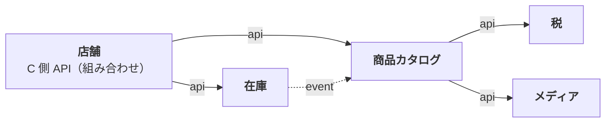
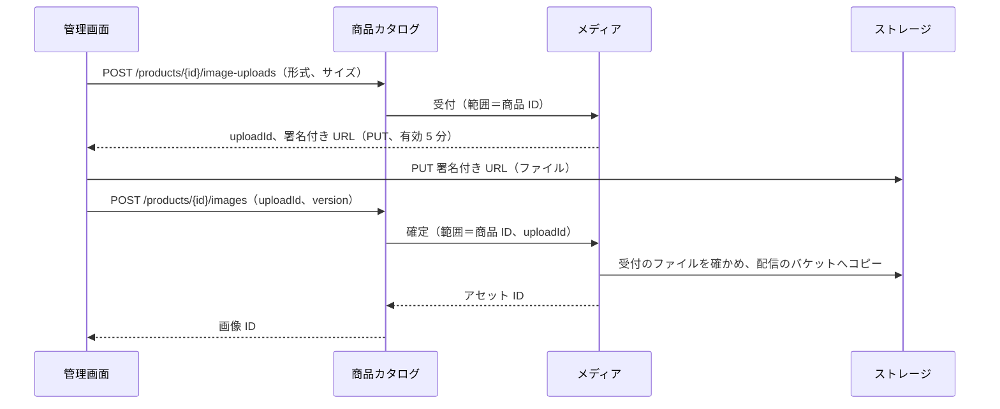

# Plan 001：商品カタログと在庫

ステータス：承認済み（tasks 作成済み）　対象：[spec.md](spec.md)

本 spec で追加するモジュールの設計は、各モジュールの設計書に書く。本書には、モジュールをまたぐ決定と、作り方の段取りだけを書く。

| モジュール | 設計書 | 主な担当 |
|------------|--------|----------|
| 税 | [tax.md](../../modules/tax.md) | US-1 |
| 商品カタログ | [catalog.md](../../modules/catalog.md) | US-2〜7、9、11 |
| 在庫 | [inventory.md](../../modules/inventory.md) | US-8 |
| 店舗 | [storefront.md](../../modules/storefront.md) | US-10〜12 |
| メディア | [media.md](../../modules/media.md) | US-7、13（画像のファイルの受け付け、検証、保存、配信） |

用語と識別子の対応は[用語集](../../glossary.md)。

## 1. モジュール間の関係

矢印の向きが依存の向き（実線＝API、点線＝イベント購読）。

- 税を商品カタログから分けるのは、将来の注文モジュールも税計算に使うため。
- 画像のファイルの扱い（受け付け、検証、変換、配信）は、商品の規則と関係がなく、ほかの用途（カテゴリの画像など）でも使うので、メディアモジュールに分ける。商品カタログはアセット ID と並び順だけを持つ。
- 在庫は、商品カタログのイベントでバリアントの登録・削除を知る。そのため商品カタログは在庫を呼べず（依存が循環する）、C 側での組み合わせは店舗モジュールが行う。
- B 側の在庫数の合計（AC-49）は、管理画面が商品一覧 API と在庫集計 API を呼んで組み合わせる。
- 税込価格で並べ替えるため（AC-53、54）、商品カタログは税モジュールから税率の一覧を受け取り、SQL で税込価格を計算する（[catalog.md](../../modules/catalog.md)）。

パッケージのルートは `com.ecsite`。例外体系、i18n、金額、ページングなどの共通部品は `common` に置く。

## 2. API

項目の定義は OpenAPI（[admin.yaml](../../../api/openapi/admin.yaml)、[store.yaml](../../../api/openapi/store.yaml)）。規約は constitution 第 9 節。本節は endpoint と AC の対応だけを示す。

### 2.1 B 側（`/api/admin`）

| Method | Path | 権限 | AC |
|--------|------|------|----|
| GET | `/tax-categories` | `tax:read` | |
| POST | `/tax-categories` | `tax:write` | 1 |
| GET | `/tax-categories/{id}` | `tax:read` | |
| PUT | `/tax-categories/{id}/rates`（一覧ごと置き換え） | `tax:write` | 2〜5、7 |
| GET | `/categories`（木） | `category:read` | |
| POST | `/categories` | `category:write` | 8〜10 |
| GET | `/categories/{id}` | `category:read` | |
| PUT | `/categories/{id}` | `category:write` | 10、11 |
| PUT | `/categories/order`（兄弟の並び順） | `category:write` | 11 |
| DELETE | `/categories/{id}` | `category:write` | 12 |
| GET | `/products` | `product:read` | 47〜50 |
| GET | `/products/{id}` | `product:read` | |
| POST | `/products` | `product:write` | 6、13〜17、25 |
| PUT | `/products/{id}` | `product:write` | 6、18、19、25、26 |
| DELETE | `/products/{id}` | `product:write` | 33 |
| PUT | `/products/{id}/publish`、`/unpublish`、`/discontinue`（冪等） | `product:write` | 29〜32 |
| PUT | `/products/{id}/publication-period`（P2） | `product:write` | 34〜36 |
| POST | `/products/{id}/variants` | `product:write` | 20〜24 |
| DELETE | `/products/{id}/variants/{variantId}` | `product:write` | 71 |
| PUT | `/products/{id}/variants/order` | `product:write` | 27 |
| PUT | `/products/{id}/variants/{variantId}/suspend`、`/resume`（P2、冪等） | `product:write` | 28 |
| POST | `/products/{id}/image-uploads`（P2） | `product:write` | 39、40 |
| POST | `/products/{id}/images`（P2） | `product:write` | 37、39、40 |
| PUT | `/products/{id}/images/order`（P2） | `product:write` | 37 |
| DELETE | `/products/{id}/images/{imageId}`（P2） | `product:write` | 37 |
| PUT | `/products/{id}/variants/{variantId}/image`（P2） | `product:write` | 38 |
| GET | `/inventory/variants/{variantId}` | `inventory:read` | |
| POST | `/inventory/variants/{variantId}/adjustments` | `inventory:write` | 42〜44、46 |
| GET | `/inventory/variants/{variantId}/adjustments` | `inventory:read` | 45 |
| GET | `/inventory/stock-summaries?productIds=` | `inventory:read` | 49 |

画像のアップロードの流れは第 7 節。

### 2.2 C 側（`/api/store`）

| Method | Path | AC |
|--------|------|----|
| GET | `/products` | 51〜57 |
| GET | `/products/search?q=` | 58〜61 |
| GET | `/products/{productId}` | 62〜66 |
| GET | `/categories` | 52 |

URL には内部 ID を使い、品番を使わない（AC-66）。

## 3. フロントエンド

| | store（C 側） | admin（B 側） |
|---|---|---|
| 画面 | トップ、商品一覧、検索結果、商品詳細 | 税区分、カテゴリ、商品一覧、商品編集（バリアントを含む）、在庫調整 |
| API 呼び出し | サーバーコンポーネントから直接 | ブラウザから。開発時は Vite のプロキシ |
| キャッシュ | API の結果のキャッシュは最大 60 秒（NFR-1） | TanStack Query の既定。ただし 4xx の取得は繰り返さない |

価格表示（BR-4）と日本時間への変換（BR-3）は、それぞれのアプリの中で共通の部品にする（2 つのアプリで共有するパッケージは作らない。店舗は日時を表示しないので、日本時間の部品は管理画面だけ）。

admin のディレクトリ、API の呼び出し方、フォーム、画面の追加手順は [管理画面の構成](../../frontend/admin.md)、store は [店舗画面の構成](../../frontend/store.md) に従う。

## 4. 基盤

| 項目 | 方針 |
|------|------|
| 依存バージョン | MyIAM の `libs.versions.toml` を起点に、着手時点の最新安定版にする |
| Flyway | Spring Boot 4 では `spring-boot-starter-flyway` が必要 |
| イベント発行記録 | Spring Modulith の公式 DDL を `common` schema のマイグレーションに含める（自動作成は使わない） |
| イベント購読 | Spring Modulith のモジュール間リスナー（コミット後・非同期）。再起動時の未完了イベントの自動再発行は無効のまま。失敗時のリスクと手動の復旧手順は [inventory.md](../../modules/inventory.md) |
| トレーシング | Micrometer Tracing。Zipkin 形式から始める |
| ローカル環境 | `compose.yaml` に PostgreSQL 18、Zipkin、SeaweedFS（S3 互換。画像） |
| Seed | 税区分（標準 10%、軽減 8%）、カテゴリ、商品のサンプル |

## 5. テスト

| 対象 | 単体 | 統合 |
|------|------|------|
| US-1 | 税率の一覧の置き換えの各検証、指定時点の税率、値オブジェクト | API 経由の登録、AC-4 のシナリオ、排他制約 |
| US-2 | 深さ、名称 | 削除の拒否（AC-12）、木の取得 |
| US-3〜5 | 登録、軸、一意性、公開条件、状態遷移、削除条件 | 品番の一意性、AC-6、Repository |
| US-8 | 在庫調整の検証 | AC-43、**並行調整（AC-44）**、履歴、イベントによる在庫の作成 |
| US-9 | | 絞り込み、ページング |
| US-7 | 枚数、並び順、バリアントの画像、削除のときの指定の解除 | 受付から登録までの流れ（SeaweedFS）、形式・サイズ・枚数の拒否、偽った形式の拒否、削除のイベントでのファイルの削除 |
| US-10〜12 | 税込計算 | 表示条件、税込での並べ替え・絞り込み、**Java と SQL の税込計算の一致**、在庫なし、検索 |
| 横断 | | モジュール境界の検証、B 側 endpoint の権限名の記載漏れを検出する契約テスト |

## 6. 実装の順序

tasks は段階ごとに `tasks/` の 1 ファイルにする（[00](tasks/00-foundation.md)、[01](tasks/01-tax.md)、[02](tasks/02-category.md)、[03](tasks/03-product.md)、[04](tasks/04-inventory.md)、[05](tasks/05-admin-product-list.md)、[06](tasks/06-storefront.md)、[07](tasks/07-admin-ui.md)、[08](tasks/08-store-ui.md)、[09](tasks/09-frontend-tests.md)、[10](tasks/10-p2.md)）。

| # | 段階 | 完了条件 |
|---|------|----------|
| 0 | 基盤（Gradle、Modulith、Flyway、jOOQ、OpenAPI 生成、例外、ページング、可観測性、CI、compose） | 空のアプリが起動し、CI が通る |
| 1 | tax（US-1） | US-1 の AC のテストが通る |
| 2 | カテゴリ（US-2） | 同上 |
| 3 | 商品・バリアント・公開（US-3〜5） | P1 の AC のテストが通る |
| 4 | inventory（US-8） | 並行調整を含めて通る |
| 5 | B 側の商品一覧（US-9） | 同上 |
| 6 | storefront（US-10〜12） | 同上 |
| 7 | 管理画面 | 画面から B 側の操作ができる |
| 8 | 店舗画面 | 画面から C 側の閲覧ができる |
| 9 | フロントのテスト（結合テスト、E2E） | 主な操作の流れの結合テストと、コアフローの E2E が CI で通る |
| 10 | P2（US-6、AC-28、US-7、US-13） | 各項目の AC のテストが通る。画像の設計は第 7 節 |

## 7. 商品画像（US-7）

画像のファイルはオブジェクトストレージ（S3 API）に置き、DB には置き場所（キー）だけを持つ（constitution 5-1：ローカルディスクにファイルを置かない）。AWS を本番の前提にし、GCP（GCS）でも同じ作りで動くように、ストレージの機能は両方にあるものだけを使う。

ファイルの受け付け・検証・配信・削除はメディアモジュール（[media.md](../../modules/media.md)）、商品の画像の規則（枚数、並び順、バリアントの画像）は商品カタログ（[catalog.md](../../modules/catalog.md)）が持つ。

### 7.1 置き場所

| バケット | 内容 | 読み取り | 消し方 |
|----------|------|----------|--------|
| 受付（incoming） | アップロードされたままのファイル。キーは `{範囲}/{uploadId}`（範囲は持ち主。商品の画像なら商品 ID） | 非公開 | ライフサイクル規則で 1 日後に自動で消す（受付だけして登録されなかったもの） |
| 配信（public） | 確定したアセット。キーは `assets/{assetId}.{拡張子}` | 公開（本番は CDN の後ろ） | 使う側がアセットを手放した後、メディアモジュールのイベントで消す |

- バケットを 2 つに分けるのは、公開の範囲とライフサイクル規則をバケット単位で設定するため（GCS は公開の設定をバケット単位でしか持てない）。
- 配信のキーはアセット ID で作り、同じキーを上書きしない。そのため `Cache-Control: public, max-age=31536000, immutable` を付けて、CDN とブラウザに長くキャッシュさせる。
- API は、配信の基準 URL（設定）とキーから画像の URL を組み立てて返す。CDN に変えても、DB は変わらない。
- 非公開の商品の画像も URL を知っていれば見られる。URL に推測できないアセット ID を含むことで、MVP では許容する。

### 7.2 アップロードの流れ

画像のファイルは、ブラウザから受付のバケットへ直接送る（署名付き URL）。バックエンドはファイルを中継しない。

1. **受付**：商品カタログが枚数（AC-40：20 枚まで）を確かめ、メディアモジュールが形式（AC-39、67。7.5 の表）とサイズ（10MB まで）を確かめて署名付き URL を返す。受付の記録は DB に持たない。
2. **登録**：メディアモジュールが、受付のファイルの大きさと先頭のバイト（マジックナンバー）で形式を確かめ（申告は信用しない）、配信のバケットへ置いてアセットを確定する。商品カタログは、そのアセット ID を商品の画像の最後に加える。枚数とバージョンもここで確かめ直す。両方を 1 つのトランザクションで行う。
3. 画像・商品を削除したら、商品カタログがアセットを手放し、メディアモジュールがコミットの後に配信のファイルを消す。
4. US-13 では、2 の確定のときに WebP へ変換してから配信のバケットへ置く（7.5）。

### 7.3 ストレージの抽象

メディアモジュールに、ストレージの操作をまとめたポート（`ObjectStorage`）を置く。操作は、署名付きの PUT の URL の発行、ファイルの情報の取得、先頭のバイトの読み取り、配信のバケットへの書き込み、削除だけにする（US-13 で、バケット間のコピーを書き込みに変える）。

| 環境 | 実装 | 補足 |
|------|------|------|
| ローカル・CI | S3 の実装 + SeaweedFS | compose と Testcontainers で動かす。SeaweedFS は署名付き URL の署名・期限、CORS を検証する |
| AWS | S3 の実装（AWS SDK v2） | 認証は既定の資格情報の連鎖（IAM ロール）。配信は CloudFront（OAC） |
| GCP | GCS の実装（必要になったら足す） | 署名付き URL（V4）、IAM、Cloud CDN。S3 互換の API で済むかを先に試し、だめなら GCS のクライアントで作る |

- 設定（`ecsite.media.storage`。環境変数で上書きする。constitution 5-8）：受付・配信のバケット名、エンドポイント（エミュレーターのときだけ）、リージョン、パス形式のアドレス、配信の基準 URL、署名付き URL の有効期間。
- SeaweedFS は、署名に含めた `Content-Type` を検証しない（AWS は検証する）。形式は 2 の登録で確かめるので、影響はない。
- バケット、CORS（管理画面のオリジンから PUT）、公開の設定、ライフサイクル規則は、本番では基盤の構成（IaC）で作る。ローカルは compose の初期化で作る。

### 7.4 C 側の表示

- 一覧の代表画像は、商品の画像の先頭（AC-37）。なければ null（店舗画面は代わりの図を出す）。
- 詳細のバリアントの画像は、バリアントに指定した画像を返し、なければ null にする。店舗画面は、null なら代表画像を使う（AC-38）。
- 店舗画面は API が返した URL をそのまま使う（画像の縮小・形式の変換は配信の側で行う。US-13 と、その後の CDN の設定）。

### 7.5 画像の変換（US-13）

受け付けた画像は、すべて WebP に変換して配信する（AC-68）。変換は確定（7.2 の 2）の中で同期に行い、失敗したらその場でエラーを返して登録しない（AC-70）。

| 受け付ける形式 | MIME タイプ | 先頭のバイトでの判定 |
|----------------|-------------|----------------------|
| JPEG | `image/jpeg` | `FF D8 FF` |
| PNG | `image/png` | `89 50 4E 47 0D 0A 1A 0A` |
| WebP | `image/webp` | `RIFF` + 長さ + `WEBP` |
| BMP | `image/bmp` | `BM` |
| HEIC / HEIF | `image/heic`、`image/heif` | 4 バイト目からの `ftyp` と、ブランド（`heic`、`heix`、`mif1` など） |
| AVIF | `image/avif` | 4 バイト目からの `ftyp` と、ブランド（`avif`、`avis`） |

#### 変換のサービス

変換は、別のコンテナで動く画像処理のサービス imgproxy（MIT ライセンス。中身は libvips）に頼む。

- 選んだ理由
  - コンテナで動くので、ローカル・CI・統合テストは SeaweedFS と同じく compose と Testcontainers で起動できる。開発者の環境に何も入れなくてよい。
  - 利用者のファイルを解析するネイティブのコードが、アプリと別のコンテナで動く。異常終了やメモリの使いすぎがアプリに及ばず、メモリと CPU の上限をコンテナごとに決められる。
  - 向きの反映、メタデータの除去、WebP への変換を、設定と URL の指定だけで行える。縮小や複数の大きさ、配信のときの変換（CDN の前に置く）も、後で同じサービスで行える。
- ライセンス：imgproxy は MIT。公式のイメージに含まれる libvips（LGPL-2.1）、libheif（LGPL-3）などは、イメージをそのまま使うだけなら（他者に配布しなければ）義務は生じない。
- HEIC の中身の HEVC には特許があり、オープンソースのデコーダーは特許のライセンスを含まない。本番で商用にするときは、HEIC を受け付けるかを見直す。
- 対応形式の確認：imgproxy（オープンソース版）が HEIC・AVIF・BMP を読めることを、着手の最初（T1032）に実際の画像で確かめる。読めない形式があれば、方式を見直して相談する。

#### 変換の流れ

1. メディアモジュールが、受付のファイルの大きさと先頭のバイトで形式を確かめる（これまでどおり）。
2. imgproxy に、受付のバケットのファイル（`s3://{受付のバケット}/{受付のキー}`）を WebP に変換させ、結果を受け取る。imgproxy は受付のバケットを直接読む（S3 の連携。GCS にも同じ連携がある）。バックエンドはファイルを中継しない。
3. 変換した WebP を、配信のバケットに書き込む（`Cache-Control` はこれまでどおり）。バケット間のコピーはやめる。
4. アセットを記録する（形式は WebP）。

- 変換の内容：向き（EXIF の Orientation）を画素に反映してから、メタデータ（位置情報、撮影機器など）をすべて除き（AC-69）、WebP（品質は設定。既定 82）で保存する。大きさ（画素数）は変えない。
- imgproxy の守り
  - URL に署名を付ける（鍵とソルトはバックエンドと imgproxy だけが持つ）。imgproxy は外に公開しない。
  - 読める場所を、受付のバケットだけにする（`IMGPROXY_ALLOWED_SOURCES`）。受付のバケットは読むだけの権限にする。
  - 元のファイルの大きさ（10MB）と画素数（スマートフォンの 48MP の写真が通る値）に上限を設ける。
  - 時間の上限（既定 30 秒）と、同時に動かす変換の数（imgproxy の workers）を設定で決める。
- 失敗のエラー：先頭のバイトで形式を判定できないものは、これまでどおり `INVALID_IMAGE_FILE`。判定できたが imgproxy が変換できなかったもの（壊れたファイル、時間切れ）は `IMAGE_CONVERSION_FAILED`。imgproxy に届かないときは、システムのエラー（500）にする。
- 1 回の確定で変換するのは 1 枚（10MB まで）。複数の画像は、管理画面が 1 枚ずつ登録する。
- 非同期にする余地：変換はポート（`ImageConverter`）の背後に置き、確定から呼ぶ。時間がかかるようになったら（大きさの上限を上げる、複数の大きさを作る など）、アセットに「変換中」の状態を足し、変換をイベントの後で行う形に変えられる。そのときは AC-70 の表し方（登録した後に失敗を見せる）を spec で見直す。
- US-13 より前に登録したアセット（JPEG・PNG・WebP のまま）は変換し直さない（本番のデータはまだない）。

#### 環境

| 環境 | imgproxy | 受付のバケットの読み取り |
|------|----------|--------------------------|
| ローカル | compose のサービス（ポートは 8081） | SeaweedFS（compose のネットワークの中の名前で読む） |
| 統合テスト | Testcontainers（SeaweedFS と同じネットワーク） | 同上 |
| CI の E2E | compose で起動（SeaweedFS と同じ） | 同上 |
| AWS | ECS のサービス（内部のネットワークだけ） | IAM ロール（受付のバケットを読むだけ） |
| GCP | Cloud Run（内部だけ） | GCS の連携とサービスアカウント |

- バックエンドの設定（`ecsite.media.converter`。環境変数で上書きする）：imgproxy の URL、署名の鍵とソルト、品質、時間の上限。
