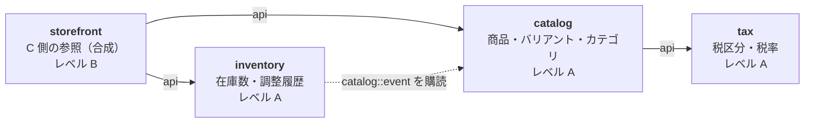
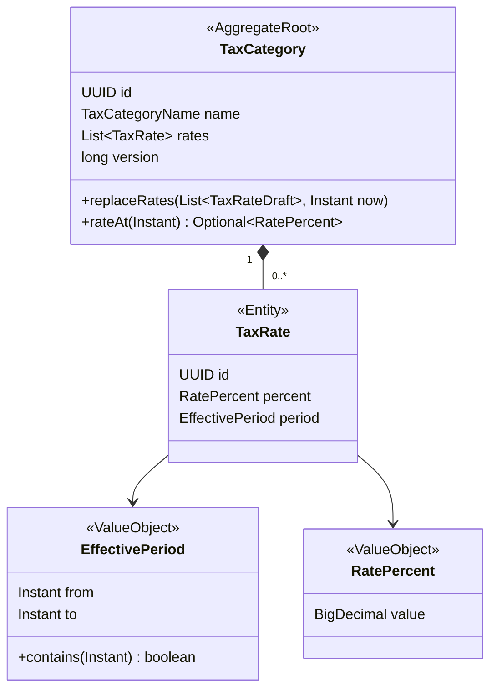
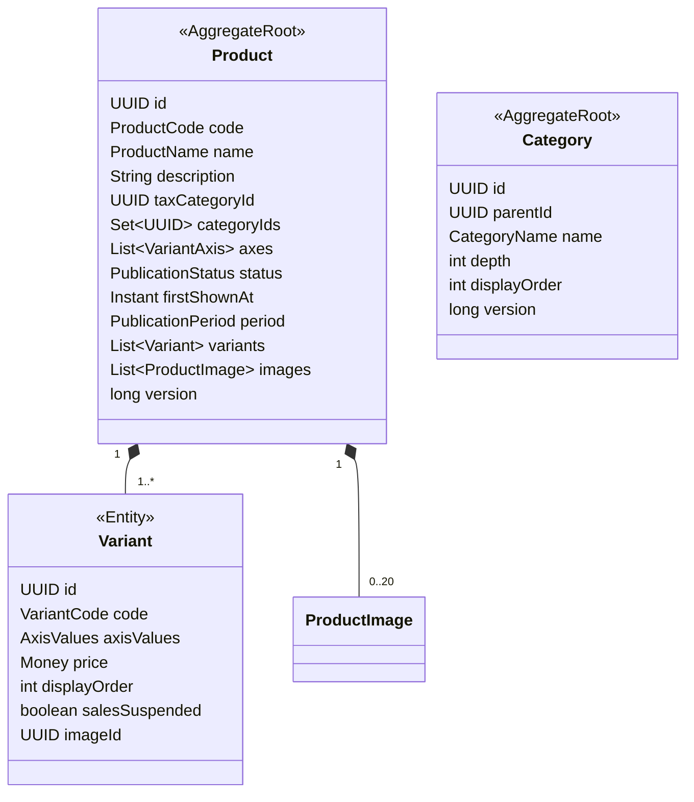

# Plan 001：商品カタログと在庫

| 項目 | 内容 |
|------|------|
| ステータス | 承認済み（OpenAPI 契約の作成待ち） |
| 対象 spec | [spec.md](spec.md) |
| 作成日 | 2026-10-08 |

本書は spec 001 を「どう作るか」を決める。spec に書かれていない振る舞いは追加しない。
plan の作成中に見つかった spec の不足は、第 2 節に挙げる。spec を直してから、該当部分の実装に入る。

## 1. 全体像

### 1.1 モジュール構成

spec 001 で作るバックエンドのモジュールは 4 つ。



実線 = API 呼び出し、点線 = イベント購読。矢印の向きが依存の向き。

| モジュール | 責務 | レベル | 理由 |
|------------|------|--------|------|
| `tax` | 税区分と期間付き税率。指定時点の税率を答える | A | 「開始済みの税率は変えられない」などの不変条件がある。将来、注文モジュールも税計算に使う |
| `catalog` | 商品、バリアント、カテゴリ、公開、画像、商品検索 | A | 軸の組み合わせの一意性、公開条件など、不変条件が多い |
| `inventory` | バリアントごとの在庫数と調整履歴 | A | 並行して調整されても失われない（AC-44）。将来の引当・減算の土台 |
| `storefront` | C 側 API。catalog と inventory の結果を合成して返す | B | 自分のデータもドメインルールも持たない、参照専用の合成層 |

### 1.2 なぜ `tax` と `storefront` を分けるか

constitution 4.1 の想定モジュールには `tax` と `storefront` がない。追加の理由は次のとおり（constitution の変更提案は第 12 節）。

**`tax` を `catalog` から分ける理由**：税率は商品の属性ではなく、国の制度である。将来、注文モジュールが「注文時点の税率」で税額を計算するとき、`catalog` に依存させたくない。

**`storefront` を置く理由**：C 側の画面は「商品情報（catalog）」と「在庫の有無（inventory）」を同時に必要とする。しかし、

- `inventory` は、バリアントが登録されたことを知るために `catalog` のイベントを購読する（inventory → catalog）
- そのため `catalog` が `inventory` を呼ぶと、依存が循環する。Spring Modulith は循環依存を `ModulithTest` で検出して失敗させる

そこで、両方を呼んで結果を合成するだけの `storefront` を置く。将来、カートの中身を表示するときなども、C 側向けの合成はここに集まる。

**B 側の在庫数合計（AC-49）**：B 側は合成モジュールを作らず、管理画面（SPA）が商品一覧 API と在庫集計 API を呼んで合成する。B 側は性能要件が緩く、モジュールを 1 つ増やすほどの価値がないため。

### 1.3 パッケージ構成

MyIAM と同じ構成をとる。ルートパッケージは `com.ecsite`。

```
com.ecsite
├── module/
│   ├── tax/
│   │   ├── api/catalog/        # catalog 向けの窓口（@NamedInterface("api")）
│   │   ├── application/
│   │   ├── domain/
│   │   ├── infrastructure/
│   │   └── presentation/       # /api/admin/tax-categories
│   ├── catalog/
│   │   ├── api/store/          # storefront 向けの窓口
│   │   ├── event/              # 公開イベント（@NamedInterface("event")）
│   │   ├── taxdir/             # tax の腐敗防止層
│   │   ├── application/
│   │   ├── domain/
│   │   ├── infrastructure/
│   │   └── presentation/       # /api/admin/products, /api/admin/categories
│   ├── inventory/
│   │   ├── api/store/
│   │   ├── application/
│   │   ├── domain/
│   │   ├── infrastructure/     # catalog イベントのリスナーを含む
│   │   └── presentation/       # /api/admin/inventory
│   └── storefront/
│       ├── catalogdir/         # catalog の腐敗防止層
│       ├── stockdir/           # inventory の腐敗防止層
│       ├── service/
│       └── controller/         # /api/store/**
├── common/                     # 例外体系、i18n、Money、ページング
└── config/
```

## 2. plan 作成中に見つかった spec の不足

constitution 第 16 節に従い、spec を先に直した。決定の内容は spec 第 8 節（G1〜G4）を参照。

| # | 不足 | 反映先 |
|---|------|--------|
| G1 | 税率の期間の表し方と、過去の日時の扱い | spec AC-2〜5（適用開始・終了日時、重複・途切れの禁止） |
| G2 | 未来の税率しか持たない税区分の割り当て | spec AC-6 |
| G3 | バリアントの削除 | spec AC-71 |
| G4 | 新着順の基準 | spec AC-54 |

## 3. ドメインモデル

### 3.1 tax



- `EffectivePeriod`：半開区間 `[from, to)`。`from` が null は「過去すべて」、`to` が null は「無期限」（AC-2）。`from < to` を検証する。
- `RatePercent`：0 以上 100 未満、小数第 2 位まで（AC-7）。
- **税率は一覧ごと置き換える**（`replaceRates`）。1 件ずつの追加・変更・削除にしない理由：期間限定の税率を入れるには、「既存の税率に終了日時を入れる」「期間限定の税率を足す」「戻りの税率を足す」を同時に行う必要がある（AC-4）。1 件ずつだと途中の状態で途切れが生じ、AC-3 を満たせない。
- `replaceRates` が検証すること：
  1. 期間が重複しない。期間の間に途切れがない。最後の `to` は null（AC-3）。
  2. 既存の税率とは ID で対応づけ、`now` と比べて変更の可否を判定する（AC-5）。
     - 開始済み（`from` が null、または `from <= now`）：税率と `from` は変更不可、削除不可。`to` は `now` より後の値に変更できる。
     - 終了済み（`to <= now`）：一切変更不可。
     - 未開始：自由に変更・削除できる。
  3. 新たに設定する `from` / `to` は、null または `now` より後（AC-5）。
- `rateAt(t)`：`period.contains(t)` の税率（AC-4）。期間が重複しないので、該当は 0 件か 1 件。
- 現在時刻は、ドメインに `Instant now` として渡す。アプリケーション層は `Clock` を注入して取得する。テストで時刻を固定するため。

### 3.2 catalog



- **Product と Variant は 1 つの集約**。「軸の値の組み合わせが商品内で一意」（AC-23）は商品単位の不変条件なので、バリアントを集約の外に出すと守れない。
- **Category は別の集約**。商品とは ID でだけつながる。
- `PublicationStatus`：`UNPUBLISHED` / `PUBLISHED` / `DISCONTINUED`（AC-32）。
- `firstShownAt`：最初に C 側へ表示された日時。新着順のキー（G4）。
- `everPublished` は持たない。`firstShownAt != null` で判定する（AC-33）。
- C 側に表示される条件（BR-2）は、ドメインメソッド `isVisibleAt(Instant)` と、参照用 SQL の条件の 2 か所に現れる。両者の一致は統合テストで確認する。
- `ProductCode` / `VariantCode` は値オブジェクト。半角英数字とハイフンで 1〜32 文字（AC-15、AC-21）。**識別子ではなく属性**として扱い、他データからの参照には使わない（BR-5、constitution 7.1）。
- `Money`：円単位の `long`。1 以上（AC-25）。`common` に置く。

ドメインイベント（`catalog.event`、他モジュールに公開）：

| イベント | 発生 | 購読者 |
|----------|------|--------|
| `VariantRegistered(productId, variantId)` | バリアント登録 | inventory（在庫レコードを作る） |
| `VariantDeleted(productId, variantId)` | バリアント削除（G3） | inventory（在庫レコードを消す） |
| `ProductDeleted(productId, variantIds)` | 商品削除 | inventory（在庫レコードを消す） |
| `ProductPublished` / `ProductUnpublished` / `ProductDiscontinued` / `VariantPriceChanged` | 各操作 | 現時点ではなし。将来の検索インデックス同期で使う（constitution 4.4） |

### 3.3 inventory

- `StockItem`（集約）：`id`、`variantId`、`productId`、`quantity`。
- `StockAdjustment`（値オブジェクト）：増減量、理由（`ARRIVAL` / `STOCKTAKE` / `DAMAGE_OR_LOSS` / `OTHER`）、メモ。「その他ならメモ必須」（AC-46）、「増減量は 0 以外」をここで検証する。
- 調整履歴は、`StockItem` の子として持たず、追記専用の記録として別に保存する。履歴は増え続けるため、集約に含めると読み込みが重くなる。

#### 並行調整（AC-44）の方式

**集約を読み込んで保存する方式（楽観ロック）ではなく、条件付きの差分更新を使う。**

```sql
UPDATE inventory.stock_item
   SET quantity = quantity + :delta
 WHERE variant_id = :variantId
   AND quantity + :delta >= 0
RETURNING quantity;
```

- 更新件数が 0 なら、「在庫が負になる」（AC-43）か「在庫レコードがない」のどちらか。後者かどうかを確認して、エラーを分ける。
- `RETURNING` で調整後の在庫数を受け取り、同じトランザクションで履歴に書く（AC-45）。
- DB にも `CHECK (quantity >= 0)` を付け、最後の防衛線にする。

**理由**：楽観ロックでは、+5 と +3 が同時に来ると片方が失敗し、AC-44 を満たすには自動リトライが必要になる。差分更新なら DB が直列化するので、リトライなしで両方反映される。将来、注文による引当が入ると同じ行への同時更新はさらに増えるため、ここで方式を決めておく。

**トレードオフ**：「負にならない」というルールが、ドメインの値オブジェクトだけで完結せず、SQL の条件にも現れる。ルールの置き場所が 2 か所になることは `docs/modules/inventory.md` に明記し、並行性テストで担保する。

#### 在庫レコードの作成（AC-41）

- `VariantRegistered` を購読して、在庫数 0 のレコードを作る。リスナーは冪等にする（`ON CONFLICT (variant_id) DO NOTHING`。constitution 5.5）。
- イベントはコミット後に非同期で処理されるため、バリアント登録の直後のごく短い間、在庫レコードが存在しないことがある。
  - C 側：レコードがないバリアントは「在庫なし」として扱う。
  - B 側：その間に在庫を調整しようとすると「見つからない」エラーになる。管理画面は再試行を促す。

### 3.4 storefront

ドメインを持たない。`catalogdir` / `stockdir` で相手の API を自分の型に変換し、`service` で合成して返す。

## 4. 税込価格の計算

- 計算式は BR-1：`税込 = floor(税抜 × (100 + 税率) / 100)`。`BigDecimal` で計算し、`RoundingMode.FLOOR` で切り捨てる。
- 計算は `tax` のドメインサービスに置き、`tax.api` で公開する。

### 4.1 並べ替え・絞り込みも税込価格で行う（AC-53、AC-54）

税区分によって税率が違うため、税抜価格の順と税込価格の順は一致しない。

> 例：A は税抜 1,000 円・8% で税込 1,080 円、B は税抜 990 円・10% で税込 1,089 円。税抜では A が高いが、税込では B が高い。

そこで、商品一覧の SQL で税込価格を計算する。

1. `catalog` は、`tax.api` から「税区分ごとの現在の税率」を受け取る（税区分は数件程度）。
2. それを SQL の `CASE tax_category_id WHEN ... THEN rate END` として埋め込み、`floor(price * (100 + rate) / 100)` を計算する。
3. その値で、販売中バリアントの最安値（AC-55）、価格帯の絞り込み、並べ替えを行う。

**リスク**：税込計算が Java と SQL の 2 か所に存在する。端数処理の結果が一致することを、境界値（`x.99` 円になる組み合わせなど）を含む統合テストで確認する。

### 4.2 税率のキャッシュ

- `catalog` は、`tax.api` から得た「税区分ごとの税率の一覧（予定を含む）」を Caffeine で 30 秒キャッシュする。
- キャッシュするのは「一覧」で、どの税率が有効かは**表示する時刻で判定する**。そのため、税率の切り替わり時刻ちょうどに正しく切り替わる。キャッシュの古さが影響するのは「税率を登録・変更した直後」だけで、最大 30 秒。NFR-1（1 分以内）を満たし、constitution 5.3（TTL 必須、ずれても許容できるデータ）にも合う。

## 5. データモデル（Flyway）

PostgreSQL の schema をモジュールごとに分ける（constitution 7.1）。モジュールをまたぐ外部キーは張らない（他モジュールのテーブルを参照しないため）。

### 5.1 tax

```sql
CREATE TABLE tax.tax_category (
    id          uuid PRIMARY KEY,
    name        varchar(50) NOT NULL UNIQUE,
    version     bigint      NOT NULL,
    created_at  timestamptz NOT NULL,
    updated_at  timestamptz NOT NULL
);

CREATE EXTENSION IF NOT EXISTS btree_gist;

CREATE TABLE tax.tax_rate (
    id               uuid PRIMARY KEY,
    tax_category_id  uuid         NOT NULL REFERENCES tax.tax_category (id),
    rate_percent     numeric(4,2) NOT NULL CHECK (rate_percent >= 0 AND rate_percent < 100),
    effective_from   timestamptz,          -- null は「過去すべて」
    effective_to     timestamptz,          -- null は「無期限」
    CHECK (effective_from IS NULL OR effective_to IS NULL OR effective_from < effective_to),
    -- 同じ税区分の中で期間が重なることを DB でも禁止する（最後の防衛線）
    EXCLUDE USING gist (
        tax_category_id WITH =,
        tstzrange(effective_from, effective_to, '[)') WITH &&
    )
);
```

- 期間の重複は排他制約（`EXCLUDE`）で DB でも防ぐ。`tstzrange` は null の端を無限として扱うので、AC-3 の「空白は無限」と一致する。
- 「途切れがない」「最後は無期限」は DB の制約では表しにくいため、ドメイン（`replaceRates`）とテストで担保する。

### 5.2 catalog

```sql
CREATE TABLE catalog.category (
    id             uuid PRIMARY KEY,
    parent_id      uuid REFERENCES catalog.category (id),
    name           varchar(50) NOT NULL,
    depth          smallint    NOT NULL CHECK (depth BETWEEN 1 AND 3),
    display_order  int         NOT NULL,
    version        bigint      NOT NULL,
    created_at     timestamptz NOT NULL,
    updated_at     timestamptz NOT NULL,
    UNIQUE NULLS NOT DISTINCT (parent_id, name)   -- 最上位カテゴリ同士の重複も防ぐ
);

CREATE TABLE catalog.product (
    id               uuid PRIMARY KEY,
    product_code     varchar(32)  NOT NULL UNIQUE,  -- 業務番号。参照には使わない
    name             varchar(200) NOT NULL,
    description      text         NOT NULL,
    tax_category_id  uuid         NOT NULL,         -- tax モジュールの ID。外部キーは張らない
    status           varchar(20)  NOT NULL,
    first_shown_at   timestamptz,
    publish_start    timestamptz,                   -- US-6（P2）
    publish_end      timestamptz,                   -- US-6（P2）
    version          bigint       NOT NULL,
    created_at       timestamptz  NOT NULL,
    updated_at       timestamptz  NOT NULL
);

CREATE TABLE catalog.product_axis (
    product_id  uuid        NOT NULL REFERENCES catalog.product (id),
    position    smallint    NOT NULL CHECK (position BETWEEN 1 AND 3),
    name        varchar(30) NOT NULL,
    PRIMARY KEY (product_id, position)
);

CREATE TABLE catalog.product_category (
    product_id   uuid NOT NULL REFERENCES catalog.product (id),
    category_id  uuid NOT NULL REFERENCES catalog.category (id),
    PRIMARY KEY (product_id, category_id)
);

CREATE TABLE catalog.variant (
    id                uuid PRIMARY KEY,
    product_id        uuid        NOT NULL REFERENCES catalog.product (id),
    variant_code      varchar(32) NOT NULL UNIQUE,  -- 業務番号。参照には使わない
    axis_key          text        NOT NULL,         -- 軸の値を連結した値。商品内の一意性の最後の防衛線
    price_excl_tax    bigint      NOT NULL CHECK (price_excl_tax >= 1),
    display_order     int         NOT NULL,
    sales_suspended   boolean     NOT NULL DEFAULT false,  -- AC-28（P2）
    image_id          uuid,                                -- US-7（P2）
    UNIQUE (product_id, axis_key)
);

CREATE TABLE catalog.variant_axis_value (
    variant_id  uuid        NOT NULL REFERENCES catalog.variant (id),
    position    smallint    NOT NULL,
    value       varchar(50) NOT NULL,
    PRIMARY KEY (variant_id, position)
);
```

画像（US-7、P2）のテーブルは、US-7 に着手するときに別のマイグレーションで追加する。

### 5.3 inventory

```sql
CREATE TABLE inventory.stock_item (
    id          uuid PRIMARY KEY,
    variant_id  uuid        NOT NULL UNIQUE,  -- catalog の ID。外部キーは張らない
    product_id  uuid        NOT NULL,         -- B 側の商品単位の集計（AC-49）用
    quantity    int         NOT NULL CHECK (quantity >= 0),
    created_at  timestamptz NOT NULL,
    updated_at  timestamptz NOT NULL
);

CREATE TABLE inventory.stock_adjustment (
    id              uuid PRIMARY KEY,
    stock_item_id   uuid        NOT NULL REFERENCES inventory.stock_item (id),
    delta           int         NOT NULL CHECK (delta <> 0),
    reason          varchar(20) NOT NULL,
    memo            varchar(500),
    quantity_after  int         NOT NULL,
    actor_id        uuid,        -- 認証導入までは null（constitution 10）
    adjusted_at     timestamptz NOT NULL
);
CREATE INDEX ON inventory.stock_adjustment (stock_item_id, adjusted_at DESC);
```

### 5.4 共通

- Spring Modulith のイベント発行記録のテーブルは、使用する Spring Modulith のバージョンの公式 DDL を、`common` schema のマイグレーションとして含める。自動作成は使わない（スキーマの正本を Flyway に一本化するため）。
- 商品の一覧・検索用のインデックスは、実装時に実行計画を見て追加する。キーワード検索は精度も性能も求めない（constitution 4.4）ため、専用のインデックスは作らない。

## 6. API

OpenAPI の正本（`api/openapi/store.yaml`、`admin.yaml`）は、本 plan のレビュー後に作成する（第 13 節）。ここでは endpoint の一覧と、各 AC との対応を決める。

### 6.1 B 側（`/api/admin`）

| Method | Path | 内容 | 権限 | AC |
|--------|------|------|------|----|
| GET | `/tax-categories` | 税区分の一覧（税率を含む） | `tax:read` | |
| POST | `/tax-categories` | 税区分の登録 | `tax:write` | 1 |
| PUT | `/tax-categories/{id}/rates` | 税率の一覧をまとめて置き換える | `tax:write` | 2〜5、7 |
| GET | `/categories` | カテゴリの木 | `category:read` | |
| POST | `/categories` | カテゴリの登録 | `category:write` | 8〜10 |
| PUT | `/categories/{id}` | 名称の変更 | `category:write` | 10、11 |
| PUT | `/categories/order` | 兄弟カテゴリの並び順を一括で変更 | `category:write` | 11 |
| DELETE | `/categories/{id}` | カテゴリの削除 | `category:write` | 12 |
| GET | `/products` | 商品の一覧・絞り込み | `product:read` | 47〜50 |
| GET | `/products/{id}` | 商品の詳細（バリアントを含む） | `product:read` | |
| POST | `/products` | 商品の登録 | `product:write` | 6、13〜17 |
| PUT | `/products/{id}` | 商品の編集 | `product:write` | 6、18、19 |
| DELETE | `/products/{id}` | 商品の削除 | `product:write` | 33 |
| PUT | `/products/{id}/publish` | 公開 | `product:write` | 29、31 |
| PUT | `/products/{id}/unpublish` | 非公開 | `product:write` | 30 |
| PUT | `/products/{id}/discontinue` | 販売終了 | `product:write` | 32 |
| PUT | `/products/{id}/publication-period` | 公開期間の設定（P2） | `product:write` | 34〜36 |
| POST | `/products/{id}/variants` | バリアントの登録 | `product:write` | 20〜25 |
| PUT | `/products/{id}/variants/{variantId}` | バリアントの編集（価格など） | `product:write` | 26 |
| DELETE | `/products/{id}/variants/{variantId}` | バリアントの削除 | `product:write` | 71 |
| PUT | `/products/{id}/variants/order` | バリアントの並び順 | `product:write` | 27 |
| PUT | `/products/{id}/variants/{variantId}/suspend`、`/resume` | 販売停止・解除（P2） | `product:write` | 28 |
| GET | `/inventory/variants/{variantId}` | 在庫数 | `inventory:read` | |
| POST | `/inventory/variants/{variantId}/adjustments` | 在庫の調整 | `inventory:write` | 42〜44、46 |
| GET | `/inventory/variants/{variantId}/adjustments` | 調整履歴 | `inventory:read` | 45 |
| GET | `/inventory/stock-summaries?productIds=...` | 商品ごとの在庫数の合計 | `inventory:read` | 49 |

画像（US-7、US-13）の endpoint は、P2 に着手するときに本 plan を追記する。方式は constitution 第 8 節（署名付き URL でブラウザから直接アップロード）に従う。

### 6.2 C 側（`/api/store`）

| Method | Path | 内容 | AC |
|--------|------|------|----|
| GET | `/products` | 商品一覧（カテゴリ、価格帯、並び順） | 51〜57 |
| GET | `/products/search?q=` | キーワード検索 | 58〜61 |
| GET | `/products/{productId}` | 商品の詳細 | 62〜66 |
| GET | `/categories` | カテゴリの木（絞り込み用） | 52 |

- C 側の URL は商品の内部 ID（UUID）を使い、品番を使わない（AC-66、BR-5）。
- 一覧（`/products`）と検索（`/products/search`）は、別の endpoint、別の実装とする（constitution 4.4）。

### 6.3 共通の規約

constitution 第 17 節で「最初の plan で決める」とした項目を、ここで決める（第 12 節で constitution に反映を提案）。

**エラーレスポンス**：MyIAM と同じく RFC 9457（Problem Details）に、次の項目を加える。

```json
{
  "type": "about:blank",
  "title": "Conflict",
  "status": 409,
  "detail": "...",
  "instance": "/api/admin/products",
  "errorCode": "PRODUCT_CODE_ALREADY_EXISTS",
  "message": "商品品番 ABC-001 はすでに使われています。",
  "traceId": "4bf92f3577b34da6a3ce929d0e0e4736",
  "errors": [ { "field": "name", "message": "必須です。" } ]
}
```

- `errorCode` はフロントが分岐に使う。`message` はそのまま画面に出せる日本語。
- `traceId` は MyIAM ではシステムエラーのときだけ返していたが、本プロジェクトでは**すべてのエラー**で返す（constitution 13）。
- `errors` は入力検証エラーのときだけ。
- HTTP ステータスは MyIAM の `ErrorType` の対応を踏襲する（入力・業務ルール 400、見つからない 404、競合 409、システム 500）。

**ページング**：

- リクエスト：`page`（1 始まり、既定 1）、`size`（既定 20、最大 100）。
- レスポンス：`{ "items": [...], "page": 1, "size": 20, "totalItems": 135, "totalPages": 7 }`。
- 並び順は、任意の項目名ではなく、endpoint ごとに決めた値を `sort` で受ける（例：`newest`、`price_asc`、`price_desc`）。DB の列名を外に出さないため。
- MVP はオフセット方式。件数が増えて問題になったら、カーソル方式を別途検討する。

**更新の競合（楽観ロック）**：

- 商品・カテゴリ・税区分の更新リクエストには、取得時の `version` を含める。保存時に一致しなければ 409（`CONCURRENT_MODIFICATION`）を返す。運営者 2 人が同時に同じ商品を編集したとき、後の保存が前の保存を黙って消すのを防ぐ。

**日時**：API では ISO 8601 のオフセット付き文字列でやり取りする。保存は UTC（constitution 7.1）。画面での入力・表示を日本時間にするのはフロントの責務（BR-3）。

## 7. キーワード検索（US-11）

- `catalog` に検索用の port `ProductSearch` を置き、MVP の実装は `PostgresProductSearch` とする。
- 実装：商品名と説明に対する `ILIKE '%キーワード%'`。並び順は新着順で固定。キーワード内の `%` と `_` はエスケープする。
- 通常の一覧のクエリ（`ProductQueryRepository`）とはコードを共有しない。C 側に表示される条件（BR-2）だけは共通の部品にする。条件が 2 か所でずれると、非公開の商品が検索だけに出る事故になるため。
- 検索エンジン導入時は、`ProductSearch` の実装を差し替え、`catalog.event` でインデックスを同期する（constitution 4.4）。

## 8. フロントエンド

C 側と B 側は別のプロジェクトにする（第 12 節で constitution に反映を提案）。

| | `frontend/store`（C 側） | `frontend/admin`（B 側） |
|---|---|---|
| フレームワーク | Next.js（App Router） | Vite + React（SPA） |
| 理由 | 商品ページは SEO と初期表示速度が重要。サーバー側でレンダリングする | SEO 不要。静的ファイルとして配信でき、構成が単純 |
| API 呼び出し | サーバーコンポーネントからバックエンドを直接呼ぶ | ブラウザから呼ぶ。開発時は Vite のプロキシ、本番の構成はデプロイ先の決定時（constitution 17-8） |
| サーバー状態 | Next.js の fetch とキャッシュ | TanStack Query |
| 画面 | トップ、商品一覧、検索結果、商品詳細 | 税区分、カテゴリ、商品一覧、商品編集（バリアント含む）、在庫調整 |

共通：

- 言語は TypeScript。パッケージ管理は pnpm。
- API の型は `openapi-typescript` で OpenAPI から生成し、呼び出しは `openapi-fetch` を使う。生成物はコミットせず、ビルド前に生成する。
- スタイルは Tailwind CSS。部品は shadcn/ui を両方で使う（コンポーネントをプロジェクト内にコピーする方式なので、2 プロジェクト間でパッケージを共有する必要がない）。
- 日時は、画面で日本時間に変換して表示・入力する（BR-3）。
- 価格は「1,980 円（税抜 1,800 円）」の形式で表示する部品を 1 つ作り、すべての画面でそれを使う（BR-4）。

## 9. バックエンドの基盤

| 項目 | 方針 |
|------|------|
| 依存バージョン | MyIAM の `libs.versions.toml` を起点に、着手時点の最新安定版に上げる |
| Flyway | `spring-boot-starter-flyway`（Spring Boot 4 ではこの starter が必要）と PostgreSQL 用モジュール。マイグレーションは `backend/src/main/resources/db/migration/` |
| jOOQ コード生成 | MyIAM と同じく Gradle で Testcontainers の使い捨て PostgreSQL を起動し、**Flyway を適用してから**生成する |
| OpenAPI → Java | OpenAPI Generator の `spring` ジェネレーター。`interfaceOnly`、`useSpringBoot4`、`useJackson3`（OpenAPI Generator 7.16 以降）。Controller は生成されたインターフェースを実装する |
| 時刻 | `Clock` を Bean として注入する。テストでは固定の `Clock` を使う |
| ログ | Spring Boot の構造化ログ（JSON）を標準出力へ。トレース ID を含める |
| メトリクス | Actuator + Micrometer の Prometheus エンドポイント |
| トレーシング | Micrometer Tracing。MyIAM と同じく Zipkin 形式から始める |
| ヘルスチェック | liveness / readiness を有効化。graceful shutdown を有効化 |
| ローカル環境 | `compose.yaml` に PostgreSQL 18 と Zipkin。S3 互換ストレージは US-7 着手時に追加 |
| Seed | ローカル用 profile でのみ、税区分（標準 10%、軽減 8%）、カテゴリ、商品のサンプルを日本語で投入する |
| イベント | Spring Modulith の `@ApplicationModuleListener`（コミット後・非同期・別トランザクション）。再起動時の未完了イベントの自動再発行は無効のままにし、複数インスタンスでの重複を避ける（constitution 5.5） |

**S3 互換ストレージ（US-7 で使う）の候補メモ**：MinIO のコミュニティ版は 2025 年 10 月に Docker イメージの配布を止め、その後リポジトリもアーカイブされた。新規に採用するのは避け、SeaweedFS や Garage などを US-7 着手時に比較する。

## 10. テスト

constitution 12.2（テスト先行、提案）に沿って、AC ごとにテストの種類を割り当てる。

| 対象 | 単体（`src/test`） | 統合（`src/integrationTest`） |
|------|-------------------|------------------------------|
| US-1 税 | `replaceRates` の検証（重複、途切れ、最後が無期限、過去日時、開始済み・終了済みの変更制限）、`rateAt`、`EffectivePeriod`、`RatePercent`（AC-2〜5、7） | API 経由の登録、AC-4 のシナリオ、排他制約による重複の拒否（AC-1〜5） |
| US-2 カテゴリ | 深さ、名称の検証（AC-9、10） | 削除の拒否（子あり・商品あり）（AC-12）、木の取得 |
| US-3〜5 商品 | `Product` の登録、軸、バリアントの一意性、公開の条件、状態遷移、商品・バリアントの削除の条件（AC-13〜33、71） | 品番の一意性（AC-14、21）、税率のない税区分の割り当て拒否（AC-6）、Repository の再構築・差分更新・イベント発行 |
| US-8 在庫 | `StockAdjustment` の検証（AC-46） | 負になる調整の拒否（AC-43）、**並行調整**（AC-44：複数スレッドから同時に調整し、合計が一致すること）、履歴（AC-45）、イベントによる在庫レコードの作成（AC-41） |
| US-9 B 側一覧 | | 絞り込みとページング（AC-47〜50） |
| US-10〜12 C 側 | 税込計算（BR-1） | 表示条件（AC-51、59、65）、税込での並べ替え・絞り込み（AC-53、54）、**Java と SQL の税込計算の一致**、在庫なしの表示（AC-56、64）、検索（AC-58） |
| 横断 | | `ModulithTest`（循環依存がないこと）、公開 endpoint の契約テスト（MyIAM の手法を踏襲し、B 側 endpoint の権限名の記載漏れを検出） |

- 各テストには `@DisplayName` で日本語の名前を付け、対応する AC 番号を含める（例：`AC-44 同時に調整しても、すべての調整が反映される`）。
- フロントは Vitest で、価格表示の部品と日時変換などのロジックだけをテストする。画面の E2E は MVP では手動（constitution 12.1）。

## 11. 実装の順序

詳細は tasks.md で分解する。大まかな順序と、それぞれの完了条件。

| # | 段階 | 完了条件 |
|---|------|----------|
| 0 | 基盤：Gradle、Modulith、Flyway、jOOQ 生成、OpenAPI 生成、例外体系、ページング、可観測性、CI、compose | 空のアプリが起動し、CI が通る |
| 1 | tax（US-1） | US-1 の AC のテストがすべて通る |
| 2 | catalog：カテゴリ（US-2） | US-2 の AC のテストが通る |
| 3 | catalog：商品・バリアント・公開（US-3〜5） | US-3〜5 の P1 の AC のテストが通る |
| 4 | inventory（US-8） | US-8 の AC のテストが通る。並行調整のテストを含む |
| 5 | B 側の商品一覧（US-9） | US-9 の AC のテストが通る |
| 6 | storefront（US-10〜12） | US-10〜12 の AC のテストが通る |
| 7 | 管理画面（admin） | B 側の操作が画面からひととおりできる（手動確認） |
| 8 | 店舗画面（store） | C 側の閲覧が画面からひととおりできる（手動確認） |
| 9 | P2：US-6、AC-28、US-7、US-13 | 余力に応じて。US-7 の前に本 plan へ画像の設計を追記する |

段階 1〜6 はバックエンドだけで完結し、MockMvc のテストで AC を確認できる。フロントは、バックエンドの API が固まってから作る。

## 12. constitution への変更提案

本 plan の承認とあわせて、constitution を次のように更新した。

| # | 節 | 変更 |
|---|----|------|
| C1 | 4.1、4.2 | モジュール `tax`（レベル A）と `storefront`（レベル B：C 側の参照の合成。ドメインを持たない）を追加 |
| C2 | 2、17-2 | フロントエンドは 2 プロジェクト。C 側は Next.js、B 側は Vite + React の SPA。共通で TypeScript、pnpm、Tailwind CSS、shadcn/ui、openapi-typescript |
| C3 | 9、17-3 | エラーレスポンスの形式（6.3）を確定 |
| C4 | 9、17-4 | ページングの規約（6.3）を確定 |
| C5 | 9、17-5 | OpenAPI のコード生成ツール（第 9 節）を確定 |
| C6 | 9 | 更新系リクエストに `version` を含める楽観ロックの規約を追加 |
| C7 | 5 | 「指定時刻に切り替わるデータ（予約公開、期間付き税率など）は、定期ジョブで切り替えず、適用期間を持たせて参照時に判定する」を追加。分散ロックの必要な定期ジョブを増やさないため |
| C8 | 5 | 「時刻に依存するロジックは `Clock` を注入し、ドメインには `Instant` を引数で渡す」を追加 |

## 13. 次の作業

1. OpenAPI の正本（`api/openapi/store.yaml`、`admin.yaml`）の作成。これも plan の一部としてレビューする
2. tasks.md の作成

## 14. 変更履歴

| 日付 | 内容 |
|------|------|
| 2026-10-08 | 初版（ドラフト） |
| 2026-10-08 | G1〜G4 を反映。税率を適用期間（開始・終了）で持ち、一覧ごと置き換える方式に変更。承認 |
