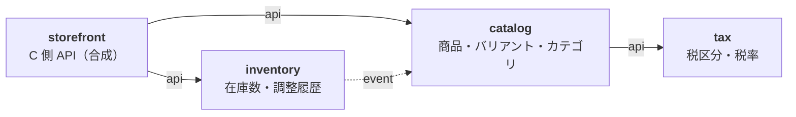

# Plan 001：商品カタログと在庫

ステータス：承認済み（OpenAPI の作成待ち）　対象：[spec.md](spec.md)

## 1. モジュール構成



矢印の向きが依存の向き（実線＝API、点線＝イベント購読）。

- `tax` を `catalog` から分けるのは、将来 `order` も税計算に使うため。
- `inventory` は `catalog` のイベントでバリアントの登録を知る。そのため `catalog` は `inventory` を呼べず（循環になる）、C 側での組み合わせは `storefront` が行う。
- B 側の在庫数合計（AC-49）は、管理画面が商品一覧 API と在庫集計 API を呼んで組み合わせる。

パッケージ（ルート `com.ecsite`）：

```
module/
├── tax/        api/catalog/  application/  domain/  infrastructure/  presentation/
├── catalog/    api/store/  event/  taxdir/  application/  domain/  infrastructure/  presentation/
├── inventory/  api/store/  application/  domain/  infrastructure/  presentation/
└── storefront/ catalogdir/  stockdir/  service/  controller/
common/   # 例外体系、i18n、Money、ページング
config/
```

## 2. ドメインモデル

### 2.1 tax

- `TaxCategory`（集約）：`id`、`name`、`rates`、`version`
- `TaxRate`（エンティティ）：`id`、`RatePercent`、`EffectivePeriod`
- `EffectivePeriod`：半開区間 `[from, to)`。null は無限（AC-2）
- `RatePercent`：0 以上 100 未満、小数第 2 位まで（AC-7）

**税率は一覧ごと置き換える**（`replaceRates(drafts, now)`）。期間限定の税率を入れるには、既存の税率の終了日時の変更と追加を同時に行う必要があり（AC-4）、1 件ずつでは途中で期間が途切れるため。

`replaceRates` の検証：

1. 重複なし、途切れなし、最後の `to` は null（AC-3）
2. 既存の税率と ID で対応づけ、`now` と比べて判定する（AC-5）
   - 開始済み：率と `from` は変更・削除不可。`to` は `now` より後に変更可
   - 終了済み：変更不可
   - 未開始：変更・削除可
3. 新たに設定する `from` / `to` は null か `now` より後（AC-5）

`rateAt(t)`：`t` を含む税率（期間は重複しないので 0 件か 1 件）。

### 2.2 catalog

- `Product`（集約）：`id`、`ProductCode`、名称、説明、`taxCategoryId`、`categoryIds`、軸（最大 3）、`PublicationStatus`、`firstShownAt`、公開期間、`variants`、`images`、`version`
- `Variant`（エンティティ）：`id`、`VariantCode`、軸の値、`Money`（税抜）、表示順、販売停止、`imageId`
- `Category`（集約）：`id`、`parentId`、名称、`depth`、表示順、`version`

- Product と Variant は 1 つの集約にする。軸の組み合わせの一意性（AC-23）が商品単位の不変条件のため。
- `PublicationStatus`：`UNPUBLISHED` / `PUBLISHED` / `DISCONTINUED`（AC-32）。
- `firstShownAt`：最初に C 側へ表示された日時。新着順のキー（AC-54）であり、null かどうかで「公開したことがあるか」を判定する（AC-33、AC-71）。
- C 側に表示される条件（BR-2）は、ドメインの `isVisibleAt(Instant)` と参照用 SQL の 2 か所にある。一致を統合テストで確認する。

公開イベント（`catalog.event`）：

| イベント | 購読者 |
|----------|--------|
| `VariantRegistered(productId, variantId)` | inventory：在庫レコードを作る |
| `VariantDeleted(productId, variantId)` / `ProductDeleted(productId, variantIds)` | inventory：在庫レコードを消す |
| `ProductPublished` / `ProductUnpublished` / `ProductDiscontinued` / `VariantPriceChanged` | なし（将来の検索インデックス同期用） |

### 2.3 inventory

- `StockItem`（集約）：`id`、`variantId`、`productId`、`quantity`
- `StockAdjustment`（値オブジェクト）：増減量（0 以外）、理由、メモ（「その他」は必須。AC-46）
- 調整履歴は集約に含めず、追記専用で別に保存する（増え続けるため）。

**並行調整（AC-44）は、楽観ロックではなく条件付きの差分更新で行う。**

```sql
UPDATE inventory.stock_item
   SET quantity = quantity + :delta
 WHERE variant_id = :variantId AND quantity + :delta >= 0
RETURNING quantity;
```

- 楽観ロックだと同時の +5 と +3 の片方が失敗し、リトライが必要になる。差分更新なら DB が直列化する。
- 0 件更新は「負になる」（AC-43）か「レコードがない」。後者かを確認してエラーを分ける。
- `RETURNING` の値を履歴に書く（AC-45）。DB にも `CHECK (quantity >= 0)` を付ける。
- 「負にならない」ルールが SQL にも現れることを `docs/modules/inventory.md` に書く。

**在庫レコードの作成（AC-41）**：`VariantRegistered` を購読して在庫数 0 で作る（`ON CONFLICT DO NOTHING` で冪等）。非同期なので、登録直後のごく短い間はレコードがない。C 側はレコードがなければ「在庫なし」、B 側はその間の調整が 404 になる。

### 2.4 storefront

ドメインを持たない。`catalogdir` / `stockdir` で相手の API を自分の型に変換し、組み合わせて返す。

## 3. 税込価格

- 計算（BR-1）：`floor(税抜 × (100 + 税率) / 100)`。`BigDecimal` と `RoundingMode.FLOOR`。`tax` に置き、`tax.api` で公開する。
- **並べ替え・絞り込み（AC-53、54）も税込で行う。** 税区分ごとに税率が違うため、税抜の順と税込の順は一致しない（例：1,000 円・8% は 1,080 円、990 円・10% は 1,089 円）。
  - `catalog` は `tax.api` から税区分ごとの現在の税率を受け取り、SQL の `CASE tax_category_id WHEN ... THEN rate END` で税込価格を計算する。最安値（AC-55）もこれで求める。
  - Java と SQL の計算結果の一致を、端数の境界値を含めて統合テストで確認する。
- `catalog` は税率の一覧（予定を含む）を Caffeine で 30 秒キャッシュし、どの税率が有効かは表示時刻で判定する。切り替え時刻ちょうどに切り替わり、登録・変更の反映遅れは最大 30 秒（NFR-1 以内）。

## 4. データモデル

### 4.1 tax

```sql
CREATE TABLE tax.tax_category (
    id          uuid PRIMARY KEY,
    name        varchar(50) NOT NULL UNIQUE,
    version     bigint      NOT NULL,
    created_at  timestamptz NOT NULL,
    updated_at  timestamptz NOT NULL
);

CREATE EXTENSION IF NOT EXISTS btree_gist;

CREATE TABLE tax.tax_rate (
    id               uuid PRIMARY KEY,
    tax_category_id  uuid         NOT NULL REFERENCES tax.tax_category (id),
    rate_percent     numeric(4,2) NOT NULL CHECK (rate_percent >= 0 AND rate_percent < 100),
    effective_from   timestamptz,  -- null：過去すべて
    effective_to     timestamptz,  -- null：無期限
    CHECK (effective_from IS NULL OR effective_to IS NULL OR effective_from < effective_to),
    EXCLUDE USING gist (
        tax_category_id WITH =,
        tstzrange(effective_from, effective_to, '[)') WITH &&
    )
);
```

期間の重複は排他制約で DB でも防ぐ（`tstzrange` は null を無限として扱う）。途切れと「最後は無期限」はドメインとテストで担保する。

### 4.2 catalog

```sql
CREATE TABLE catalog.category (
    id             uuid PRIMARY KEY,
    parent_id      uuid REFERENCES catalog.category (id),
    name           varchar(50) NOT NULL,
    depth          smallint    NOT NULL CHECK (depth BETWEEN 1 AND 3),
    display_order  int         NOT NULL,
    version        bigint      NOT NULL,
    created_at     timestamptz NOT NULL,
    updated_at     timestamptz NOT NULL,
    UNIQUE NULLS NOT DISTINCT (parent_id, name)
);

CREATE TABLE catalog.product (
    id               uuid PRIMARY KEY,
    product_code     varchar(32)  NOT NULL UNIQUE,
    name             varchar(200) NOT NULL,
    description      text         NOT NULL,
    tax_category_id  uuid         NOT NULL,
    status           varchar(20)  NOT NULL,
    first_shown_at   timestamptz,
    publish_start    timestamptz,
    publish_end      timestamptz,
    version          bigint       NOT NULL,
    created_at       timestamptz  NOT NULL,
    updated_at       timestamptz  NOT NULL
);

CREATE TABLE catalog.product_axis (
    product_id  uuid        NOT NULL REFERENCES catalog.product (id),
    position    smallint    NOT NULL CHECK (position BETWEEN 1 AND 3),
    name        varchar(30) NOT NULL,
    PRIMARY KEY (product_id, position)
);

CREATE TABLE catalog.product_category (
    product_id   uuid NOT NULL REFERENCES catalog.product (id),
    category_id  uuid NOT NULL REFERENCES catalog.category (id),
    PRIMARY KEY (product_id, category_id)
);

CREATE TABLE catalog.variant (
    id               uuid PRIMARY KEY,
    product_id       uuid        NOT NULL REFERENCES catalog.product (id),
    variant_code     varchar(32) NOT NULL UNIQUE,
    axis_key         text        NOT NULL,  -- 軸の値を連結した値
    price_excl_tax   bigint      NOT NULL CHECK (price_excl_tax >= 1),
    display_order    int         NOT NULL,
    sales_suspended  boolean     NOT NULL DEFAULT false,
    image_id         uuid,
    UNIQUE (product_id, axis_key)
);

CREATE TABLE catalog.variant_axis_value (
    variant_id  uuid        NOT NULL REFERENCES catalog.variant (id),
    position    smallint    NOT NULL,
    value       varchar(50) NOT NULL,
    PRIMARY KEY (variant_id, position)
);
```

画像のテーブルは US-7 で追加する。

### 4.3 inventory

```sql
CREATE TABLE inventory.stock_item (
    id          uuid PRIMARY KEY,
    variant_id  uuid        NOT NULL UNIQUE,
    product_id  uuid        NOT NULL,
    quantity    int         NOT NULL CHECK (quantity >= 0),
    created_at  timestamptz NOT NULL,
    updated_at  timestamptz NOT NULL
);

CREATE TABLE inventory.stock_adjustment (
    id              uuid PRIMARY KEY,
    stock_item_id   uuid        NOT NULL REFERENCES inventory.stock_item (id),
    delta           int         NOT NULL CHECK (delta <> 0),
    reason          varchar(20) NOT NULL,
    memo            varchar(500),
    quantity_after  int         NOT NULL,
    actor_id        uuid,
    adjusted_at     timestamptz NOT NULL
);
CREATE INDEX ON inventory.stock_adjustment (stock_item_id, adjusted_at DESC);
```

### 4.4 共通

- Spring Modulith のイベント発行記録のテーブルは、公式の DDL を `common` schema のマイグレーションに含める（自動作成は使わない）。
- 一覧用のインデックスは、実装時に実行計画を見て追加する。

## 5. API

OpenAPI（`api/openapi/`）は本 plan の後に作る。規約は constitution 第 9 節。

### 5.1 B 側（`/api/admin`）

| Method | Path | 権限 | AC |
|--------|------|------|----|
| GET | `/tax-categories` | `tax:read` | |
| POST | `/tax-categories` | `tax:write` | 1 |
| PUT | `/tax-categories/{id}/rates`（一覧ごと置き換え） | `tax:write` | 2〜5、7 |
| GET | `/categories`（木） | `category:read` | |
| POST | `/categories` | `category:write` | 8〜10 |
| PUT | `/categories/{id}` | `category:write` | 10、11 |
| PUT | `/categories/order`（兄弟の並び順） | `category:write` | 11 |
| DELETE | `/categories/{id}` | `category:write` | 12 |
| GET | `/products` | `product:read` | 47〜50 |
| GET | `/products/{id}` | `product:read` | |
| POST | `/products` | `product:write` | 6、13〜17 |
| PUT | `/products/{id}` | `product:write` | 6、18、19 |
| DELETE | `/products/{id}` | `product:write` | 33 |
| PUT | `/products/{id}/publish`、`/unpublish`、`/discontinue` | `product:write` | 29〜32 |
| PUT | `/products/{id}/publication-period`（P2） | `product:write` | 34〜36 |
| POST | `/products/{id}/variants` | `product:write` | 20〜25 |
| PUT | `/products/{id}/variants/{variantId}` | `product:write` | 26 |
| DELETE | `/products/{id}/variants/{variantId}` | `product:write` | 71 |
| PUT | `/products/{id}/variants/order` | `product:write` | 27 |
| PUT | `/products/{id}/variants/{variantId}/suspend`、`/resume`（P2） | `product:write` | 28 |
| GET | `/inventory/variants/{variantId}` | `inventory:read` | |
| POST | `/inventory/variants/{variantId}/adjustments` | `inventory:write` | 42〜44、46 |
| GET | `/inventory/variants/{variantId}/adjustments` | `inventory:read` | 45 |
| GET | `/inventory/stock-summaries?productIds=` | `inventory:read` | 49 |

画像（US-7、US-13）の endpoint は US-7 の着手時に追記する。

### 5.2 C 側（`/api/store`）

| Method | Path | AC |
|--------|------|----|
| GET | `/products` | 51〜57 |
| GET | `/products/search?q=` | 58〜61 |
| GET | `/products/{productId}` | 62〜66 |
| GET | `/categories` | 52 |

URL には内部 ID を使い、品番を使わない（AC-66）。

## 6. キーワード検索

- `catalog` の port `ProductSearch`。MVP の実装は商品名と説明への `ILIKE`（`%` と `_` はエスケープ）、並びは新着順固定。
- 通常の一覧（`ProductQueryRepository`）とはコードを分ける。ただし表示条件（BR-2）は共通の部品にし、検索だけに非公開の商品が出る事故を防ぐ。

## 7. フロントエンド

| | store（C 側） | admin（B 側） |
|---|---|---|
| 画面 | トップ、商品一覧、検索結果、商品詳細 | 税区分、カテゴリ、商品一覧、商品編集（バリアントを含む）、在庫調整 |
| API 呼び出し | サーバーコンポーネントから直接 | ブラウザから。開発時は Vite のプロキシ |

- 価格表示（BR-4）と日本時間への変換（BR-3）は共通の部品にする。

## 8. 基盤

| 項目 | 方針 |
|------|------|
| 依存バージョン | MyIAM の `libs.versions.toml` を起点に、着手時点の最新安定版にする |
| Flyway | Spring Boot 4 では `spring-boot-starter-flyway` が必要 |
| トレーシング | Micrometer Tracing。Zipkin 形式から始める |
| ローカル環境 | `compose.yaml` に PostgreSQL 18 と Zipkin |
| Seed | 税区分（標準 10%、軽減 8%）、カテゴリ、商品のサンプル |
| イベント | `@ApplicationModuleListener`。再起動時の未完了イベントの自動再発行は無効のまま |

## 9. テスト

| 対象 | 単体 | 統合 |
|------|------|------|
| US-1 | `replaceRates` の各検証、`rateAt`、値オブジェクト | API 経由の登録、AC-4 のシナリオ、排他制約 |
| US-2 | 深さ、名称 | 削除の拒否（AC-12）、木の取得 |
| US-3〜5 | 登録、軸、一意性、公開条件、状態遷移、削除条件 | 品番の一意性、AC-6、Repository |
| US-8 | `StockAdjustment` | AC-43、**並行調整（AC-44）**、履歴、イベントでのレコード作成 |
| US-9 | | 絞り込み、ページング |
| US-10〜12 | 税込計算 | 表示条件、税込での並べ替え・絞り込み、**Java と SQL の税込計算の一致**、在庫なし、検索 |
| 横断 | | `ModulithTest`、B 側 endpoint の権限名の記載漏れを検出する契約テスト |

## 10. 実装の順序

| # | 段階 | 完了条件 |
|---|------|----------|
| 0 | 基盤（Gradle、Modulith、Flyway、jOOQ、OpenAPI 生成、例外、ページング、可観測性、CI、compose） | 空のアプリが起動し、CI が通る |
| 1 | tax（US-1） | US-1 の AC のテストが通る |
| 2 | カテゴリ（US-2） | 同上 |
| 3 | 商品・バリアント・公開（US-3〜5） | P1 の AC のテストが通る |
| 4 | inventory（US-8） | 並行調整を含め通る |
| 5 | B 側の商品一覧（US-9） | 同上 |
| 6 | storefront（US-10〜12） | 同上 |
| 7 | 管理画面 | 画面から B 側の操作ができる |
| 8 | 店舗画面 | 画面から C 側の閲覧ができる |
| 9 | P2（US-6、AC-28、US-7、US-13） | US-7 の前に画像の設計を追記する |
