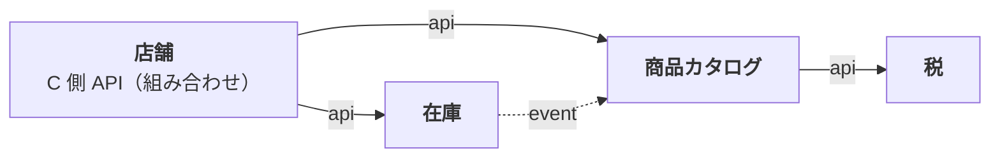

# Plan 001：商品カタログと在庫

ステータス：承認済み（tasks 作成済み）　対象：[spec.md](spec.md)

本 spec で追加するモジュールの設計は、各モジュールの設計書に書く。本書には、モジュールをまたぐ決定と、作り方の段取りだけを書く。

| モジュール | 設計書 | 主な担当 |
|------------|--------|----------|
| 税 | [tax.md](../../modules/tax.md) | US-1 |
| 商品カタログ | [catalog.md](../../modules/catalog.md) | US-2〜7、9、11、13 |
| 在庫 | [inventory.md](../../modules/inventory.md) | US-8 |
| 店舗 | [storefront.md](../../modules/storefront.md) | US-10〜12 |

用語と識別子の対応は[用語集](../../glossary.md)。

## 1. モジュール間の関係

矢印の向きが依存の向き（実線＝API、点線＝イベント購読）。

- 税を商品カタログから分けるのは、将来の注文モジュールも税計算に使うため。
- 在庫は、商品カタログのイベントでバリアントの登録・削除を知る。そのため商品カタログは在庫を呼べず（依存が循環する）、C 側での組み合わせは店舗モジュールが行う。
- B 側の在庫数の合計（AC-49）は、管理画面が商品一覧 API と在庫集計 API を呼んで組み合わせる。
- 税込価格で並べ替えるため（AC-53、54）、商品カタログは税モジュールから税率の一覧を受け取り、SQL で税込価格を計算する（[catalog.md](../../modules/catalog.md)）。

パッケージのルートは `com.ecsite`。例外体系、i18n、金額、ページングなどの共通部品は `common` に置く。

## 2. API

項目の定義は OpenAPI（[admin.yaml](../../../api/openapi/admin.yaml)、[store.yaml](../../../api/openapi/store.yaml)）。規約は constitution 第 9 節。本節は endpoint と AC の対応だけを示す。

### 2.1 B 側（`/api/admin`）

| Method | Path | 権限 | AC |
|--------|------|------|----|
| GET | `/tax-categories` | `tax:read` | |
| POST | `/tax-categories` | `tax:write` | 1 |
| GET | `/tax-categories/{id}` | `tax:read` | |
| PUT | `/tax-categories/{id}/rates`（一覧ごと置き換え） | `tax:write` | 2〜5、7 |
| GET | `/categories`（木） | `category:read` | |
| POST | `/categories` | `category:write` | 8〜10 |
| GET | `/categories/{id}` | `category:read` | |
| PUT | `/categories/{id}` | `category:write` | 10、11 |
| PUT | `/categories/order`（兄弟の並び順） | `category:write` | 11 |
| DELETE | `/categories/{id}` | `category:write` | 12 |
| GET | `/products` | `product:read` | 47〜50 |
| GET | `/products/{id}` | `product:read` | |
| POST | `/products` | `product:write` | 6、13〜17、25 |
| PUT | `/products/{id}` | `product:write` | 6、18、19、25、26 |
| DELETE | `/products/{id}` | `product:write` | 33 |
| PUT | `/products/{id}/publish`、`/unpublish`、`/discontinue`（冪等） | `product:write` | 29〜32 |
| PUT | `/products/{id}/publication-period`（P2） | `product:write` | 34〜36 |
| POST | `/products/{id}/variants` | `product:write` | 20〜24 |
| DELETE | `/products/{id}/variants/{variantId}` | `product:write` | 71 |
| PUT | `/products/{id}/variants/order` | `product:write` | 27 |
| PUT | `/products/{id}/variants/{variantId}/suspend`、`/resume`（P2、冪等） | `product:write` | 28 |
| GET | `/inventory/variants/{variantId}` | `inventory:read` | |
| POST | `/inventory/variants/{variantId}/adjustments` | `inventory:write` | 42〜44、46 |
| GET | `/inventory/variants/{variantId}/adjustments` | `inventory:read` | 45 |
| GET | `/inventory/stock-summaries?productIds=` | `inventory:read` | 49 |

画像（US-7、US-13）の endpoint は US-7 の着手時に追記する。

### 2.2 C 側（`/api/store`）

| Method | Path | AC |
|--------|------|----|
| GET | `/products` | 51〜57 |
| GET | `/products/search?q=` | 58〜61 |
| GET | `/products/{productId}` | 62〜66 |
| GET | `/categories` | 52 |

URL には内部 ID を使い、品番を使わない（AC-66）。

## 3. フロントエンド

| | store（C 側） | admin（B 側） |
|---|---|---|
| 画面 | トップ、商品一覧、検索結果、商品詳細 | 税区分、カテゴリ、商品一覧、商品編集（バリアントを含む）、在庫調整 |
| API 呼び出し | サーバーコンポーネントから直接 | ブラウザから。開発時は Vite のプロキシ |
| キャッシュ | API の結果のキャッシュは最大 60 秒（NFR-1） | TanStack Query の既定 |

価格表示（BR-4）と日本時間への変換（BR-3）は共通の部品にする。

admin のディレクトリ、API の呼び出し方、フォーム、画面の追加手順は [管理画面の構成](../../frontend/admin.md)、store は [店舗画面の構成](../../frontend/store.md) に従う。

## 4. 基盤

| 項目 | 方針 |
|------|------|
| 依存バージョン | MyIAM の `libs.versions.toml` を起点に、着手時点の最新安定版にする |
| Flyway | Spring Boot 4 では `spring-boot-starter-flyway` が必要 |
| イベント発行記録 | Spring Modulith の公式 DDL を `common` schema のマイグレーションに含める（自動作成は使わない） |
| イベント購読 | Spring Modulith のモジュール間リスナー（コミット後・非同期）。再起動時の未完了イベントの自動再発行は無効のまま。失敗時のリスクと手動の復旧手順は [inventory.md](../../modules/inventory.md) |
| トレーシング | Micrometer Tracing。Zipkin 形式から始める |
| ローカル環境 | `compose.yaml` に PostgreSQL 18 と Zipkin |
| Seed | 税区分（標準 10%、軽減 8%）、カテゴリ、商品のサンプル |

## 5. テスト

| 対象 | 単体 | 統合 |
|------|------|------|
| US-1 | 税率の一覧の置き換えの各検証、指定時点の税率、値オブジェクト | API 経由の登録、AC-4 のシナリオ、排他制約 |
| US-2 | 深さ、名称 | 削除の拒否（AC-12）、木の取得 |
| US-3〜5 | 登録、軸、一意性、公開条件、状態遷移、削除条件 | 品番の一意性、AC-6、Repository |
| US-8 | 在庫調整の検証 | AC-43、**並行調整（AC-44）**、履歴、イベントによる在庫の作成 |
| US-9 | | 絞り込み、ページング |
| US-10〜12 | 税込計算 | 表示条件、税込での並べ替え・絞り込み、**Java と SQL の税込計算の一致**、在庫なし、検索 |
| 横断 | | モジュール境界の検証、B 側 endpoint の権限名の記載漏れを検出する契約テスト |

## 6. 実装の順序

tasks は段階ごとに `tasks/` の 1 ファイルにする（[00](tasks/00-foundation.md)、[01](tasks/01-tax.md)、[02](tasks/02-category.md)、[03](tasks/03-product.md)、[04](tasks/04-inventory.md)、[05](tasks/05-admin-product-list.md)、[06](tasks/06-storefront.md)、[07](tasks/07-admin-ui.md)、[08](tasks/08-store-ui.md)、[09](tasks/09-p2.md)）。

| # | 段階 | 完了条件 |
|---|------|----------|
| 0 | 基盤（Gradle、Modulith、Flyway、jOOQ、OpenAPI 生成、例外、ページング、可観測性、CI、compose） | 空のアプリが起動し、CI が通る |
| 1 | tax（US-1） | US-1 の AC のテストが通る |
| 2 | カテゴリ（US-2） | 同上 |
| 3 | 商品・バリアント・公開（US-3〜5） | P1 の AC のテストが通る |
| 4 | inventory（US-8） | 並行調整を含めて通る |
| 5 | B 側の商品一覧（US-9） | 同上 |
| 6 | storefront（US-10〜12） | 同上 |
| 7 | 管理画面 | 画面から B 側の操作ができる |
| 8 | 店舗画面 | 画面から C 側の閲覧ができる |
| 9 | P2（US-6、AC-28、US-7、US-13） | US-7 の前に画像の設計を追記する |
