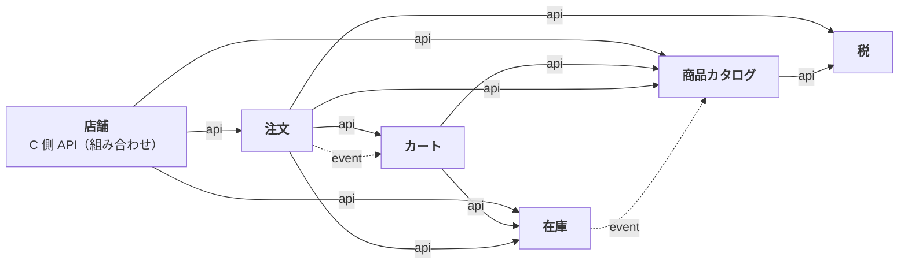

# Plan 002：カートと注文

ステータス：承認済み（tasks 作成済み）　対象：[spec.md](spec.md)

本 spec で追加・変更するモジュールの設計は、各モジュールの設計書に書く。本書には、モジュールをまたぐ決定と、作り方の段取りだけを書く。

| モジュール | 設計書 | 主な担当 |
|------------|--------|----------|
| カート（新規） | [cart.md](../../modules/cart.md) | US-14、15（品目の追加・変更・削除） |
| 注文（新規） | [order.md](../../modules/order.md) | US-15（金額と購入できるか）、16〜21 |
| 在庫（変更） | [inventory.md](../../modules/inventory.md) | 引当、販売可能数、注文による増減と履歴（AC-82〜84、87、101、103、107、BR-11） |
| 税（変更） | [tax.md](../../modules/tax.md) | 税率ごとの消費税額（BR-8） |
| 商品カタログ（変更） | [catalog.md](../../modules/catalog.md) | 注文できるバリアントの情報（AC-72、80、92） |
| 店舗（変更） | [storefront.md](../../modules/storefront.md) | カートの表示（US-15） |

用語と識別子の対応は[用語集](../../glossary.md)。

## 1. モジュール間の関係



矢印の向きが依存の向き（実線＝API、点線＝イベント購読）。メディアモジュールは変わらないので省いた。

- **カート**はレベル B。品目（バリアントと数量）を持つだけで、価格を持たない（AC-79）。入れるときの確認（AC-72、76）のために商品カタログと在庫を呼ぶ。
- **注文**はレベル A。注文手続き（引当の持ち主）、注文、キャンセルの状態遷移を持つ。カートの品目を読み、注文が成立したらカートを空にする。
- **金額の計算は注文モジュールに 1 つだけ置く**（BR-7）。カートの表示、注文手続き、注文の成立は、どれも注文モジュールの「見積もり」で金額と購入できるかを求める。税込単価と税率ごとの消費税額の計算そのものは税モジュールに置き、注文モジュールはそれを呼ぶ（税の端数処理のルールを 1 か所にするため）。
- **カートの表示**は、店舗モジュールが、注文モジュールの見積もり（カートの品目を読んで見積もる）を表示の形にして返す。カートの変更（追加・数量の変更・削除）は、カートモジュールの C 側 API が受ける（constitution 4.3）。
- **引当**は在庫モジュールに置く。引当の持ち主は注文手続き。カートが変わったら、注文モジュールがカートのイベントを受けて引当を解く（AC-84）。カートは注文に依存できない（注文がカートに依存しているため）ので、イベントにする。
- 消費者の識別は、カート ID と注文 ID（どちらも推測できない UUID）で行う（第 3 節）。

## 2. 強い一貫性の作り方（NFR-2）

引当、注文の成立と在庫の減算、キャンセルと在庫の戻しは、**1 つのトランザクションの中で、注文モジュールが在庫モジュールの API を同期で呼ぶ**ことで行う（constitution 6 の例外。spec の NFR-2 に明記）。

- モジュラーモノリスで DB が 1 つなので、モジュールごとの schema をまたいでも 1 つのトランザクションにできる。在庫モジュールの API は呼び出し元のトランザクションに参加する。
- イベントを使わないので、イベントの処理の失敗で在庫がずれることはない。未完了イベントの自動再発行（constitution 16）は、引き続き先送りできる。
- 将来、注文と在庫を別のプロセスに分けるときは、この部分を Saga などに作り直す必要がある。分けるまでは、この方が単純で正しい。

### 引当の排他

```
注文手続きに進む（AC-82）
  1. 対象のバリアントの在庫を、バリアント ID の順に行ロックする（デッドロックを避けるため順序を固定）
  2. 販売可能数 ＝ 在庫数 − ほかの持ち主の有効な引当の合計 を求める
  3. 全品目が足りれば、この持ち主の引当を置き換える。1 つでも足りなければ、何も書かずに足りない品目を返す
```

- 同じ在庫への引当は行ロックで 1 つずつ処理されるので、在庫数を超えて引き当てない（AC-83）。
- 運営者の在庫調整（差分の加算の 1 回の更新）も同じ行を更新するので、引当とは順番に処理される。
- 期限切れの引当は数えないだけで、消さない（BR-11）。削除は定期ジョブの方式が決まってから（spec の Non-goals）。

### 注文の成立

```
注文する（AC-87〜92）
  1. 注文手続きを行ロックする（同じ注文手続きの二重送信を 1 つずつ処理する。AC-91）
  2. その注文手続きの注文がすでにあれば、それを返す（AC-91）
  3. カートが注文手続きを始めたときから変わっていないことを確かめる
  4. 注文日時で見積もり、確認した総額と比べる（AC-89）
  5. 在庫モジュールで、引当を在庫数の減算に置き換える。期限切れなら、その場で引き当て直す（AC-87）。調整履歴に理由「注文」と注文番号を書く（AC-107）
  6. 注文を保存し、カートを空にする（AC-90）
```

すべて 1 つのトランザクション。途中で失敗すれば、在庫も注文もカートも変わらない。

## 3. 消費者の識別（ログインなし）

| 対象 | 識別 | 持ち方 |
|------|------|--------|
| カート | カート ID（ランダムな UUID） | 店舗画面のサーバーが、HttpOnly の Cookie に持つ。ブラウザの JavaScript からは読めない |
| 注文手続き | 注文手続き ID | 注文手続きの画面の URL に持つ |
| 注文 | 注文 ID（ランダムな UUID） | 注文の画面の URL（AC-94） |

- ID そのものが鍵になるので、ランダムな UUID（122 ビット）にする。注文番号（BR-10）とは別の値で、互いに推測できない。
- HTTP セッションは使わない（constitution 5-1）。
- カートの API は、カート ID を知っていれば誰でも操作できる。注文の画面も同じ。総当たりの対策は、公開ネットワークへのデプロイ前に行う（spec の Non-goals）。
- 認証を入れるときは、カートと注文に会員を結び付ける。ID による識別は、ゲストの購入として残す。

## 4. 決めたこと

| 項目 | 決定 |
|------|------|
| 注文番号の形式（BR-10） | 注文日（日本時間）の 8 桁 ＋ ハイフン ＋ ランダムな数字 6 桁。例：`20261010-482915`。日ごとの注文数を推測させないためランダムにし、読み上げやすいよう数字だけにする。重複したら作り直す |
| 送料（BR-6） | 金額（既定 1,000 円）と、送料に適用する税区分（ID）を設定に持つ。税率は、税モジュールから注文日時の税率を取る（税率の改定に設定の変更なしで追従するため）。税区分がない・有効な税率がないときはシステムのエラー |
| 送料がかかる条件 | 購入できる品目が 1 つ以上あるとき。空のカートの総額は 0 円 |
| 引当の期限（AC-82） | 15 分。設定で変えられる |
| カートの期限（AC-81） | 30 日。期限切れのカートは、読むときに空として扱い、次に書くときに品目を消してから書く |
| 同じ注文の再送（AC-91） | 注文手続き 1 つにつき注文は 1 つ。同じ注文手続きでの再送には、作成済みの注文を返す |
| 確認した総額（AC-89） | 注文のリクエストに、注文手続きの画面で表示した総額を含める。注文日時で計算し直した総額と違えば 409 |
| カートの変更の検出 | カートはバージョンを持ち、変更のたびに上げる。注文手続きは始めたときのバージョンを持ち、注文の時点で違えば 409（イベントで引当が解かれる前に注文が来ても、古い内容で注文しないため） |
| 状態の切り替え（承認・却下・キャンセル・申請） | constitution 9 の例外どおり、バージョンを送らない。冪等にする（AC-96、105） |
| 個人情報 | メールアドレス・お届け先はログに出さない。B 側の一覧は氏名だけを返す |
| イベント | 注文の成立とキャンセルを、注文のイベントとして発行する（今は購読者がない。決済・出荷・レポートの土台）。カートの変更はカートのイベント |

## 5. API

項目の定義は OpenAPI（[admin.yaml](../../../api/openapi/admin.yaml)、[store.yaml](../../../api/openapi/store.yaml)）。規約は constitution 第 9 節。本節は endpoint と AC の対応だけを示す。

### 5.1 C 側（`/api/store`）

| Method | Path | モジュール | AC |
|--------|------|------------|----|
| POST | `/carts` | カート | 73 |
| GET | `/carts/{cartId}` | 店舗 | 77、79〜81 |
| POST | `/carts/{cartId}/items`（入れる。同じバリアントは合算） | カート | 72、74〜76 |
| PUT | `/carts/{cartId}/items/{variantId}`（数量の変更） | カート | 75、76、78 |
| DELETE | `/carts/{cartId}/items/{variantId}` | カート | 78 |
| POST | `/carts/{cartId}/checkouts`（注文手続きに進む） | 注文 | 82〜85 |
| GET | `/checkouts/{checkoutId}` | 注文 | 84、85 |
| POST | `/checkouts/{checkoutId}/order` | 注文 | 86〜92、107 |
| GET | `/orders/{orderId}` | 注文 | 93、94、96 |
| PUT | `/orders/{orderId}/cancellation-request`（冪等） | 注文 | 95、96 |

### 5.2 B 側（`/api/admin`）

| Method | Path | 権限 | AC |
|--------|------|------|----|
| GET | `/orders` | `order:read` | 97〜99、106 |
| GET | `/orders/{orderId}` | `order:read` | 100、106 |
| PUT | `/orders/{orderId}/cancellation-request/approve`（冪等） | `order:write` | 101、104、105 |
| PUT | `/orders/{orderId}/cancellation-request/reject` | `order:write` | 102、105 |
| PUT | `/orders/{orderId}/cancel`（理由が必須。冪等） | `order:write` | 103〜105 |

在庫の調整履歴（`GET /inventory/variants/{variantId}/adjustments`）は、理由に「注文」「注文のキャンセル」と注文番号が加わる（AC-107）。運営者の調整（`POST .../adjustments`）では、これらの理由は 400。`admin.yaml` へのこの変更は、既存の管理画面と同時に直すため、段階 1（T2103）で行う。

## 6. フロントエンド

| | store（C 側） | admin（B 側） |
|---|---|---|
| 画面 | カート、注文手続き（入力と確認）、注文（完了・照会・キャンセルの申請） | 注文一覧、注文の詳細（承認・却下・キャンセル）。在庫の調整履歴に注文の理由を表示 |
| 操作 | 商品の詳細の「カートに入れる」、カートの数量の変更・削除、注文手続き、キャンセルの申請 | 承認・却下・キャンセル |

- 店舗画面はブラウザから API を呼ばない（[店舗画面の構成](../../frontend/store.md)）。カートの変更、注文手続き、注文、申請は、Next.js のサーバーアクションからバックエンドを呼ぶ。カート ID の Cookie もサーバー側で読み書きする。
- 店舗画面の操作は閲覧だけではなくなるので、店舗画面の構成の「結果の知らせ方」に、入力の誤りと業務のエラーの出し方を足す。
- カート・注文手続き・注文の画面は、取得にキャッシュを使わない（数量・引当・状態がすぐ変わるため）。
- 注文手続きの画面に、引当の残り時間を示す。期限が切れても注文はできる（AC-87）ので、操作は止めない。

## 7. テスト

| 対象 | 単体 | 統合 |
|------|------|------|
| 税（BR-8） | 税率ごとの消費税額、送料を含む合計、spec の例 | |
| 在庫（BR-11） | | 販売可能数、**同時の引当（AC-83）**、引当の置き換え・解除・期限切れ、減算への置き換え（期限切れの引き当て直しを含む）、戻し、注文の理由の履歴（AC-107）、運営者の調整で注文の理由を拒否 |
| カート（US-14、15） | 数量・品目数の上限、合算、期限 | 選べないバリアントの拒否（AC-72）、販売可能数を超える数量の拒否（AC-76） |
| 注文の見積もり（BR-7、AC-80） | 小計・総額・送料・消費税額、購入できない品目の理由 | カートの表示（店舗モジュール経由） |
| 注文の成立（US-16） | 状態の初期値、写し | **同時の注文（引当の期限が切れた者どうし。AC-87）**、総額の不一致（AC-89）、**二重送信（AC-91）**、カートの変更の検出、成立後の商品・税率の変更で注文が変わらない（AC-92）、全体の取り消し（AC-87） |
| キャンセル（US-18、21） | 状態遷移（BR-9）、1 回だけの申請、理由の必須 | 承認・運営者のキャンセルで在庫が戻る（AC-101、103）、冪等（AC-105）、在庫の戻しの失敗で注文も変わらない（AC-104） |
| 一覧・詳細（US-19、20） | | 絞り込み、ページング、キャンセル済みの表示 |
| 横断 | | モジュール境界の検証（新しい依存）、B 側 endpoint の権限名の記載漏れ |
| E2E | | 商品をカートに入れて注文し、管理画面でキャンセルの申請を承認すると、在庫が戻る |

## 8. 実装の順序

tasks は段階ごとに `tasks/` の 1 ファイルにする（[01](tasks/01-foundation.md)、[02](tasks/02-cart.md)、[03](tasks/03-order.md)、[04](tasks/04-cancellation-and-admin.md)、[05](tasks/05-store-ui.md)、[06](tasks/06-admin-ui.md)、[07](tasks/07-frontend-tests.md)、[08](tasks/08-review.md)）。タスク番号は `T2` ＋ 段階 ＋ 連番（例：T2101）。

| # | 段階 | 完了条件 |
|---|------|----------|
| 1 | 税と在庫の土台（消費税額、引当、販売可能数、注文による増減と履歴） | BR-8、BR-11、AC-83、107 のテストが通る。C 側の在庫の有無が販売可能数になる |
| 2 | カート（US-14、15 の変更） | AC-72〜76、78、81 のテストが通る |
| 3 | 注文の見積もりと注文の成立（US-15 の表示、16、17） | AC-77、79、80、82〜94 のテストが通る。同時の注文と二重送信を含む |
| 4 | キャンセルと B 側の注文（US-18〜21） | AC-95〜106 のテストが通る |
| 5 | 店舗画面 | 画面からカート・注文・申請ができる |
| 6 | 管理画面 | 画面から注文の参照・承認・却下・キャンセルができる |
| 7 | フロントのテスト（結合テスト、E2E） | 主な操作の結合テストと、注文の E2E が CI で通る |
| 8 | 見直し | 実装と文書の食い違い、読みにくさ、コメントの不足を直し、テストが通る |
