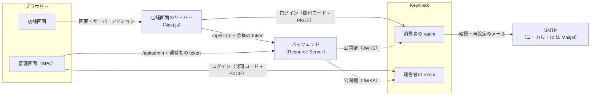

# Plan 003：認証

ステータス：承認済み（tasks 作成済み）　対象：[spec.md](spec.md)

本 spec で変更するモジュールの設計は、各モジュールの設計書に書く。本書には、モジュールをまたぐ決定と、作り方の段取りだけを書く。

| 対象 | 設計書 | 主な担当 |
|------|--------|----------|
| IdP（新規。Keycloak の設定） | 本書 第 2 節 | US-22〜24、28、AC-139、140 |
| 認証の土台（新規。モジュールではない） | 本書 第 3 節 | AC-136〜138、NFR-3、4 |
| 会員（新規） | member.md（段階 3 で作る） | 会員の識別（BR-13） |
| カート（変更） | [cart.md](../../modules/cart.md) | US-25 |
| 注文（変更） | [order.md](../../modules/order.md) | US-26、27 |
| 店舗（変更） | [storefront.md](../../modules/storefront.md) | カートの表示の本人確認（AC-121） |
| 在庫・注文（変更、P2） | [inventory.md](../../modules/inventory.md)、[order.md](../../modules/order.md) | US-30 |

用語と識別子の対応は[用語集](../../glossary.md)。

## 1. 全体の構成

- **店舗画面**は、サーバー（Next.js）が IdP とやり取りし、token をサーバー側だけで扱う（BFF）。ブラウザーには暗号化した HttpOnly の Cookie だけを渡し、JavaScript から token を読めないようにする。店舗画面はもともとブラウザーから API を呼ばない（[店舗画面の構成](../../frontend/store.md)）ので、この形に合う。
- **管理画面**は SPA なので、ブラウザーで IdP とやり取りし（public client）、token をメモリーにだけ持つ。ログインの状態は IdP が自分のドメインの Cookie（SSO セッション）で持つ。
  - 再読み込み、新しいタブ、タブを閉じて開き直したとき：SPA は token を持たないので IdP のログインに移るが、IdP がログインの状態を見て、パスワードを求めずにすぐ戻す（一瞬の移動だけ）。
  - IdP のログインの状態が切れたとき（最後の操作から 30 分、最長 8 時間。第 2.3 節）と、ブラウザーを閉じたとき（運営者の realm では「ログインしたままにする」を無効にし、IdP の Cookie をブラウザーを閉じるまでにする）：ログインし直す。
  - 戻すときは、画面の中に隠した iframe（第三者の Cookie になり、ブラウザーに止められることがある）ではなく、画面ごとの移動で行う。
- **バックエンド**は token を検証するだけで、ログインの画面も Cookie も持たない（constitution 10.1）。HTTP セッションを使わない（constitution 5-1）。
- 確認と再設定のメールは IdP が送る。EC はメールを送らない。

## 2. IdP（Keycloak）の設定

### 2.1 realm と client

| realm | client | 種類 | 用途 |
|-------|--------|------|------|
| `ec-store` | `ec-store-web` | confidential（店舗画面のサーバーが secret を持つ） | 会員のログイン |
| `ec-store` | `ec-store-api` | token を受けるだけ（ログインしない） | 会員の token の audience |
| `ec-admin` | `ec-admin-web` | public（PKCE） | 運営者のログイン |
| `ec-admin` | `ec-admin-api` | token を受けるだけ | 運営者の token の audience と、権限の role の置き場所 |

- それぞれの web の client が発行する access token の audience に、対応する api の client を入れる（audience の mapper）。バックエンドは issuer と audience の両方を確かめる。
- 会員の token には権限を載せない。subject、メールアドレス、確認済みか、氏名だけ。

### 2.2 権限と職務（BR-12）

- **権限**は、`ec-admin-api` の client role にする。名前は `resource:action` そのもの（例：`product:write`）。一覧は `admin.yaml` に現れる権限と同じにする（第 3.3 節の契約テストで確かめる）。
- **職務**は、運営者の realm の composite role にする。管理者（`administrator`）はすべての権限を、閲覧者（`viewer`）は `:read` の権限を含む。職務を足すのは realm の設定だけで行う。
- Keycloak は composite role を展開して、access token の `resource_access.ec-admin-api.roles` に載せる。バックエンドはここだけを読む（第 3.2 節）。
- token の大きさ：MVP の権限は 10 個（tax、category、product、inventory、order の read・write）。ヘッダーの上限（8KB）には遠い（constitution 10.2）。

### 2.3 spec で plan に任せた値

| 項目 | 消費者の realm | 運営者の realm | AC |
|------|----------------|----------------|----|
| パスワードの条件 | 8 文字以上、64 文字以下。メールアドレスと同じものは不可 | 同じ | 110 |
| ログインの失敗による一時的な停止 | 5 回続けて失敗すると 15 分 | 同じ | 116、135 |
| ログインの状態（SSO セッション）が続く時間 | 最後の操作から 7 日、最長 30 日 | 最後の操作から 30 分、最長 8 時間 | 117 |
| access token の有効期間 | 5 分 | 5 分 | 140 |
| 職務の変更・無効化の反映 | | access token の有効期間（5 分）以内。無効化した運営者は token を更新できない | 140 |
| 会員登録 | 有効。ログイン ID はメールアドレス | 無効 | 108、134 |
| メールアドレスの確認 | 必須（確認するまでログインできない） | 不要（管理の画面で作るため） | 111 |
| 会員登録の流れ | メールアドレスと氏名を入れる → 確認のメール → リンクを開く → パスワードを設定する（Keycloak 26.8 は、メールアドレスの確認が必須のとき、登録の画面にパスワードを出さない）。確認の前はパスワードがないので、ログインできない | | 108、110〜112 |
| パスワードを忘れたとき | 有効 | 有効 | 118 |
| 氏名 | 姓と名を必須にする | 同じ | 108 |

- 消費者の realm の値は、EC の会員としての使いやすさを優先し、長めにする（サイトに戻るたびにログインさせない）。運営者の realm は短くする。
- 画面の言語は日本語を既定にする。見た目はロゴと色だけを合わせる（spec の Non-goals）。

### 2.4 設定の置き場所と環境

- realm の設定は、realm ごとに JSON に書き出して `keycloak/realms/` に置き、Keycloak の起動時に取り込む（constitution 10.1）。すでにある realm は取り込み直さない。設定を変えたら JSON を更新し、ローカルでは Keycloak の DB を作り直して取り込み直す。
- client の secret とローカル用のアカウントのパスワードは、ローカルと CI だけで使う値を JSON に書く。本番相当の環境では、環境変数で上書きする（constitution 5-8）。
- ローカル用のアカウント（JSON に含める）：

  | realm | アカウント | 職務 |
  |-------|------------|------|
  | 消費者 | 会員 1 人（メールアドレス確認済み） | |
  | 運営者 | 管理者 1 人 | 管理者 |
  | 運営者 | 閲覧者 1 人 | 閲覧者 |

- compose に Keycloak と Mailpit を足す。Keycloak の DB は、既存の PostgreSQL に別の database（`keycloak`）を作って使う（ローカルで登録した会員が、再起動で消えないようにするため）。

| サービス | ポート | 用途 |
|----------|--------|------|
| Keycloak | 8180 | IdP。8080 はバックエンド、8081 は imgproxy が使っている |
| Mailpit | 1025（SMTP）、8025（画面と API） | IdP が送るメールを受け取って見せる。外には送らない |

- Keycloak のバージョンは、着手の時点の最新の安定版に固定する（イメージのタグを固定する）。

## 3. バックエンド

### 3.1 token の検証

- Spring Security の Resource Server を使い、パスのプレフィックスごとに別の filter chain にする（constitution 10.2 の 3）。

  | パス | 受け付ける token | 認証のない要求 |
  |------|------------------|----------------|
  | `/api/admin/**` | 運営者の realm の issuer、audience `ec-admin-api` | すべて 401 |
  | `/api/store/**` | 消費者の realm の issuer、audience `ec-store-api` | 第 5.1 節で「会員」とした endpoint だけ 401。ほかは今までどおり使える |
  | `/actuator/**` | | 今までどおり |

- 別の realm の token は、署名の鍵も issuer も合わないので、無効な token として 401 になる（AC-138）。
- token はステートレスに検証する（公開鍵を IdP から取ってキャッシュする）。CSRF の対策は、Cookie を使わない（token をヘッダーで受ける）ので無効にする。
- issuer の URL は設定に持ち、環境変数で上書きする。

### 3.2 権限と操作者

- **権限を読むのは 1 か所**：token の `resource_access.ec-admin-api.roles` を、Spring Security の権限に変換する処理を 1 つだけ置く（constitution 10.2 の 2）。受け渡し方を変えるときは、ここだけを変える。
- **endpoint ごとの権限は `admin.yaml` から決める**：起動時に、`admin.yaml` の各操作（メソッドとパス）と `x-required-permission` の対応を読み込み、`/api/admin/**` の要求に必要な権限を判定する。対応にない要求は拒否する（NFR-3）。Controller に権限を書かないので、`admin.yaml` と食い違わず、書き漏れで公開されることもない。
  - `admin.yaml` は、ビルドのときにバックエンドのリソースに写す（OpenAPI Generator と同じファイルを読む）。
- **操作者**：会員と運営者の識別子は token の subject（Keycloak のユーザー ID。UUID）。presentation 層で token から取り出し、application 層には `memberId`・`operatorId` などの引数で渡す（constitution 10.2 の 1）。Spring Security の型は presentation 層と設定の外に出さない。
- 置き場所：token の検証、権限の変換、`admin.yaml` による判定は、モジュールではなく `config/security` に置く（業務のモジュールの依存を増やさないため）。presentation 層が使う「今の会員」「今の運営者」を取り出す部品は `common/security` に置く。

### 3.3 エラー

- 401 と 403 を、ほかのエラーと同じ Problem Details で返す（constitution 9 に追加する）。

  | 場面 | ステータス | `errorCode` | `message` |
  |------|------------|-------------|-----------|
  | 認証がない・無効・期限切れ、別の realm の token | 401 | `UNAUTHENTICATED` | ログインしてください。 |
  | 権限が足りない | 403 | `FORBIDDEN` | この操作を行う権限がありません。 |

- 会員が他人のカート・注文手続き・注文を指定したときは 403 ではなく 404 にする（AC-126、131。存在を推測させない）。

### 3.4 会員の識別とデータ

- **会員モジュールを新しく作る**（レベル B）。会員の表は、EC の会員 ID（UUID）、IdP のアカウントの ID（token の subject。一意）、登録日時を持つ。届け先などの会員の情報は、将来の spec でここに足す（spec の Non-goals）。
  - カート・注文手続き・注文が持つのは、IdP のアカウントの ID ではなく EC の会員 ID にする。IdP を替える・アカウントを移すときに、EC のデータを書き換えずに、会員の表の対応だけを直せるようにするため（BR-13）。
  - 会員は、会員の token で初めて EC の API を呼んだときに作る（IdP の登録を EC に知らせる仕組みを作らないため）。同じアカウントの同時の初回の要求でも 1 人だけ作る（IdP のアカウントの ID の一意性で、作成済みなら読み直す）。
  - メールアドレスと氏名は会員の表に持たず、必要なときに token から読む（IdP が正本。写しを同期しないため）。
  - 会員モジュールは「token の subject から会員 ID を求める（なければ作る）」API を公開し、カートと注文の presentation 層が使う。
- **カート**：会員 ID を持てるようにする（ログインせずに作ったカートは持たない）。会員のカートは会員ごとに 1 つ（一意）。
  - 会員のカートは、その会員だけが読み書きできる。ほかの人には 404。会員を持たないカートは、今までどおりカート ID を知っていれば使える（AC-120）。
  - 会員のカートは、初めて使うときに作る。
- **カートを移す**（AC-122、123）：ログインせずに使っていたカートの品目を、会員のカートへ移す処理をカートモジュールに置く。
  - 同じバリアントは合算して 10 で切り詰める。品目が 30 を超える分は、移すカートの並びの後ろから移さない。結果として、切り詰めた品目と移せなかった品目を返す。
  - 商品カタログ・在庫は確かめない（spec の AC-123）。
  - 移し終えたら、元のカートを空にする。同じカートを 2 回移しても（ログインの二重の処理）、2 回目は空なので何も起きない。
  - 移すと会員のカートが変わるので、カートの変更のイベントを出す（引当を解く。AC-84）。
- **注文手続きと注文**：会員 ID を必須にして持つ。注文手続きを始められるのは会員のカートだけ。注文手続き・注文は、持ち主の会員以外には 404。
- **メールアドレス**（AC-127）：注文のときに、token のメールアドレスを注文の写しに使う。token の「確認済み」が真でなければ拒否する（IdP の設定で確認前はログインできないが、念のため）。注文のリクエストからメールアドレスをなくす。
- **既存のデータ**：ログインせずに作った注文・注文手続きと、それらの引当は、マイグレーションで消してから、会員 ID を必須にする（spec の Non-goals。本番のデータはない）。在庫の調整履歴は、注文番号の写しを持つだけなので残す。ログインせずに作ったカートは残す。

### 3.5 操作した運営者（P2：US-30）

- 在庫の調整と、注文のキャンセルの承認・却下・運営者のキャンセルに、運営者 ID と、token の氏名の写しを残す（AC-142）。表示は写しを使う（運営者の氏名が後で変わっても、記録は変わらない。constitution 7.1）。
- P1 の間は、application 層に運営者 ID を渡す口だけを先に作っておき、記録は P2 で足す。

## 4. 決めたこと

| 項目 | 決定 |
|------|------|
| IdP | Keycloak（constitution 10.1）。realm は消費者と運営者で分ける |
| 店舗画面のログイン | Auth.js（`next-auth`）の Keycloak の provider。セッションは暗号化した Cookie（JWT 方式）に持ち、サーバーの状態を持たない（constitution 5-1）。access token の期限が近ければ、refresh token で取り直す。着手の時点（2026-10）の状況：Auth.js は 2025-09 から Better Auth のチームが保守し、セキュリティの修正だけを出している。v5 は beta（5.0.0-beta.32）のままだが、Next.js 16 に対応している。ログインの処理は `src/auth.ts` に集め、替えるときの範囲を狭くする（T3401） |
| 管理画面のログイン | `oidc-client-ts` + `react-oidc-context`。token はメモリーに持ち、期限が近ければ refresh token で取り直す |
| ログアウト（AC-115） | IdP の RP-Initiated Logout（ID token を添えて IdP のログアウトに移る）で、IdP のログインの状態も終える。店舗画面は自分の Cookie も消す |
| 権限の判定 | `admin.yaml` の `x-required-permission` を起動時に読み、要求ごとに判定する（第 3.2 節） |
| 401・403 | Problem Details。`UNAUTHENTICATED`、`FORBIDDEN`（第 3.3 節） |
| 会員の識別 | 会員モジュールの会員 ID。token の subject から求め、初めての要求で作る（第 3.4 節） |
| 管理画面のログインの状態 | IdP の SSO セッションで保つ。新しいタブ・再読み込みは、パスワードなしで IdP から token を取り直す。ブラウザーを閉じたらログインし直す（第 1 節） |
| 他人のデータ | 404（AC-126、131） |
| カートを移す時機 | 店舗画面のサーバーが、ログインの直後に 1 回呼ぶ。移した結果（切り詰め・移せなかった品目）はカートの画面で一度だけ知らせる |
| 店舗画面の API のキャッシュ | 会員の token を付けて呼ぶ API は、キャッシュを使わない（会員ごとに違う結果を共有のキャッシュに載せないため） |
| E2E での会員登録 | Mailpit の API で確認のメールを読み、リンクを開く |

## 5. API

項目の定義は OpenAPI（[admin.yaml](../../../api/openapi/admin.yaml)、[store.yaml](../../../api/openapi/store.yaml)）。

### 5.1 C 側（`/api/store`）

「認証」の列：**会員**＝会員の token が必須、**任意**＝なくてもよい（あれば会員として扱う）、**不要**＝今までどおり。

| Method | Path | 認証 | 変更 | AC |
|--------|------|------|------|----|
| GET | `/products`、`/products/search`、`/products/{productId}`、`/categories`、`/shop` | 不要 | なし | |
| POST | `/carts` | 不要 | なし（ログインせずに使うカートを作る） | 120 |
| GET | `/me/cart` | 会員 | 新規。会員のカートの ID を返す（なければ作る） | 121 |
| POST | `/me/cart/merge` | 会員 | 新規。ログインせずに使っていたカートの ID を受け、品目を移す。切り詰め・移せなかった品目を返す | 122、123 |
| GET、POST、PUT、DELETE | `/carts/{cartId}`、`/carts/{cartId}/items/**` | 任意 | 会員のカートは持ち主だけ。ほかは 404 | 120、121 |
| POST | `/carts/{cartId}/checkouts` | 会員 | 認証を必須にする。会員のカートだけ | 125、126 |
| GET | `/checkouts/{checkoutId}` | 会員 | 持ち主だけ | 126 |
| POST | `/checkouts/{checkoutId}/order` | 会員 | 持ち主だけ。リクエストからメールアドレスを除く | 126〜128 |
| GET | `/me/orders` | 会員 | 新規。自分の注文の一覧（新しい順、ページング） | 129 |
| GET | `/orders/{orderId}` | 会員 | 持ち主だけ | 130、131 |
| PUT | `/orders/{orderId}/cancellation-request` | 会員 | 持ち主だけ | 130、131 |

- `/me/...` は「token の会員の」を表す。会員 ID を URL に出さない。

### 5.2 B 側（`/api/admin`）

- すべての操作で、運営者の token と、`x-required-permission` の権限を必須にする（AC-136〜138、NFR-3）。endpoint と権限は変えない。
- `admin.yaml` の説明（「認証は MVP では実装しない」）を、認証の方式と 401・403 の説明に書き換え、全操作に 401・403 の応答を足す。
- P2（US-30）：在庫の調整履歴と注文の詳細に、操作した運営者の氏名を足す。

## 6. フロントエンド

| | store（C 側） | admin（B 側） |
|---|---|---|
| 画面 | ヘッダーにログイン・会員登録、またはログイン中の氏名・アカウント（IdP のアカウントの画面へ）・ログアウト。注文の一覧（新規）。注文手続きからメールアドレスの入力を除く | 起動したらログインを求める。ヘッダーに運営者の氏名とログアウト |
| ログインを求める場面 | 注文手続きに進む、注文の一覧・詳細を開く。ログインした後は元の画面（注文手続きならカート）に戻る（AC-113、125） | すべての画面 |
| エラー | 401 はログインの画面へ | 401 はログインし直し、403 は「権限がない」と示す（AC-141） |

- **店舗画面のカート ID**：ログインしていないときは今までどおり Cookie のカート ID を使う。ログインしているときは `/me/cart` の ID を使い、Cookie のカート ID は使わない。ログインの直後に、Cookie にカート ID があれば `/me/cart/merge` を呼び、Cookie から消す。
- **会員の注文**：注文の URL（注文 ID）の画面はそのまま使い、ログインと持ち主の確認を足す。
- **管理画面の API の呼び出し**：`openapi-fetch` の middleware で、token を `Authorization` ヘッダーに付ける。テストでは token のない状態で MSW に通す。
- 店舗画面・管理画面の構成の文書（[store.md](../../frontend/store.md)、[admin.md](../../frontend/admin.md)）に、ログインの状態の取り方と、API に token を付ける場所を書く。

## 7. テスト

| 対象 | 単体 | 統合 | E2E |
|------|------|------|-----|
| IdP の設定 | | Keycloak（Testcontainers）に realm の JSON を取り込み、発行した token をバックエンドが受け付ける・拒む（audience、別の realm、権限の role の場所）。`admin.yaml` の権限と `ec-admin-api` の role が一致する | |
| token の検証・権限（AC-136〜138、NFR-3） | 権限の変換 | 認証なし・無効・期限切れ・別の realm で 401。権限なしで 403。`admin.yaml` にない要求は拒否。Problem Details の形 | |
| 会員 | | 初めての要求で作る、同時の初回の要求で 1 人だけ、同じアカウントは同じ会員 ID | |
| カート（US-25） | 移すときの合算・切り詰め・品目の上限 | 会員のカートの作成と一意、持ち主以外は 404、移す（AC-122、123）、2 回移しても変わらない | |
| 注文（US-26、27） | | 会員でない注文手続きの拒否、持ち主以外は 404、メールアドレスの写し、自分の注文の一覧とページング | |
| 既存の統合テスト | | 管理 API・会員の API を呼ぶテストに、テスト用の token を付ける（Spring Security のテストの機能で作り、Keycloak は起動しない） | |
| 店舗画面 | カートの ID の選び方（ログインの有無） | | 会員登録（Mailpit で確認）→ ログイン → カートを移す → 注文 → 注文の一覧。ログアウトで IdP のログインも終わる |
| 管理画面 | | ログインしていないとき・403 の表示（結合テスト） | 管理者でログインして注文を承認する（既存の E2E を、ログインしてから行う形にする）。閲覧者は更新できない |
| 横断 | | モジュール境界の検証 | |

- 2 段階認証は入れない（spec の Non-goals）ので、E2E はパスワードだけでログインできる。

## 8. 実装の順序

tasks は段階ごとに `tasks/` の 1 ファイルにする（[01](tasks/01-idp.md)、[02](tasks/02-backend-auth.md)、[03](tasks/03-member-cart-order.md)、[04](tasks/04-store-ui.md)、[05](tasks/05-admin-ui.md)、[06](tasks/06-e2e-ci.md)、[07](tasks/07-operator-record.md)、[08](tasks/08-review.md)）。タスク番号は `T3` ＋ 段階 ＋ 連番（例：T3101）。

| # | 段階 | 完了条件 |
|---|------|----------|
| 1 | IdP と開発環境（Keycloak・Mailpit を compose に、realm の JSON、constitution 9・用語集・README・skill `local-dev` の更新） | ローカルで両 realm にログインでき、会員登録の確認のメールが Mailpit に届く |
| 2 | バックエンドの認証の土台（token の検証、権限の変換、`admin.yaml` による判定、401・403、既存の統合テストへの token） | AC-136〜138、NFR-3 のテストと IdP の設定の統合テストが通る。既存のテストがすべて通る |
| 3 | 会員モジュールと、カート・注文の会員化（US-25〜27 のバックエンド、マイグレーション、`store.yaml` の変更） | AC-120〜131 のバックエンドのテストが通る。会員の同時の初回の要求で 1 人だけ作られる |
| 4 | 店舗画面（ログイン・ログアウト、カートを移す、注文手続き、注文の一覧） | 画面から会員登録・ログイン・注文・注文の照会ができる |
| 5 | 管理画面（ログイン、token の付与、401・403） | 管理者で全操作ができ、閲覧者は更新で「権限がない」と示される |
| 6 | E2E と CI（Keycloak・Mailpit を CI に、会員登録から注文まで、既存の E2E のログイン） | E2E が CI で通る |
| 7 | 操作した運営者（P2：US-30） | AC-142 のテストが通る |
| 8 | 見直し | 実装と文書の食い違い、読みにくさ、コメントの不足を直し、テストが通る。README の「公開ネットワークにデプロイしてはならない」を外せるか確かめる |
